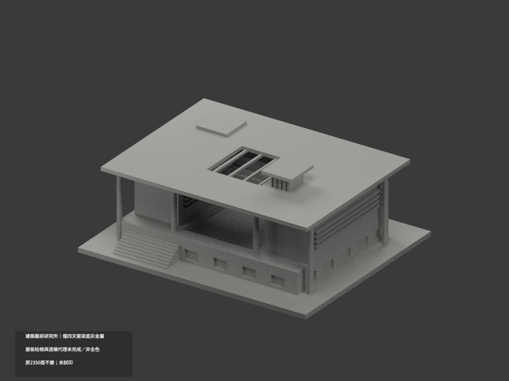
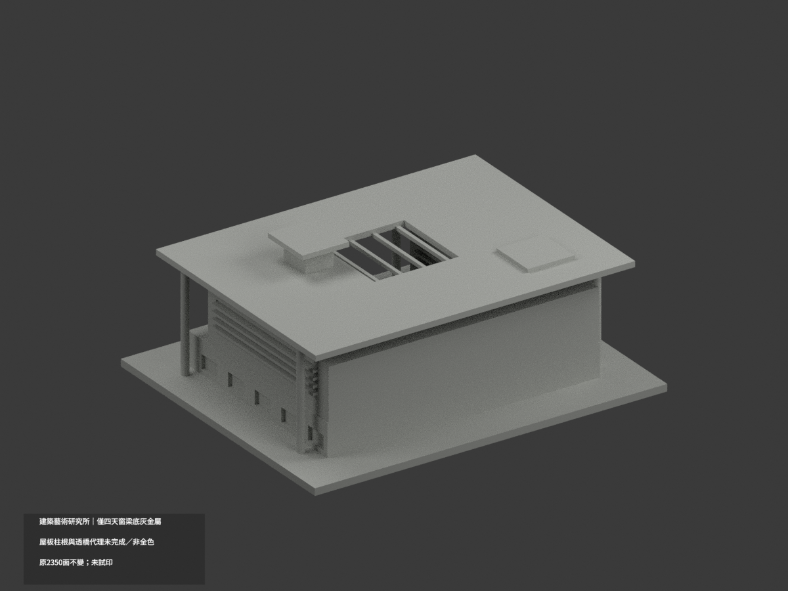
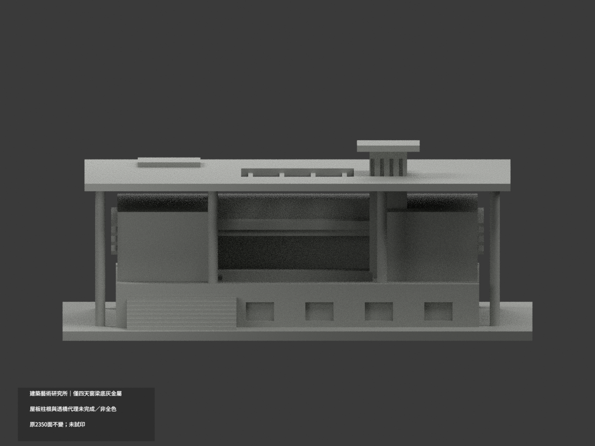
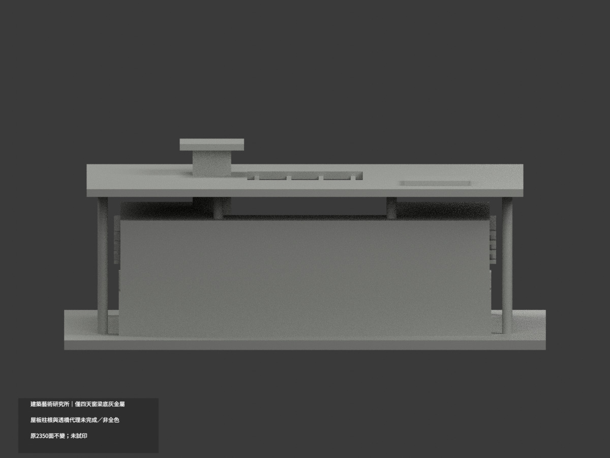
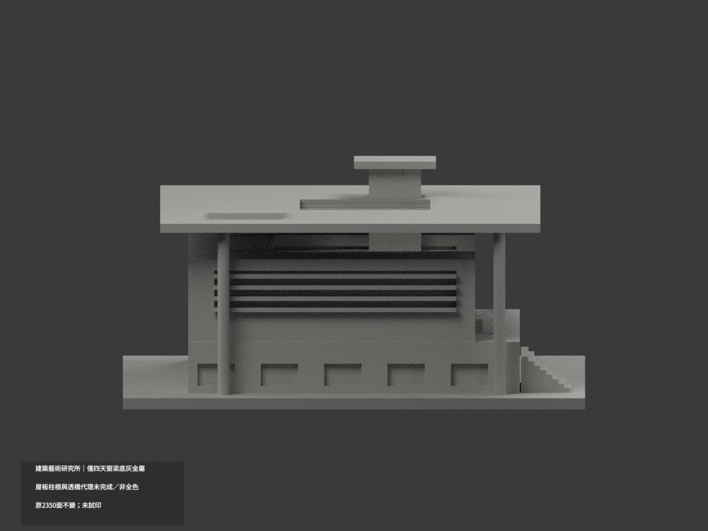
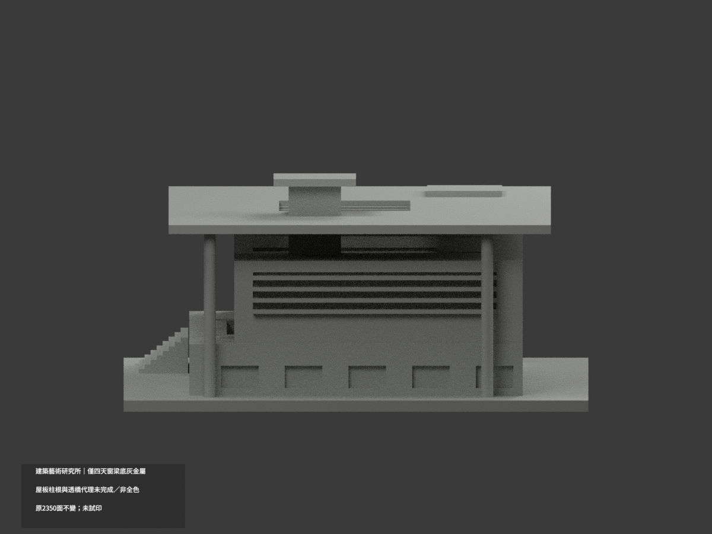
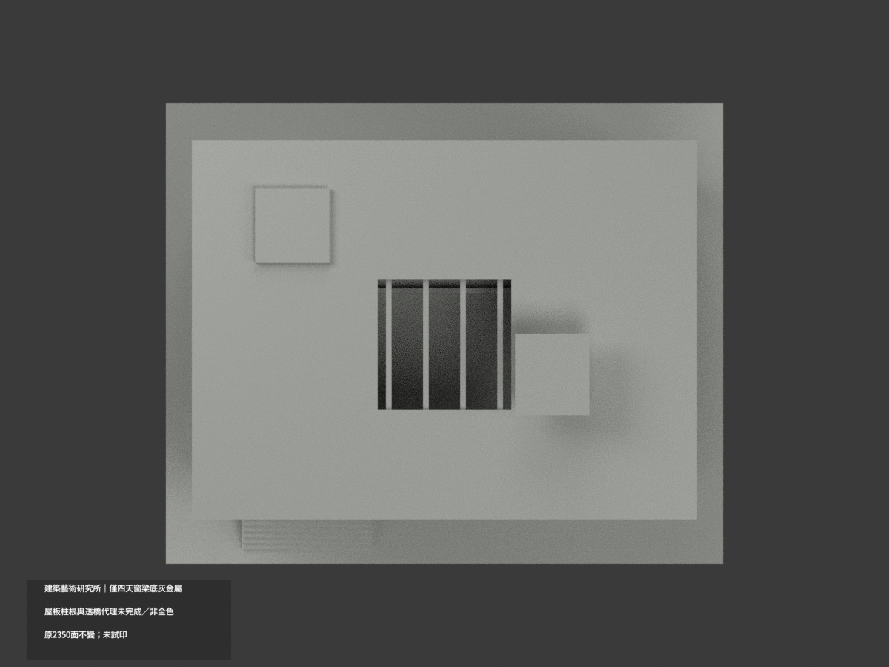
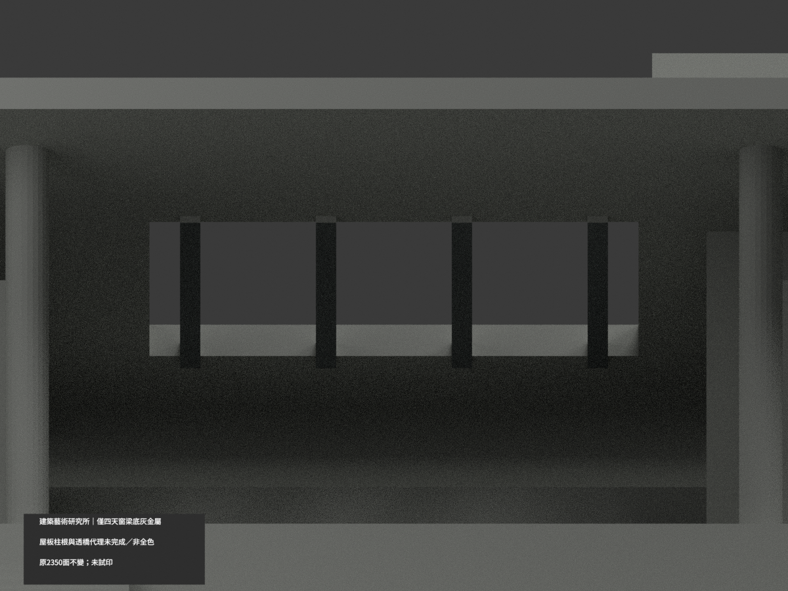
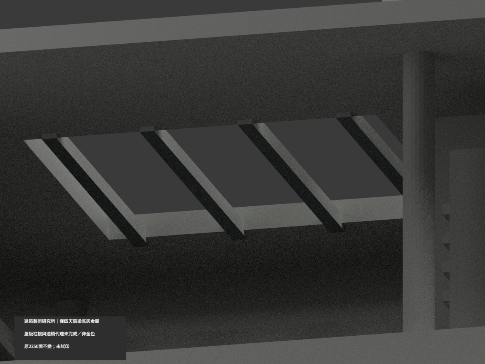
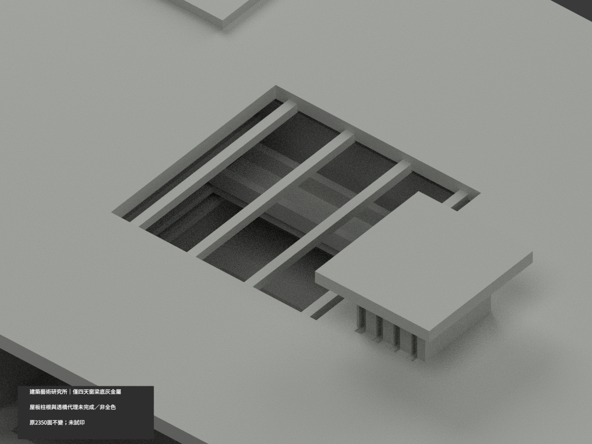

# 建築藝術研究所｜僅四天窗梁底局部灰金屬

**局部補色未完成：僅四天窗梁底 8 原面灰金屬；屋板柱根與透橋代理未完成。主要低角可見，非全色或2026現況。** `partial_color_incomplete=true`、`fully_colored_exterior=false`。同項 `tnnua-architecture-institute`／`count_delta=0`，官田校區。20261103為處理日期而非拍攝日。

| 前斜視 | 後斜視 | 正面 |
|---|---|---|
|  |  |  |
|  |  |  |
|  |  |  |
|  | | |

## 材色範圍

只四獨立天窗梁底：z46.5、x中心−15/−5/5/15各±0.75、y−22..16。全三頂點同一原矩形、各兩三角完整57mm²，共8灰金屬；2342面中性。全共面連通域一致，不用三角面心截色、不切面/加構件。名義灰不是金屬精確測色；低視角才能見底面，不能為圖面顯色擴到整屋底。

大屋板頂/底、梁側頂端全部中性：照片鋼梁/淺屋板混材不能對應原大平面。所有全高柱跨基座接頭無原材界，整柱中性；橘橋實景是透空桁架/欄杆，原實厚欄板不能整橘。窗背/框/百葉/下基座孔格/壁面/階/後域未知中性。**中性不是實景灰證明；來源範圍界線不是實材接縫。**

原2350三角、STL/build字節、尺寸不變；不補桁架/玻璃框/柱根，不以補色追認原近似幾何為精測或當前現況。

## 來源、日期與權利

僅兩成功實景：校方 source-view1 與獨立 Flickr source-view4，均已親看外觀/仰看天窗。日期未知，不宣2026現況。archbook403來源未讀、不重試或繞過，不當證據。網址/hash見source register；公開不包含參考原照、不貼圖，未見CC不沿repo license推商用。HEX只展示色族。

## 檔案與 QA

`appearance.3mf`兩展示材，`scene.blend`真面材，`color-mesh.npz`原三角材索引。STL無色原件及build保字節；Immutable原包無OBJ，不冒稱原OBJ存在或保留。

原README保留為`ORIGINAL-MONOCHROME-README.md`/`.zh-TW.md`，舊previews/QA保單色歷程非新色QA。依requirements執行`colorize_model.py`、`export_appearance.py`、`validate_color.py`；Blender執行`render_color.py`/`verify_color_scene.py`。原build+color隔離重建保留不刪；3MF/STL三角座標、封閉正體積、重開scene、10張1200×900見QA。父另終審。

**未實際列印。** 兩展示材不是已驗四色切片工程，薄部與支撐另核。

## English limitations

Very limited partial: only four complete original skylight beam underside rectangles at z46.5, two triangles and57mm² each,8gray-metal/2342neutral. Low-angle views reveal them; no expansion onto broad roof underside for visibility. Beam sides/top/ends, roof sheets, fullheight columns with mixed base/junction zones, solid bridge proxies replacing photographed open orange truss, windows and unknown surfaces remain neutral. Two successful built photographs viewed; capture dates unknown, archbook403 source not accessed.2350originaltriangles/STL/build bytes unchanged/count_delta0; color review does not authenticate original simplified geometry. Photos privately retained, not textures, no current-condition or commercial permission claim; not test-printed.
