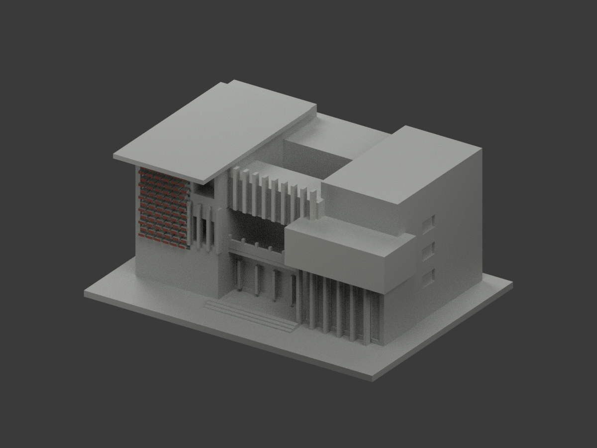
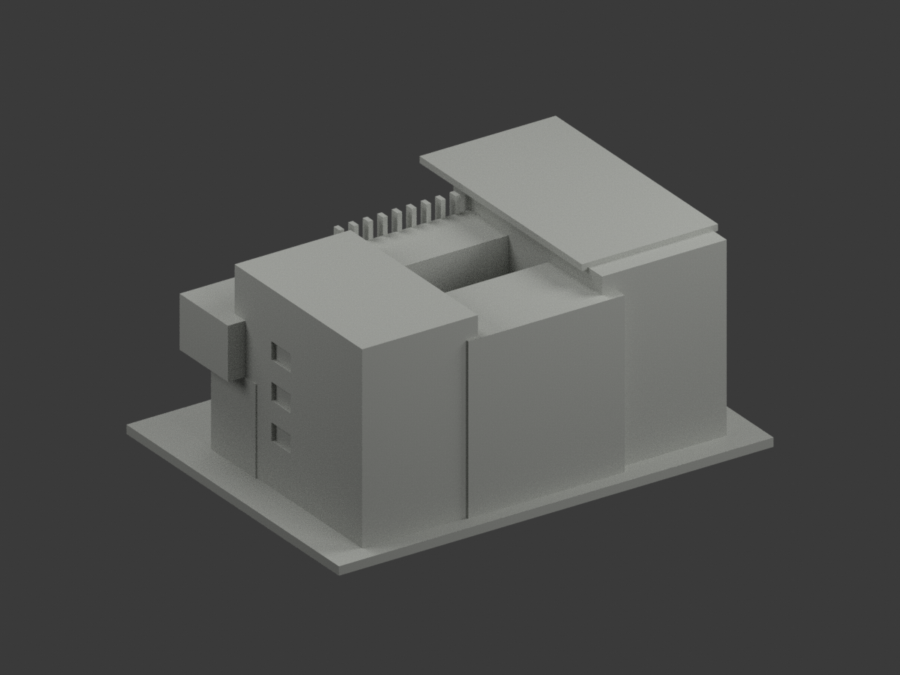
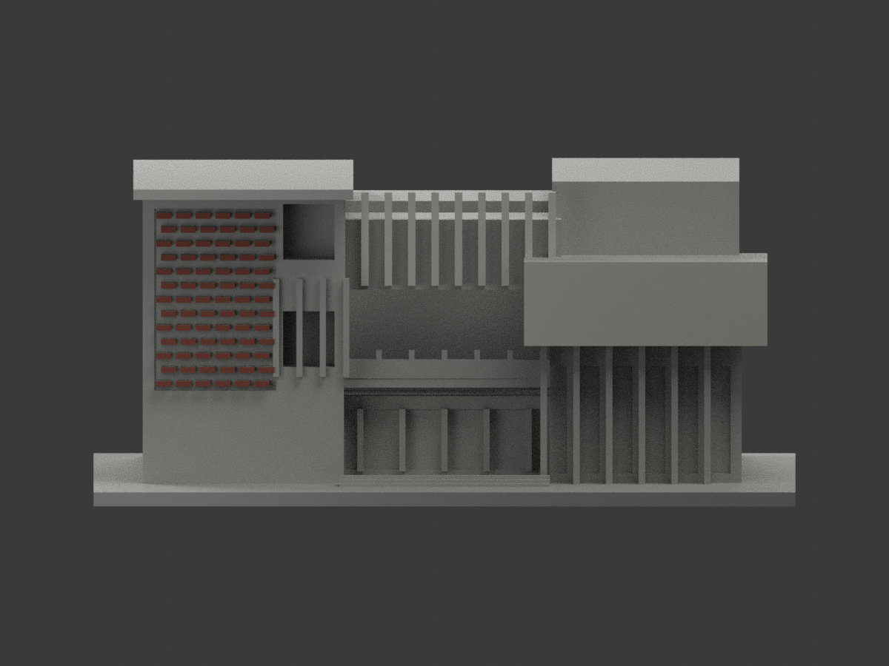
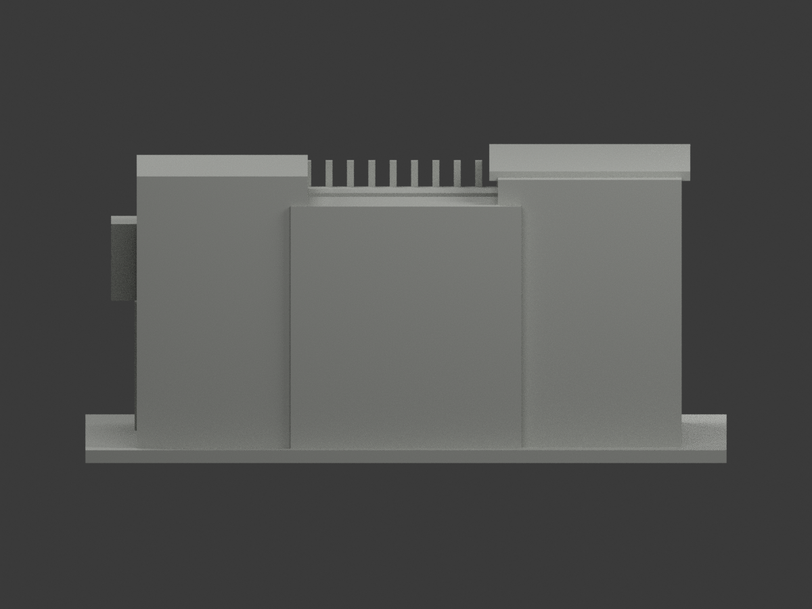
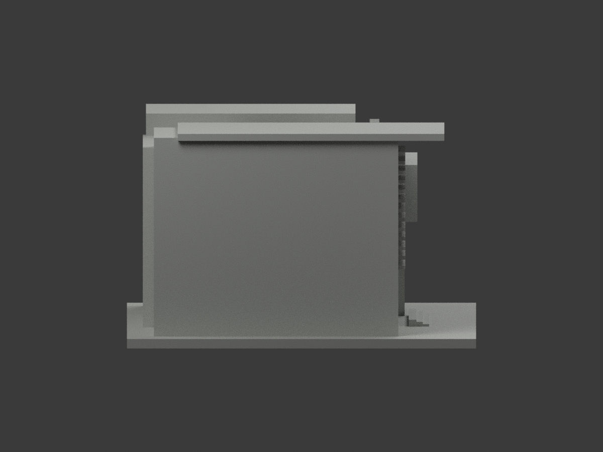
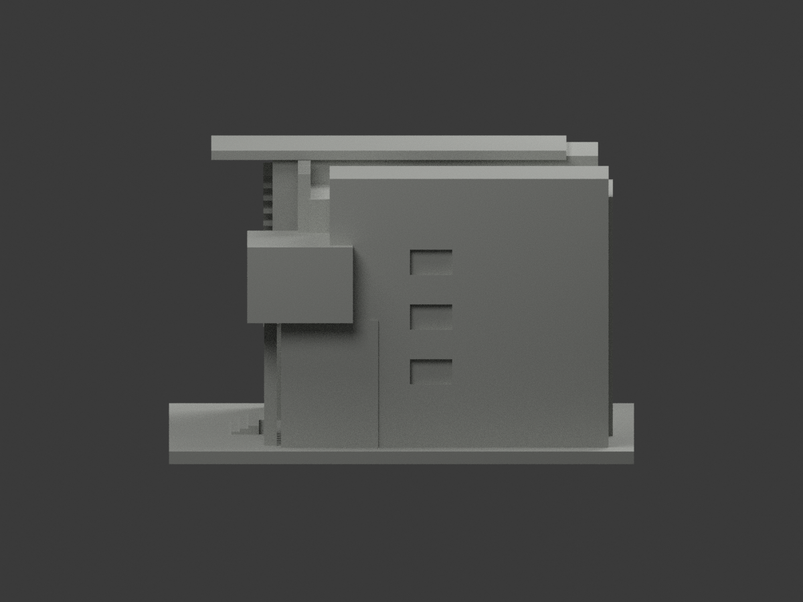
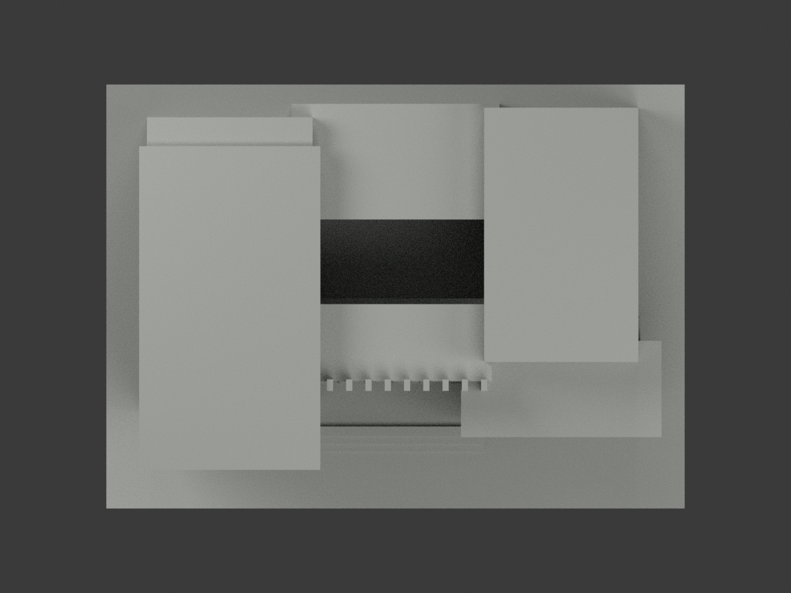
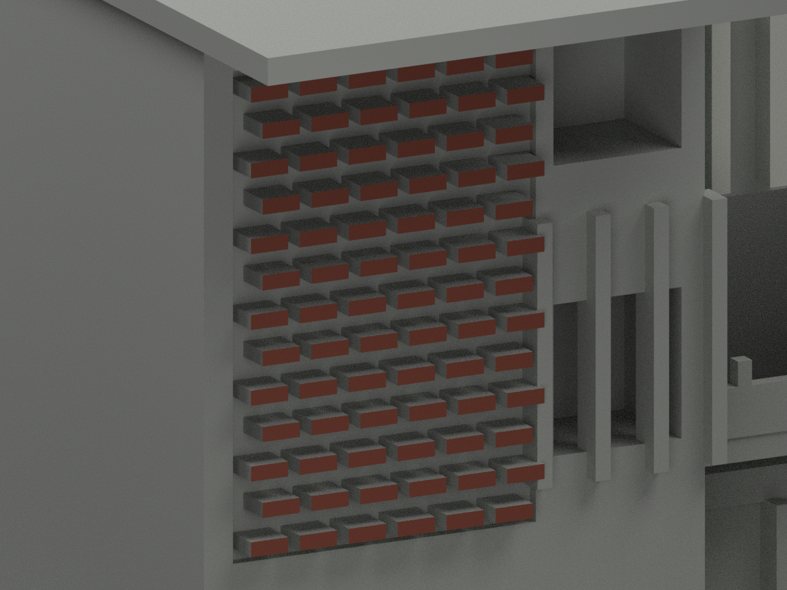
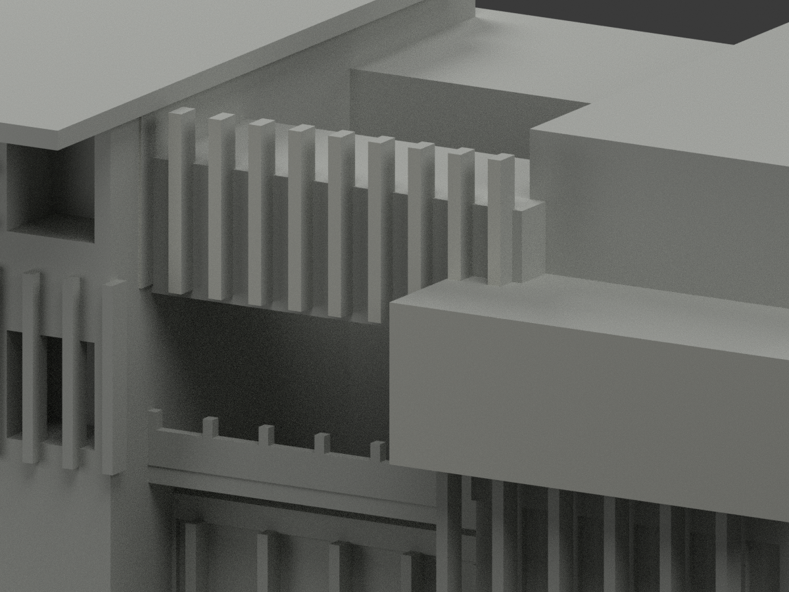
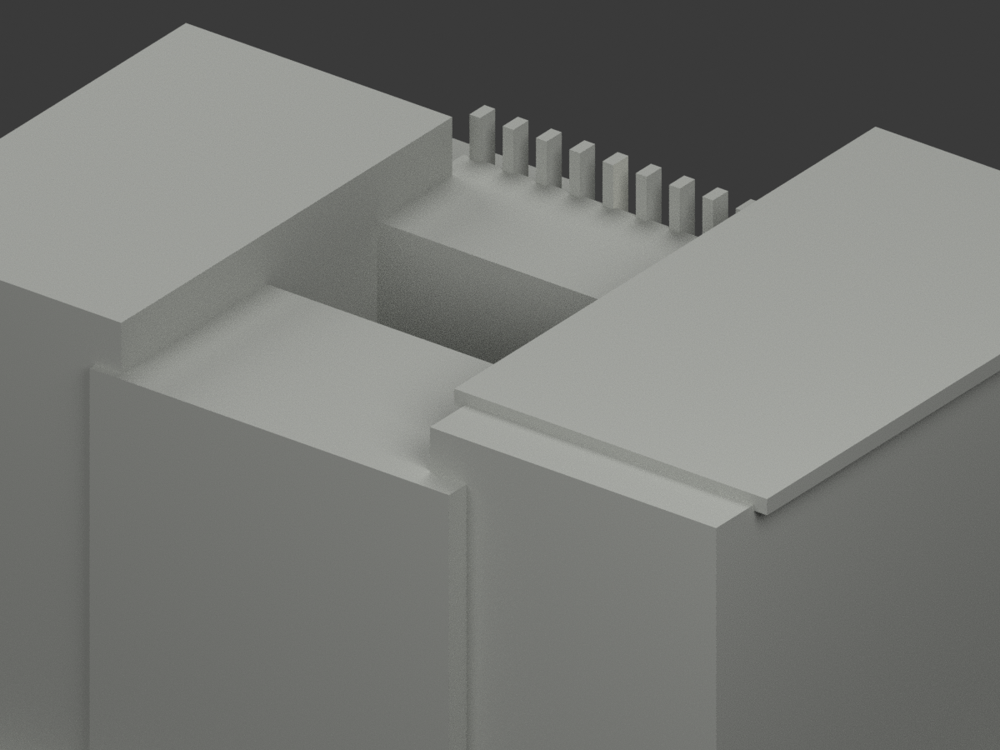

# 藝史文資館｜僅原磚浮紋前面紅與 fin／盒前面白

> **目前色版（2026-11-18 模型）**：本次只改 4 個原三角面的材質；現版共 2,498 面。面數以模型實際指派為準（材質索引／面數：0: Observed coarse brick relief fronts muted brick red = 156、1: Observed central fin and right box fronts offwhite = 26、2: UNVERIFIED mixed walls bases proxies roof neutral = 2,316）。舊統計及舊 QA 為前版歷史，不能作為現版驗證。現版檔案核對請用 [PUBLIC-MODEL-SHA256SUMS](PUBLIC-MODEL-SHA256SUMS)。


**局部補色未完成：僅78原磚浮紋前面156三角紅及10 fin／右盒前面22三角白；混材牆透空代理未完成。非全色或2026現況。** `partial_color_incomplete=true`、`fully_colored_exterior=false`。同項 `tnnua-art-history-cultural-heritage`／`count_delta=0`，官田校區。20261103為處理日期而非拍攝日。

| 前斜視 | 後斜視 | 正面 |
|---|---|---|
|  |  |  |
|  |  |  |
|  |  |  |
|  | | |

## 材色範圍

78原獨立粗磚 relief 矩形前面 y−32.7，各3.2×1.2mm兩三角，13排×6塊共156紅。10原中央fin前面 y−24.5，原union後最左僅寬0.3×20mm、最右兩條僅1.6×14mm，其餘七條1.6×20mm，皆完整外露矩形各兩三角，共20白；右盒前面 y−36.5，x17..69/z33..51整矩形兩三角白。全三頂點核原完整面和面積，不面心截色、不切面；2320面中性。共面連通域全部同材。

原粗化磚塊排列不是照片精準砌磚/透孔；**不補孔、不宣原浮紋等於真透空屏**。整左全高主壁/背板/灰基座/白框混材原無界全部中性，不能整紅。磚頂側背、fin頂側、右盒頂底側均中性；照片開金屬欄與原實厚欄代理不同，整中性。所有低柱/窗背/牆/階/屋背未知中性。**中性不是實景灰證明；資料覆蓋界線不是實際材色接縫。**

原2498三角/STL/build字節、尺寸不變，不以補色追認原近似幾何或現況。

## 來源、日期與權利

唯一成功來源校方 `official-2019-assessment.pdf` 物理22頁、印18頁、圖29；直接抽出 `pdf-page22-image2.jpeg` 已親看。2019是報告年份非照片拍攝年，capture未知，不宣2026現況。其他嵌圖不取色，banner503未讀不重試。網址/hash見source register；原PDF/照片私存、不公開/不貼圖，未見CC不沿repo license推商用，HEX只名義色族非測色。

## 檔案與 QA

`appearance.3mf`三展示材，`scene.blend`真面材，`color-mesh.npz`原三角材索引。原STL無色及build保字節；Immutable原包無OBJ，不冒稱原OBJ存在或保留。

原README保`ORIGINAL-MONOCHROME-README.md`/`.zh-TW.md`，舊previews/QA保單色歷程非新色審。依requirements執行colorize/export/validate腳本；Blender執行render_color.py/verify_color_scene.py。原build+color全隔離重建保留不刪，3MF/STL三角同一/封閉正體積/reopen/10張1200×900見QA，父另終審。

**未實際列印。** 三展示材不是已驗四色切片工程，薄部支撐另核。

## English limitations

Partial only:156original coarse brick-relief front triangles muted red;20central-fin front triangles and2right-projecting-box front triangles offwhite;2320neutral. Original union clips leftmost fin to0.3×20mm and rightmost two to1.6×14mm; seven others1.6×20mm. Every actual exposed independent rectangle is complete, allvertices and area verified, uniform coplanar components, no geometry cut. Coarse relief not accurate photographed brick/perforation screen; mixed fullheight leftwall/graybase/whiteframes remain neutral, as do all component sides/top/back, solid railing proxies, windowbacks and roof. Single actual PDFfigure29 viewed;2019report not capture date, banner503 not accessed.2498originaltriangles/STL/build unchanged/count_delta0; color review does not authenticate geometry or current condition. Reference PDF/photo private, not textures, no inferred commercial permission; not test-printed.


## 2026-11-18 單一中央 fin 左側原完整面延色

僅原中央 fin（名義中心 x=3 mm）朝 −X 的左側原面 **564、568、570、571** 從未知中性 index 2 改為既有名義白色 index 1（#D2D3CB）。現版面數 **[156, 26, 2316]**；原 156 紅、22 白全部保留，其餘 2,494 面不改。前文 22 白／2320 中性為本次之前的歷史版本。

來源仍是原登錄官方 2019 評鑑報告物理第 22 頁、印第 18 頁圖 29。照片可見中央白色直立 fin 群及窄側回折，支持同構件名義白色延續；不是逐片真實 fin 編號、數量、深度或精確色票。2019 是報告年份，不是確定拍攝日期，亦不主張 2026 現況。照片保持私人參考，不貼圖或公開。

選域是 x≈2.2 mm 的完整原共面連通 L 形側面，4 三角、6 條外邊、53 mm²。下段 y[−24.5,−22]／z[45,59]，上段 y[−24.5,−21.5]／z[59,65]。背緣階差來自原背梁相交；上段多出的 0.5 mm 是原粗化幾何，並非照片可獨立辨明的實際尺寸。完整保留原形，不切三角、不補材縫、不擴到背梁、磚紋、右盒或整牆。**同 fin 的 +X 右側 565、569、573、574 明確不改**，也不對稱推廣其他 fin。

原 2498 三角與 STL、全頂點及面序、材質與節點、相機／世界／燈光／transform、隱藏 caption 和 backdrop 均保留。僅新增 4 面的材質指派並同步主物件 source_mesh_sha256、scope；無孤立材需補 fake_user。本次保存未清除任何原材質。隱藏 caption 保留歷史「僅前面」文字，依然不渲染；現版範圍以此節為準。

3MF 保留原座標字串與面序，只改 4 個 p1；p2/p3 仍依原規格繼承。物件新增既有中性 pid=1/pindex=2 作 SDK 編修預設，每個原三角都有明確 p1，因此不造成額外變色。嚴格 SDK 零警告、私人材質編修保存重讀、Blender 私副本頂點與面材編修保存重開均驗證；原公檔不變。全 RNA 只有 12 個面材表示與 2 個來源屬性差異。乾淨重建資料檔 bytes 相同、場景語義相同，未承諾 Blend 檔 bytes 相同。

十張圖使用原 renderer 的七全景與三局部視角、1200×900、Cycles 48 samples、原光照／材質；不以更亮渲染代替真面材。三局部視角本就容許裁切。此為單域延色，不是全外牆完成、精測復原、實體試印或整體製造重新認證。

### SHA 鎖定基準重建

固定來源 commit：`8f90ae2478f00cce6832a07de537f7d333f6dbc0`。`source/baseline` 保留原公開 STL、NPZ、3MF、Blend、palette、appearance-materials、README，逐檔 SHA 檢查；不依賴私人照片或網路。Blender 4.3.2 內需 numpy。輸出不可與基準相同或互相包含：

```
blender -b -t 1 --python-exit-code 1 -P source/rebuild_fin_left.py -- source/baseline rebuilt
cp render_fin_left_views.py rebuilt/
blender -b -t 2 --python-exit-code 1 -P rebuilt/render_fin_left_views.py
```

可另下載 `rebuild-source.zip`。原單色／部分色歷史 QA 仍只約束其原版本，不因本次補色自動獲新認證。
