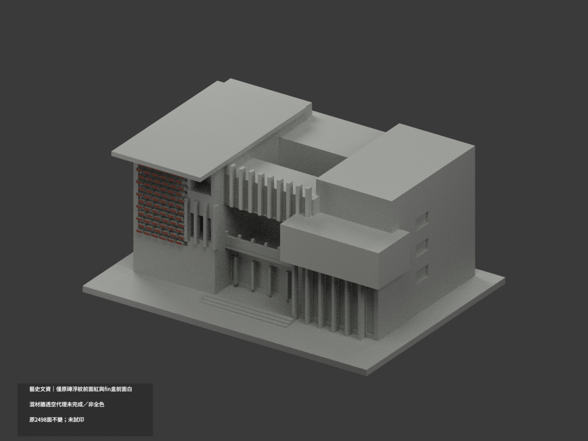
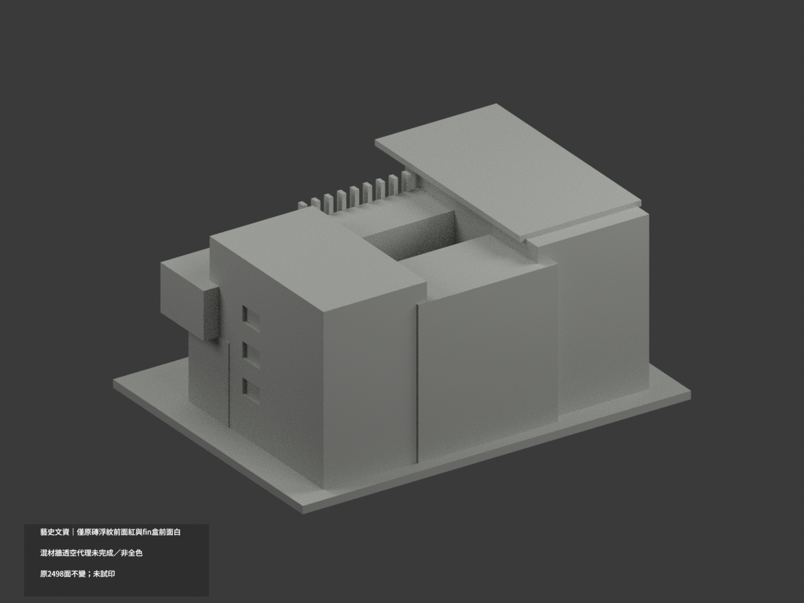
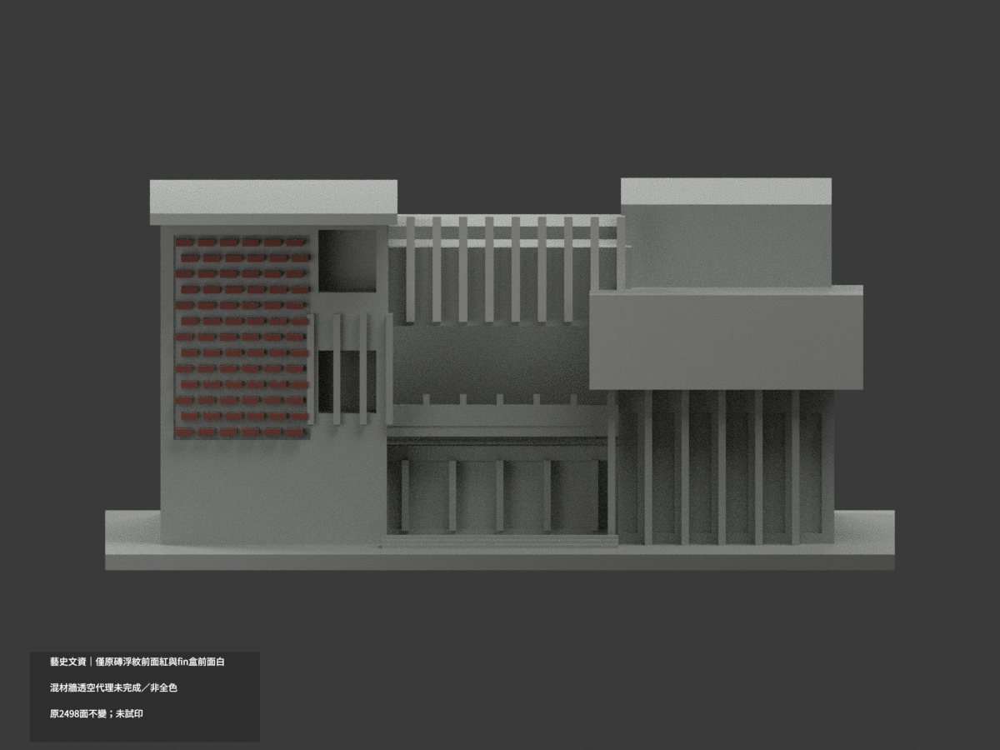
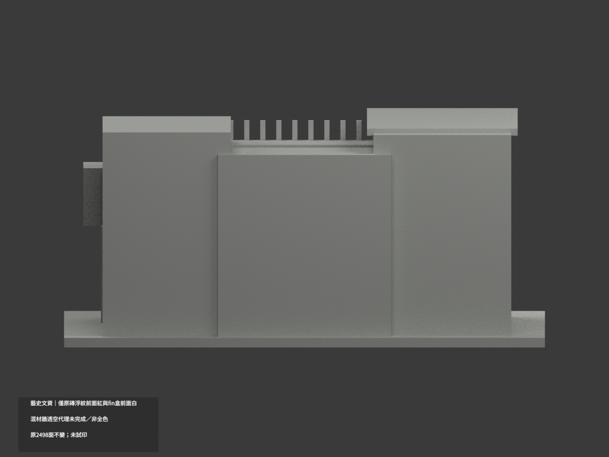
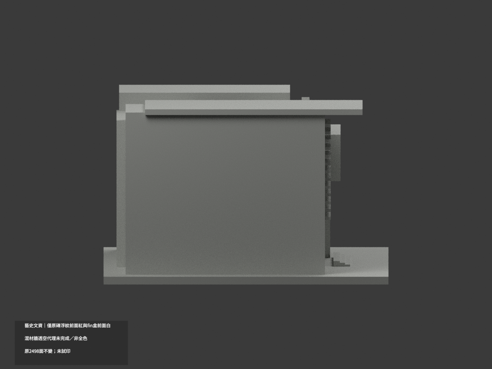
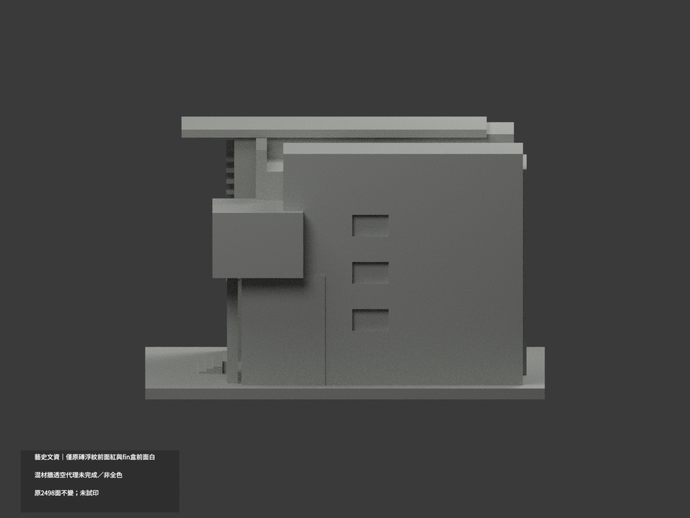
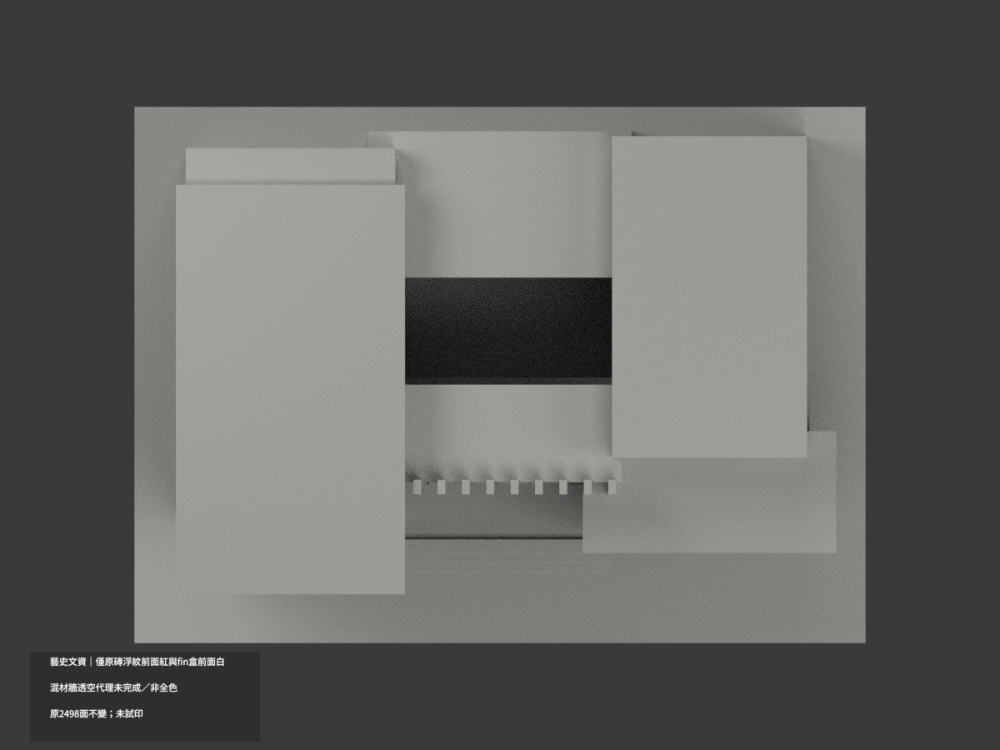
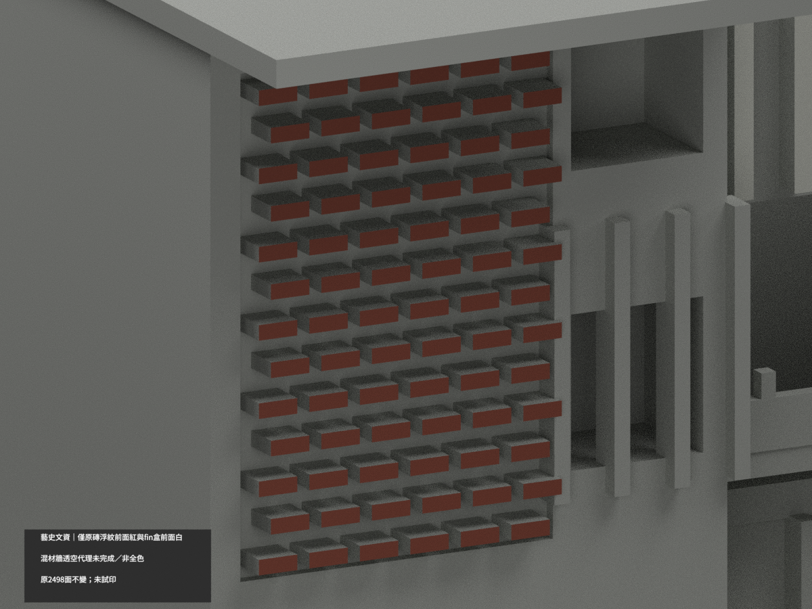
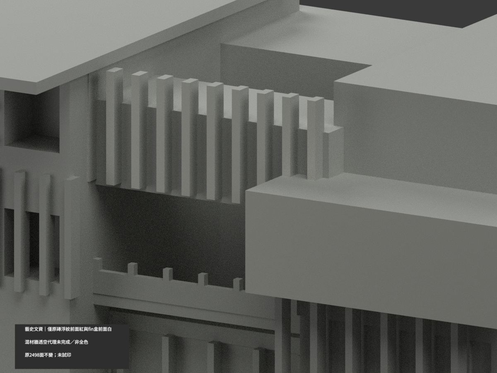
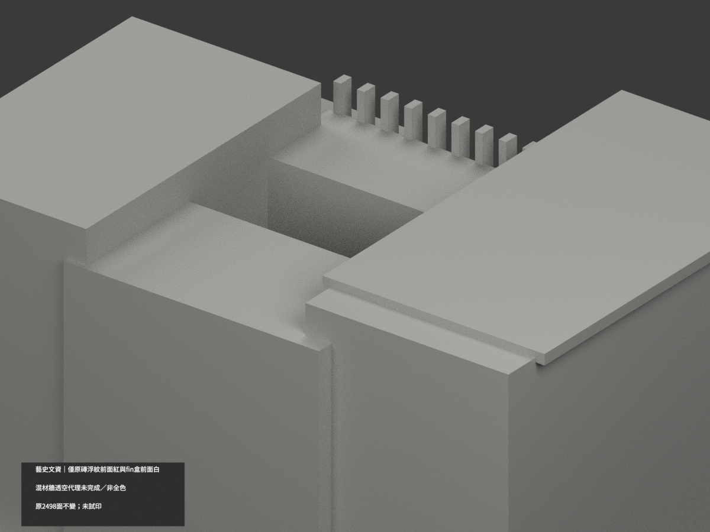

# 藝史文資館｜僅原磚浮紋前面紅與 fin／盒前面白

**局部補色未完成：僅78原磚浮紋前面156三角紅及10 fin／右盒前面22三角白；混材牆透空代理未完成。非全色或2026現況。** `partial_color_incomplete=true`、`fully_colored_exterior=false`。同項 `tnnua-art-history-cultural-heritage`／`count_delta=0`，官田校區。20261103為處理日期而非拍攝日。

| 前斜視 | 後斜視 | 正面 |
|---|---|---|
|  |  |  |
|  |  |  |
|  |  |  |
|  | | |

## 材色範圍

78原獨立粗磚 relief 矩形前面 y−32.7，各3.2×1.2mm兩三角，13排×6塊共156紅。10原中央fin前面 y−24.5，原union後最左僅寬0.3×20mm、最右兩條僅1.6×14mm，其餘七條1.6×20mm，皆完整外露矩形各兩三角，共20白；右盒前面 y−36.5，x17..69/z33..51整矩形兩三角白。全三頂點核原完整面和面積，不面心截色、不切面；2320面中性。共面連通域全部同材。

原粗化磚塊排列不是照片精準砌磚/透孔；**不補孔、不宣原浮紋等於真透空屏**。整左全高主壁/背板/灰基座/白框混材原無界全部中性，不能整紅。磚頂側背、fin頂側、右盒頂底側均中性；照片開金屬欄與原實厚欄代理不同，整中性。所有低柱/窗背/牆/階/屋背未知中性。**中性不是實景灰證明；資料覆蓋界線不是實際材色接縫。**

原2498三角/STL/build字節、尺寸不變，不以補色追認原近似幾何或現況。

## 來源、日期與權利

唯一成功來源校方 `official-2019-assessment.pdf` 物理22頁、印18頁、圖29；直接抽出 `pdf-page22-image2.jpeg` 已親看。2019是報告年份非照片拍攝年，capture未知，不宣2026現況。其他嵌圖不取色，banner503未讀不重試。網址/hash見source register；原PDF/照片私存、不公開/不貼圖，未見CC不沿repo license推商用，HEX只名義色族非測色。

## 檔案與 QA

`appearance.3mf`三展示材，`scene.blend`真面材，`color-mesh.npz`原三角材索引。原STL無色及build保字節；Immutable原包無OBJ，不冒稱原OBJ存在或保留。

原README保`ORIGINAL-MONOCHROME-README.md`/`.zh-TW.md`，舊previews/QA保單色歷程非新色審。依requirements執行colorize/export/validate腳本；Blender執行render_color.py/verify_color_scene.py。原build+color全隔離重建保留不刪，3MF/STL三角同一/封閉正體積/reopen/10張1200×900見QA，父另終審。

**未實際列印。** 三展示材不是已驗四色切片工程，薄部支撐另核。

## English limitations

Partial only:156original coarse brick-relief front triangles muted red;20central-fin front triangles and2right-projecting-box front triangles offwhite;2320neutral. Original union clips leftmost fin to0.3×20mm and rightmost two to1.6×14mm; seven others1.6×20mm. Every actual exposed independent rectangle is complete, allvertices and area verified, uniform coplanar components, no geometry cut. Coarse relief not accurate photographed brick/perforation screen; mixed fullheight leftwall/graybase/whiteframes remain neutral, as do all component sides/top/back, solid railing proxies, windowbacks and roof. Single actual PDFfigure29 viewed;2019report not capture date, banner503 not accessed.2498originaltriangles/STL/build unchanged/count_delta0; color review does not authenticate geometry or current condition. Reference PDF/photo private, not textures, no inferred commercial permission; not test-printed.
