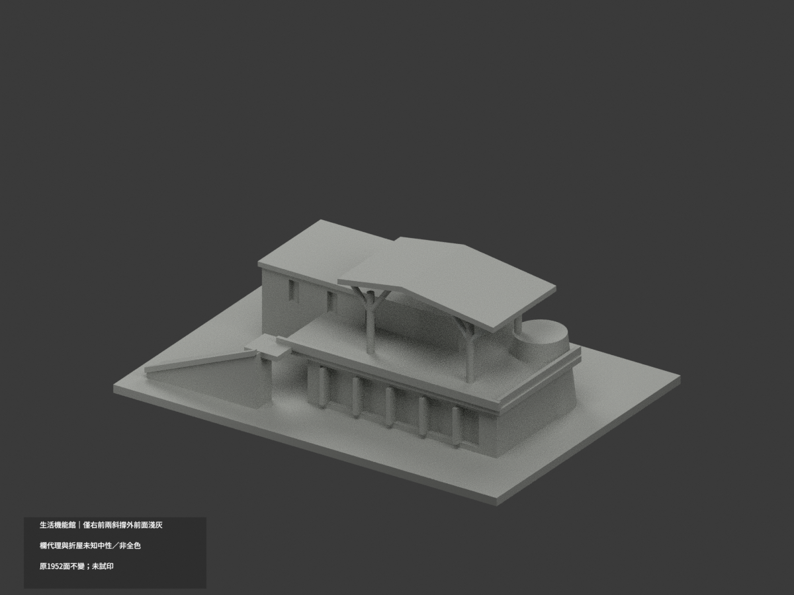
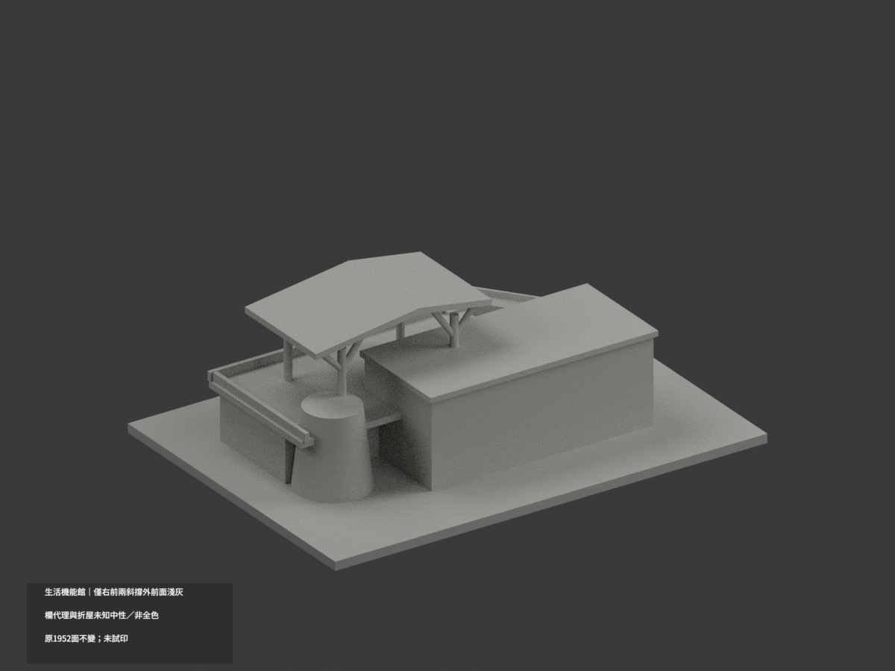
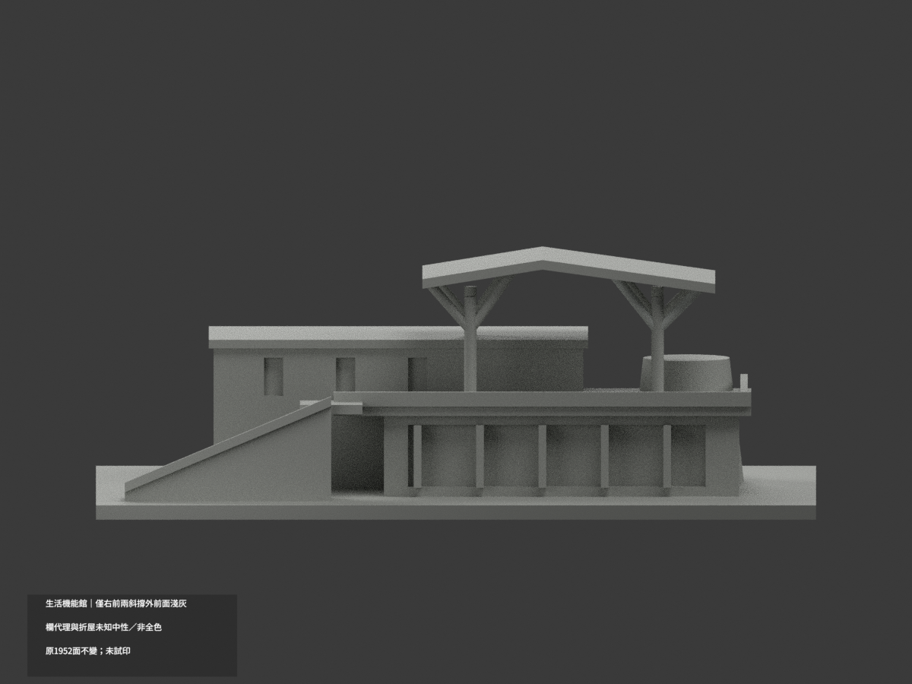
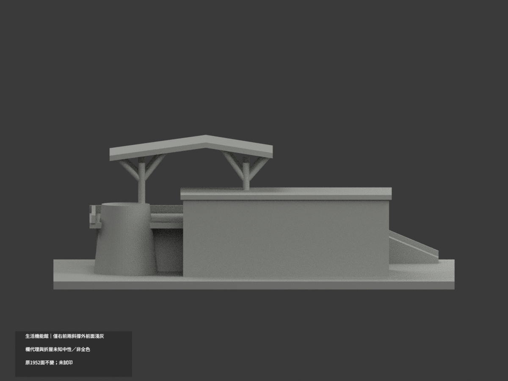
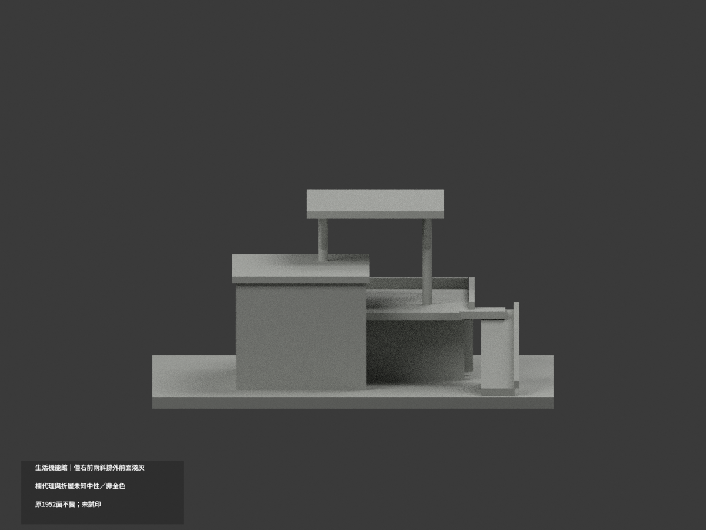
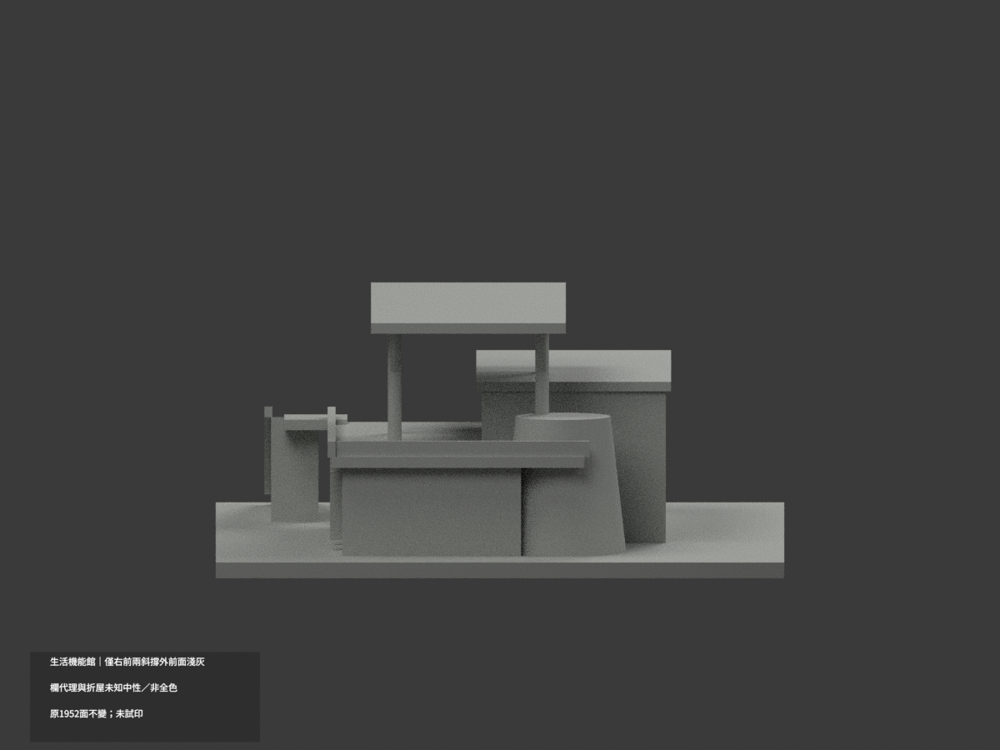
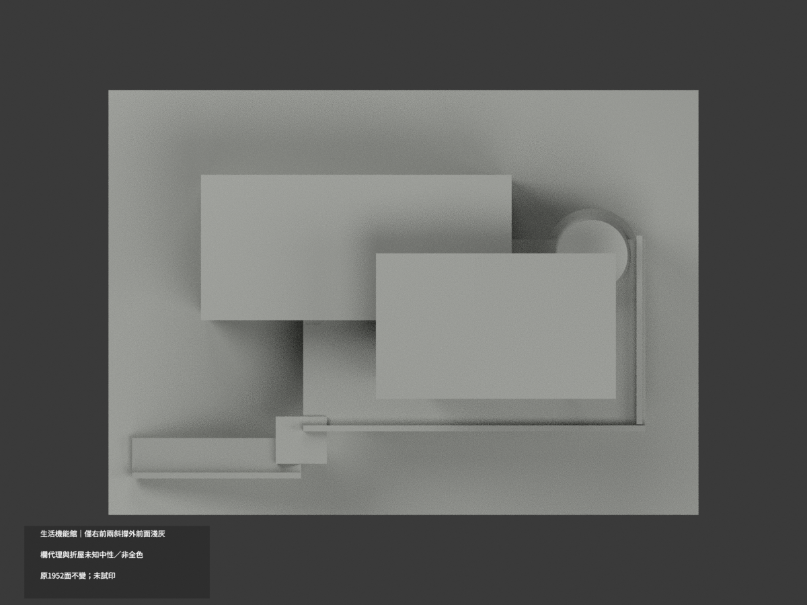
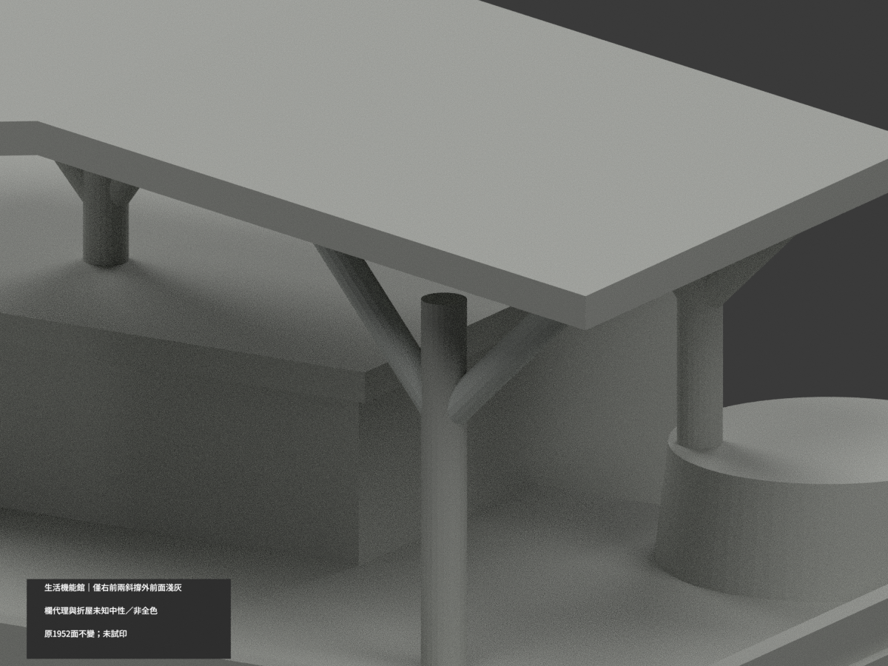
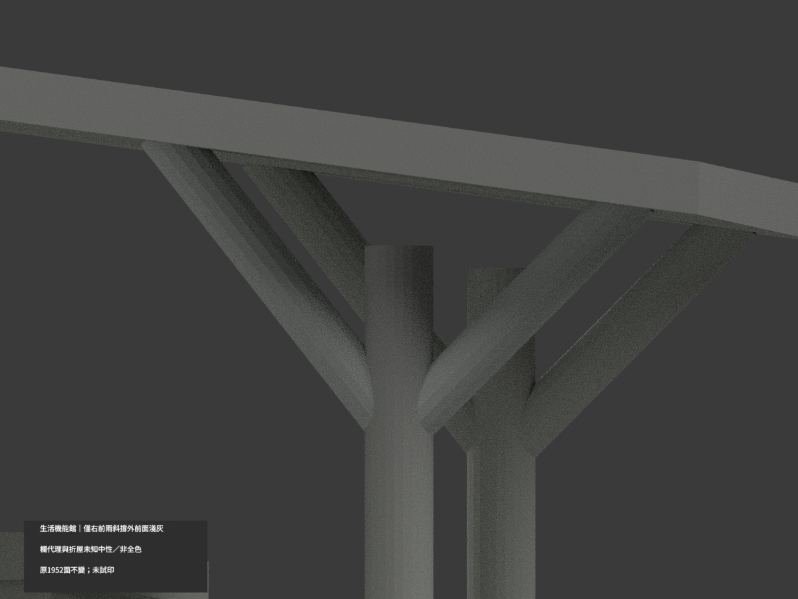
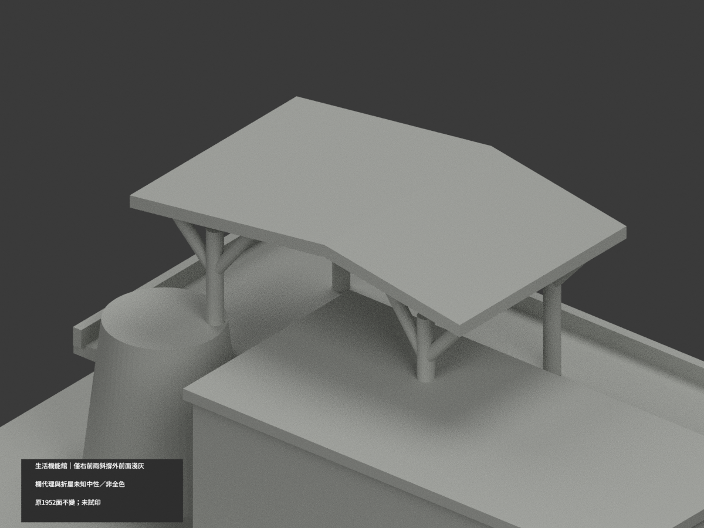

# 生活機能館｜僅右前兩斜鋼撐外前面局部淺灰

**局部補色未完成：僅右前兩斜鋼撐完整46原面淺灰；欄牆代理、折屋與其餘域未完成。非全色或2026現況。** `partial_color_incomplete=true`、`fully_colored_exterior=false`。同項`tnnua-campus-life-hall`／`count_delta=0`，官田校區；工作目錄20261103只處理日期，非capture。

| 前斜視 | 後斜視 | 正面 |
|---|---|---|
|  |  |  |
|  |  |  |
|  |  |  |
|  | | |

## 材色範圍

只原(42,−20,37)分叉至(33,−20,48.4166667)與(51,−20,45.9166667)兩半徑1、16邊柱斜鋼撐。依原build的Ry(theta)後Rz(phi)重求u/v/axis，對全三頂點核有限facet chord面距cos(pi/16)、切向半寬sin(pi/16)、軸0..length與1e−4mm容差，選facet幾何外法向朝−Y的完整原域。兩支各23合46淺灰，1906面中性；505共面連通域同材。不以STL細三角normal閾漏sliver，不用面心／半空間截三角，不任意寬半徑圈其他物。

柱身／鋼混凝土接頭照片有異材細節而原無界，整柱中性；其他支撐及後半facet未獨核中性。原實心欄牆／坡道護板代開放金屬欄，不得整塗金屬。折屋照片有鋼網／穿孔／陰影與異皮，原厚連續板不保留材界，全部中性，不能暗影作黑屋。主混凝土店體／玻璃快門／錐體／露台廣場階坡皆中性，**中性不是實景灰色證明**。正背材界只來源覆蓋非實材接縫。

原1952三角與STL/build字節／尺度不改，不做新屋網／細接頭／開欄／面切割；補色不追認原幾何近似為精測。

## 來源、日期與權利

MOI `moi-independent-award.pdf`物理22–23頁（印40–43）實景外觀照片已親看，尤其印42右近分叉鋼撐；木製模型、設計圖／色立面不取色。來源PDF2013metadata不是照片拍攝年，capture未知，不宣2026現況。NLMA challenge未繞，使用獨立正常取得MOI來源。URL/hash與頁數見source register。

原PDF/照片私存不公開／不貼圖，未見CC不沿repo license推商用；HEX名義色族而非測色。公開只原創材色映射／渲染，不含參考圖。

## 檔案與 QA

`appearance.3mf`兩展示材、`scene.blend`真面材、`color-mesh.npz`原三角／材索引。原STL無色、原build字節保留。Immutable原包無OBJ，不冒稱原OBJ存在或保留。

原README另存`ORIGINAL-MONOCHROME-README.md`或`.zh-TW.md`，舊previews／QA保單色歷程不冒新色審。依requirements跑`colorize_model.py`、`export_appearance.py`、`validate_color.py`；Blender執行`render_color.py`及`verify_color_scene.py`。原build+color全隔離重建保留不刪，3MF/STL三角multiset／封閉正體積／reopen／10張1200×900見COLOR-*QA、SCENE-QA、DELIVERY-QA；父另人工終審。

**未實際列印。** 兩展示材非已驗四色切片工程，薄部支撐與材料映射另核。

## English limitations

Partial only: two original near/right fork branches23+23front-facing finite16gon facet triangles lightgray,1906neutral,505uniform coplanar components. Allvertices satisfy exact original cylinder chordplane/tangentextent/axisinterval, no centroid cut or rawtriangle-normal sliver exclusion. Shaft/junction, other supports, solid railing proxies and entire foldedroof remain neutral; simplified thickplate cannot map photographed open grid/shadows. Built photographs on MOIphysical22–23/printed40–43 used, not woodenmodel or drawings. PDF2013metadata not capture, no2026condition.1952originaltriangles/STL/build unchanged/count_delta0; source PDFprivate, no photo texture, not physically test-printed.
