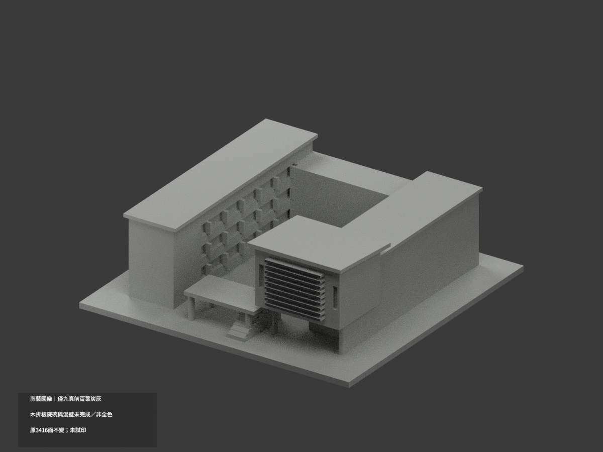
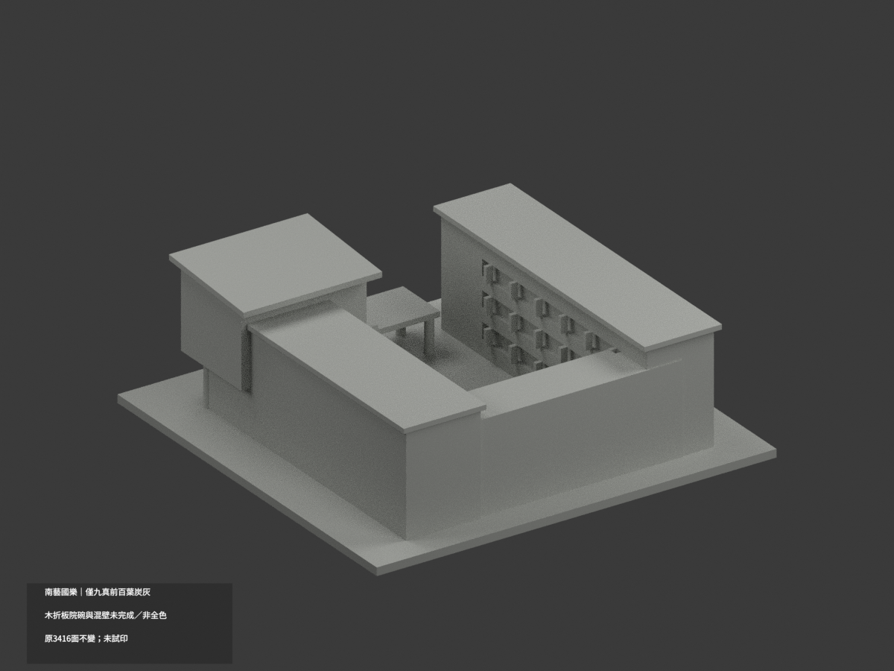
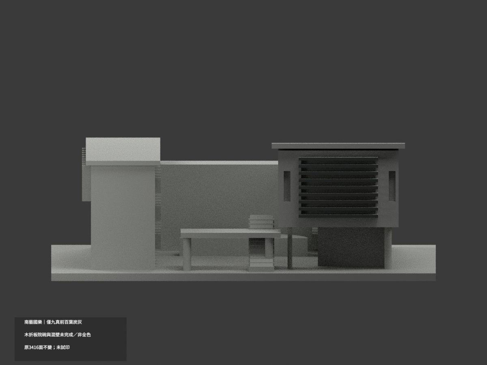
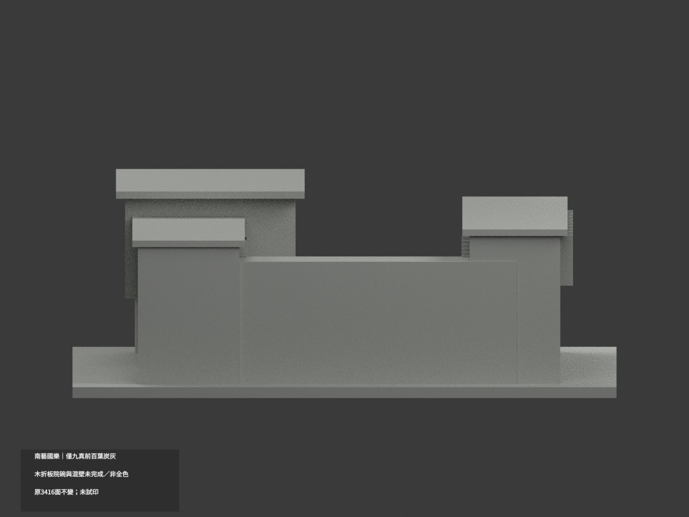
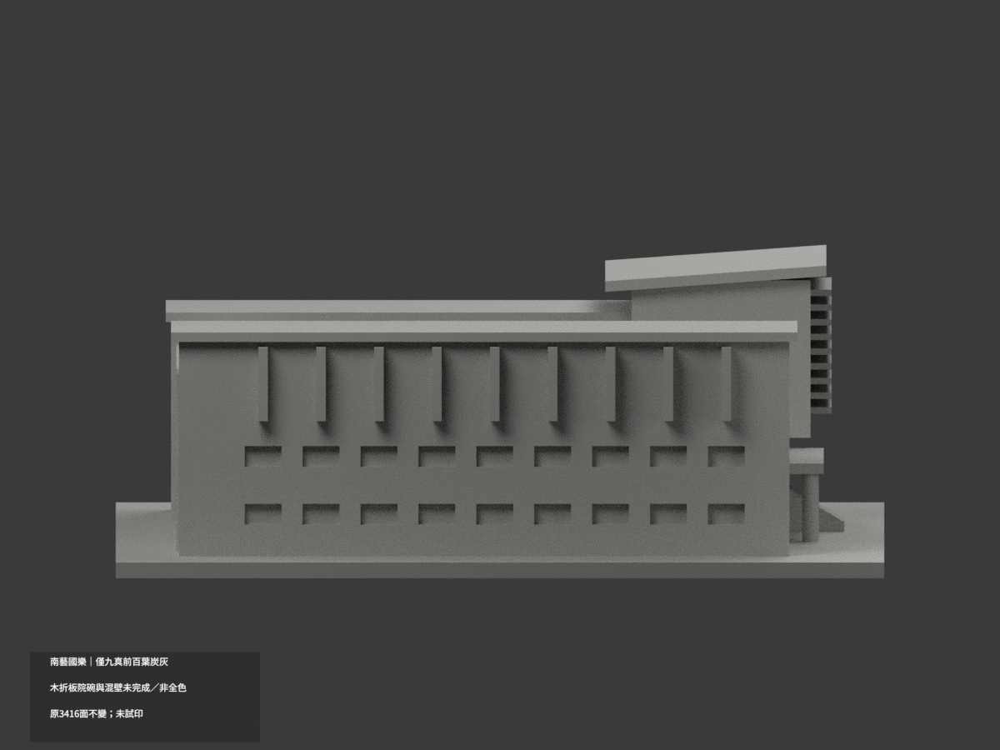
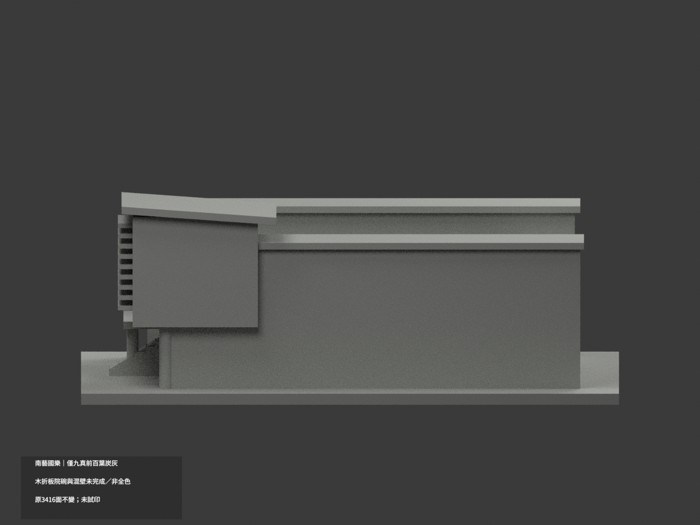
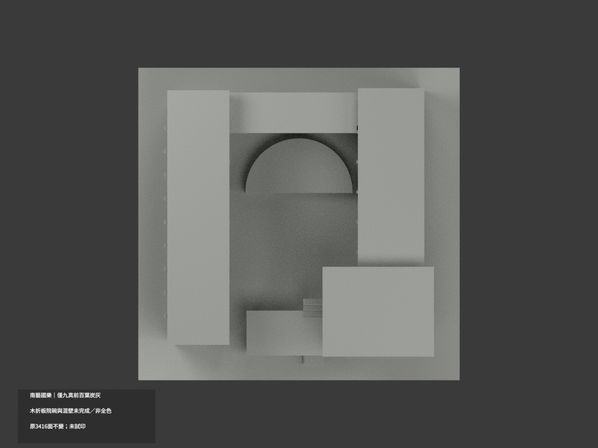
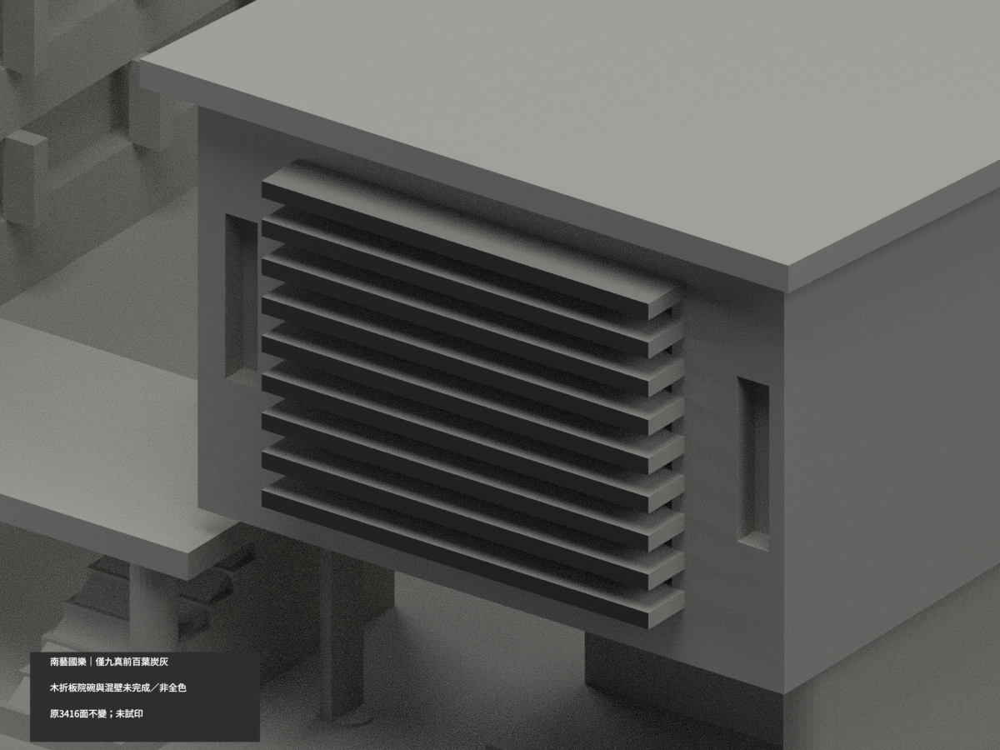
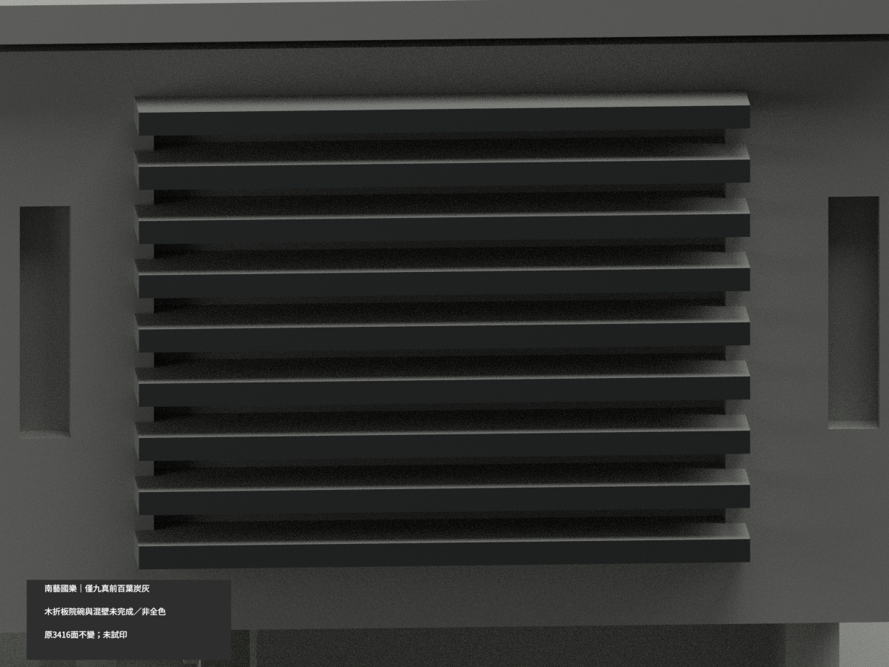
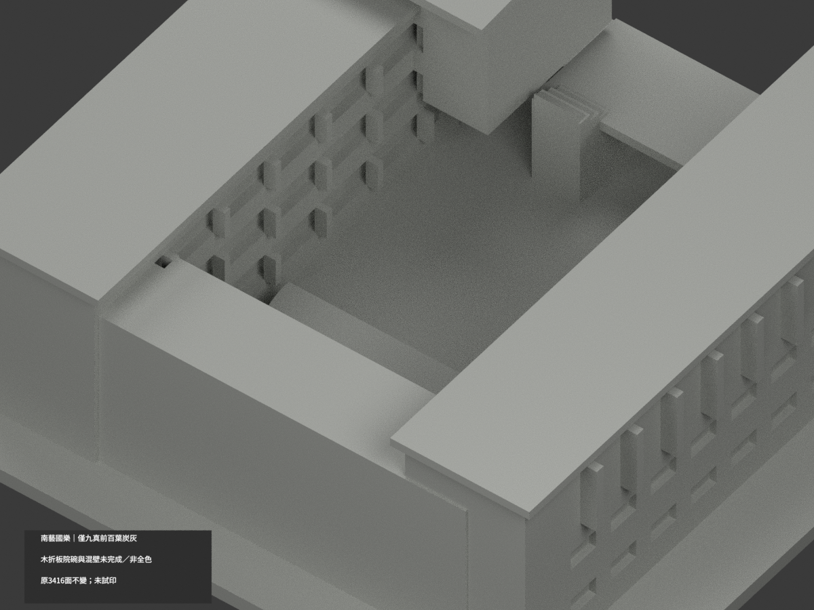

# 南藝國樂｜僅九真前百葉局部炭灰

**局部補色未完成：僅九真前百葉18原面炭灰；木折板、院落碗、混材牆與其餘域未完成。非全色或2026現況。** `partial_color_incomplete=true`、`fully_colored_exterior=false`。同項`tnnua-chinese-music`／`count_delta=0`，官田校區單一相連群，不另拆套。

| 前斜視 | 後斜視 | 正面 |
|---|---|---|
|  |  |  |
|  |  |  |
|  |  |  |
|  | | |

## 材色範圍

原y−63、x21.5..52.5，z24起每2.8一片高1.2的九個完整真百葉前矩形，各兩面共18炭灰。全三頂點／完整矩形面積37.2mm²／共面域核，不按面心截色，不盲套原index。3416三角中18炭灰＋3398中性，841共面連通域同材。

葉的頂底／側端／背及凹底全中性，不把暗前皮擴成整黑玻璃或填縫。實景木折板可見，但原粗直立薄塊不對應廣折木面與暗邊，整列中性，不整端面塗木。原nested Boolean院落碗不保留照片階層／材域，完全中性，不能補色成假木圓盤、不修形。全主混灰混淺磚牆、屋板、階柱、露台、背面維持中性；**中性不是實景灰色證明**。來源覆蓋界線非實材接縫。

原3416面／尺寸／STL/build字節不改，不新增材界、薄欄或院碗階。原幾何為公開照片估讀近似，色審不追認實測或完整原貌。

## 日期與權利

三張source-view1/2/3已親看：官正面與另外兩張側面／院碗實景；均無認證拍攝日，不宣2026現況。不同翼面不借材；照片中的木板／院碗證據只用於辨識不可映射域，不硬滿色。URL/hash見`COLOR-SOURCE-REGISTER.json`。原照私存不公開、不貼圖，未見CC不沿repo license推自由商用；HEX名義族群非測色。

## 檔案與 QA

`appearance.3mf`兩展示材、`scene.blend`真面材、`color-mesh.npz`原三角與材索引。原STL無色、原build字節保留。Immutable原包無OBJ，不冒稱原OBJ存在或保留。

原README另存`ORIGINAL-MONOCHROME-README.md`或`.zh-TW.md`，舊previews與QA保留單色歷程不當新色審。依requirements跑`colorize_model.py`、`export_appearance.py`、`validate_color.py`；Blender跑`render_color.py`／`verify_color_scene.py`。原build+color全隔離重建保留不刪，3MF/STL座標multiset／封閉正體積／scene reopen／10張1200×900見COLOR-*QA、SCENE-QA、DELIVERY-QA，父另人工終審。

**未實際列印。** 兩展示材非已驗四色切片工程，支撐／薄部／材料映射另驗。

## English limitations

Partial color only: nine original complete outward louver rectangles18faces charcoal;3398neutral and841uniform coplanar components. Louver top/bottom/ends/back and backing remain neutral, not black glazing. Original coarse wood-fin proxies cannot uniquely map folded wood broad faces; simplified Boolean courtyard bowl does not retain photographed steps/material domains. Both remain neutral without geometry repair. All mixed walls, roofs, stairs and unseen rear neutral.3416originaltriangles/STL/build unchanged, count_delta0; three photos capture unknown, not2026condition. Private photos/no texture, not physically test-printed, no original geometry accuracy endorsement.
