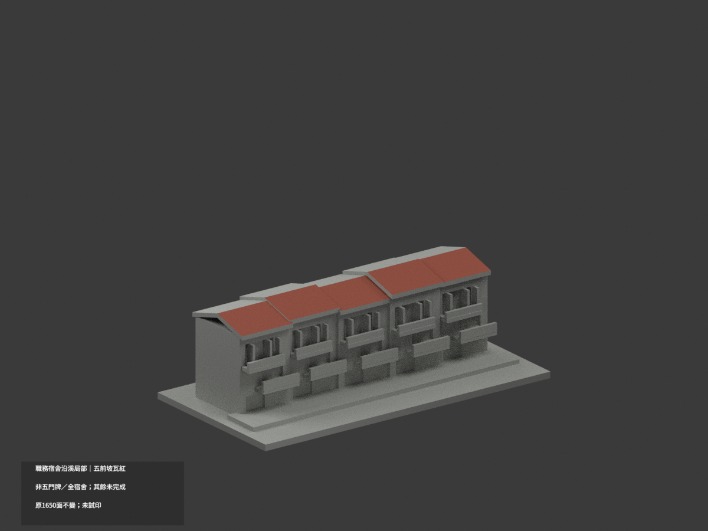
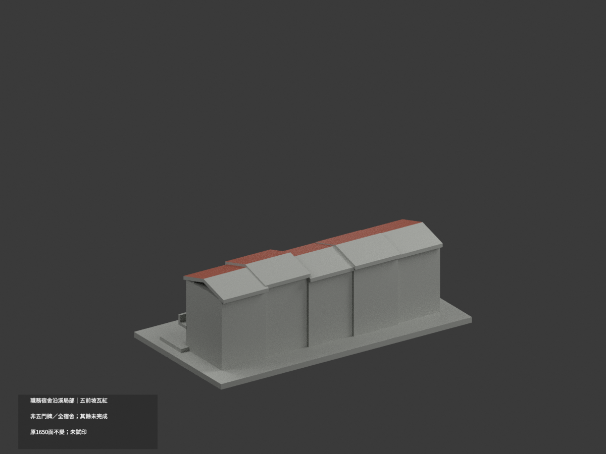
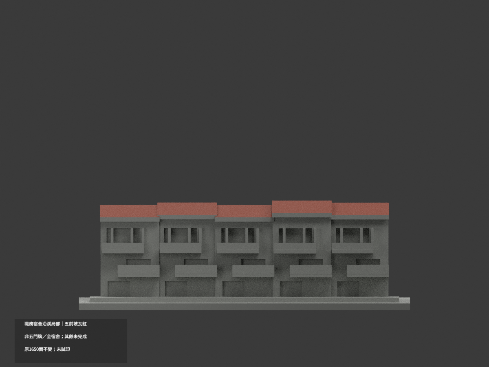
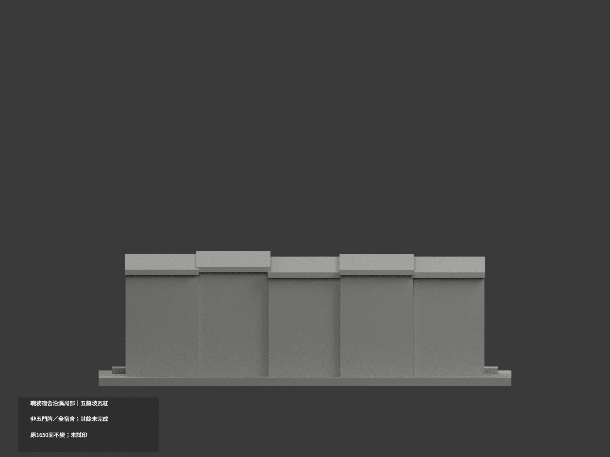
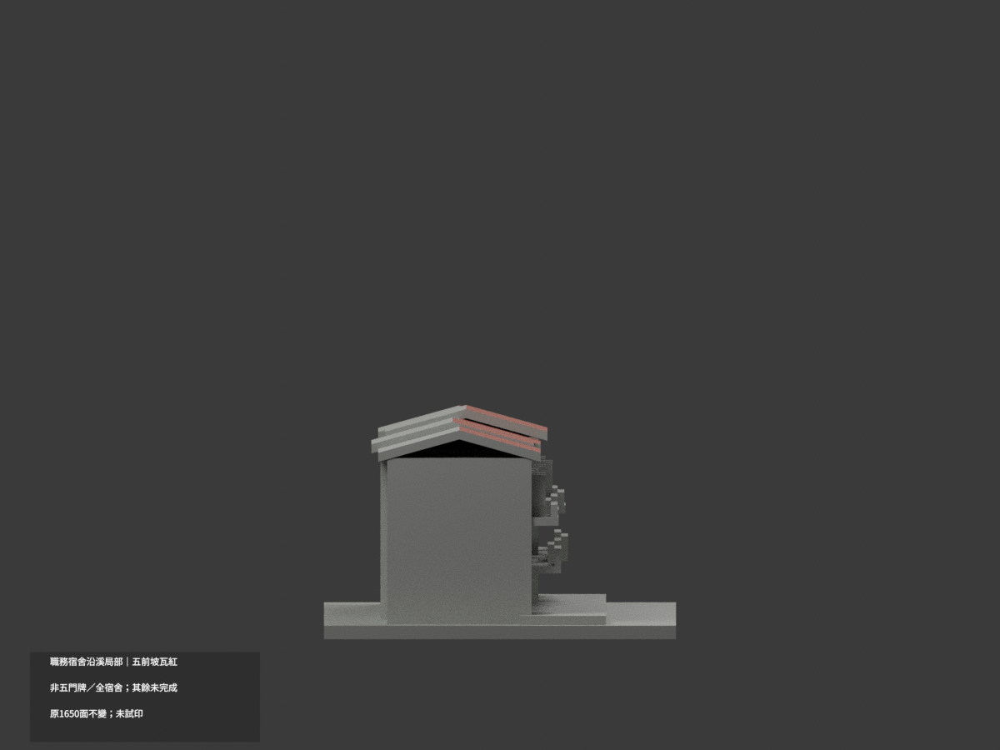
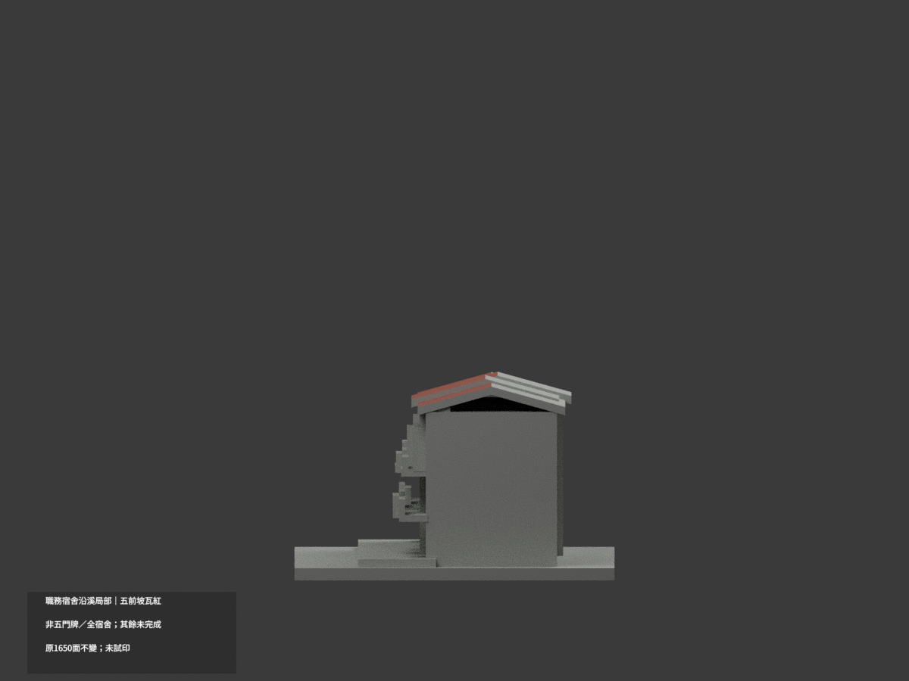
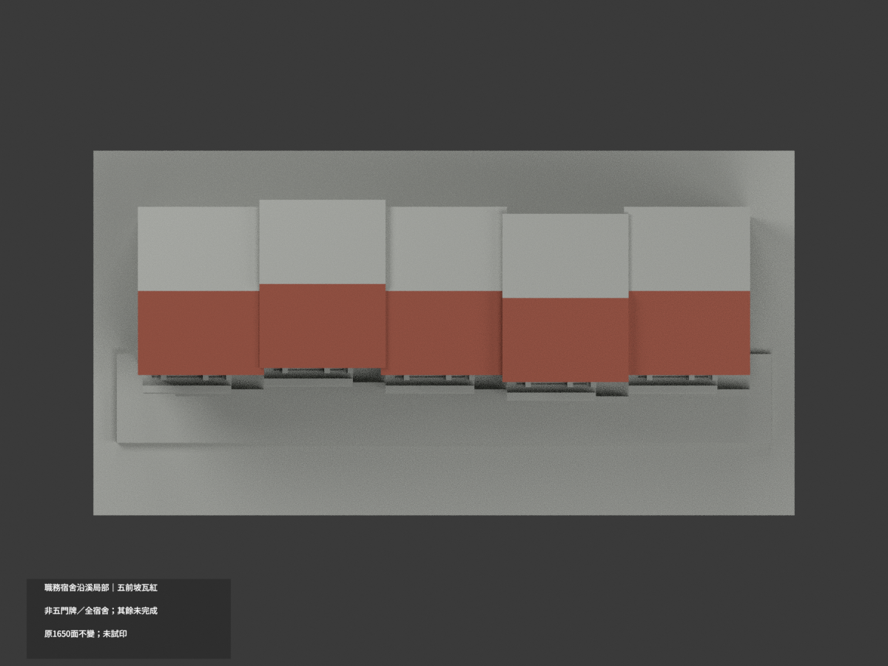
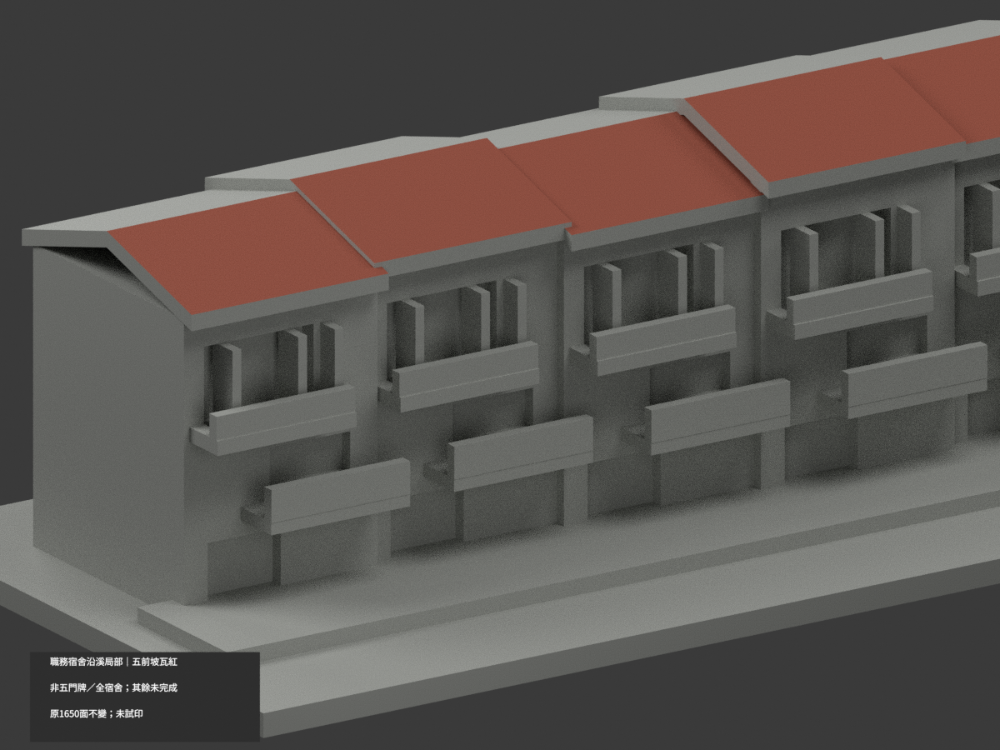
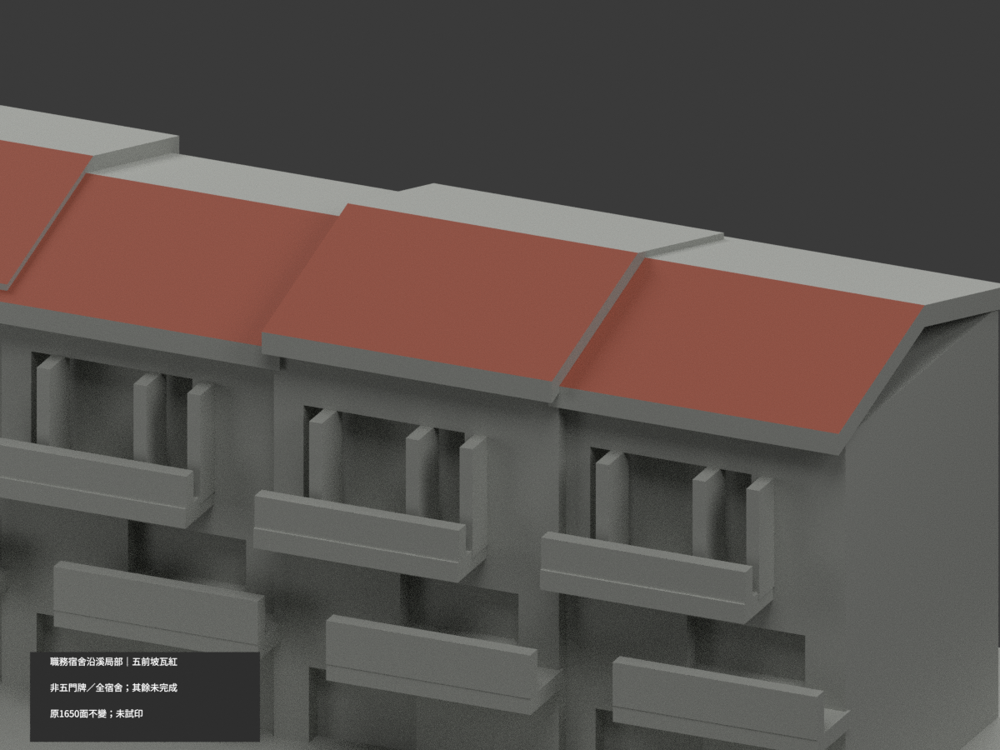
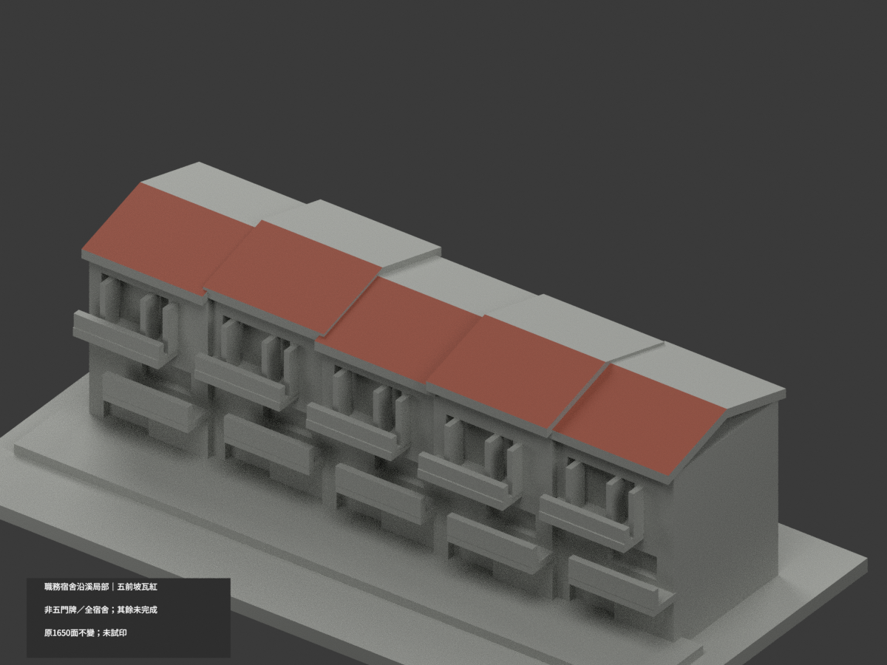

# 職務宿舍沿溪單側局部｜五近似模組前坡瓦紅

**非五門牌或全宿舍，背坡及混牆窗背未完成分色。** `partial_color_incomplete=true`、`fully_colored_exterior=false`。五個原近似模組是一條可見局部屋帶，不認證五棟或門牌，不另增模型套數。

| 總覽 | 背側 | 正面 |
|---|---|---|
||||
||||
||||
||||

## 材色範圍
同 `tnnua-faculty-housing-visible-row` 原項目，same-item、count_delta=0。**1650原三角面、STL與build_model.py字節不變**，不切面／新增瓦片；原公開包無OBJ，不假稱保留。
- 原五近似模組前坡 z=(5/18)y+c；各自原有限xy界與截距43.5／44.08333333333／43.5／45.91666666667／44.5，依次4／2／10／2／2，共20原面瓦紅。
- 每頂點須同時滿足原有限坡plane與xy界，涵Boolean裁切細面；不以法線門檻／中心點任選三角。
- 其餘1630面中性：全部後坡、厚檐／山牆、屋面凸物／女兒牆、混磚白陽臺實板、玻璃／簾／框混窗背、全高混材主牆、平台與側後。
- 全368共面連通域均一、0撤色。色／中性界是證據範圍，不是真實材接縫；不因補色追認原五模組形狀／身份或全宿舍幾何。
- 不建對岸、不配A–H棟或門牌、不重建內部或住戶。

## 來源／日期與權利
高視角與沿溪兩張已建外觀照片親看，僅用可證單側屋帶；拍攝日期未知，不稱2026現況精測。前坡紅不推定背坡紅。
原照私存，不公開／貼圖；未確認CC／再散布授權，不保證商用。HEX是名義瓦紅色族，非校準色票或污斑復原。
GO僅有界來源放行，不是發布核准，也不免除模型QA；繼承notformal字句是先期review。

## 格式與列印
[原STL](model.stl) · [逐面材色3MF](appearance.3mf) · [Blender](scene.blend)
150×78mm原展示底座，照片近似非精測比例。STL無色；3MF／Blender真逐面材。兩材標籤不是驗證兩色／四色耗材切片；**未實際列印**，無切片路徑。

## 重建與 QA
原 `build_model.py` → `colorize_model.py` → `export_appearance.py` → `validate_color.py`；Blender `render_color.py`／`verify_color_scene.py`。
原字節／三角multiset、閉合正體積、3MF面材、完整隔離原build＋color重建、scene重開、十圖1200×900與圖文hash核對，程序不取代來源人工核。
原README、單色previews／render／validation留存歷程，不冒充新QA；沒有刪檔。

## English scope
Partial color only:20 existing frontpitch triangles (4/2/10/2/2) nominalred. Five approximate modules represent one visible single-side row segment, NOT five certified houses, addresses or entirehousingcomplex. All1630 other triangles neutral. Original1650 triangles unchanged;no originalOBJ. Capture dates unknown. No oppositebank/interiors/occupants. Not testprinted or validatedfilament slicing.
