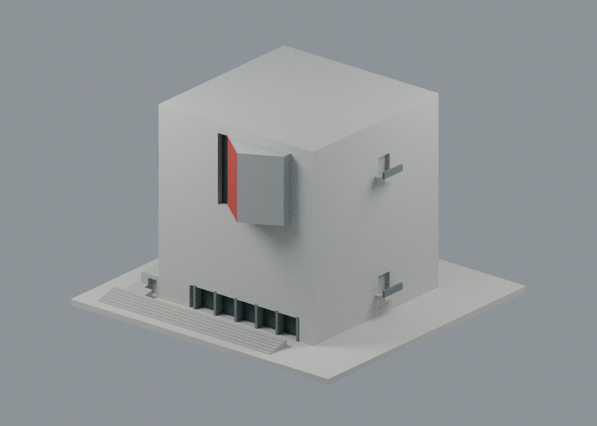
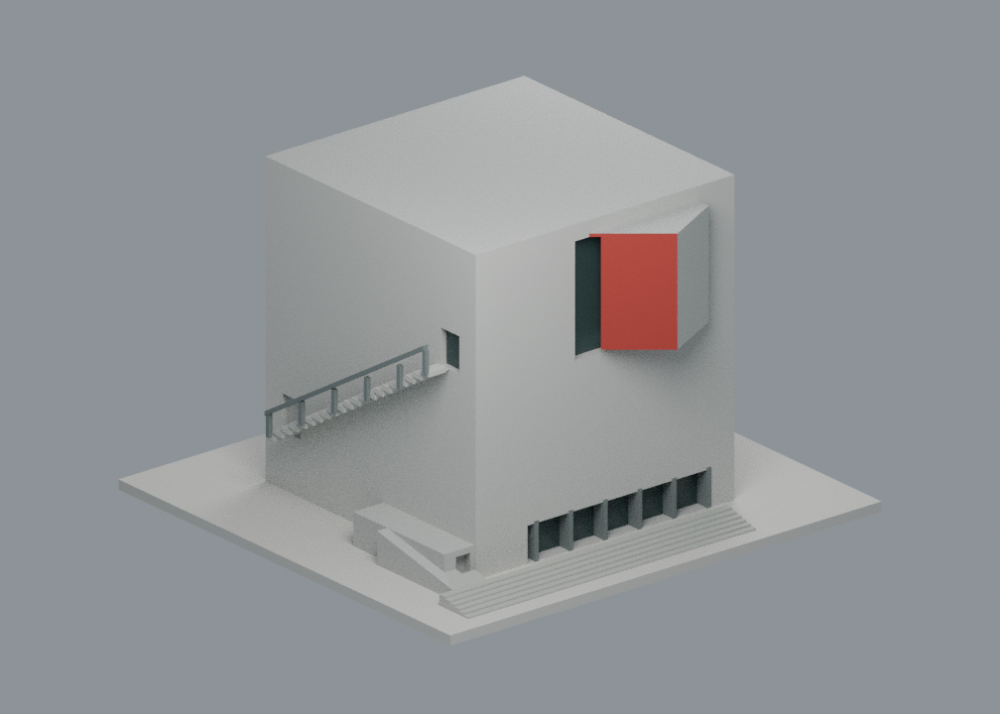
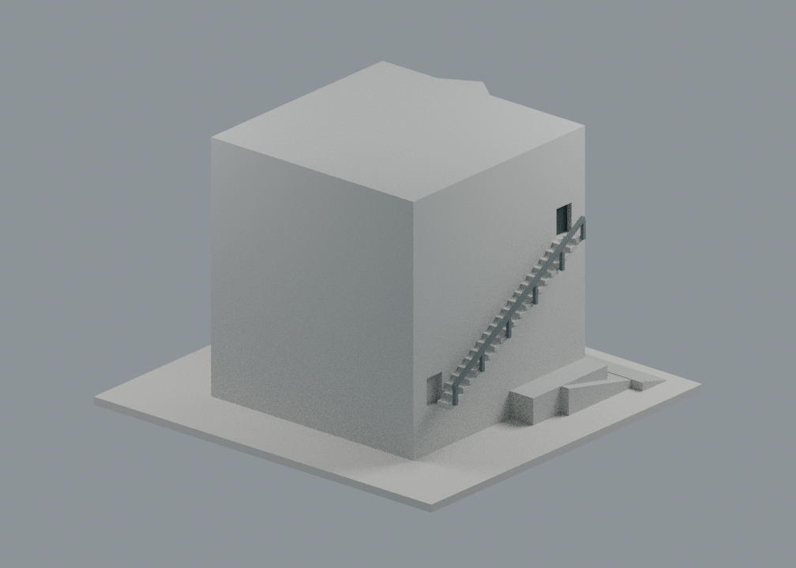
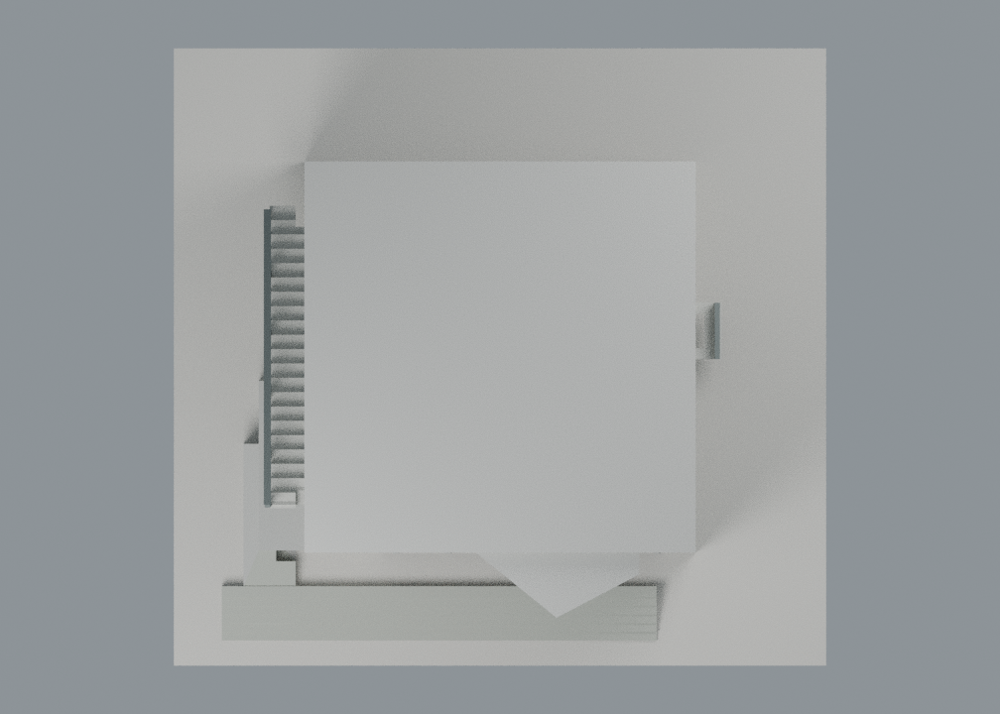

# 國立臺南藝術大學｜漢寶德紀念館

本頁只提供同一座紀念館的最新模型：立面配置修訂 v2，並已合併外梯上端門凹背補色。

## 模型預覽

| 模型預覽 | 模型預覽 | 模型預覽 |
| :---: | :---: | :---: |
|  凸盒正面與右鄰陽臺 |  左側外梯向模型正面上升 |  外梯上端門板 |
|  後面 |  頂視 | |

[STL](facade-layout-v2/model-v2.stl) · [彩色 3MF](facade-layout-v2/model.3mf) · [可編輯 Blender](facade-layout-v2/scene.blend) · [範圍、驗證與重建](facade-layout-v2/README.md) · [原公開來源記錄](sources.json)

外梯在模型左側、往正面上升，雙陽臺位於正面右鄰立面。門板補色不改幾何或尺寸。含底座 150 × 142 × 98 mm，保留 752 點及 1,524 面；模型軸向不是地理方向。仍有 11 層薄特徵警示；未試印或驗證無支撐列印。

[舊版及原編修證據（固定 Git 快照）](https://github.com/hplin50643/taiwan-buildings-3d/tree/88578077d19c33cb890500fa4267c937bc4668d5/%E5%9C%8B%E7%AB%8B%E8%87%BA%E5%8D%97%E8%97%9D%E8%A1%93%E5%A4%A7%E5%AD%B8/%E5%AE%98%E7%94%B0%E6%A0%A1%E5%8D%80/buildings/tnnua-han-pao-teh-museum)、[來源與原立面修訂報告（固定 Git 快照）](https://github.com/hplin50643/taiwan-buildings-3d/blob/88578077d19c33cb890500fa4267c937bc4668d5/%E5%9C%8B%E7%AB%8B%E8%87%BA%E5%8D%97%E8%97%9D%E8%A1%93%E5%A4%A7%E5%AD%B8/%E5%AE%98%E7%94%B0%E6%A0%A1%E5%8D%80/buildings/tnnua-han-pao-teh-museum/facade-layout-v2/README.md) 只作歷史查核，不作現行下載或圖冊。
