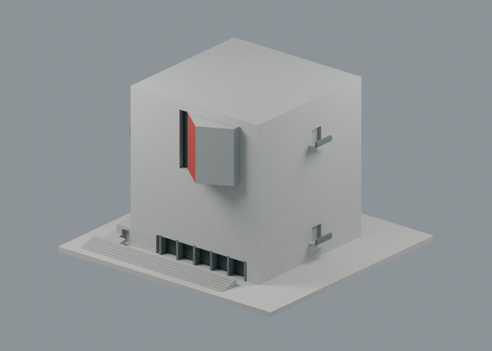
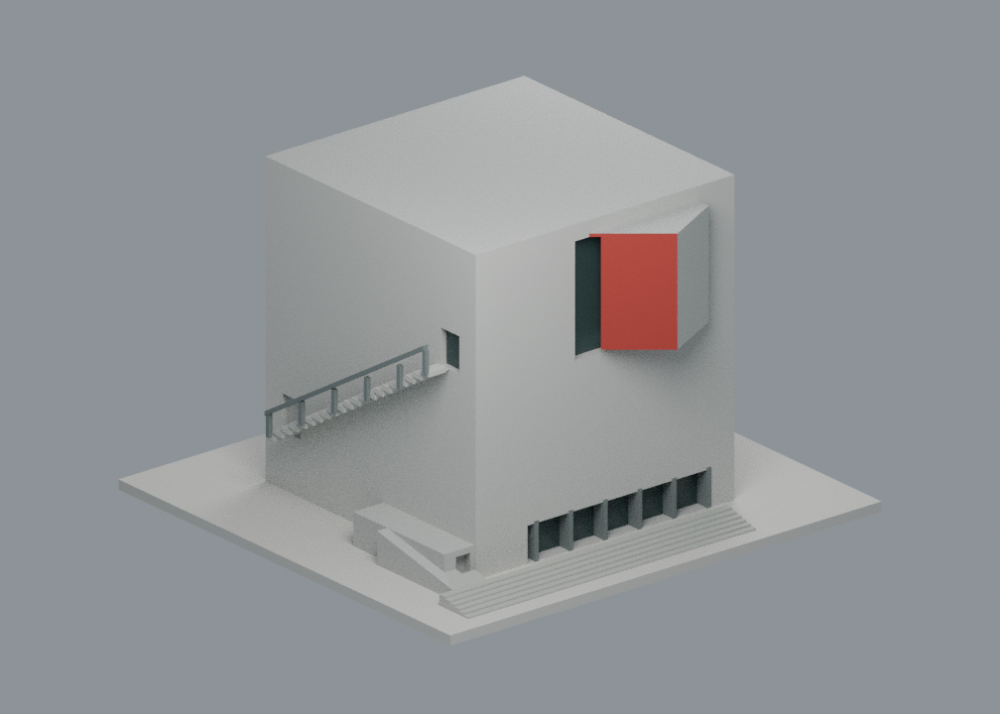
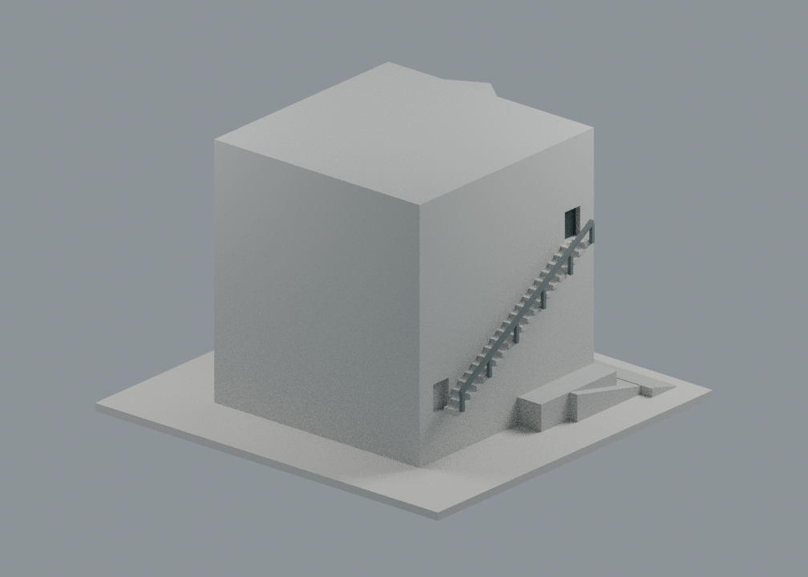
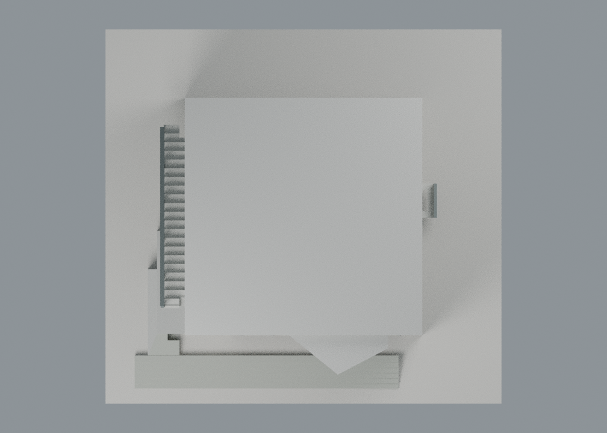

# 漢寶德紀念館｜現行外觀與立面修訂

## 模型預覽

| 模型預覽 | 模型預覽 | 模型預覽 |
| :---: | :---: | :---: |
| <br>正面與右鄰陽臺 | <br>左外梯與正面 | <br>外梯高端閉合門板代理 |
| <br>後面 | <br>頂面 | |

[現行 STL](model-v2.stl) · [現行彩色 3MF](model.3mf) · [現行 Blender](scene.blend) · [校驗](SHA256SUMS) · [獨立驗證摘要](verification.json)

以已修訂外梯與雙陽臺相對位置的 v2 為基礎，只補左側外梯高端門的兩個原三角面（1263、1265，零起算）為既有代理色 `#354746`。保留 752 點、1,524 面及七材質，STL 位元、原尺寸 150 × 142 × 98 mm 與原色面皆不變。尚未精確對位的低端門、後牆與屋頂不補色；照片色值未校正。未實際切片或試印；先前截層檢查仍有 11 層薄特徵警示，不是全模型壁厚或可印認證。

[建築師相簿](https://www.krisyaoartech.com/zh-tw/projects/cultural/Han-Pao-Teh-Memorial-Museum) 的外梯照片可辨上端較暗閉合門板；[門板材色與逐面查驗](https://github.com/hplin50643/taiwan-buildings-3d/blob/88578077d19c33cb890500fa4267c937bc4668d5/%E5%9C%8B%E7%AB%8B%E8%87%BA%E5%8D%97%E8%97%9D%E8%A1%93%E5%A4%A7%E5%AD%B8/%E5%AE%98%E7%94%B0%E6%A0%A1%E5%8D%80/buildings/tnnua-han-pao-teh-museum/stair-door-color-20261120/README.md) 說明對位限制。[立面修訂歷史報告](https://github.com/hplin50643/taiwan-buildings-3d/blob/88578077d19c33cb890500fa4267c937bc4668d5/%E5%9C%8B%E7%AB%8B%E8%87%BA%E5%8D%97%E8%97%9D%E8%A1%93%E5%A4%A7%E5%AD%B8/%E5%AE%98%E7%94%B0%E6%A0%A1%E5%8D%80/buildings/tnnua-han-pao-teh-museum/facade-layout-v2/README.md) 保留原作者的來源、尺寸、截層及幾何差分驗證。歷史版本供查核，不是現行下載，照片不隨包公開。

## 重建

現行 STL、3MF 與 Blender 可各自開啟，不需歷史檔。若要重跑材色建置，用 Python 3 和 Blender 4.3.2 執行：

```sh
python source/rebuild.py /tmp/han-current
```

程式先用[固定提交與 SHA-256 表](source/pinned-inputs.json)讀回既有公開建置輸入，再在暫存目錄執行原程式。若也要重跑原幾何差分，另安裝 [原依賴](https://github.com/hplin50643/taiwan-buildings-3d/blob/88578077d19c33cb890500fa4267c937bc4668d5/%E5%9C%8B%E7%AB%8B%E8%87%BA%E5%8D%97%E8%97%9D%E8%A1%93%E5%A4%A7%E5%AD%B8/%E5%AE%98%E7%94%B0%E6%A0%A1%E5%8D%80/buildings/tnnua-han-pao-teh-museum/requirements.txt)，加 `--historical-layout`。原報告不重寫。展示圖全部從現行 Blender 場景渲染，以無損 WebP 發佈。

修訂 v2 幾何生成器 [build_model.py](source/build_model.py) 與 [截層檢查](source/check_layers.py) 保留在現行套件；請在工作副本使用 [幾何依賴](source/requirements-geometry.txt)。因本次材色只改兩面而 STL 位元不變，[既有幾何查核](qa/geometry-validation.json) 和[原 0.2 mm 截層報告](qa/layer-check.json) 仍對應現行 STL，兩報告未重寫。
