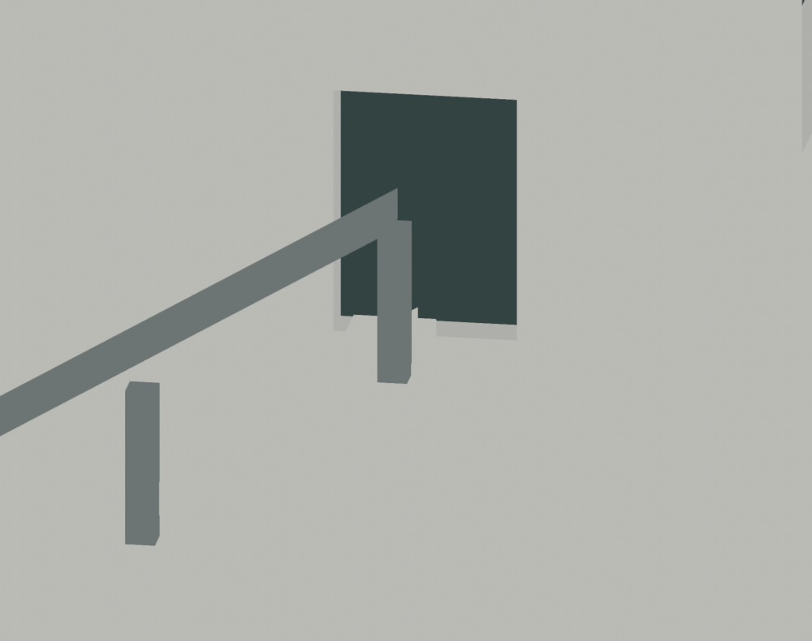

# 南藝大漢寶德紀念館｜外梯上端門板補色

這是 [立面配置修訂 v2](../facade-layout-v2/README.md) 的獨立外觀變體。只把左側外梯高端、朝模型正面上升的門板凹背改為既有深灰綠 `#354746`。沒有修改原 STL、原 v2 3MF／Blender、代表圖、既有 SHA256 清單或歷史版本。

| 補色前（門板局部） | 補色後（相同角度） |
| :---: | :---: |
|  |  |

[補色 3MF](model-colored.3mf) · [可編輯 Blender](scene.blend) · [同幾何原 v2 STL](../facade-layout-v2/model-v2.stl) · [新檔 SHA256](SHA256SUMS)

## 來源對位與限制

[建築師大元建築工場作品相簿](https://www.krisyaoartech.com/zh-tw/projects/cultural/Han-Pao-Teh-Memorial-Museum) 的[左側外梯近照](https://www.krisyaoartech.com/data/goods/gallery/202209/1664346965060207576.jpg?t=1698201498) 顯示高端平台內有一片較暗、反光的閉合門板，與清水混凝土牆和框分離。依 v2 的立面方向和梯升向，它對應模型 -X 外梯偏 -Y（模型正面）的高端。原凹背是 88 mm² 的完整矩形，x=-43 mm、y=-38 至 -30 mm、z=61 至 72 mm，法向 -X；兩個原三角面使用既有材質槽 3，未切新面。

- 深灰綠是現有模型不透明代理，不是量得的顏色、透射率或門材規格。拍攝日期及現況未核實，不隨附來源照片。
- 外梯低端門呈開啟或未能辨識，仍中性；雙陽臺、框、門側壁、梯、欄杆、後牆和簡化屋頂不改。
- 保留原 1,524 個三角面、752 個頂點以及七個材質定義，所有尺寸仍是近似。沒有新切片或實體試印。

## 獨立重建與查核

由此模型資料夾執行（下列路徑皆在倉庫內，不需下載相簿照片）：

    blender -b facade-layout-v2/scene.blend -t 4 --python-exit-code 1 -P stair-door-color-20261120/apply_stair_door.py -- --qa-renders
    python3 stair-door-color-20261120/rebuild_exchange.py

已用 Blender 4.3.2 重開兩份場景；以原 v2 STL 逐面對位，再用 lib3mf 嚴格開啟新舊 3MF、比對全部角點的材質指派。只改該門凹背兩面。

[面域、原檔與公開來源](domain.json) · [格式與材質驗證](verification.json) · [畫面差異](visual-QA.json) · [重建檢查](reproduction-QA.json) · [原 v2 校驗](../facade-layout-v2/SHA256SUMS)
