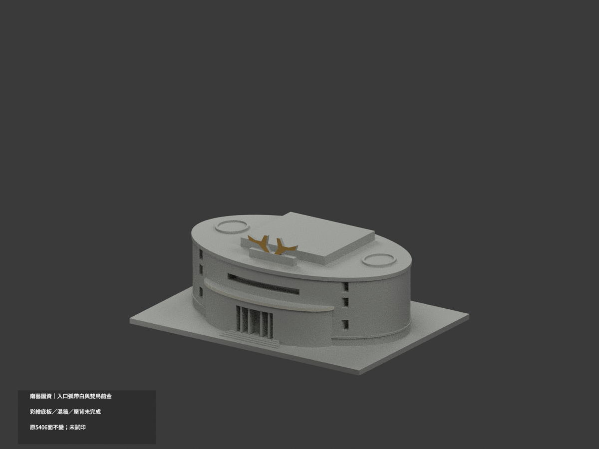
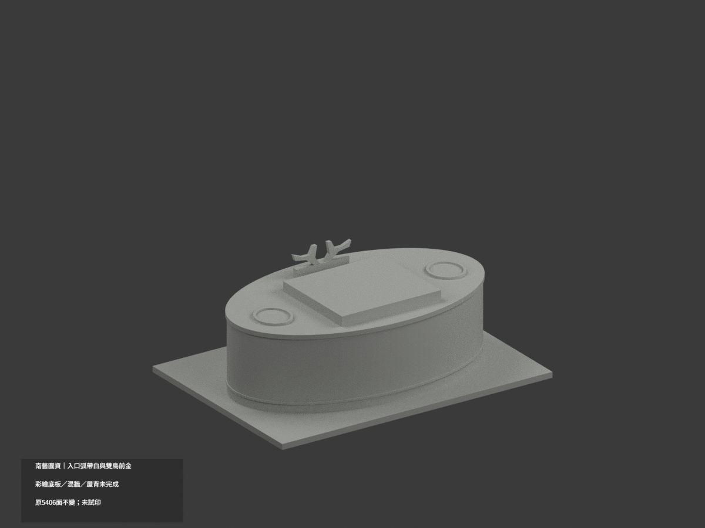
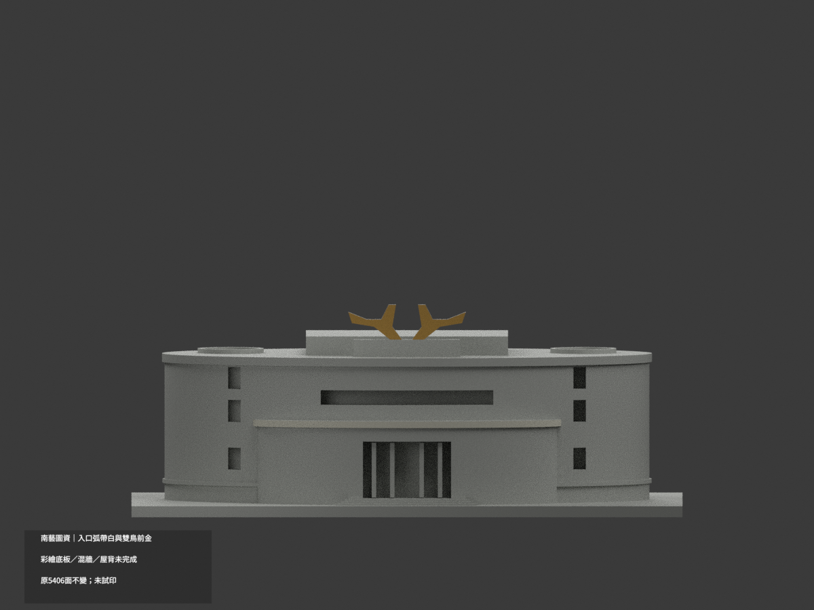
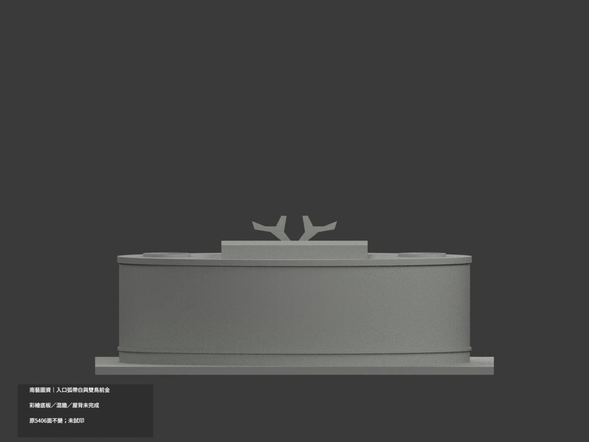
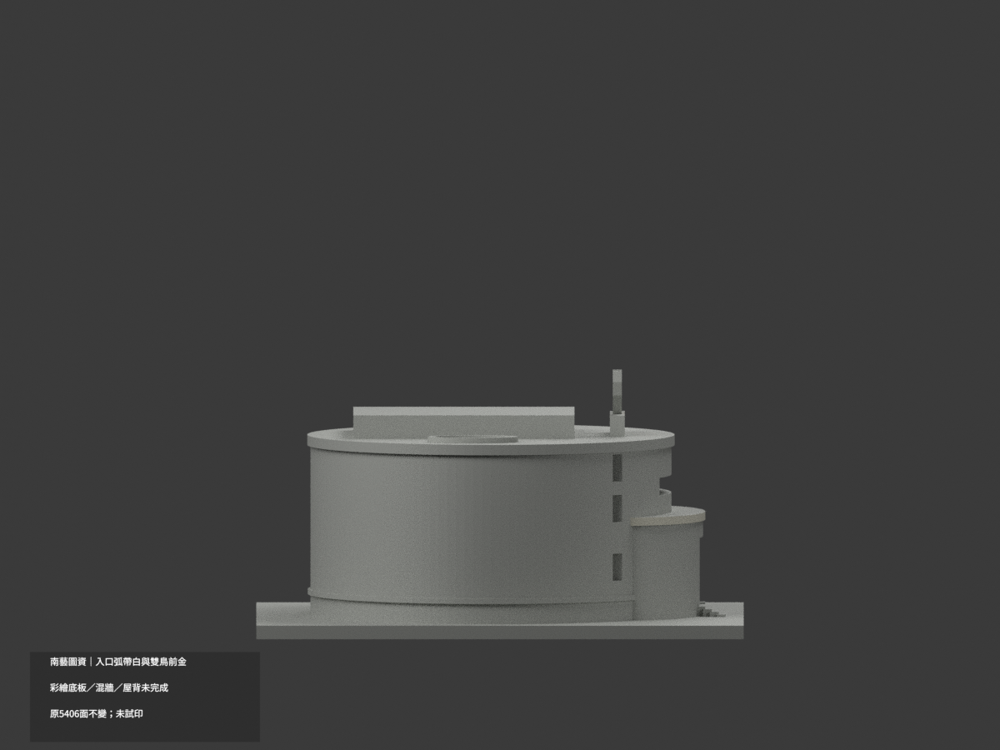
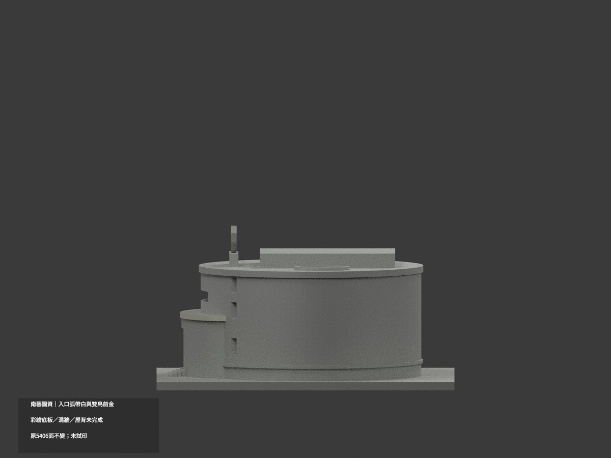
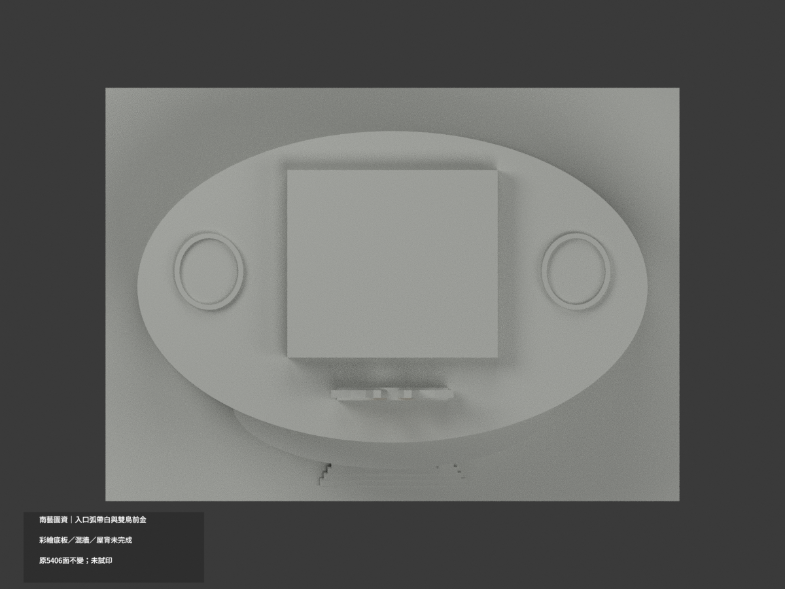
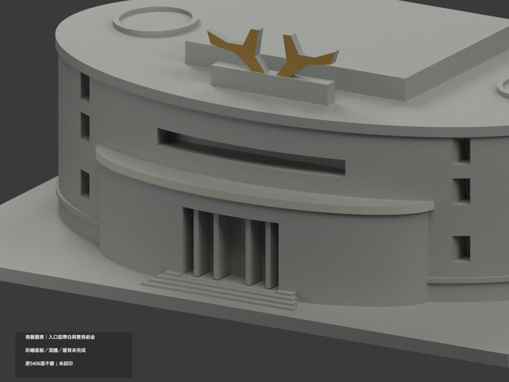
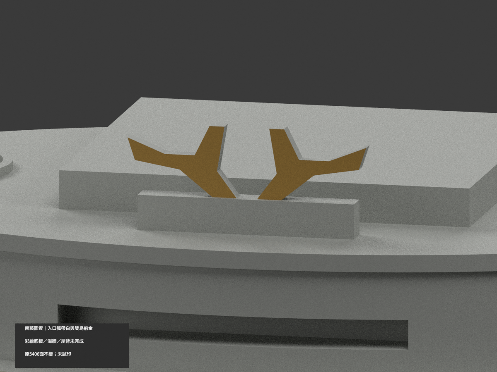
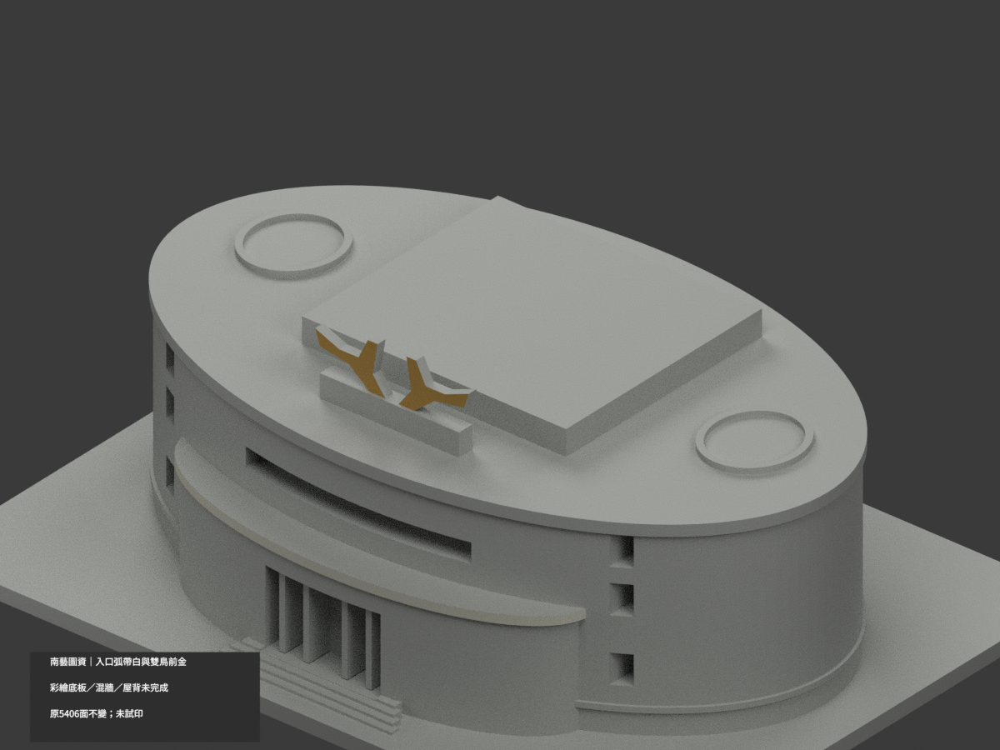

# 南藝圖資｜入口真弧帶白與簡化雙鳥前金

**彩繪底板、混主牆、屋背等未完成分色。** `partial_color_incomplete=true`、`fully_colored_exterior=false`。僅140個有據原面，非全色重建。

| 總覽 | 背側 | 正面 |
|---|---|---|
||||
||||
||||
||||

## 材色範圍
同 `tnnua-library-information` 原項目，same-item、count_delta=0。**5406原三角面、STL與build_model.py字節不變**，不切面、不新增鳥羽／喙／尾或其他幾何。原公開包沒有OBJ，不假稱保留。
- 入口弧帶採原128面橢圓 rx42、ry17.5、中心(0,−28)，有限外立facet65..126、z24..25.8，124原三角面名義白。每頂點須落同原弦線有限端點範圍，不靠半徑或法線捷徑選曲面。
- 兩獨立簡化鳥形原前面 y−27、x−16..16、z47..57，16原面金；只既有粗化剪影，不聲稱復原細雕。
- 其餘5266面中性：鳥側／背、整塊彩繪crest板 y−27.65、混磚灰牆、窗背、階／基地、弧帶頂底、上主牆冠帶與屋背。
- 全1251共面連通域均一，0候選撤色；不畫三角色楔、不把整塊彩繪底板金色。材色／中性界是證據與拓撲使用界，不是真實材料接縫。
- 補色不追認原照片近似幾何、曲率、鳥形或窗孔精度。

## 來源／日期與權利
三張官方外觀與雙鳥近照已核；拍攝日期未獲證明。EXIF修改2022及官頁檢視2026不是拍攝日期，不稱2026精測現況。
原照片私有保存，不公開／貼圖；未確認CC／再散布授權，不保證商用。HEX是近似色族，非校準色票。
GO繼承review的notformal字句屬先期審查階段；正式來源有界放行不免除建模QA，也不是發布核准。

## 格式與列印
[原STL](model.stl) · [逐面材色3MF](appearance.3mf) · [Blender](scene.blend)
150×108mm原展示底座，照片近似非精測比例。STL無色；3MF與Blender真逐面材。三材質標籤不是驗證三色／四色耗材切片；**未實際列印**，無切片路徑。

## 重建與 QA
原 `build_model.py` → `colorize_model.py` → `export_appearance.py` → `validate_color.py`；Blender `render_color.py` 與 `verify_color_scene.py`。
原字節／三角multiset、閉合正體積、3MF面材、完整隔離原build＋color重建、scene重開、十圖1200×900及圖文hash核對。程序不取代人工來源核。
原README、單色previews／render／validation保留歷程，不冒充新QA，沒有刪除原件。

## English scope
Partial color only:124 existing finite curved coping outer faces offwhite and16 original simplified bird-profile fronts nominalgold. The remaining5266 triangles are unverifiedneutral, especially the multicolor crest slab, mixed brick/gray walls, roof/rear and bird sides. Original5406 triangles unchanged; no new ornament geometry. No original OBJ in immutable package. Capture dates unknown;2022EXIF modification is not capture proof. Not test printed or validated filament slicing.
