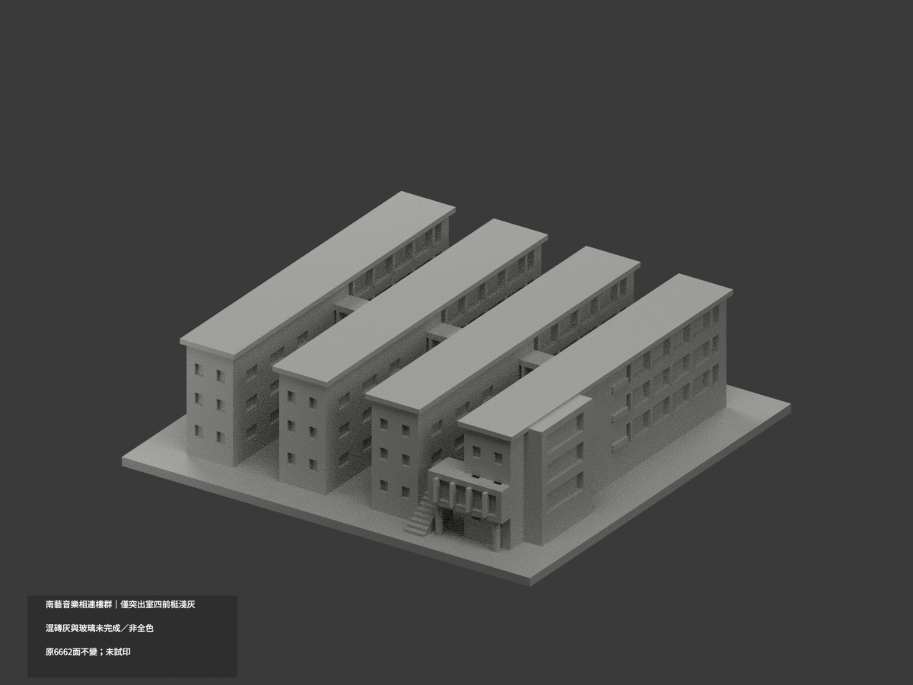
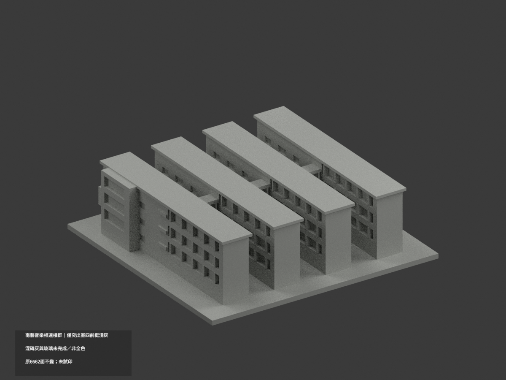
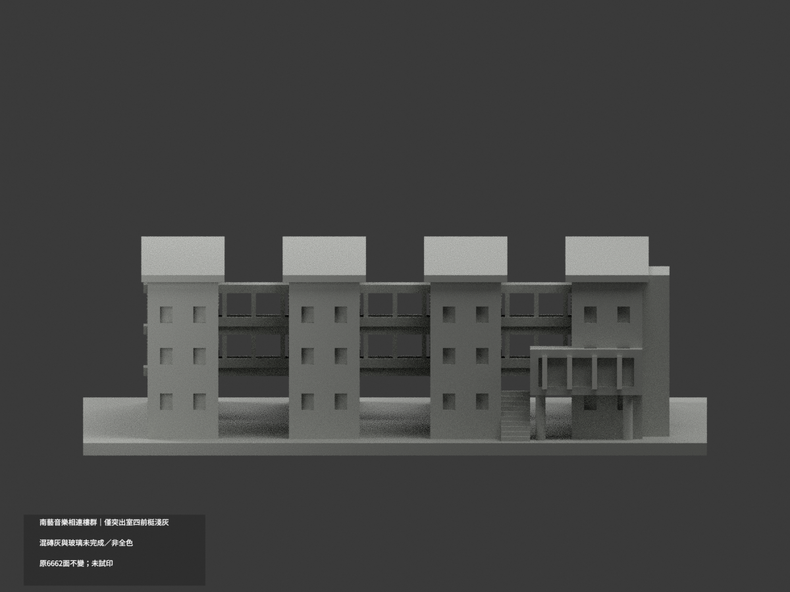
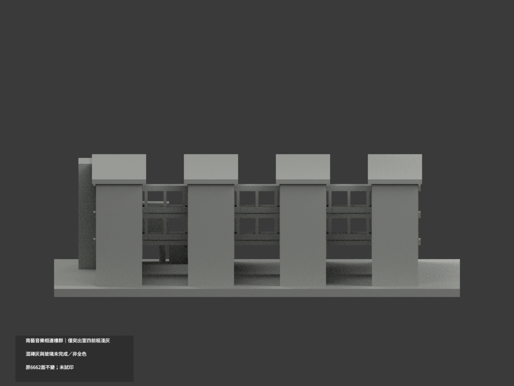
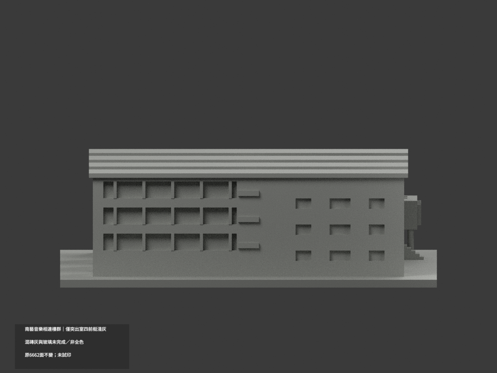
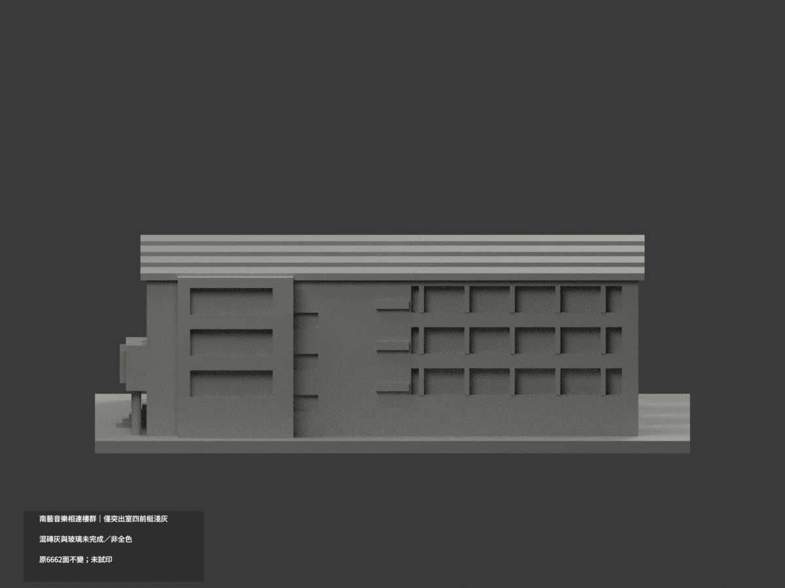
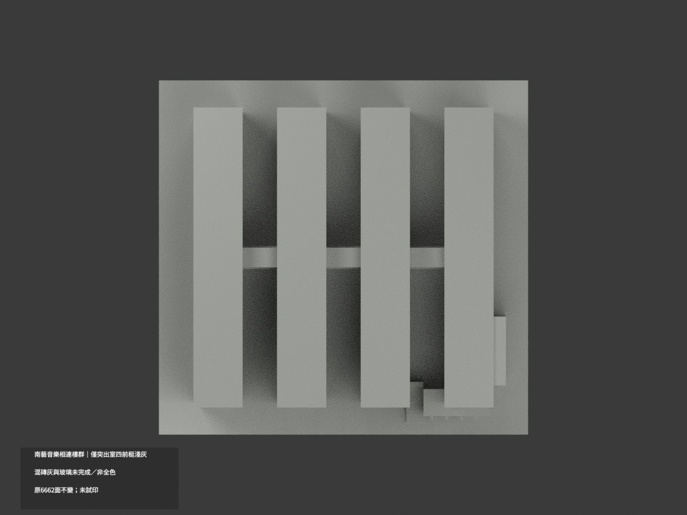
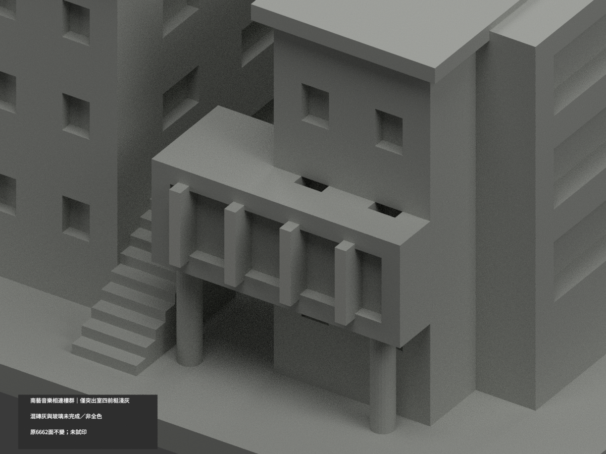
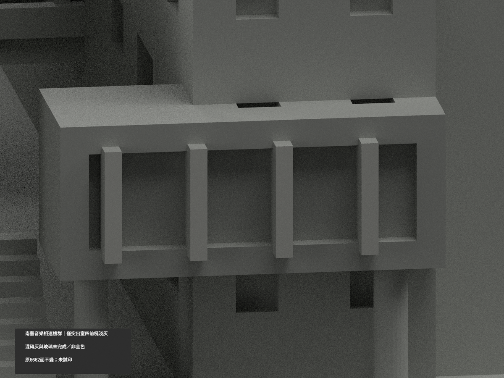
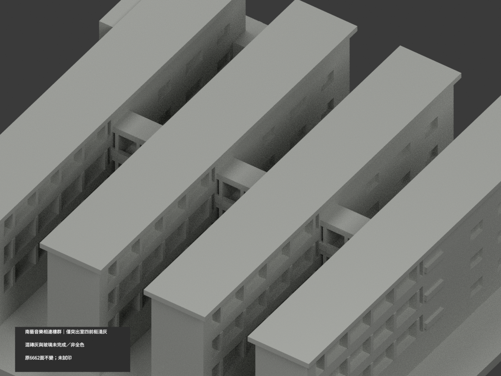

# 南藝音樂相連樓群｜僅突出室四前梃局部淺灰

**局部補色未完成：僅突出室四原前梃淺灰；玻璃、混磚灰樓體與其餘域未完成。非全色或2026現況。** `partial_color_incomplete=true`、`fully_colored_exterior=false`。同項`tnnua-music-complex`／`count_delta=0`，官田校區A–D與相連宿舍保持同一原群，不拆多套。

| 前斜視 | 後斜視 | 正面 |
|---|---|---|
|  |  |  |
|  |  |  |
|  |  |  |
|  | | |

## 材色範圍

只原突出練習室四根前梃x36/42/48/54，y−66，寬1.2、高8(z15.5..23.5)的完整朝外矩形各2面、共8面淺灰；全原頂點／矩形面積／共面域核驗，不盲套index，不切三角。其餘6654面中性，1942共面連通域同材。原粗梃不是照片密細框精確復刻，不新增grid或玻璃分界。

梃側／頂底／後、突出室皮／支柱／外階、窗背玻璃反光框混合全部中性；**中性不是實景灰色證明**。唯一照片不能把混紅磚／灰牆任分四平行量體及背院；四樓群／陽台／橋／屋皮皆中性，不能按重複碼複製實景材色。資料界線不是實景不同材縫。

原6662三角、尺寸、STL/build字節保持，不重建A–D或宿舍、不新增細框材界、不追認原照片估讀幾何為精測。

## 來源年代及權利

唯一成功官照`official-view1.jpg`已親看，能對應靠近外階的突出玻璃練習室與淺金屬窄框。其他來源曾逾時未讀，不拿失敗結果作色證。拍攝日未知，頁面2026查核／發布非capture，不宣2026完整現況。URL/hash見source register。原照私存不公開、不貼圖；未見CC不沿repo license推自由商用，HEX僅名義色族非實測。

## 檔案與 QA

`appearance.3mf`兩展示材、`scene.blend`真面材、`color-mesh.npz`原三角／材索引。原STL無色、原build字節保留。Immutable原包無OBJ，不冒稱原OBJ存在或保留。

原README另存`ORIGINAL-MONOCHROME-README.md`或`.zh-TW.md`，舊previews／QA保單色歷程不當本輪色審。依requirements執行`colorize_model.py`、`export_appearance.py`、`validate_color.py`；Blender跑`render_color.py`及`verify_color_scene.py`。原build+color全隔離重建保留不刪，3MF/STL三角multiset／封閉正體積／scene重開／10張1200×900綁定見COLOR-*QA、SCENE-QA、DELIVERY-QA；父另人工終審。

**未實際列印。** 兩展示材不是已驗四色切片工程，支撐、材料對應、薄部強度須另核。

## English limitations

Partial reference only: four complete original projecting rehearsal-room outward mullion rectangles8faces lightgray,6654neutral; all1942coplanar domains uniform. Frame sides/top/back, glassproxy, roomskin, four mixed brick-gray blocks, balconies, bridges, roof and rear courtyard unverified neutral. The sole successful official photograph has unknown capture date;2026page context is not capture/currentcondition. A–D plus connected dormitory remain one originalcomplex/count_delta0. Original6662triangles/STL/build preserved; no new frame grid or geometry validation. Source photo private, not physically test-printed.
