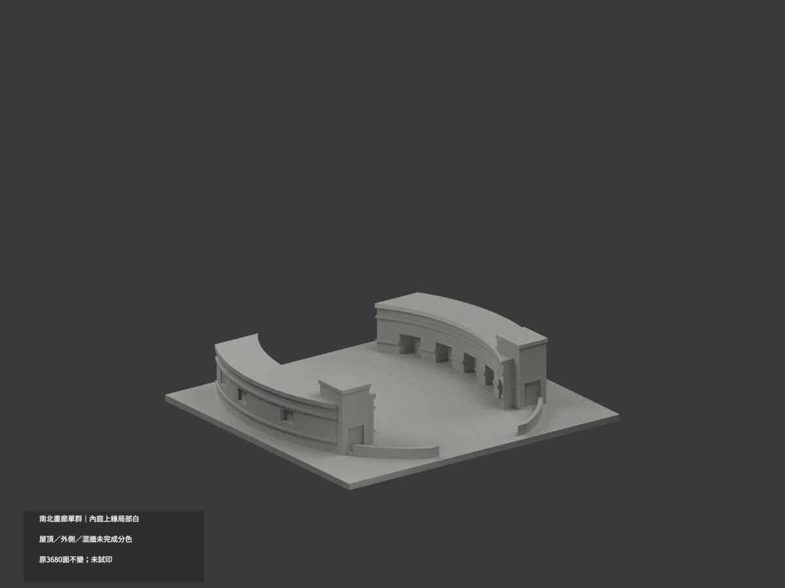
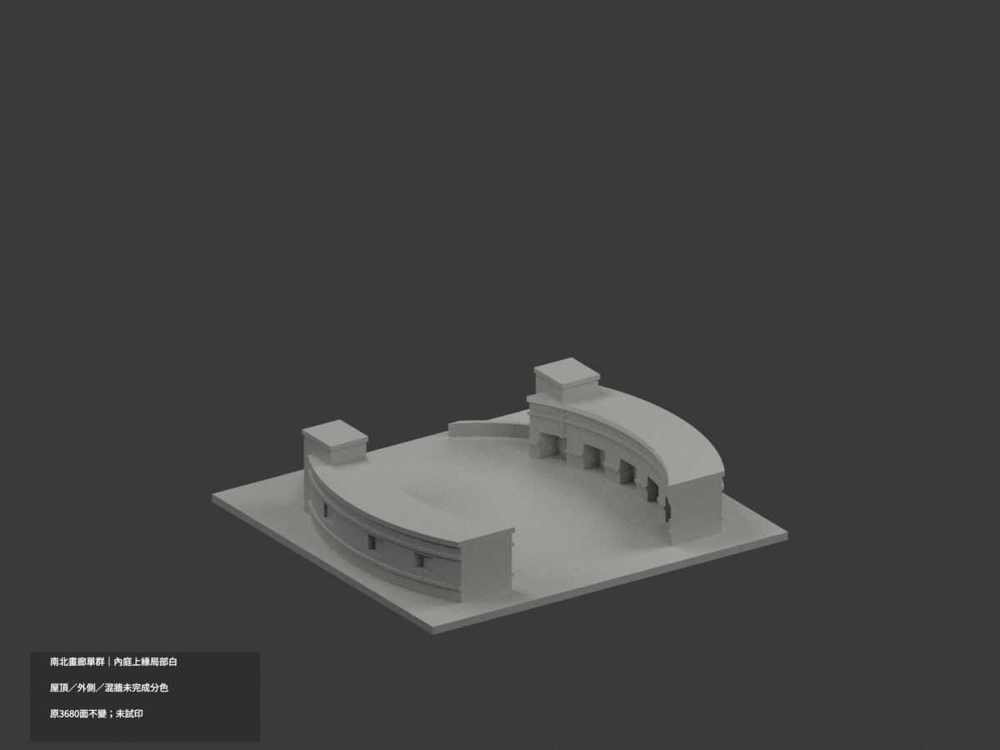
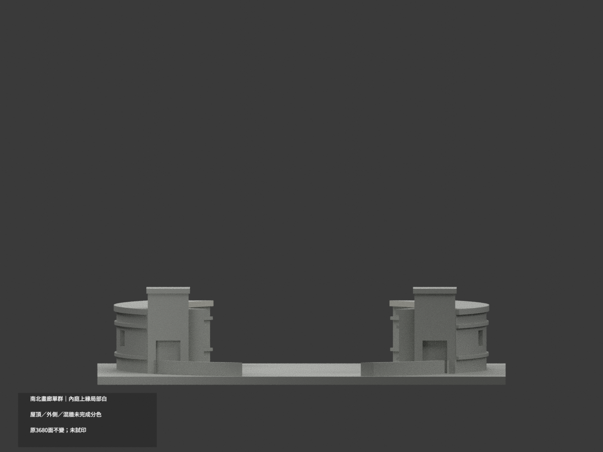
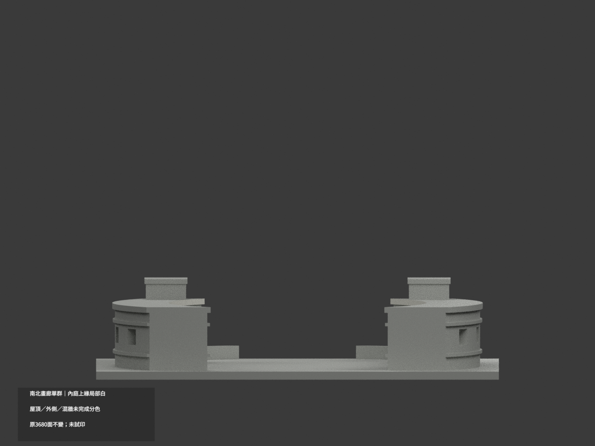
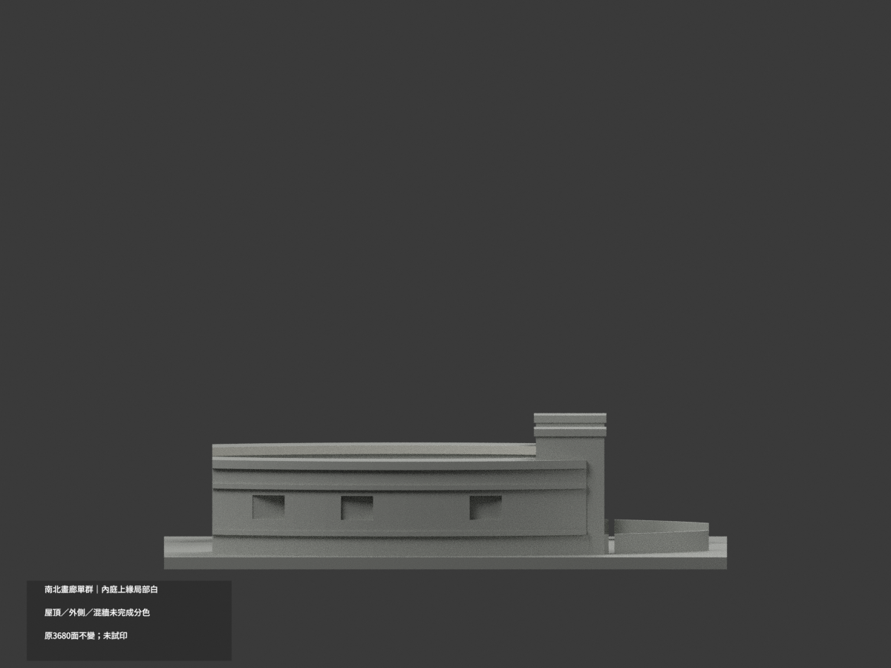
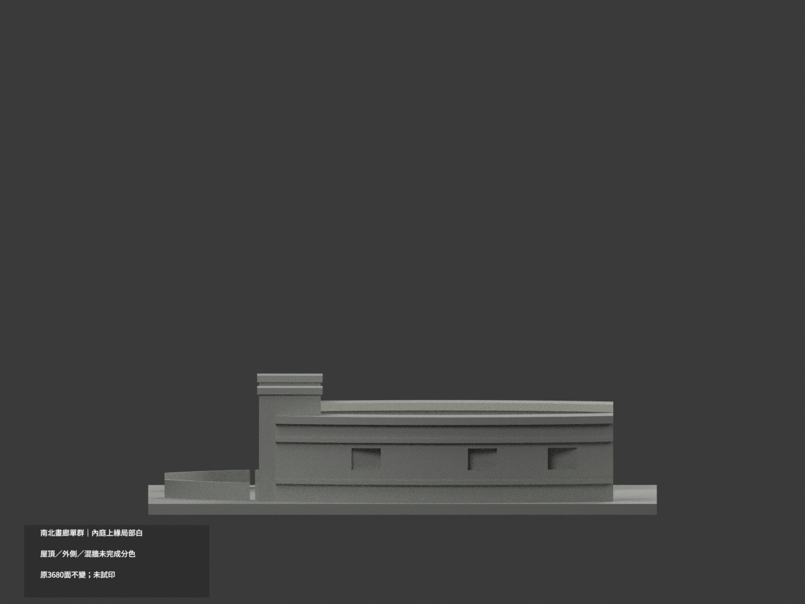
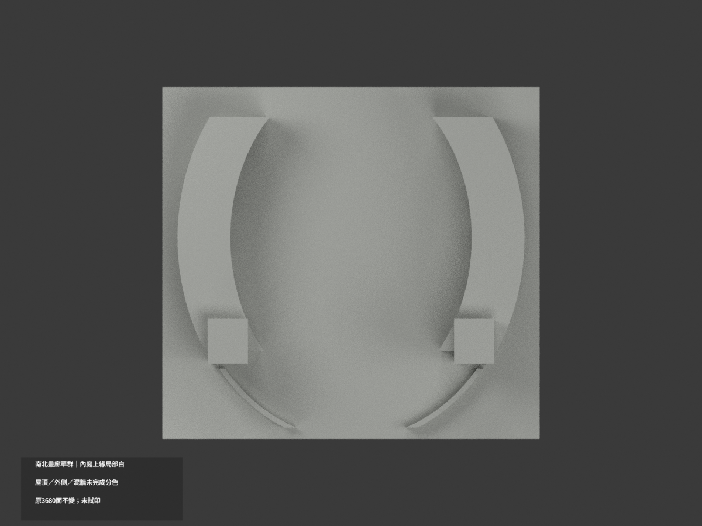
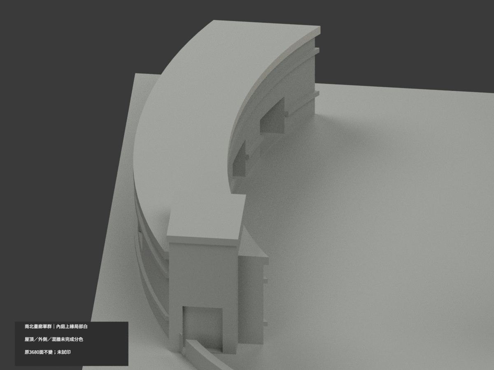
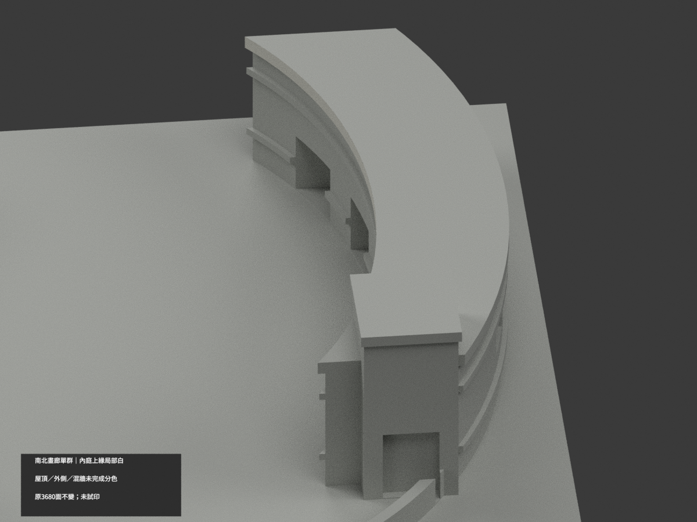
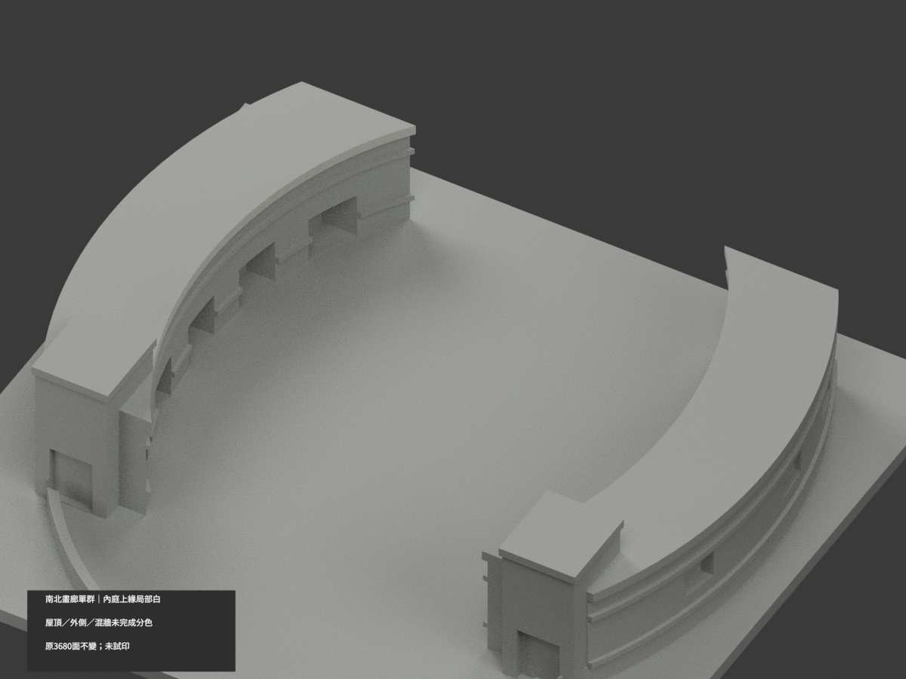

# 南北畫廊單群｜內庭上緣局部白

**屋頂、外側及混材主牆未完成分色。** `partial_color_incomplete=true`、`fully_colored_exterior=false`。南北兩翼保留同一模型群／同一slug，不分成兩套。

| 總覽 | 背側 | 正面 |
|---|---|---|
||||
||||
||||
||||

## 材色範圍
同 `tnnua-north-south-galleries-curved` 原項目，same-item、count_delta=0。**3680 原三角面、STL與build_model.py字節不變**，不切面；原公開包無OBJ，不假稱保留。
- 兩翼內庭上緣真垂直coping，左68＋右68＝136原面名義白。原128邊橢圓 rx48／ry65、中心(0,10)，z24.5–26.6；每個三角全部頂點須落同有限chord plane與tangent端界、y裁界−35..58，含原Boolean交接細面。
- 不以法線門檻／中心點挑色，不新增分界。全918共面連通域均一、0撤色。
- 其餘3544面中性：外曲面、全部水平屋頂／底面、混磚灰基座主牆、入口柱、低屏、窗洞背板；不將旁邊圖資館色材移入。
- 色／中性界是證據範圍而非實際材接縫；原近似曲線、開口或屋形不因補色追認。

## 來源／日期與權利
親看兩張地面官照與既有官方空拍，空拍可見兩翼內庭白色上緣。拍攝日期未知，不稱2026現況精測。來源GO只放行有界來源，不取代builder QA；前段review-only文字保留歷程。
原照私存，不公開／貼圖；未確認CC／再散布授權，不保證商用。HEX為名義白色族非校準色票；無人物或字樣建模。

## 格式與列印
[原STL](model.stl) · [逐面材色3MF](appearance.3mf) · [Blender](scene.blend)
150×140mm原展示底座，照片近似非精測比例。STL無色；3MF／Blender真逐面材。兩材標籤不是驗證兩色／四色耗材切片；**未實際列印**，無切片路徑。

## 重建與 QA
原 `build_model.py` → `colorize_model.py` → `export_appearance.py` → `validate_color.py`；Blender `render_color.py`／`verify_color_scene.py`。
原字節／三角multiset、閉合正體積、3MF面材、完整隔離原build＋color重建、scene重開、十圖1200×900與圖文hash核對，程序不取代來源人工核。
原README、單色previews／render／validation留存歷程，不冒充新QA；沒有刪檔。

## English scope
Partial color only:136 existing inner-court upper coping vertical faces,68 per arm, nominaloffwhite. Both gallery arms remain ONE model/slug. All3544 other faces neutral. Original3680 triangles andgeometry unchanged;no originalOBJ. Finite128gon chord/allvertex selection, notnormal or centroid cut. Unknown photo capture dates, no current survey. Not testprinted or validatedfilament slicing.
