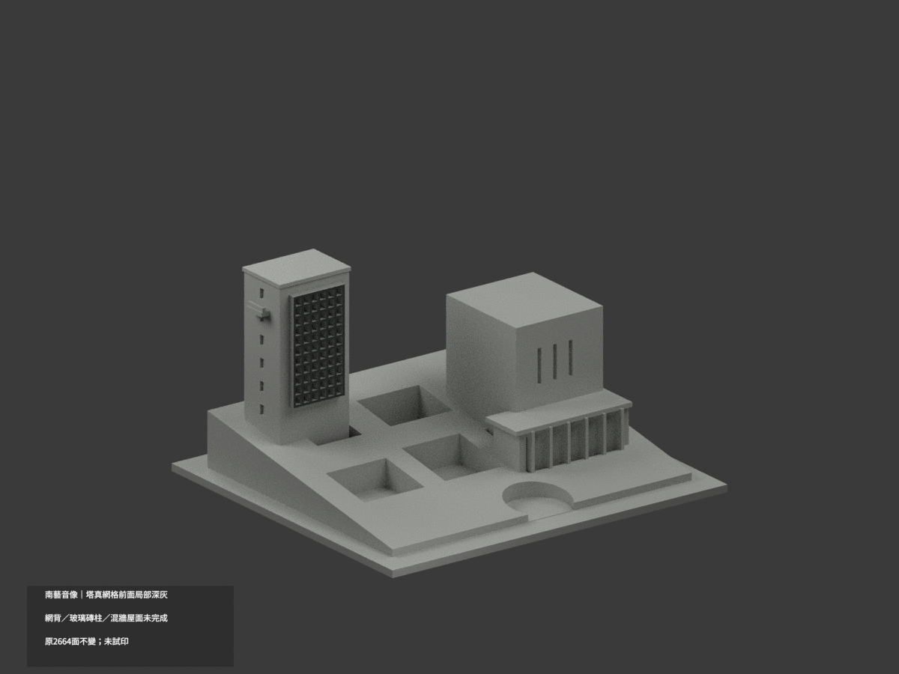
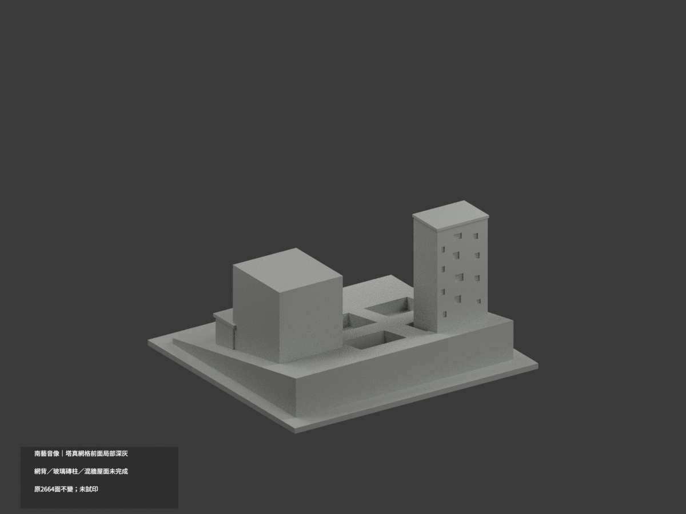
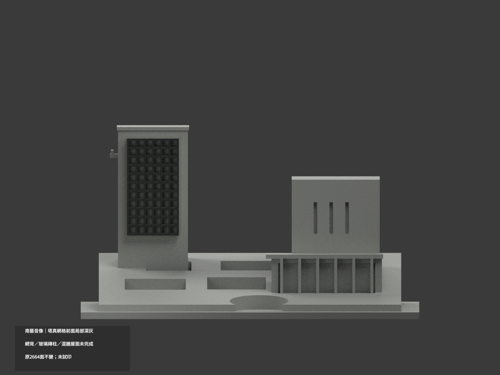
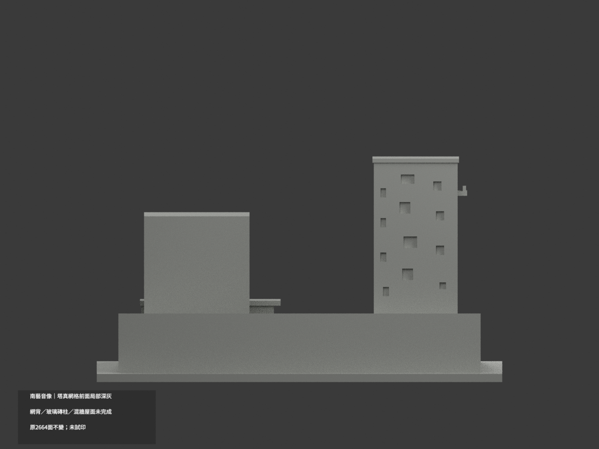
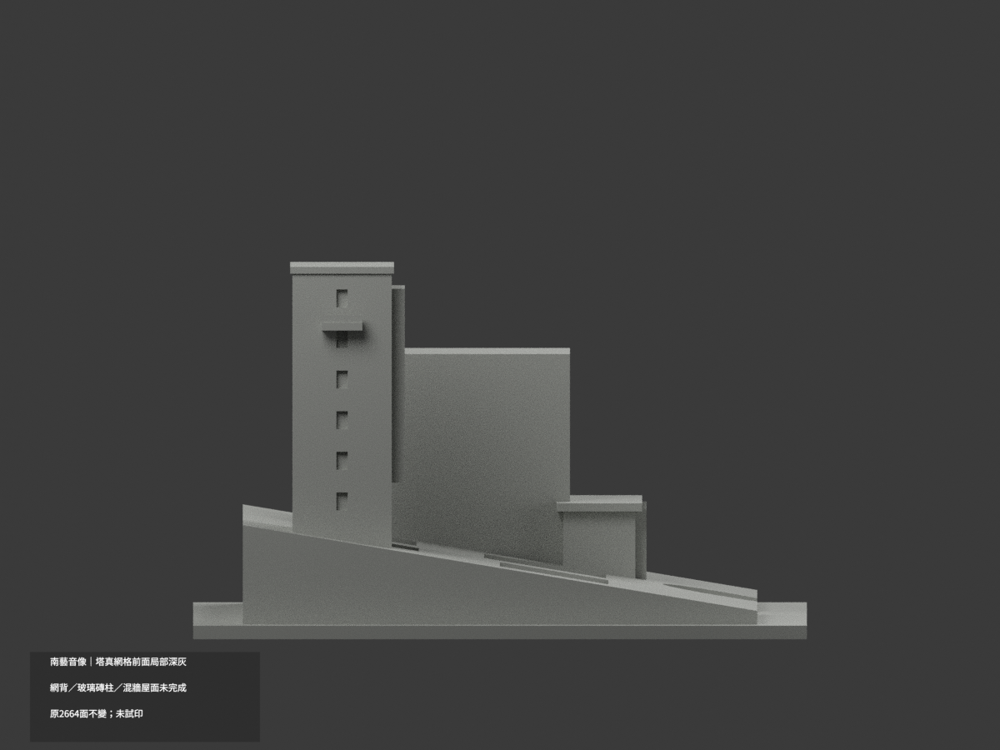
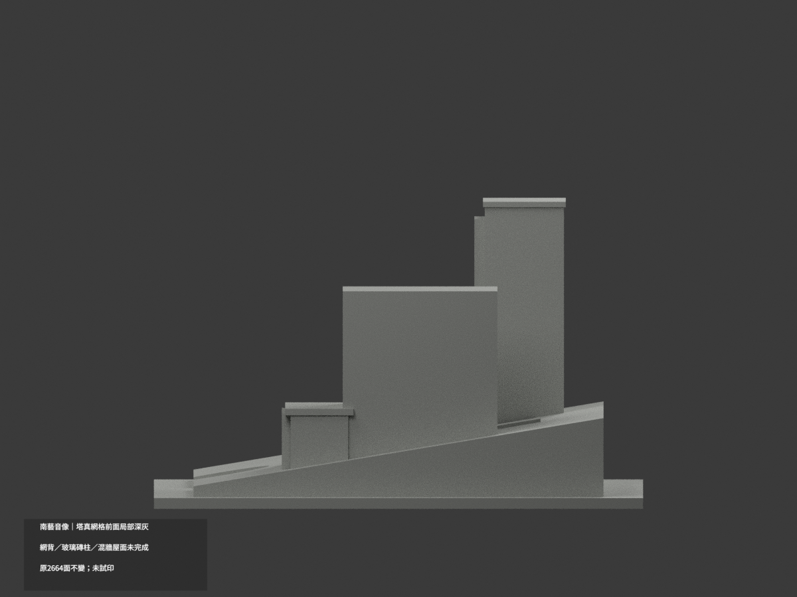
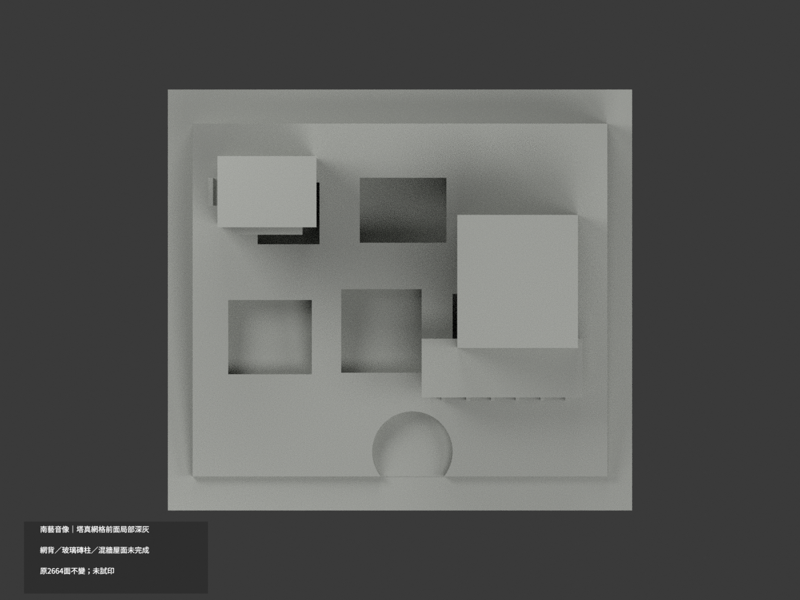
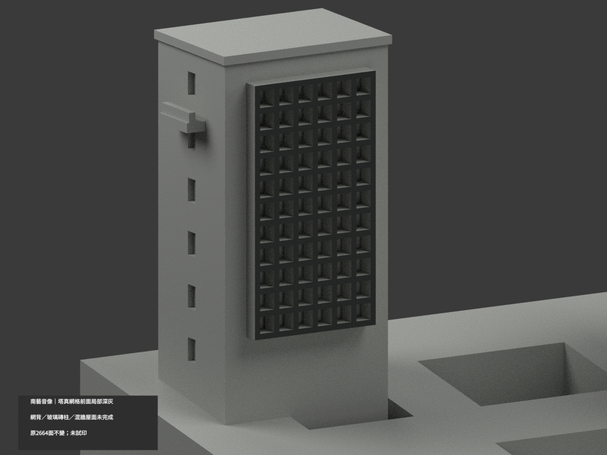
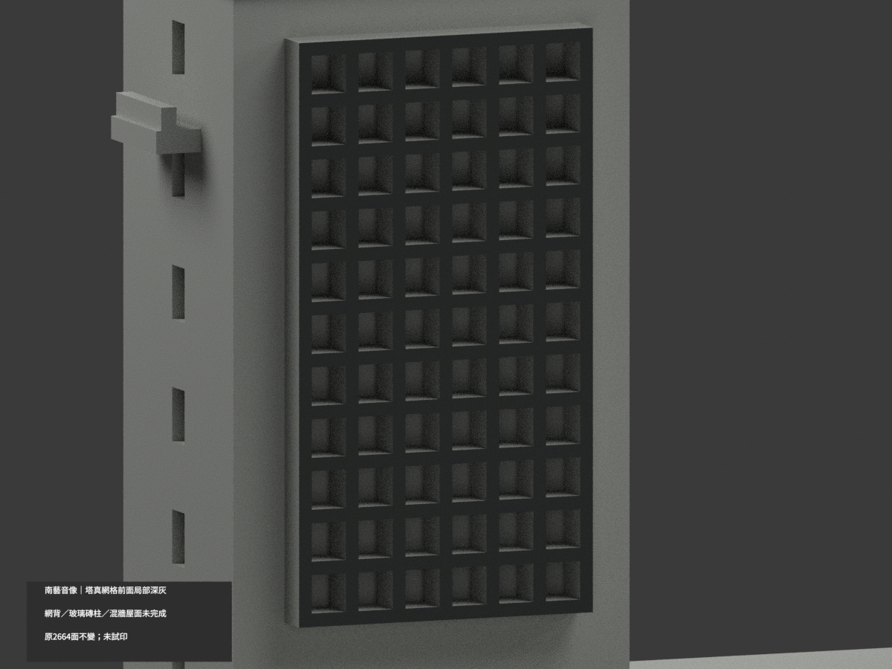
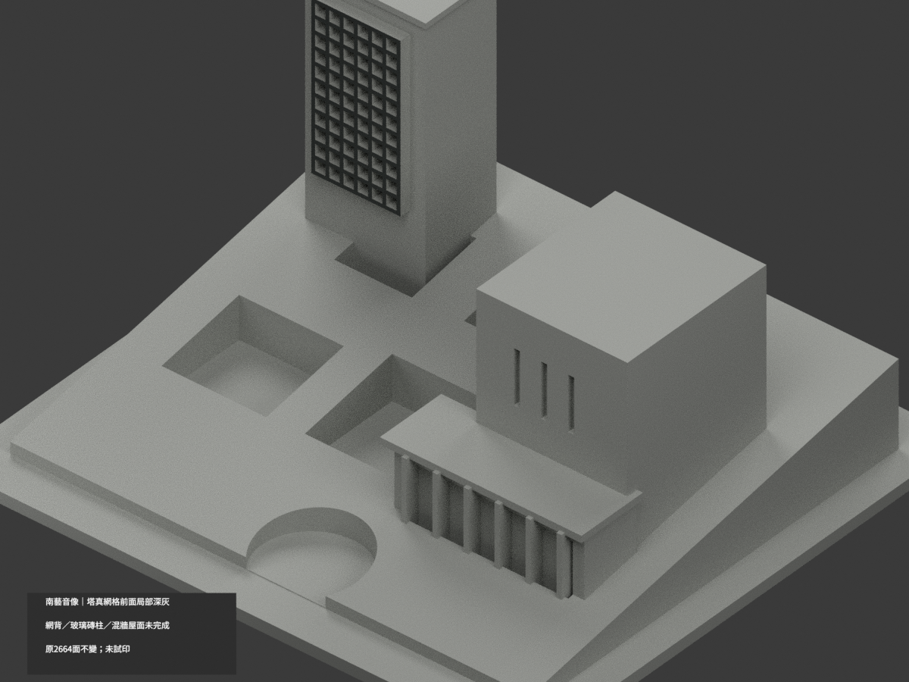

# 南藝音像｜塔外真網格前面局部深灰

**網背、玻璃磚柱、混材塔壁與屋面未完成分色。** `partial_color_incomplete=true`、`fully_colored_exterior=false`。只422真網格前面，非全色重建。

| 總覽 | 背側 | 正面 |
|---|---|---|
||||
||||
||||
||||

## 材色範圍
同 `tnnua-sound-image` 原項目，same-item、count_delta=0。**2664原三角面、STL與build_model.py字節不變**，不切面／新增幾何。原公開包無OBJ，不假稱保留。
- 塔外獨立金屬網格完整前面 y21.1、x−54.5..−31.5、z34..77，422原面名義深灰。包含所有既有豎橫網格的正面，不依陰影深淺任選三角。
- 其餘2242面中性：網格側／內／頂底、整片背板代理、混材塔牆、劇場皮、低入口玻璃磚柱／灰基座混面、玻璃與細窗代理、景觀斜屋、庭院、階及後部。
- 602共面連通域均一，0候選撤色。照片的外網／支架不是單片玻璃，不把背板全塗深色；原粗柱缺玻璃磚與基座界，不染整白或整藍。
- 材色／中性界是證據範圍，非真實材接縫；補色不追認原近似造型、坡度或窗格精度。

## 來源／日期與權利
三張官方外觀照片已實看。拍攝日期未證；DateTime2022是修改資訊，不獨立證明拍攝日期，官頁2026檢視也不是現況精測。
原照私人保存，不公開／貼圖；未確認CC／再散布授權，不保證商用。HEX為名義灰色族，非校準色票。
最終GO是有界來源放行，不是發布核准，也不免除建模QA；繼承的notformal文句僅先期review。

## 格式與列印
[原STL](model.stl) · [逐面材色3MF](appearance.3mf) · [Blender](scene.blend)
150×136mm原展示底座，照片近似非精測比例。STL無色；3MF與Blender真面材。兩材標籤非驗證兩色／四色耗材切片；**未實際列印**，無切片路徑。

## 重建與 QA
原 `build_model.py` → `colorize_model.py` → `export_appearance.py` → `validate_color.py`；Blender `render_color.py`／`verify_color_scene.py`。
原字節／三角multiset、閉合正體積、3MF逐面材、完整隔離原build＋color重建、scene重開、十圖1200×900與圖文hash核對；程序不取代人工來源核。
原README、單色previews／render／validation保留歷程，不冒充新QA，無刪檔。

## English scope
Partial color only:422 existing outward fronts of the tower's independent metal grid darkgray. All2242 other triangles neutral, including gridback/edges, glass-block column proxies, mixed tower walls and roof. Original2664 triangles unchanged; no original OBJ in immutable package. Capture dates unknown;2022modification and2026page inspection are not capture evidence. No geometry corrections, full-color claim, test print or verified filament slicing.
