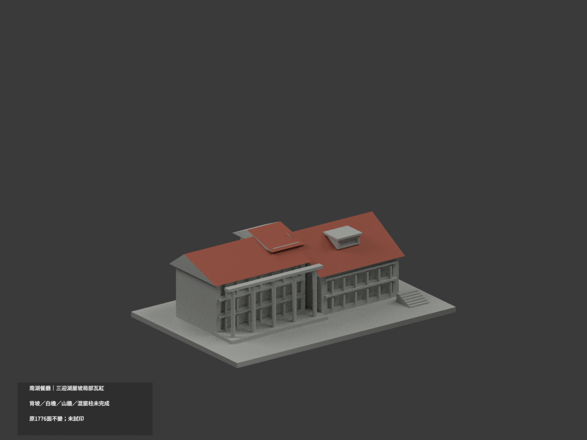
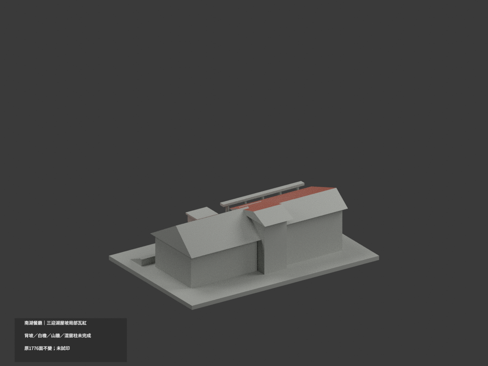
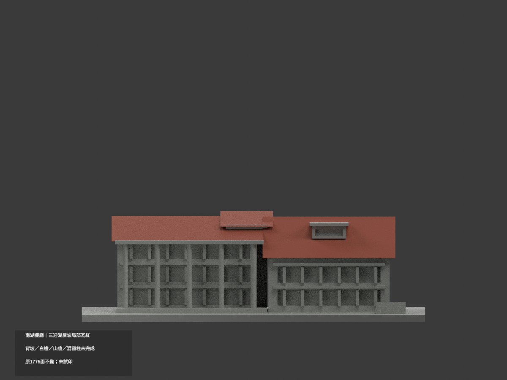
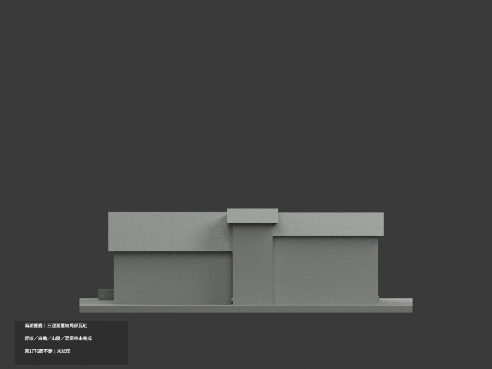
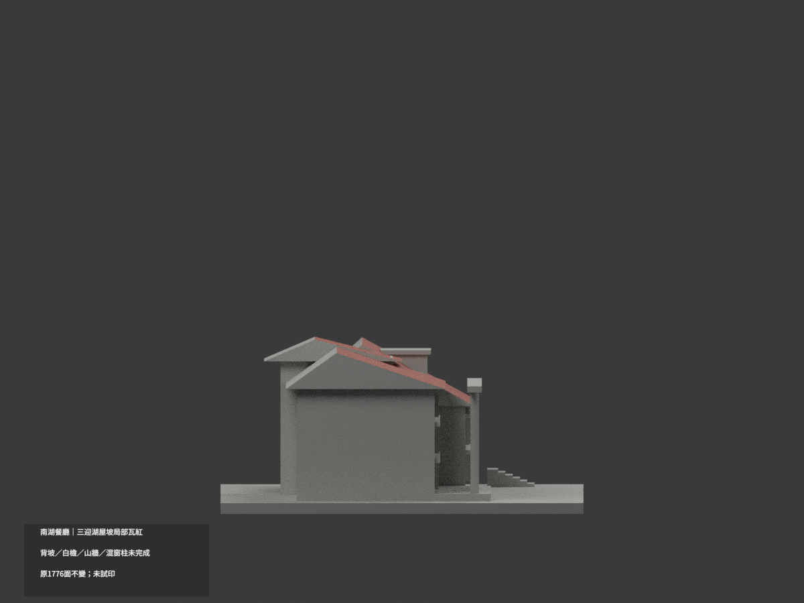
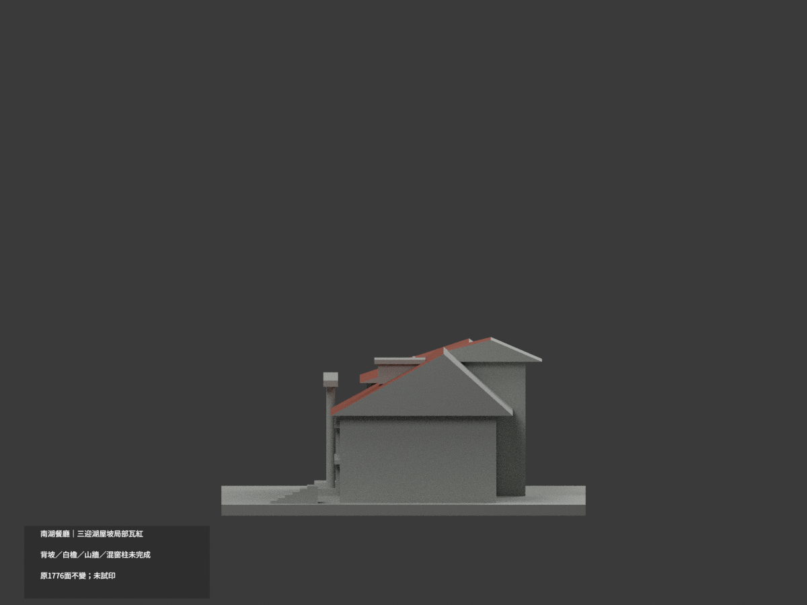
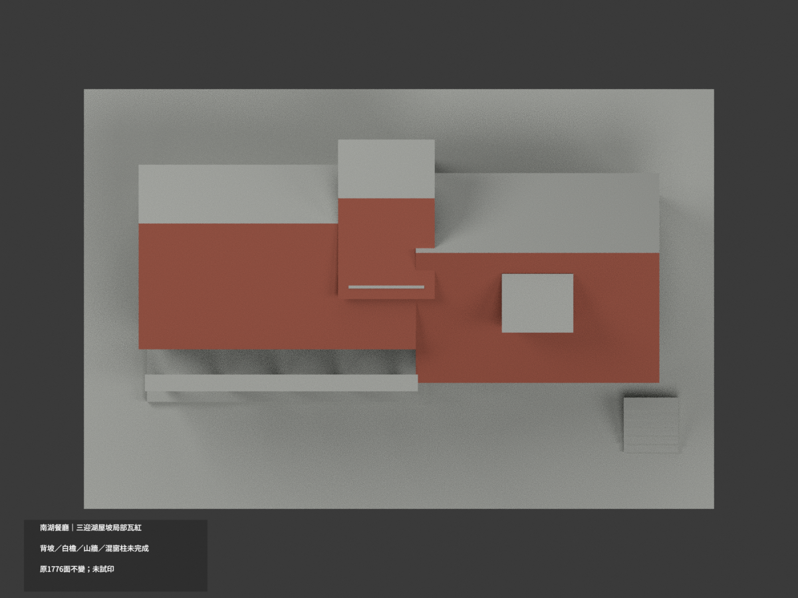
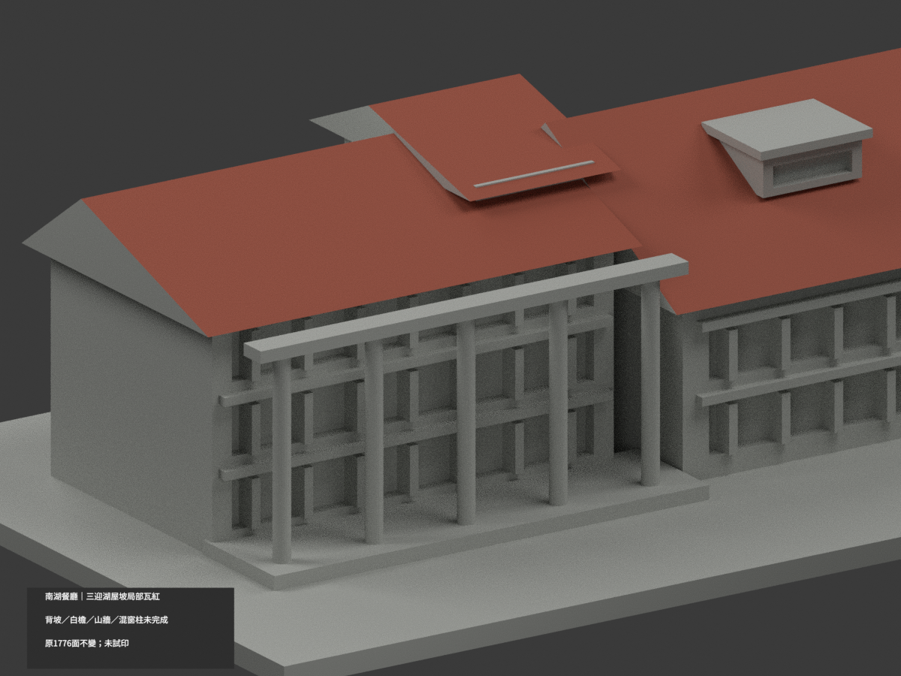
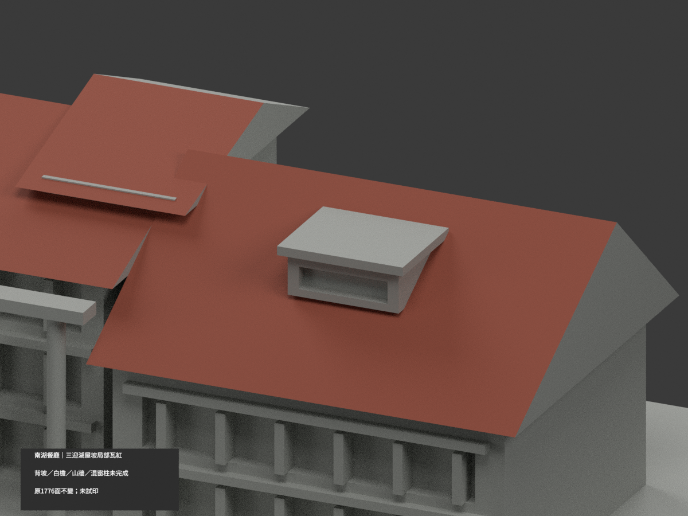
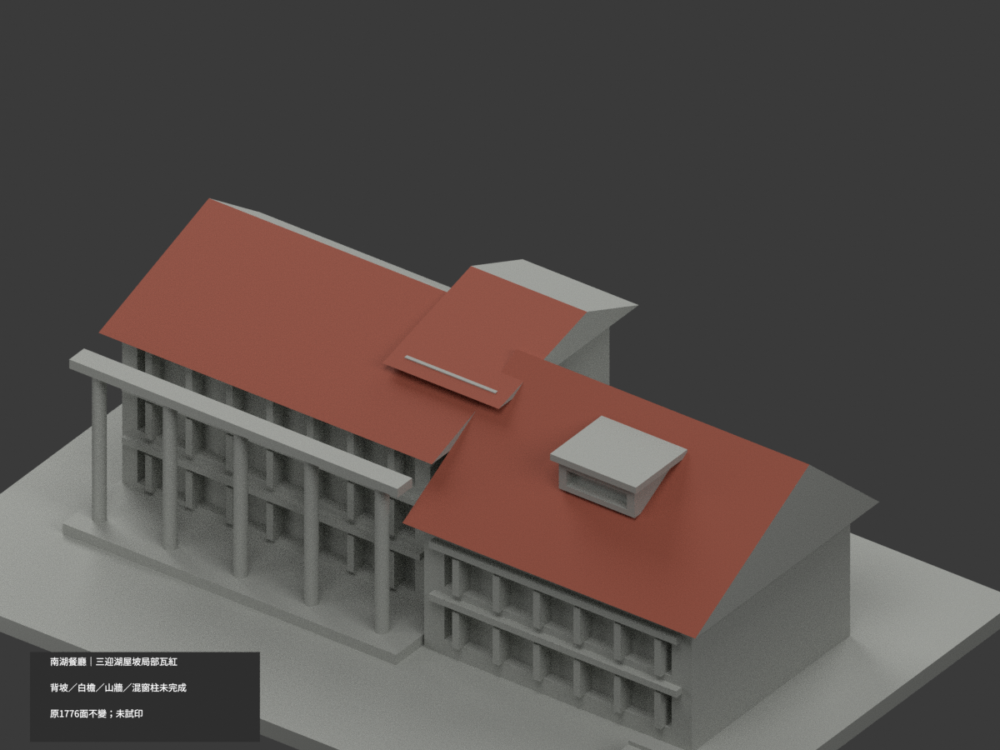

# 南湖餐廳｜三迎湖屋坡局部瓦紅

**背坡、白檐、山牆與混材窗柱未完成分色。** `partial_color_incomplete=true`、`fully_colored_exterior=false`。只三迎湖坡39原面，非全色重建。

| 總覽 | 背側 | 正面 |
|---|---|---|
||||
||||
||||
||||

## 材色範圍
同 `tnnua-south-lake-restaurant` 原項目，same-item、count_delta=0。**1776原三角面、STL與build_model.py字節不變**，不切面／新增瓦片；原公開包無OBJ，不假稱保留。
- 左迎湖坡 z=y/3+38，x−62..4、y−12..18，7原面瓦紅。
- 右迎湖坡 z=(17/31)y+37.96774193548，x4..62、y−20..11，20原面瓦紅，包含凸窗及體量交切後細面。
- 中央高坡 z=.25y+40，x−14.5..8.5、y0..24，12原面瓦紅。
- 逐面全頂點必須落原有限坡plane及xy界；不採法線門檻／中心點以免漏Boolean細面，不切面補色。
- 其餘1737面中性：後坡、山牆、屋底／白灰檐、凸窗牆／窗背／帽，混磚白柱、玻璃粗框代理、樓帶／下牆、平台階及未證背面。湖橋不新增。
- 全515共面連通域均一、0撤色；材色／中性界是來源範圍，不是真實材接縫。補色不追認原屋形／窗格近似精度。

## 來源／日期與權利
兩跨湖已建外觀照片已親看，拍攝日期未知，不稱2026現況精測。背坡不由前坡紅色推定同色。
原照私人保存，不公開／貼圖；未確認CC／再散布授權，不保證商用。HEX只名義瓦紅色族，非校準色票或污斑復原。
來源GO是有界放行，不是發布核准，也不免除建模QA；繼承notformal字句僅先期review。

## 格式與列印
[原STL](model.stl) · [逐面材色3MF](appearance.3mf) · [Blender](scene.blend)
150×100mm原展示底座，照片近似非精測比例。STL無色；3MF／Blender真逐面材。兩材標籤不是驗證兩色／四色耗材切片；**未實際列印**，無切片路徑。

## 重建與 QA
原 `build_model.py` → `colorize_model.py` → `export_appearance.py` → `validate_color.py`；Blender `render_color.py`／`verify_color_scene.py`。
原字節／三角multiset、閉合正體積、3MF面材、完整隔離原build＋color重建、scene重開、十圖1200×900與圖文hash核對；程序不取代人工來源核。
原README、單色previews／render／validation保留歷程，不冒充新QA；沒有刪檔。

## English scope
Partial color:39 original faces on three lake-facing pitches (7/20/12) nominalterracotta. All1737 remaining triangles neutral, including rear pitches, gables, whiteeaves, dormer cap, mixed columns/windowbacks. Exact finite-plane allvertex membership includes Boolean-trimmed roof triangles without normal shortcuts. Original1776 triangles unchanged; no original OBJ in immutable package. Capture dates unknown. Not testprinted or verifiedfilament slicing.
