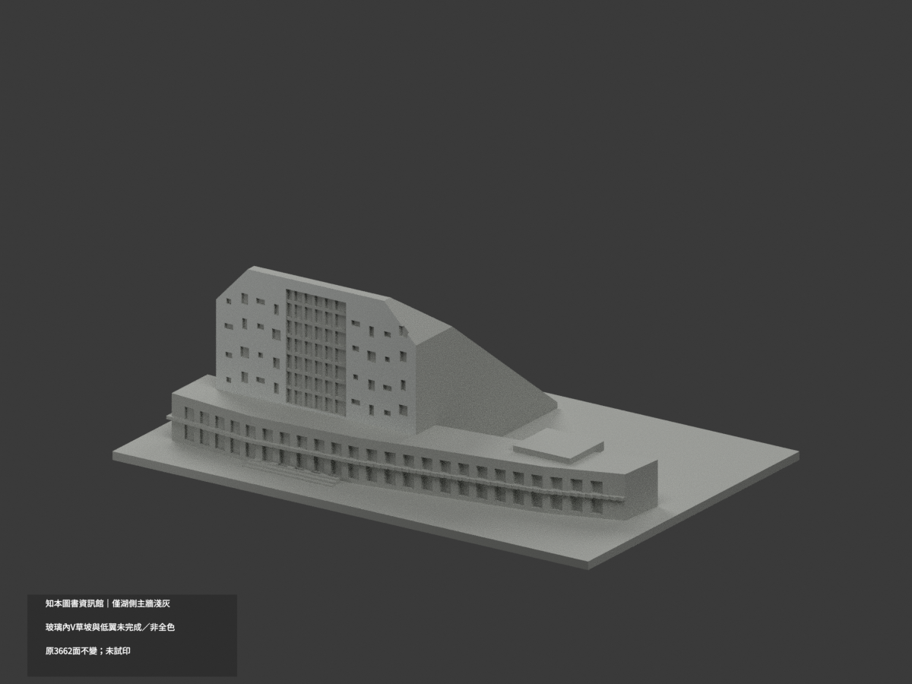
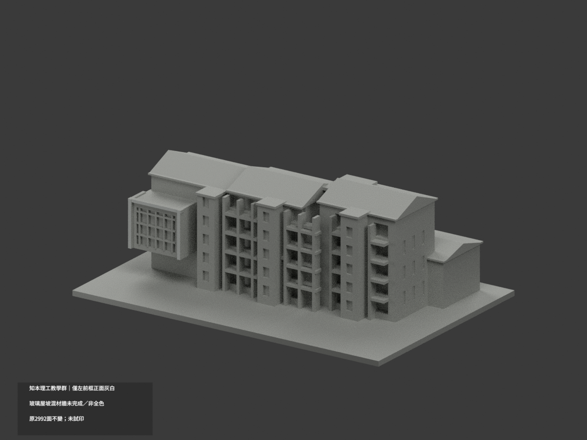
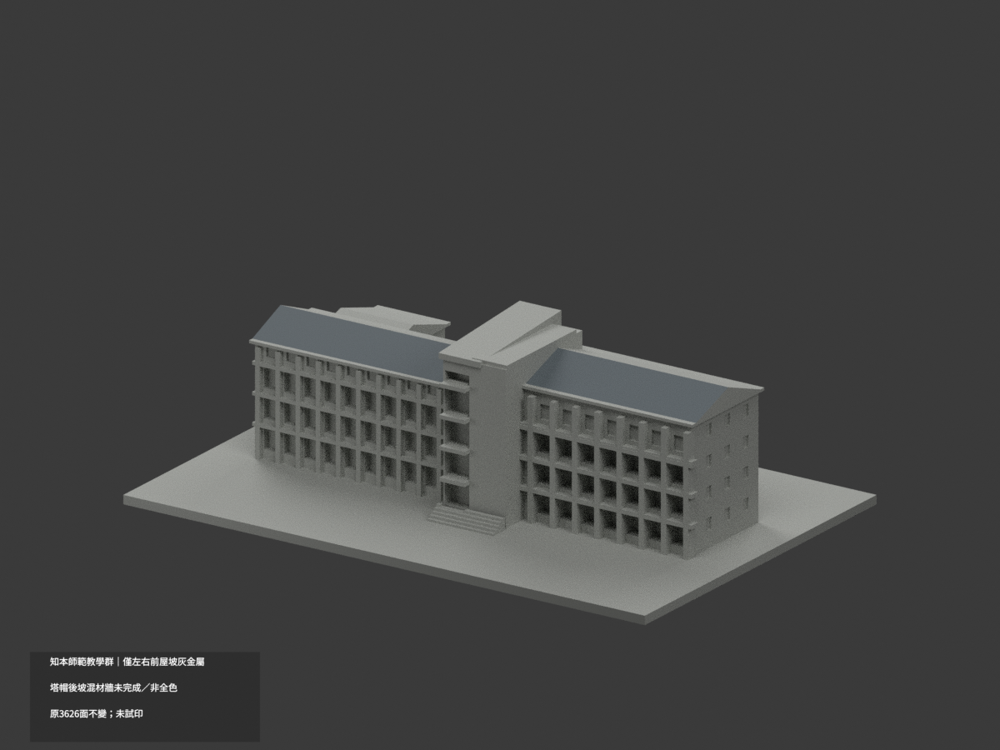
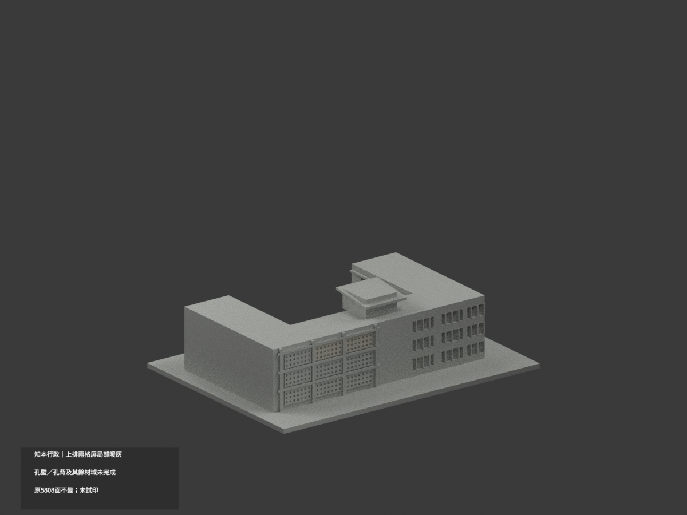
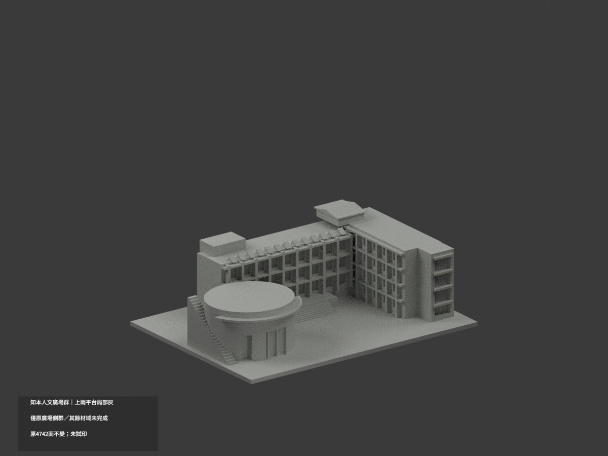
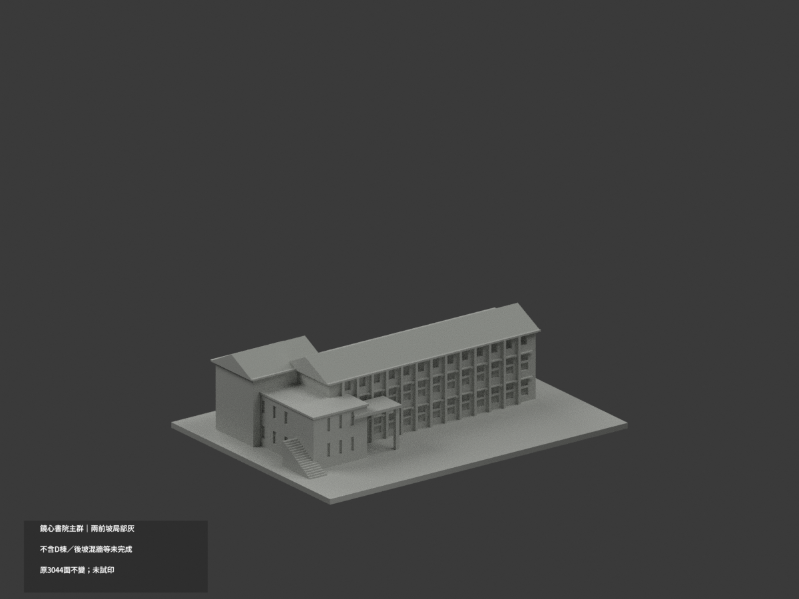
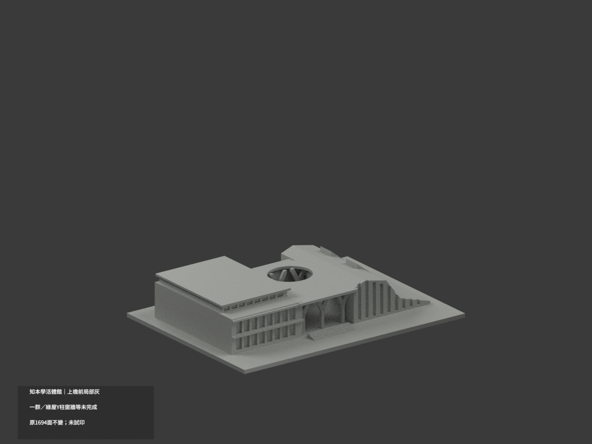
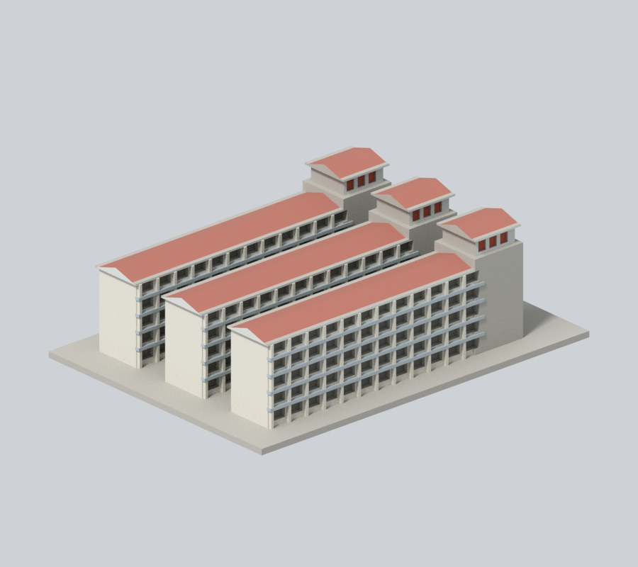
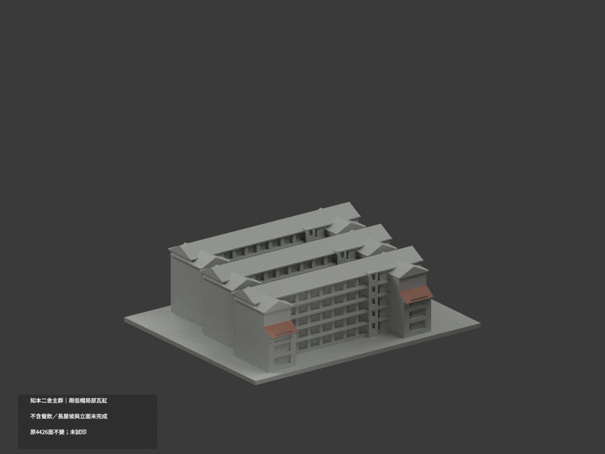
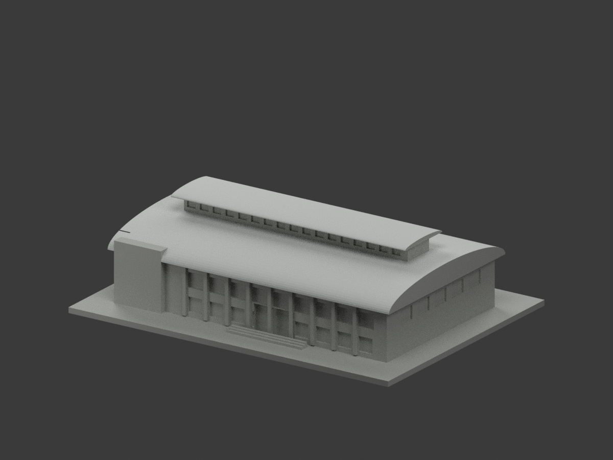

# 國立臺東大學 知本校區

本輪核准的外觀近似模型套件；全校尚未完成。套件可能包含相連群組、局部或歷史外觀，件數不等於完整建築棟數。未正式切片、未生成經驗證G-code、未實體試印。各件警示、來源年代、背面簡化及支撐需求請讀詳頁。只公開來源URL，不散布原照片或PDF。

| 建築／模型 | 建築／模型 | 建築／模型 |
|---|---|---|
| [圖書資訊館](buildings/zhiben-library-information/README.md)  [資料夾](buildings/zhiben-library-information) [局部材色3MF](buildings/zhiben-library-information/appearance.3mf) · [範圍與限制](buildings/zhiben-library-information/README.md) | [理工學院主要教學棟](buildings/zhiben-science-engineering/README.md)  [資料夾](buildings/zhiben-science-engineering) [局部材色3MF](buildings/zhiben-science-engineering/appearance.3mf) · [範圍與限制](buildings/zhiben-science-engineering/README.md) | [師範學院主要教學棟](buildings/zhiben-teachers-college/README.md)  [資料夾](buildings/zhiben-teachers-college) [局部材色3MF](buildings/zhiben-teachers-college/appearance.3mf) · [範圍與限制](buildings/zhiben-teachers-college/README.md) |
| [行政服務大樓](buildings/zhiben-administration/README.md)  [資料夾](buildings/zhiben-administration) [局部材色3MF](buildings/zhiben-administration/appearance.3mf) · [範圍與限制](buildings/zhiben-administration/README.md) | [人文學院廣場側棟群暨演藝廳](buildings/zhiben-humanities-plaza-complex/README.md)  [資料夾](buildings/zhiben-humanities-plaza-complex) [局部材色3MF](buildings/zhiben-humanities-plaza-complex/appearance.3mf) · [範圍與限制](buildings/zhiben-humanities-plaza-complex/README.md) | [鏡心書院主要教學棟](buildings/zhiben-jinsin-academy-main/README.md)  [資料夾](buildings/zhiben-jinsin-academy-main) [局部材色3MF](buildings/zhiben-jinsin-academy-main/appearance.3mf) · [範圍與限制](buildings/zhiben-jinsin-academy-main/README.md) |
| [學生活動中心暨綜合體育館](buildings/zhiben-student-union-sports/README.md)  [資料夾](buildings/zhiben-student-union-sports) [局部材色3MF](buildings/zhiben-student-union-sports/appearance.3mf) · [範圍與限制](buildings/zhiben-student-union-sports/README.md) | [第一學生宿舍主要棟群](buildings/zhiben-first-dormitory/README.md)  [資料夾](buildings/zhiben-first-dormitory) | [第二學生宿舍主要棟群](buildings/zhiben-second-dormitory/README.md)  [資料夾](buildings/zhiben-second-dormitory) [局部材色3MF](buildings/zhiben-second-dormitory/appearance.3mf) · [範圍與限制](buildings/zhiben-second-dormitory/README.md) |
| [第二宿舍旁餐飲中心](buildings/zhiben-dining-centre/README.md)  [資料夾](buildings/zhiben-dining-centre) [局部材色3MF](buildings/zhiben-dining-centre/appearance.3mf) · [範圍與限制](buildings/zhiben-dining-centre/README.md) |  |  |
