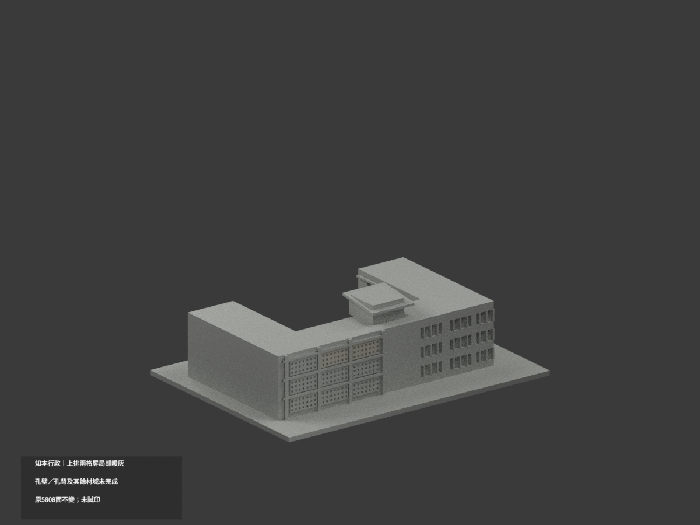
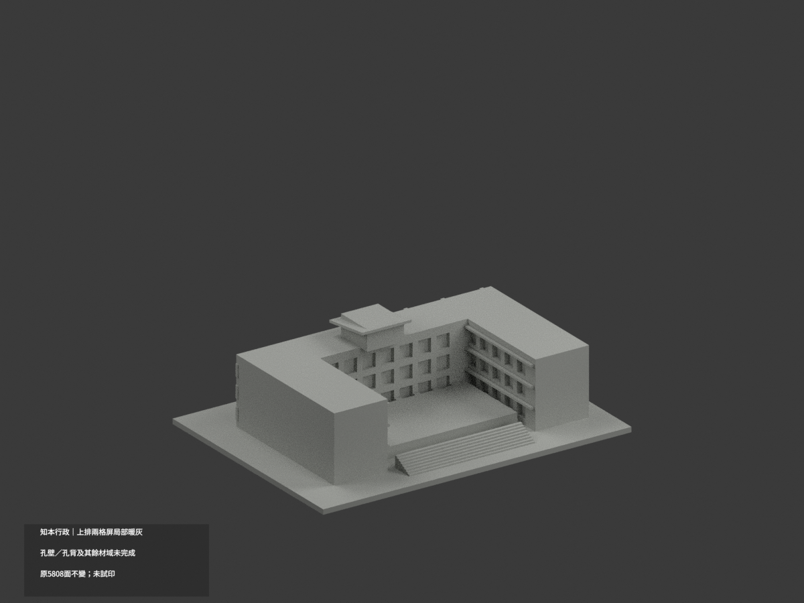
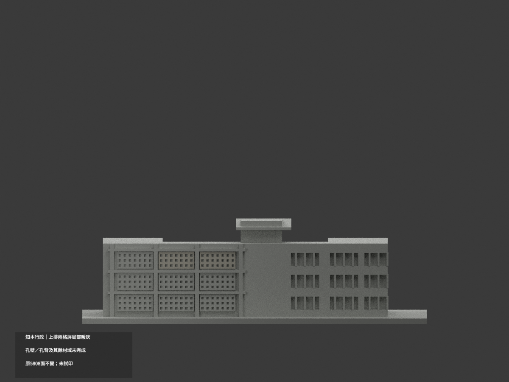
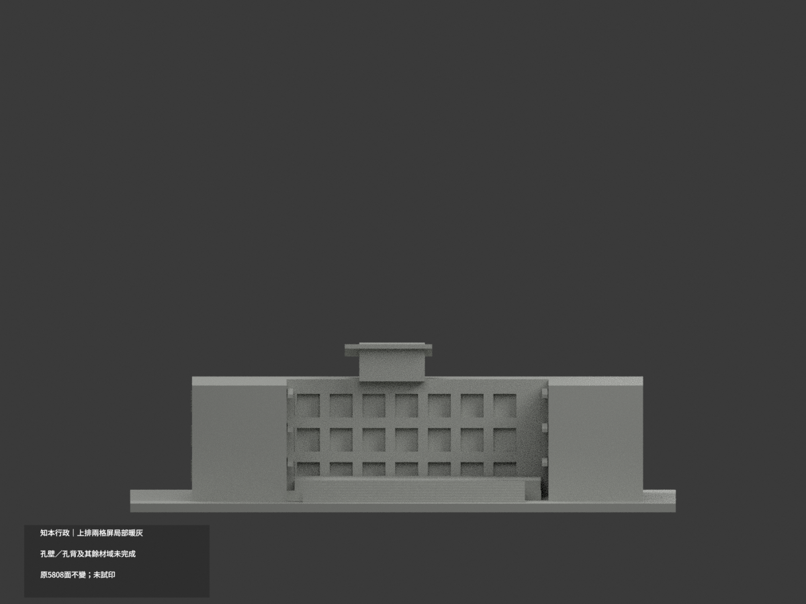
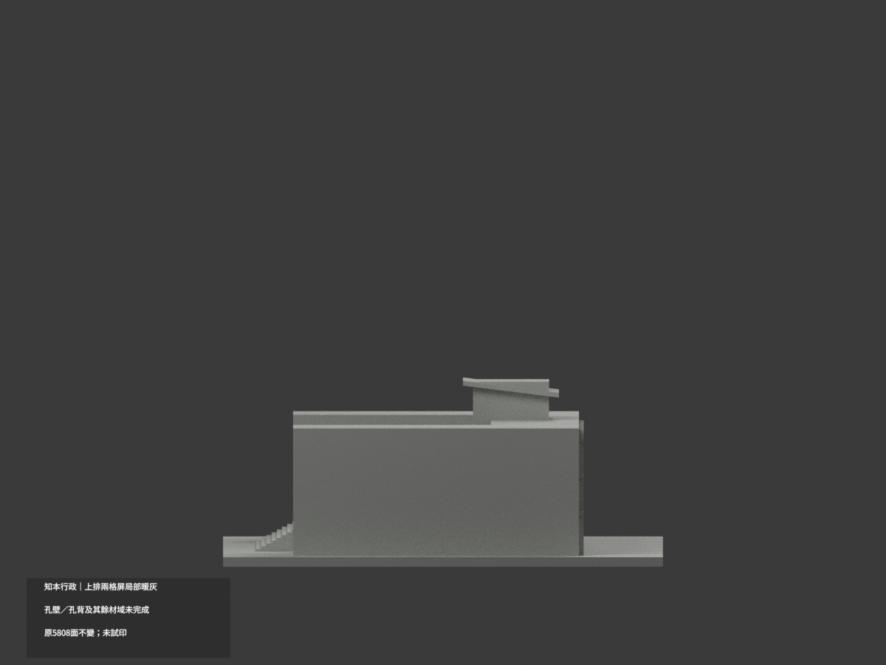
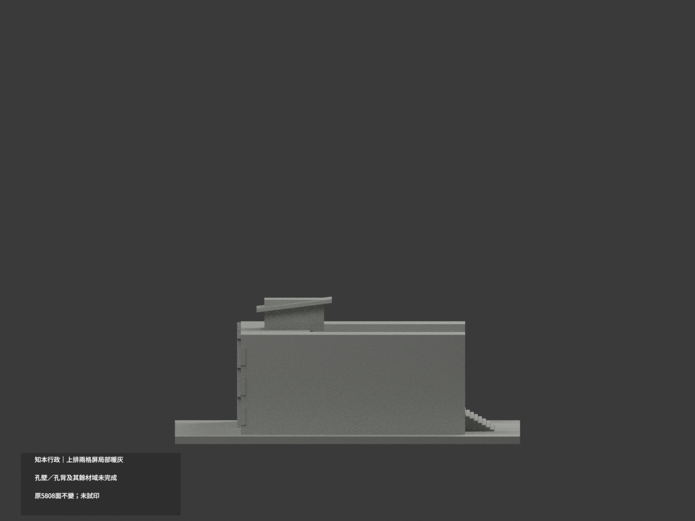
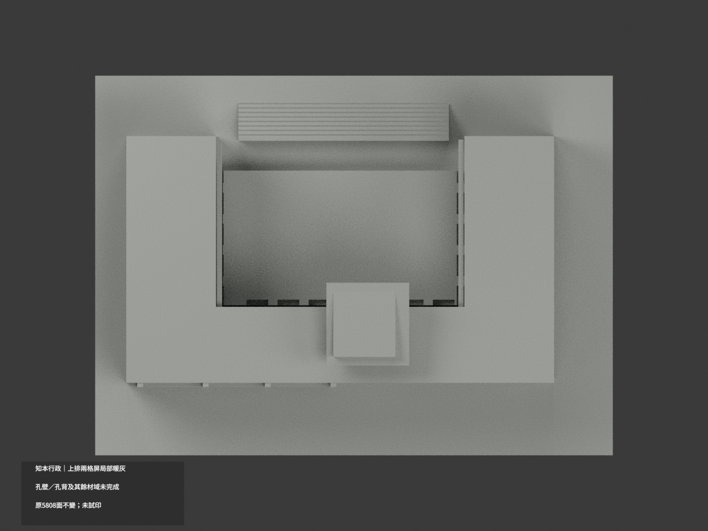
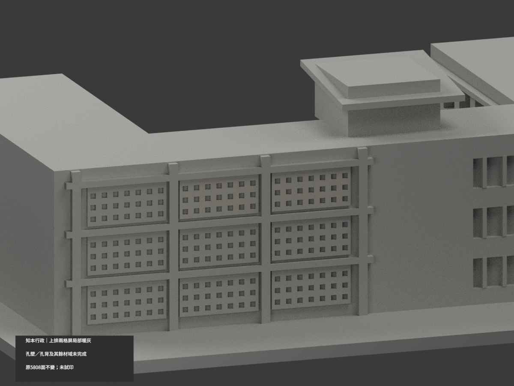
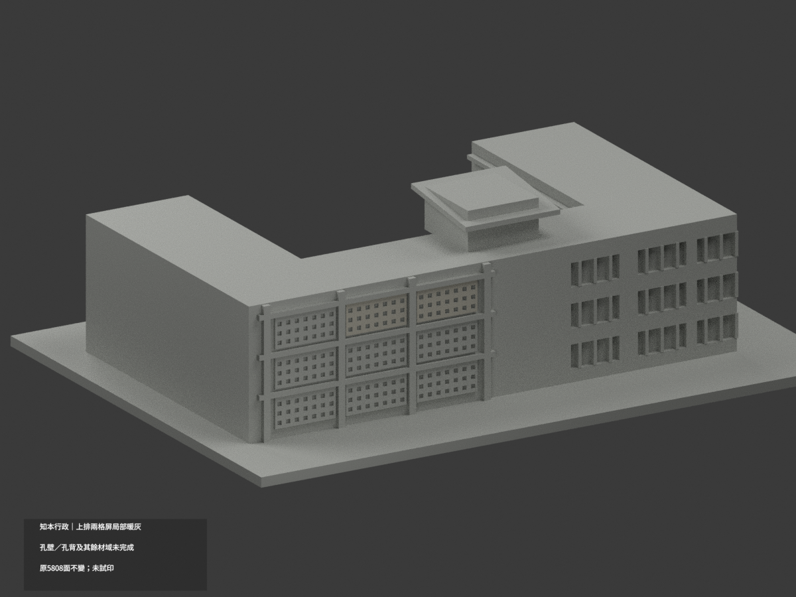
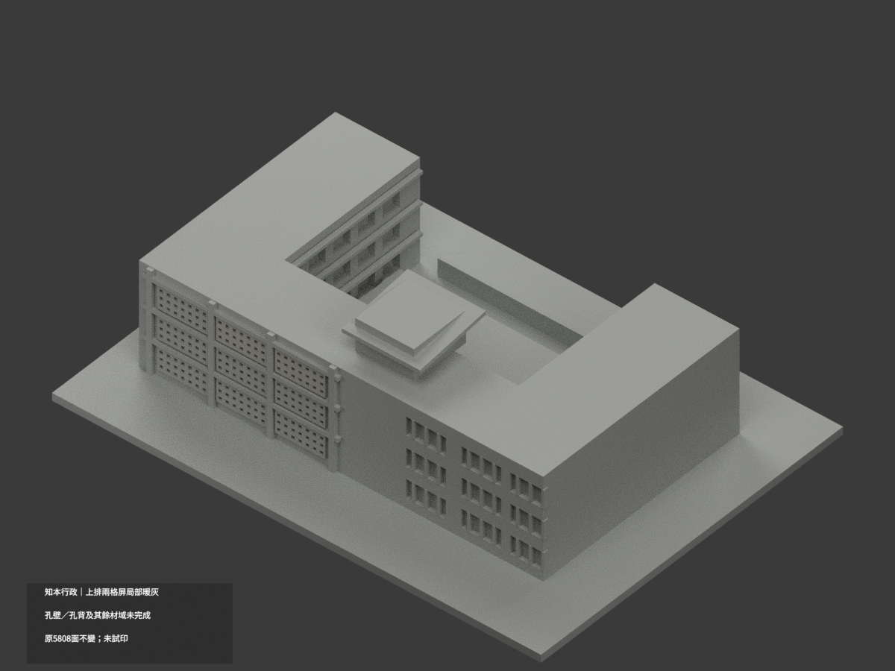

# 臺東大學知本行政｜上排兩格屏局部暖灰

**孔壁、孔背與其餘材域未完成分色。** partial_color_incomplete=true、fully_colored_exterior=false。僅兩片原格屏正面實料局部暖灰，非全棟完成；位於知本校區，非臺東市區。

| 總覽 | 背側 | 正面 |
|---|---|---|
||||
||||
||||
||||

## 材色範圍
同 zhiben-administration 原項目，same-item、count_delta=0。5808原三角面、STL與build_model.py字節不變，不切面、不增文字／格孔。原公開包無OBJ，不因其他建模流程而假稱保留。
- 僅最高排中央與右兩片格屏，完整外前面y−34.7，中心x−34/−16、原寬15.4、高z23.4..30.8。各128原Boolean三角，共256面淺暖灰。所有三頂點符合有限plane；另以整plane共享邊連通域核兩個完整構件，沒有任切三角。
- 其餘5552中性：另7片格屏、全部孔壁／孔背、前柱橫帶混遮蔽域、右窗混灰框／褐板、金字牆、斜塔帽／未知屋頂、院廊／階／底座／背面。陰影不當黑材。
- 原粗化格孔數／加厚與院內簡化牆窗欄板全部保留，不依新照片矯正。色／中性界限是證據範圍，不是真實材接縫，補色不背書原比例為精測。

## 來源與日期
僅使用校方正面與建築師已建成內院外觀兩實照，未用概念模型圖，不涉及室內資料。拍攝日未知；EXIF306的2013／2009是修改metadata而非已驗證capture，不聲稱2026現況。
原照片私人參考、不公開、不貼圖；未確認CC或再散布授權，不保證商用。HEX僅名義暖灰族，非校準色票。正式GO覆蓋先期review-only文字，不免builder QA。

## 格式與列印
[原STL](model.stl) · [逐面材色3MF](appearance.3mf) · [Blender](scene.blend)
原150×110mm展示底座，照片近似非測量比例。STL無色；3MF／Blender有真逐面材。兩材標籤不是驗證兩色／四色耗材切片，未實際列印，無切片路徑。

## 重建與 QA
原build_model.py → colorize_model.py → export_appearance.py → validate_color.py；Blender render_color.py／verify_color_scene.py。完整隔離原build＋color重建、原bytes／全三角multiset、閉合正體積、3MF逐面材、scene重開、十圖1200×900及圖文hash。原依賴版本隔離使用，不改原碼；程序不替代人工來源核對。
原README／previews／validation／renderer保留歷程，不冒充新QA；沒有刪檔。

## English scope
Partial only:256 front material triangles of two complete upper perforated screens lightwarmgray;5552 unverified faces neutral. Original5808triangles unchanged;no originalOBJ. Screen openingcounts/thickening andcourtyard approximategeometry retained. No recesswall/back recoloring,no newletters. Zhiben campus,not downtownTaitung. Captureunknown;EXIFmodification notcapture. Not fullcurrent survey,not testprinted or validatedfilament slicing.

## 版本 2 名稱勘誤

3MF 與 Blender 物件顯示名稱統一更正為「Zhiben Administration partial color」，並同步匯出、渲染與驗證程式的名稱。場景重新開啟與保存後，除物件名稱及非渲染執行期記錄外，網格、材質、變換、相機、燈光與字幕語義完全相同；場景檔案雜湊因此更新。原 STL、材色陣列與十張預覽位元不變，未重新渲染。原有局部補色及未試印限制不變。
