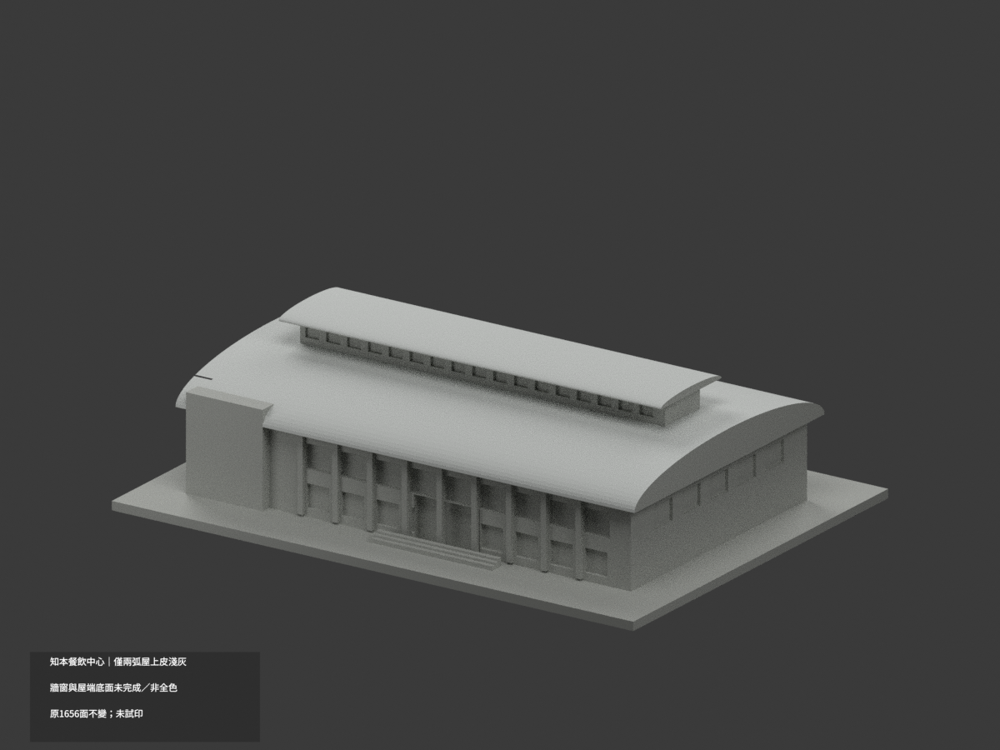
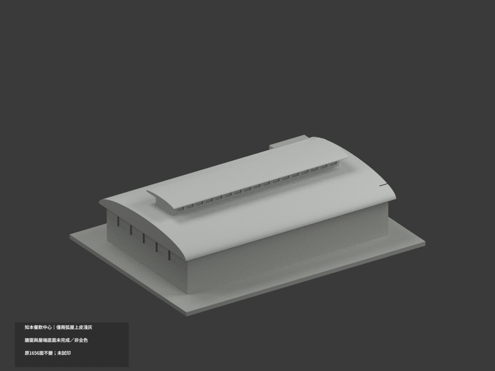
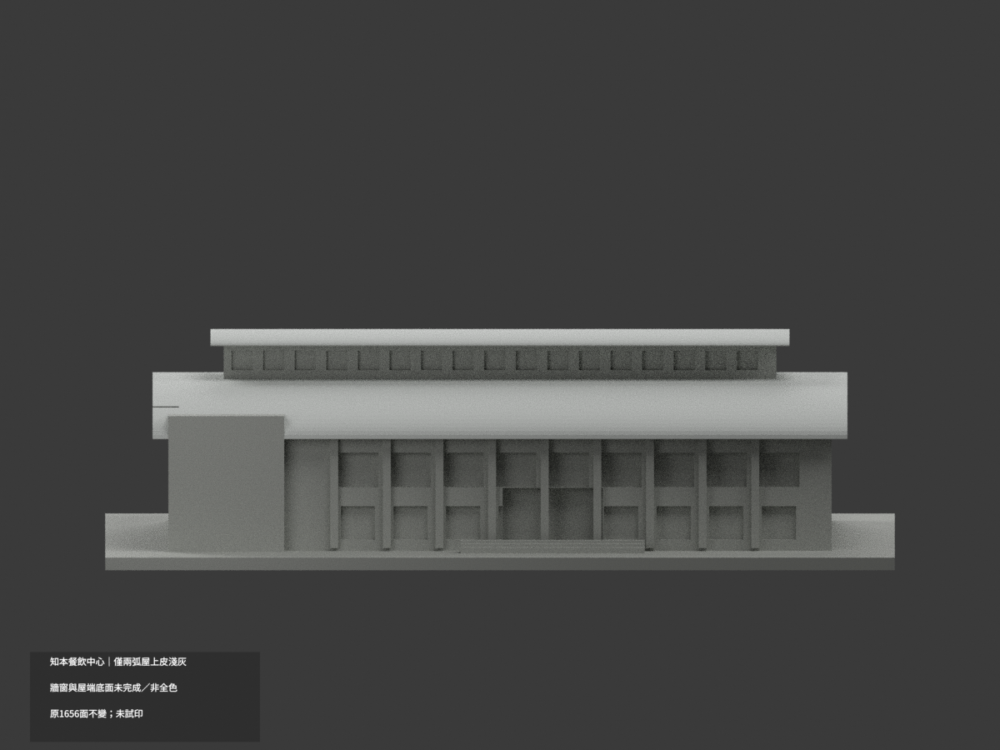
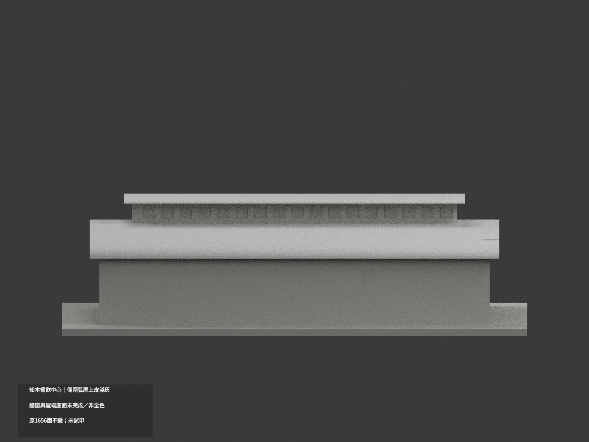
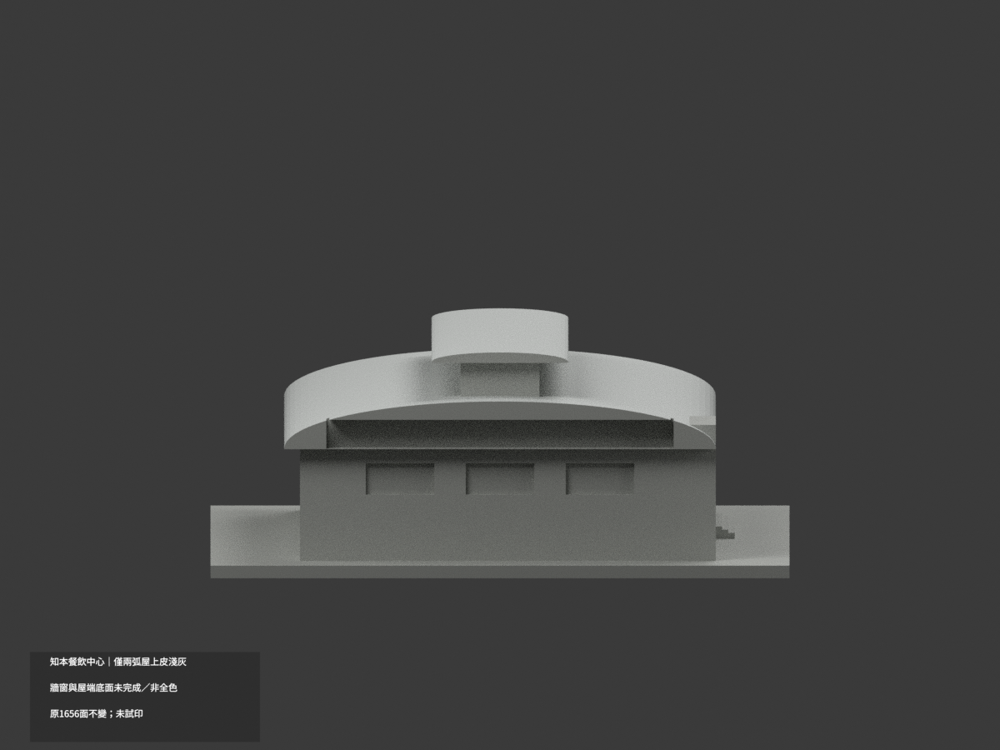
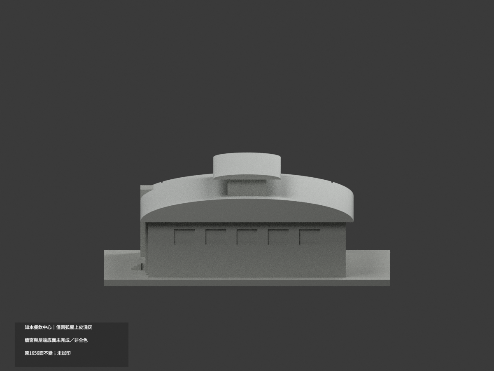
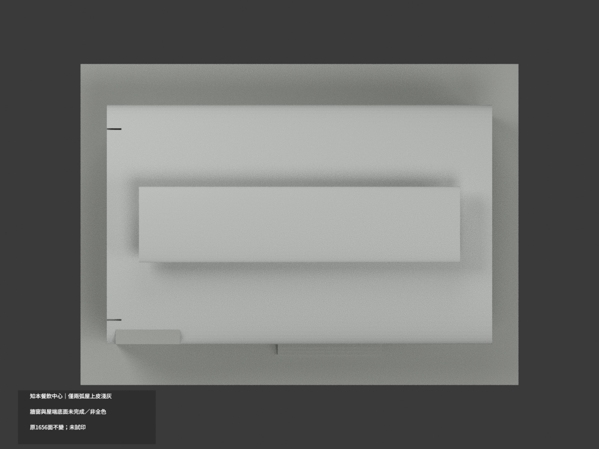
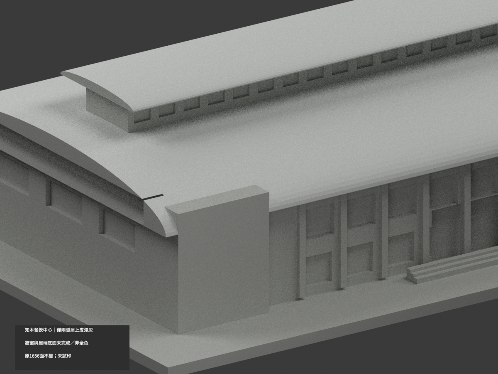
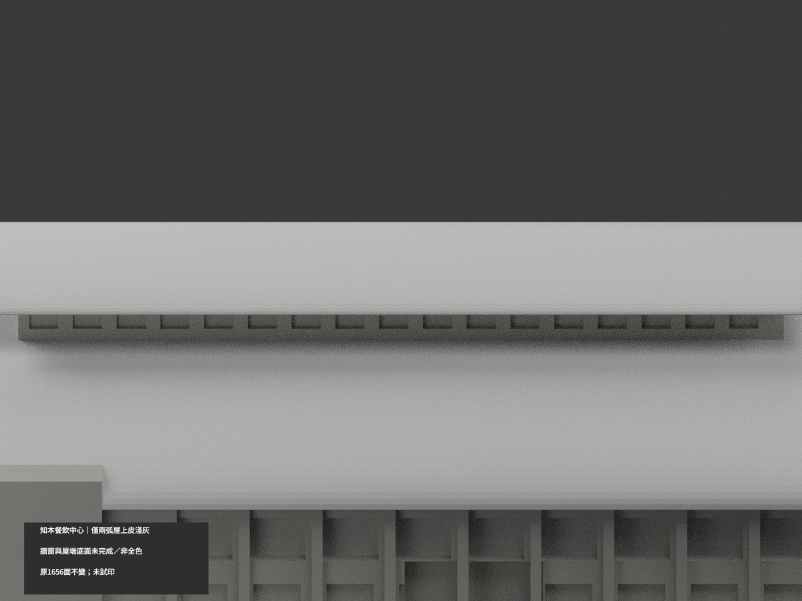
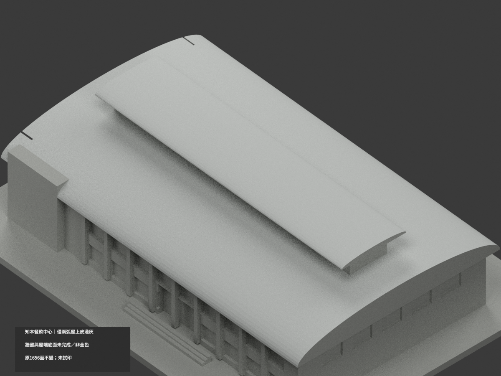

# 知本餐飲中心｜兩弧屋上皮局部淺灰

**局部補色未完成：僅主弧屋與頂帽上皮160原三角淺灰；牆窗與屋端底面未完成／非全色。** partial_color_incomplete=true、fully_colored_exterior=false。同項 zhiben-dining-centre，count_delta=0。保留原單一獨立餐飲中心外觀近似，不是宿舍低翼、體育館或2026現況測繪。

| 前斜視 | 後斜視 | 正面 |
|---|---|---|
|  |  |  |
|  |  |  |
|  |  |  |
|  | | |

## 材色範圍

主弧屋由原40段sampled yz弦面組成，半寬x66、y半徑41、基準z24與起拱9；頂帽原20段、半寬x55、y半徑13、基準z39.7與起拱1.8。每個原弦面以有限plane、tangent及全x界線核所有三頂點，逐一枚舉完整共面域，不以normal或面心切色。主皮120、頂帽40，共160原面淺灰；其他1496中性。Boolean開孔殘面全部保留，原1656三角不改、不補面。

屋端、厚邊、底面、天窗牆/窗背、左招牌實塊、樹遮下牆、柱、平台階梯及未知面均中性。中性不是實景灰，也不代表與已證上皮有真正材質接縫。只名義淺灰覆層色族，不是反射率、精準色票、板縫紋理或實測建物尺寸。

## 來源與限制

親看校方實景外照與空照，辨識第二宿舍旁右側獨立低弧屋餐飲中心，不把空照左上運動館當同棟。空照只支援廣域屋上皮色族，不支援細牆窗。兩照拍攝日期未核，不宣2026現況。照片及原資料只私人參考，不公開貼圖，未見CC不推商用授權。原單棟、主弧屋與高採光條形體近似保留，本次補色不追認原幾何精確性。

## 檔案與 QA

原STL與build_model.py字節、1656完整三角不變。Immutable原包無OBJ，原builder亦只輸出STL，不新增原OBJ聲稱。原README保留ORIGINAL-MONOCHROME-README.md，舊previews/QA為單色歷程不替代本次QA。appearance.3mf兩展示材、scene.blend真面材、color-mesh.npz保持原幾何。依原requirements隔離build+color，驗3MF三角/材色、封閉正體積、重開Blender與10張1200×900。隔離重建保留不刪；未實際列印，非已驗多色切片。

## English limitations

Partial only: 120 original upper main-roof triangles and 40 raised-cap upper triangles in nominal pale gray; 1496 other triangles neutral. Finite sampled yz chord plane, tangent and full extrusion bounds apply to every vertex; each entire coplanar domain is retained, not a centroid or normal-based paint cut. All 1656 original triangles and original STL/build bytes remain unchanged. No immutable OBJ exists. Roof ends, thickness, underside, clerestory walls/windows, sign block, lower walls, piers, ground and stairs are unverified neutral. The school exterior and aerial photographs support broad upper-skin color only. Capture dates unknown; no 2026 current-state claim. One independent dining centre beside the dormitory, not the dormitory wing or athletics facility. Original coarse geometry is not re-certified by color review. No source photos or textures are public. Count_delta=0; not test printed or validated for multicolor slicing.
