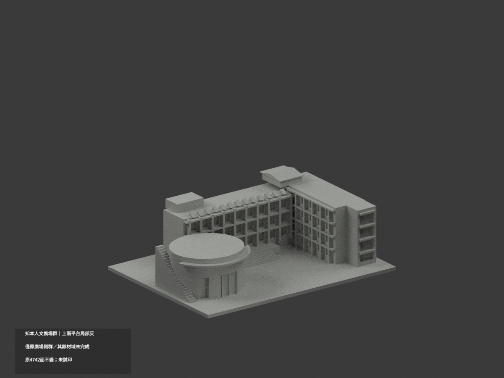
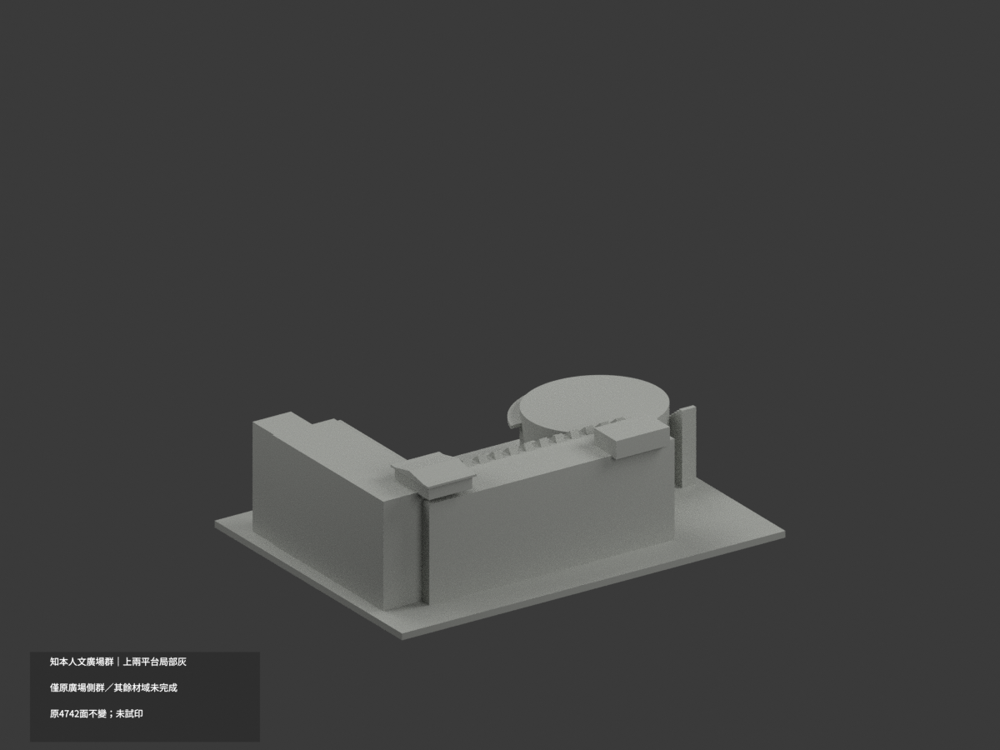
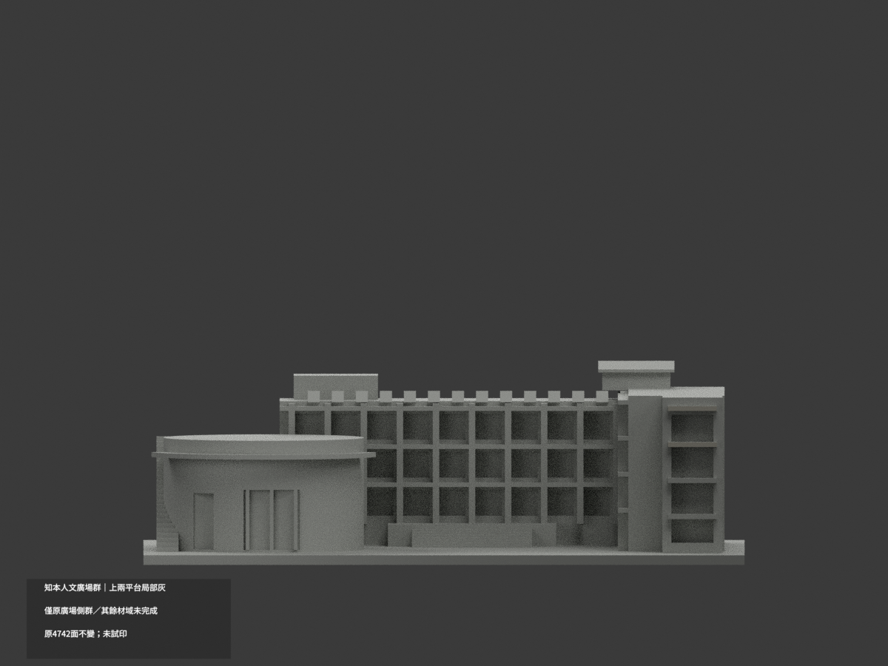
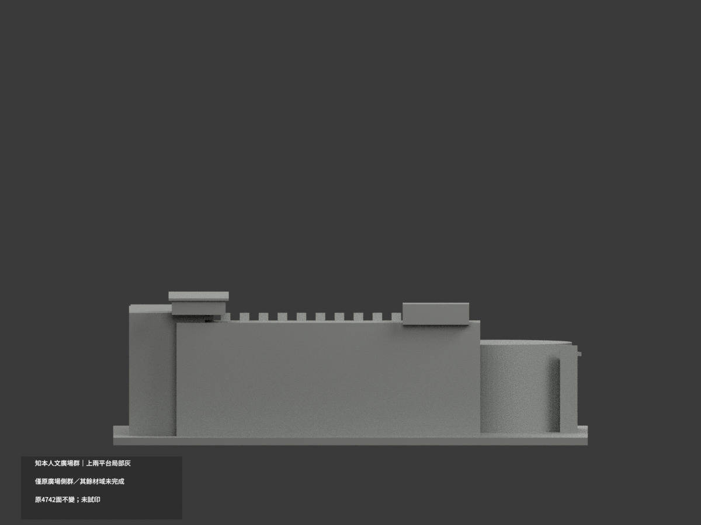
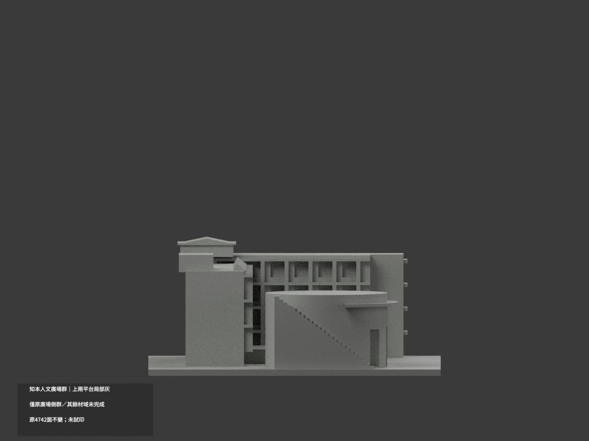
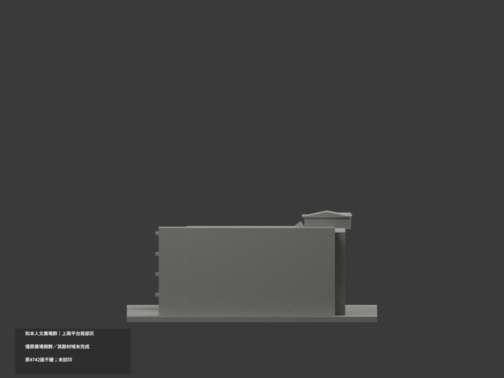
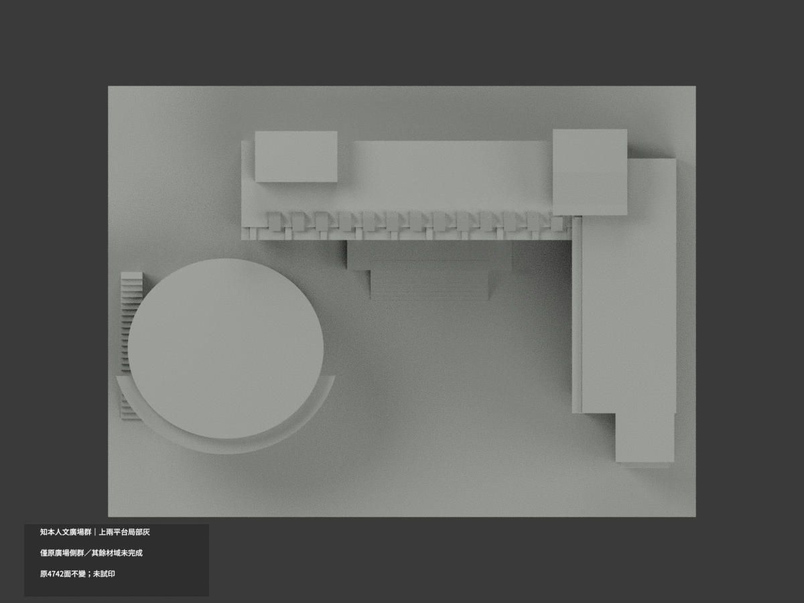
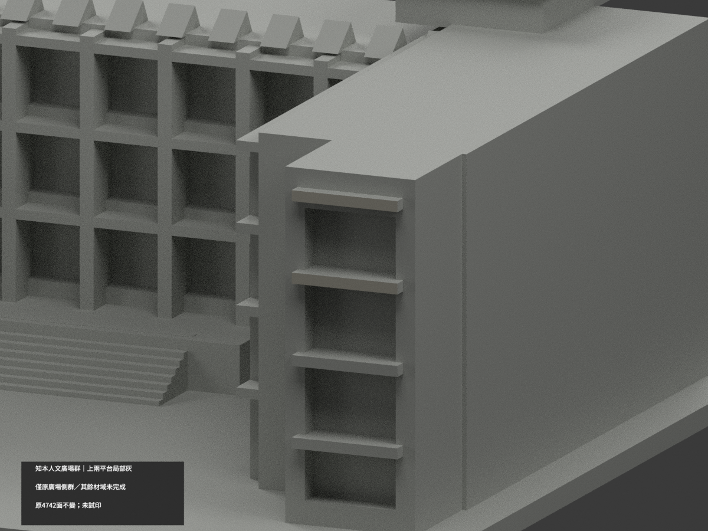
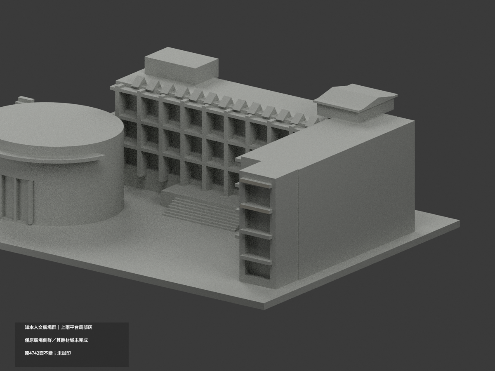
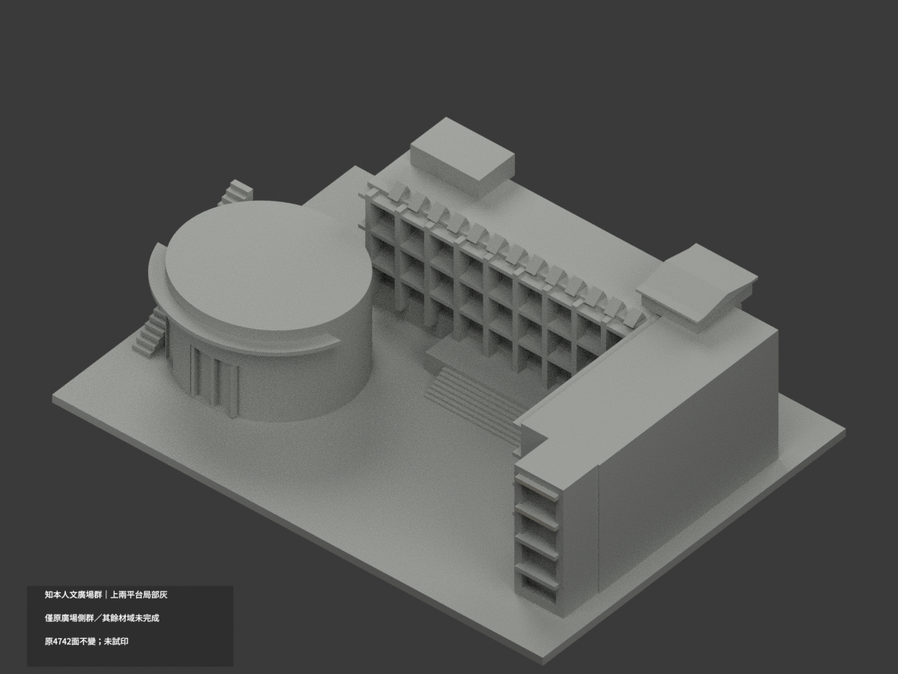

# 知本人文廣場側群｜上兩平台局部淺暖灰

**其餘廣場側群材域未完成分色。** partial_color_incomplete=true、fully_colored_exterior=false。僅近右樓梯塔上兩層原平台前面局部淺暖灰，非整群補色完成。

| 總覽 | 背側 | 正面 |
|---|---|---|
||||
||||
||||
||||

## 材色範圍
同 zhiben-humanities-plaza-complex 原項目，same-item、count_delta=0。4742原三角面、STL與build_model.py字節不變。只原照片可見的教學／演藝廳／梯塔廣場側一群，非完整人文學院，也不拆多套。原公開包無OBJ，不假稱保存不存在的原件。
- 近右梯塔上兩層平台前面y−42.5、x55.9..68.1、z29..30.2及38..39.2，各完整2原面，共4面淺暖灰。全三頂點有限plane與界限重算，另檢整plane四個獨立2面構件，只選上兩完整構件，不用z截取混材大面。
- 其餘4738中性：下兩平台對位遮蔽、主前與右翼柱帶／窗背、金字／banner牆、橢圓廳混通風燈具／玻璃／字樣、實心近似雨棚、含黑止滑條而無分界的階、多色廣場地面、鋸齒遮陽／屋頂／後面。實心雨棚不塗玻璃，不為分色新加欄杆。
- 色域／中性邊界是證據限制，不是真實材接縫。保原粗化厚平台及整群近似，補色不認證精測。

## 來源與日期
只親看校方已建成廣場外照，非概念模型，不涉及內部資料。拍攝日期未知；EXIF306修改時間非已驗證capture，舊照不保證2026現況。
原照私人參考、不公開、不貼圖；未確認CC或再散布授權，不保證商用。HEX僅名義淺暖灰族，非校準色票。正式GO覆蓋先期review-only文字，但不免builder QA。

## 格式與列印
[原STL](model.stl) · [逐面材色3MF](appearance.3mf) · [Blender](scene.blend)
原150×110mm展示底座，照片近似非測量比例。STL無色；3MF／Blender有真逐面材。兩材標籤不是驗證兩色／四色耗材切片，未實際列印，無切片路徑。

## 重建與 QA
原build_model.py → colorize_model.py → export_appearance.py → validate_color.py；Blender render_color.py／verify_color_scene.py。完整隔離原build＋color重建、原bytes／全三角multiset、閉合正體積、3MF逐面材、scene重開、十圖1200×900及圖文hash。原依賴隔離使用，不改原碼；程序不替代人工來源核對。
原README／previews／validation／renderer保留歷程，不冒充新QA；沒有刪檔。

## English scope
Partial only:4 front triangles of the two highest complete stairlandings lightwarmgray;4738 otherfacesneutral. Original4742triangles unchanged;no originalOBJ. One photographed plaza-facing ensemble,not entirehumanitiescollege andnot multiple newcounts. Wholefrontcomponents selected,no materialcut/no newgeometry. Captureunknown;EXIFmodification notcapture. Not fullcurrent survey,not testprinted or validatedfilament slicing.

## 版本 2 名稱勘誤

3MF 與 Blender 物件顯示名稱統一更正為「Zhiben Humanities Plaza Complex partial color」，並同步匯出、渲染與驗證程式的名稱。場景重新開啟與保存後，除物件名稱及非渲染執行期記錄外，網格、材質、變換、相機、燈光與字幕語義完全相同；場景檔案雜湊因此更新。原 STL、材色陣列與十張預覽位元不變，未重新渲染。原有局部補色及未試印限制不變。
