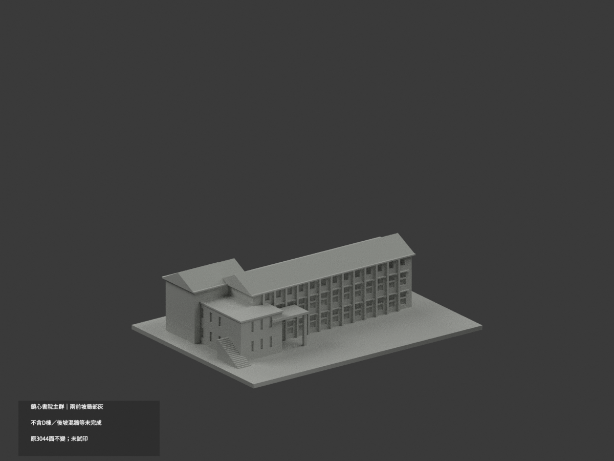
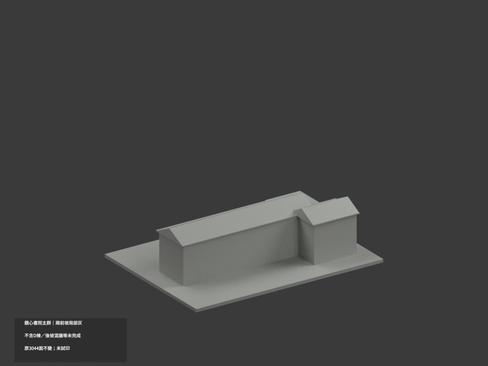
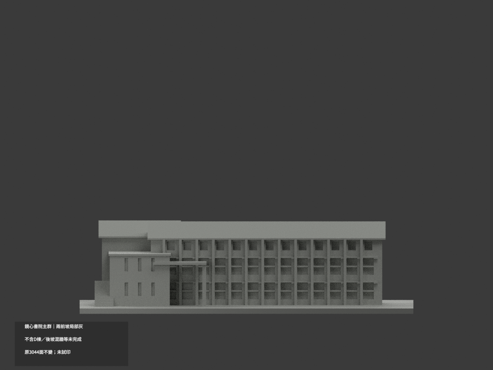
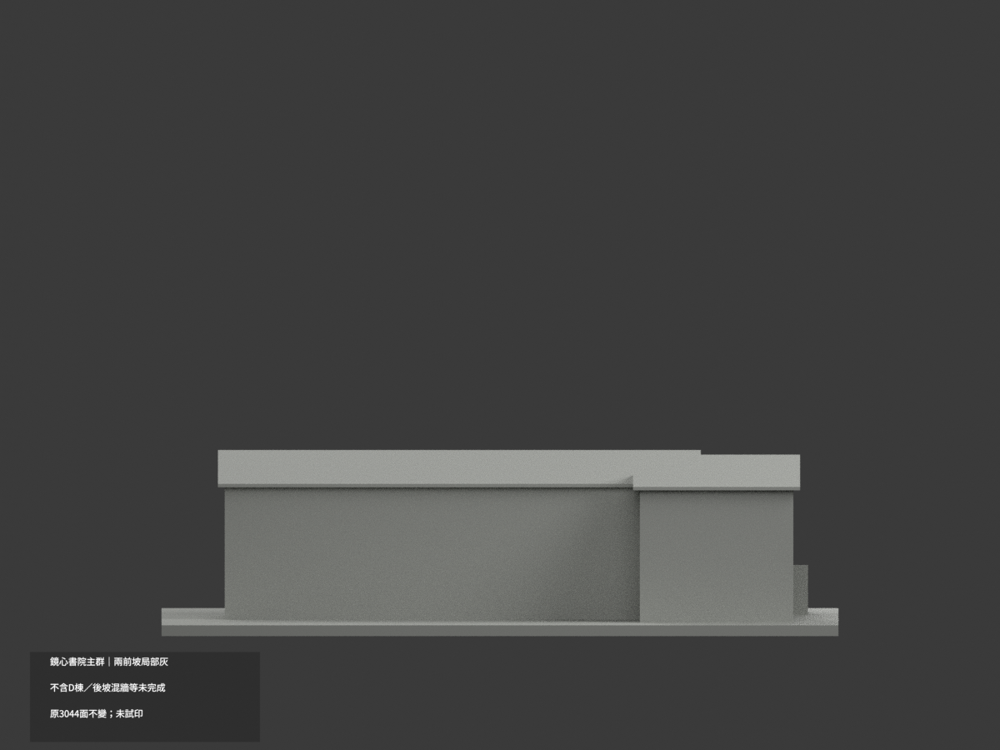
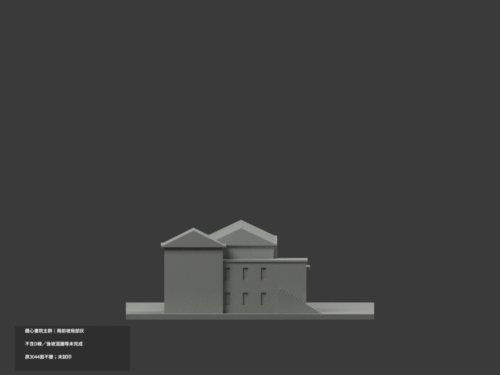
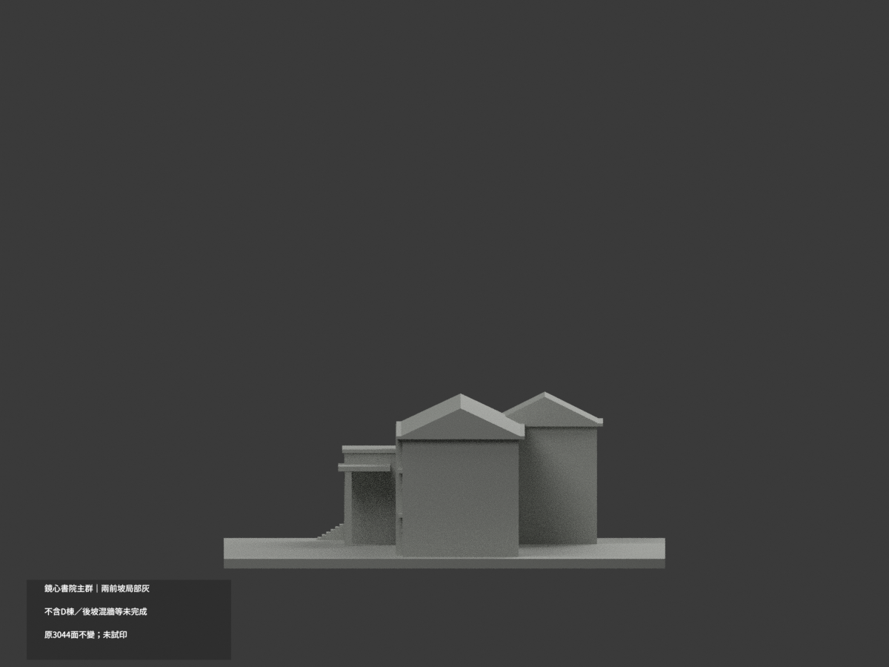
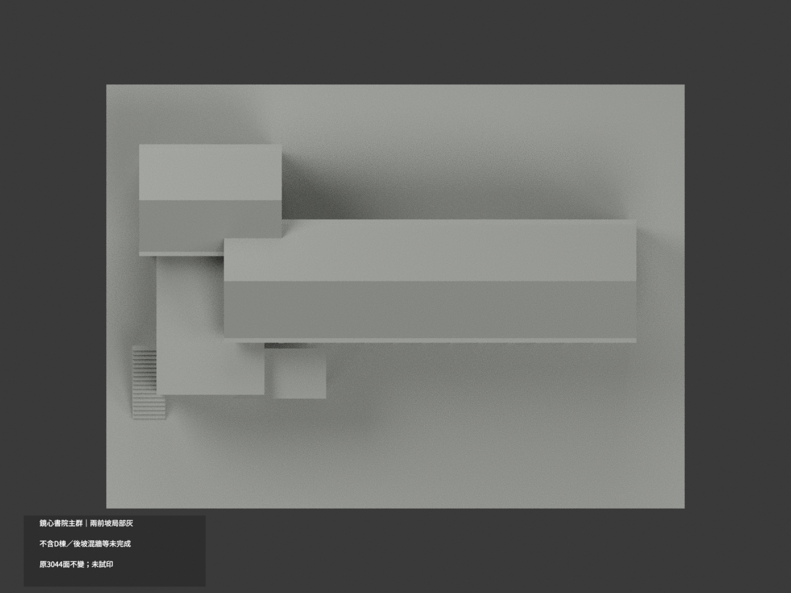
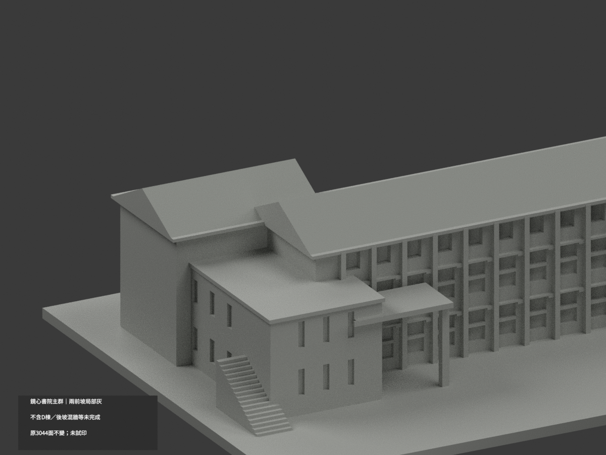
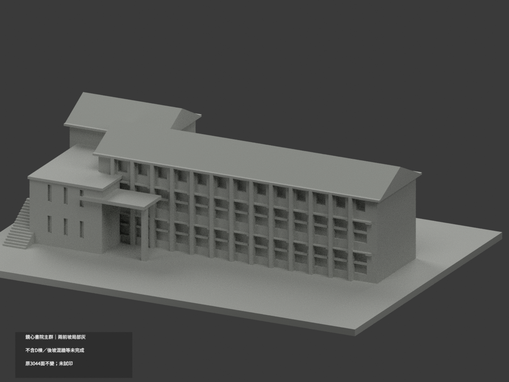
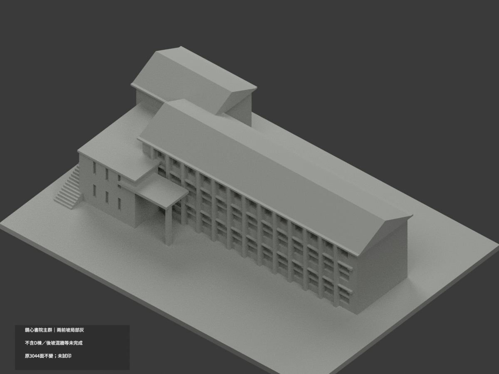

# 知本鏡心書院主群｜兩前屋坡局部灰金屬

**後坡、混材牆柱與其餘材域未完成分色。** partial_color_incomplete=true、fully_colored_exterior=false。僅兩完整原前屋坡局部中淺灰金屬色，非紅瓦，非整棟補色完成。

| 總覽 | 背側 | 正面 |
|---|---|---|
||||
||||
||||
||||

## 材色範圍
同 zhiben-jinsin-academy-main 原項目，same-item、count_delta=0。3044原三角面、STL與build_model.py字節不變。只原連接教學棟群、不含獨立D棟，不是親仁堂，不拆套。原公開包無OBJ，不假稱保存不存在的原件。
- 長前坡原yz端點(−12,32)→(4,39.5)、x−44.5..62.5，共2原面；平行短前坡(10.5,32)→(25,39.2)、x−66.5..−29.5，共4Boolean裁切原面。6面名義中淺灰金屬色，光照差不另外畫材域。
- 全三頂點符合原有限斜plane、切向及完整拉伸邊界；每個無限plane全部原面與有限選域完全相等，未漏小裁切片，不用normal／中心點簡篩。各坡共享邊連成完整域。
- 其餘3038中性：後坡、深檐／屋厚／底、山牆／低平屋、跨粉紅／乳白／灰基座全高牆柱、入口框柱／階、窗背／窗框、側後／地面。未證後坡不因原碼鏡像就一併染。
- 保原投影與屋形近似，不造材界／細節。色域與中性邊界為證據限制，不是真實材接縫；補色不背書原幾何為精測。

## 來源與日期
親看兩校方已建成外觀實照，兩道屋坡均顯灰金屬，不用概念圖，不涉及室內資料。拍攝日未知；發表／修改時間不是已驗證拍攝日，舊照不保證2026現況。
原照私人參考、不公開、不貼圖；未確認CC或再散布授權，不保證商用。HEX為名義灰族非校準色票。正式GO覆蓋先期review-only文字，不免builder QA。

## 格式與列印
[原STL](model.stl) · [逐面材色3MF](appearance.3mf) · [Blender](scene.blend)
原150×110mm展示底座，照片近似非測量比例。STL無色；3MF／Blender有真逐面材。兩材標籤不是驗證兩色／四色耗材切片，未實際列印，無切片路徑。

## 重建與 QA
原build_model.py → colorize_model.py → export_appearance.py → validate_color.py；Blender render_color.py／verify_color_scene.py。完整隔離原build＋color重建、原bytes／全三角multiset、閉合正體積、3MF逐面材、scene重開、十圖1200×900及圖文hash。原依賴隔離使用，不改原碼；程序不替代人工來源核對。
原README／previews／validation／renderer保留歷程，不冒充新QA；沒有刪檔。

## English scope
Partial only:6 complete front roof triangles(2+4Boolean fragments) nominal mediumlight gray metal,not redtiles;3038 unverifiedneutral. Original3044triangles unchanged;no originalOBJ. Connected mainteachinggroup excludesdetachedDbuilding. Infiniteplane selection exactlyequalsfinite allvertex domains. Rearslopes,eaves,mixedwalls andwindows neutral. Captureunknown;publication/modification notcapture. Not fullcurrent survey,not testprinted or validatedfilament slicing.

## 版本 2 名稱勘誤

3MF 與 Blender 物件顯示名稱統一更正為「Zhiben Jinsin Academy Main partial color」，並同步匯出、渲染與驗證程式的名稱。場景重新開啟與保存後，除物件名稱及非渲染執行期記錄外，網格、材質、變換、相機、燈光與字幕語義完全相同；場景檔案雜湊因此更新。原 STL、材色陣列與十張預覽位元不變，未重新渲染。原有局部補色及未試印限制不變。
