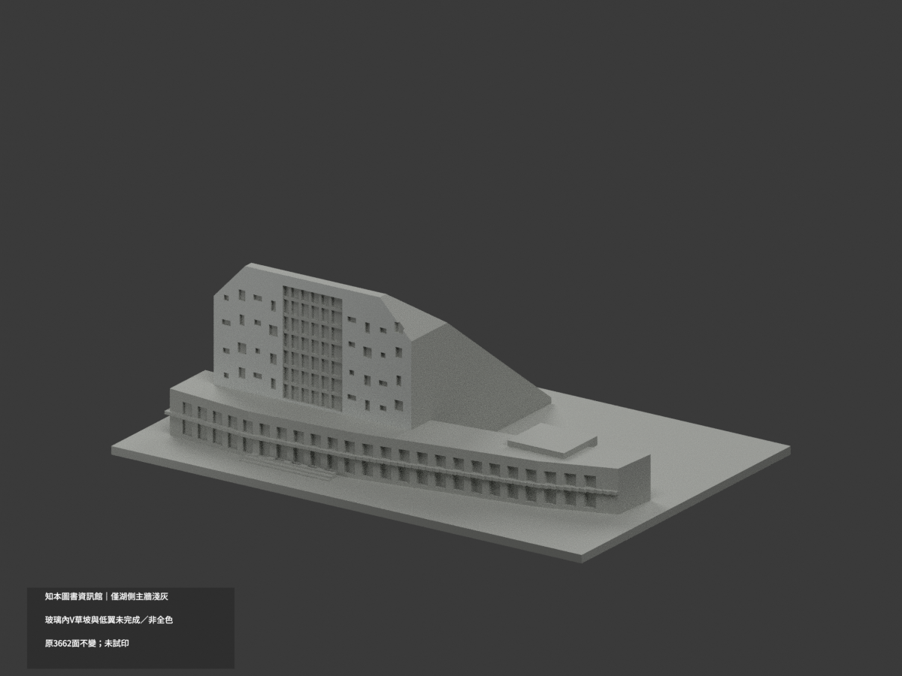
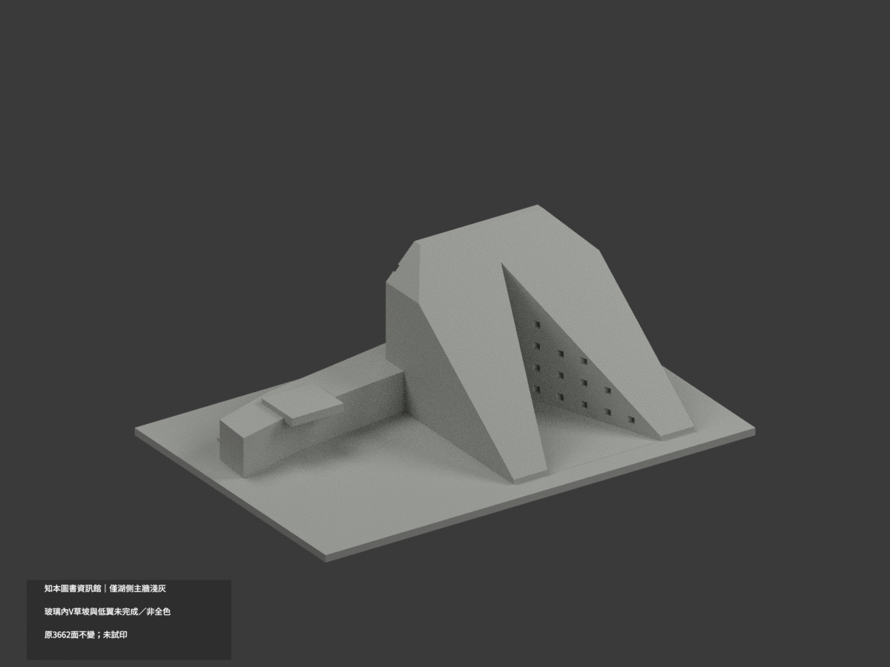
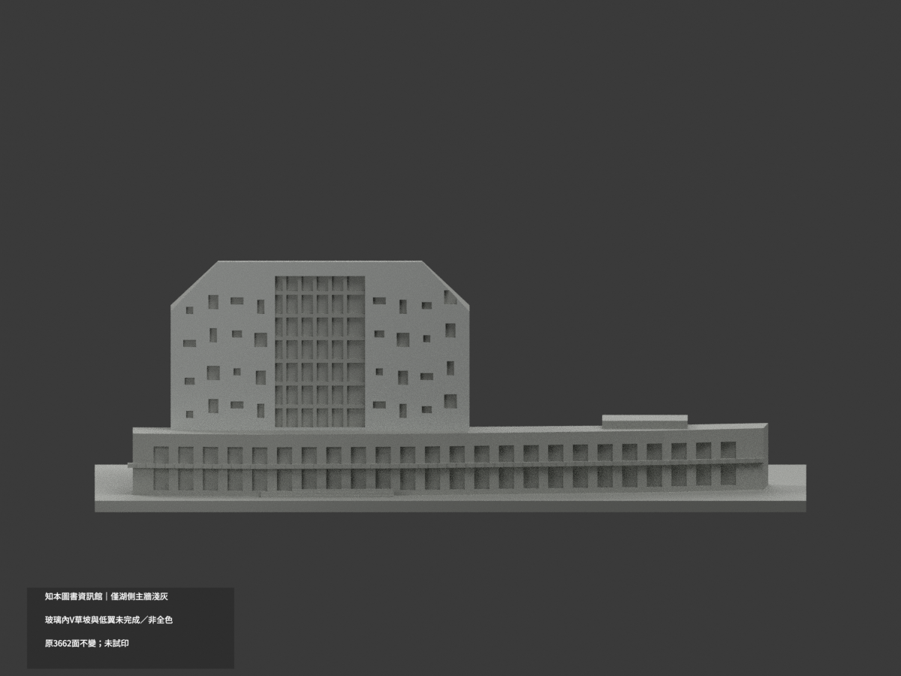
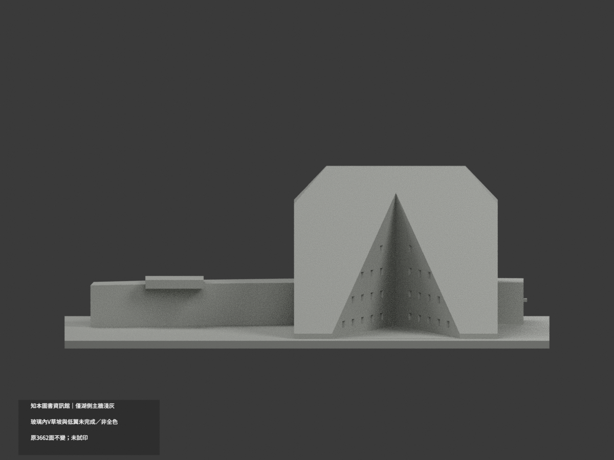
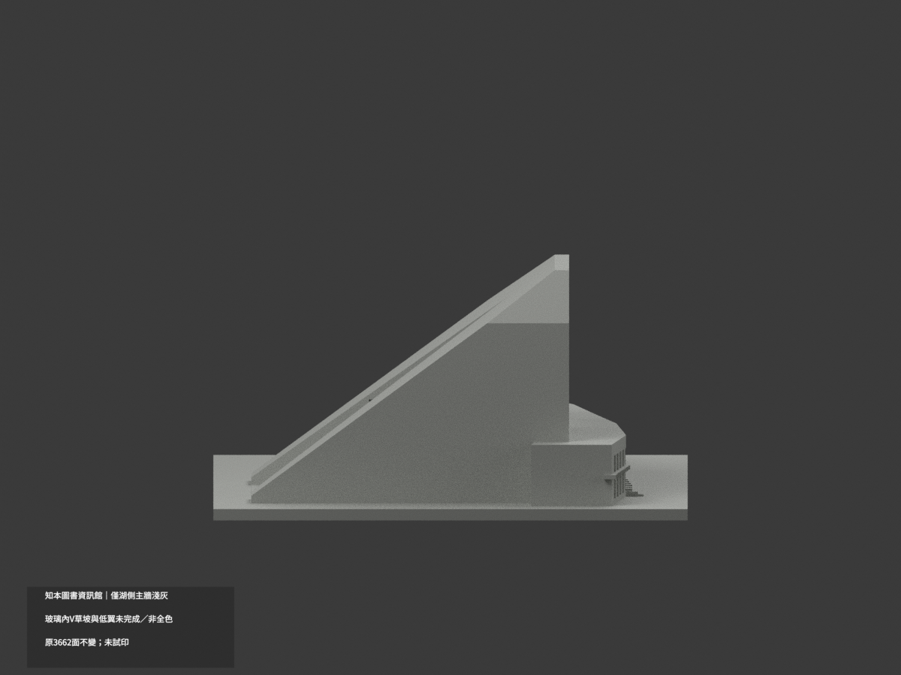
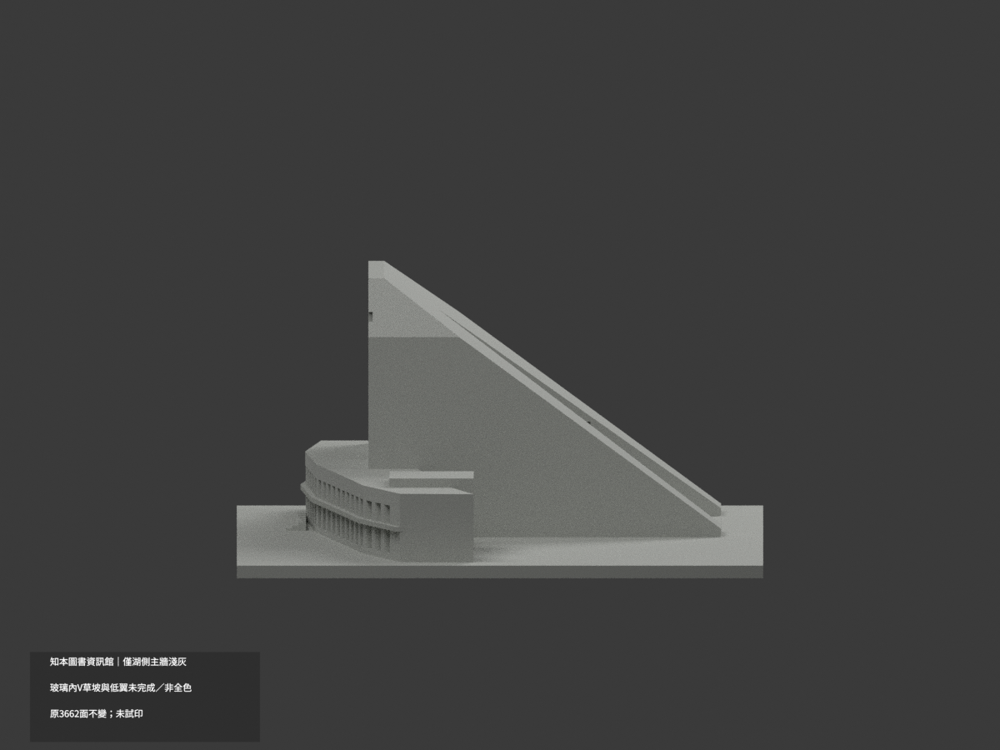
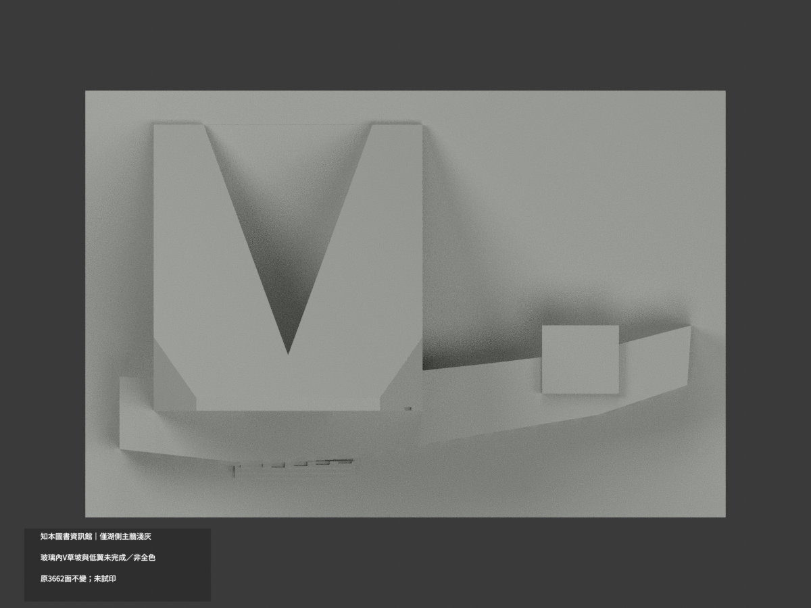
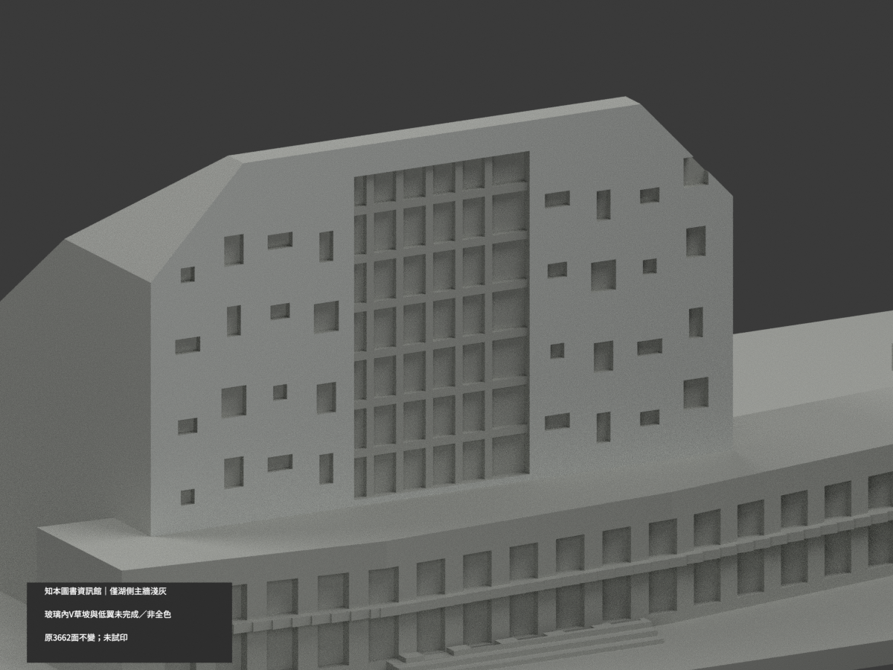
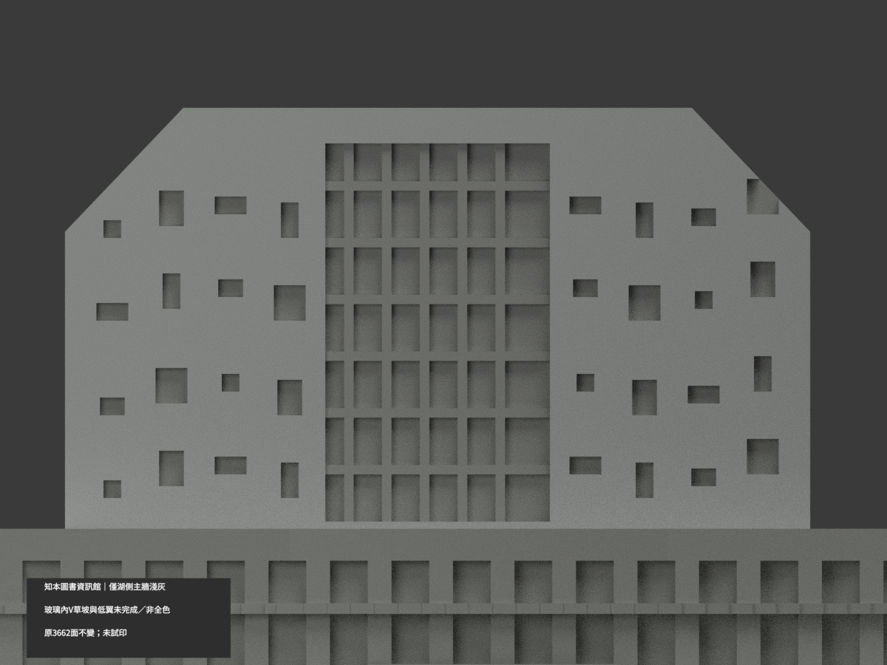
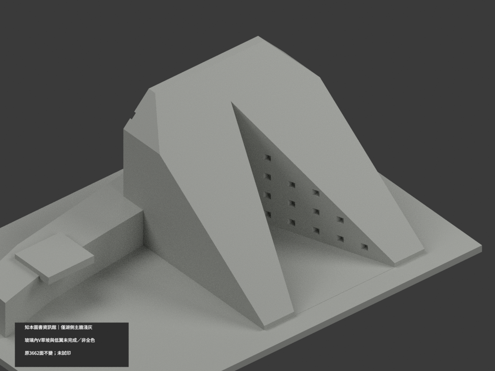

# 知本圖書資訊館｜湖側主牆局部名義淺灰

**局部補色未完成：僅湖側主牆完整原平面203三角淺灰；玻璃內V草坡與低翼未完成／非全色。** partial_color_incomplete=true、fully_colored_exterior=false。同項 zhiben-library-information／count_delta=0，原山形主館加低資訊翼一群，不拆館或增套，不是2026現況精測。

| 前斜視 | 後斜視 | 正面 |
|---|---|---|
|  |  |  |
|  |  |  |
|  |  |  |
|  | | |

## 材色範圍

先枚舉原y−25所有三角的三頂點完整共面，再共邊連通確認只有一個203面完整域，不設任意x/z裁切、不面心切色。原實際下界z15.4由低翼屋帶Boolean遮住，非新漆界。此完整湖側主牆名義淺灰；其他3459面保持中性。原3662三角與頂點不動，不補牆、窗、紋理或分面。

中央玻璃凹槽、厚化梃/零散窗背與洞返均中性；內V原簡化面缺門窗/通風界，整面中性不擴石色。草坡混步道/擋條/欄杆而原無分界，不整片綠。低資訊翼混淺灰、深灰、綠直板與玻璃未完整分面，整翼中性。其他屋頂/帽、側牆、入口楔、地台階均中性。中性不是實景灰，色域邊界不等於真材料接縫。石紋及細框未精確復原。

## 來源與版本

親看兩校方建成外觀照：湖側主牆廣域淺灰石色，坡側提供原V山形語義，不把未建模細門窗染成石材。EXIF306修改日期非拍攝日，capture未知，不宣2026現況。原主館與低翼一群、V凹槽/散窗節奏皆近似，不含完整湖岸，不以補色追認幾何。來源照片私人，不公開貼圖，不推未見CC為商用許可。HEX為展示色族不是實測色票。

## 檔案與 QA

原STL/build字節與3662三角不變，無immutable OBJ，原builder只輸出STL。原README保留ORIGINAL-MONOCHROME-README.md，舊單色previews/QA歷程不替代本次。appearance.3mf兩展示材與scene.blend真材域，color-mesh.npz同原三角。原requirements隔離重建build+color，核封閉正體積/3MF真材與座標、Blender重開、10張1200×900。重建保留不刪。未實際列印，不是已驗多色切片。

## English limitations

Partial: one entire original lake-facing plane y=-25,203 connected triangles in nominal pale gray;3459 others neutral. The whole plane is enumerated before shared-edge closure,without arbitrary x/z cropping. Actual lower z15.4 is an existing Boolean boundary where the low wing covers the main wall. Original3662 triangles/STL/build unchanged,no immutable OBJ. Central glazing/mullions,window backs/returns,inner V,grass slopes mixed with paths and railings,the mixed-material low information wing,other roofs/sides/steps remain neutral. No stone texture or exact frame reconstruction. One original main-library-plus-low-wing group,count_delta0,not the whole lakeshore. Photographs privately retained;EXIF modification is not capture date,no2026current-state or geometry-accuracy claim. No new geometry or textures;not test printed.
