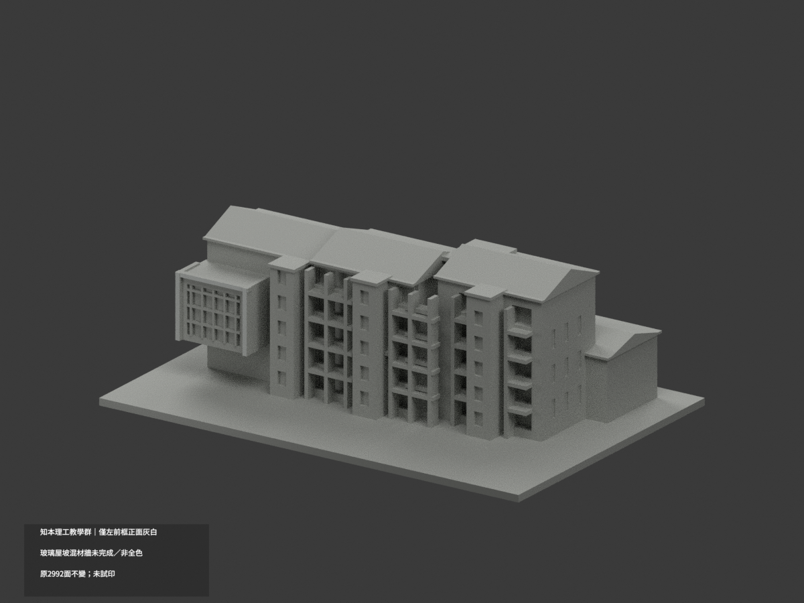
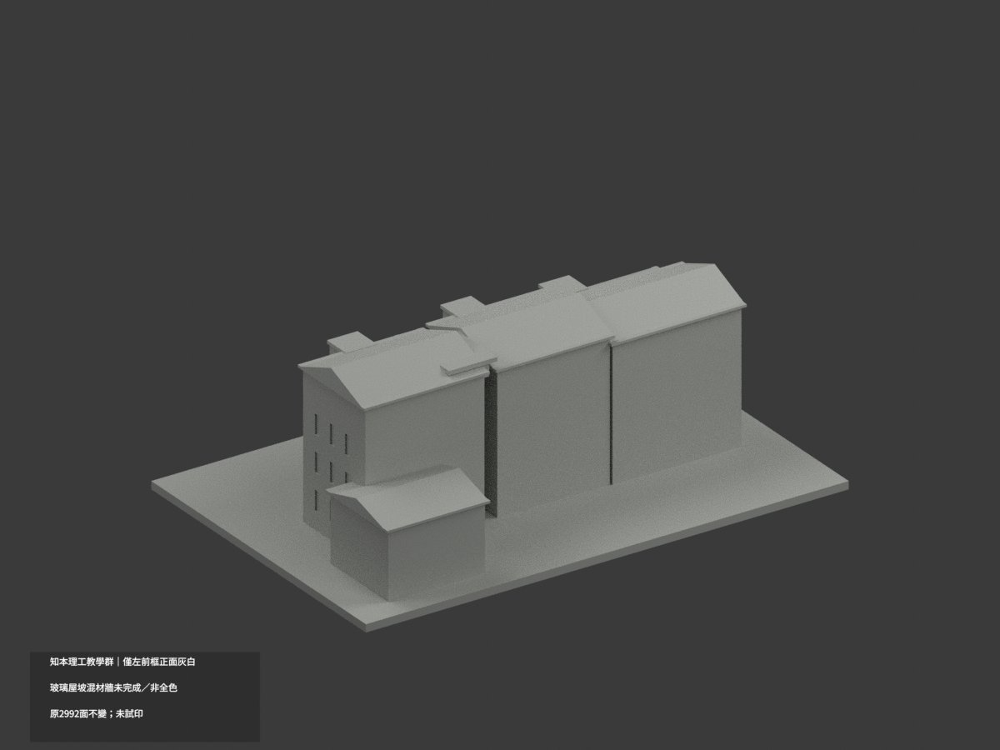
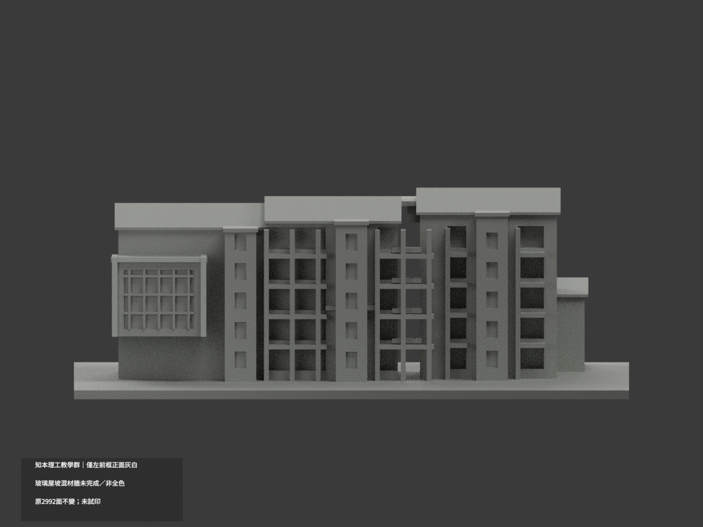
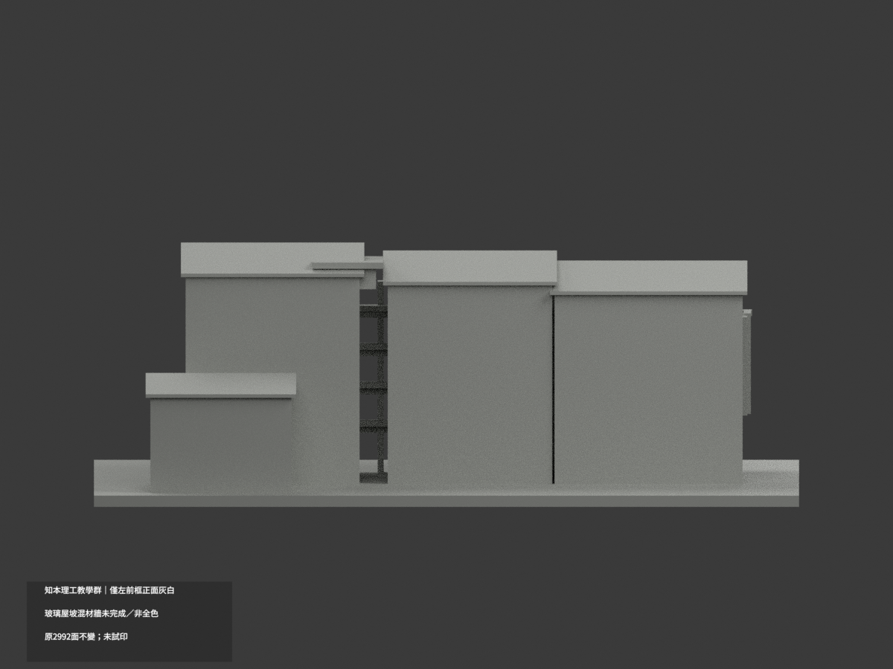
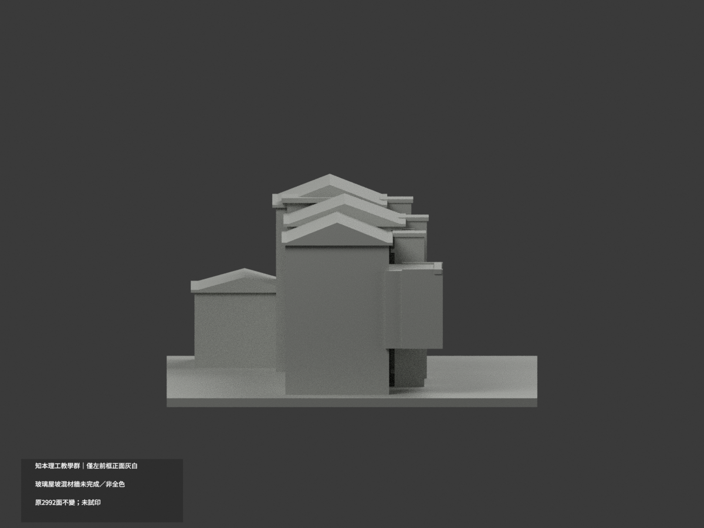
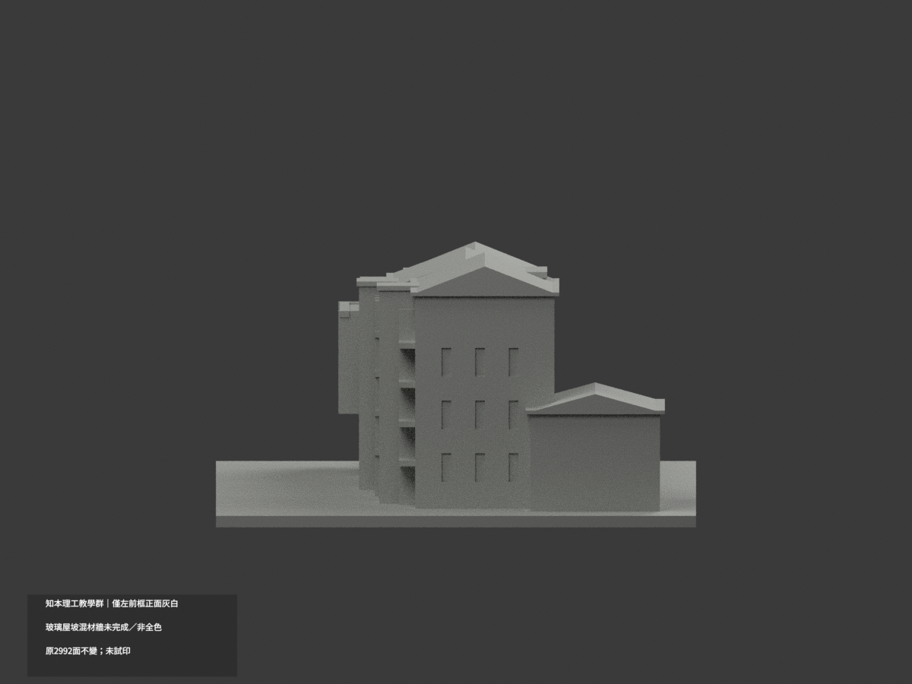
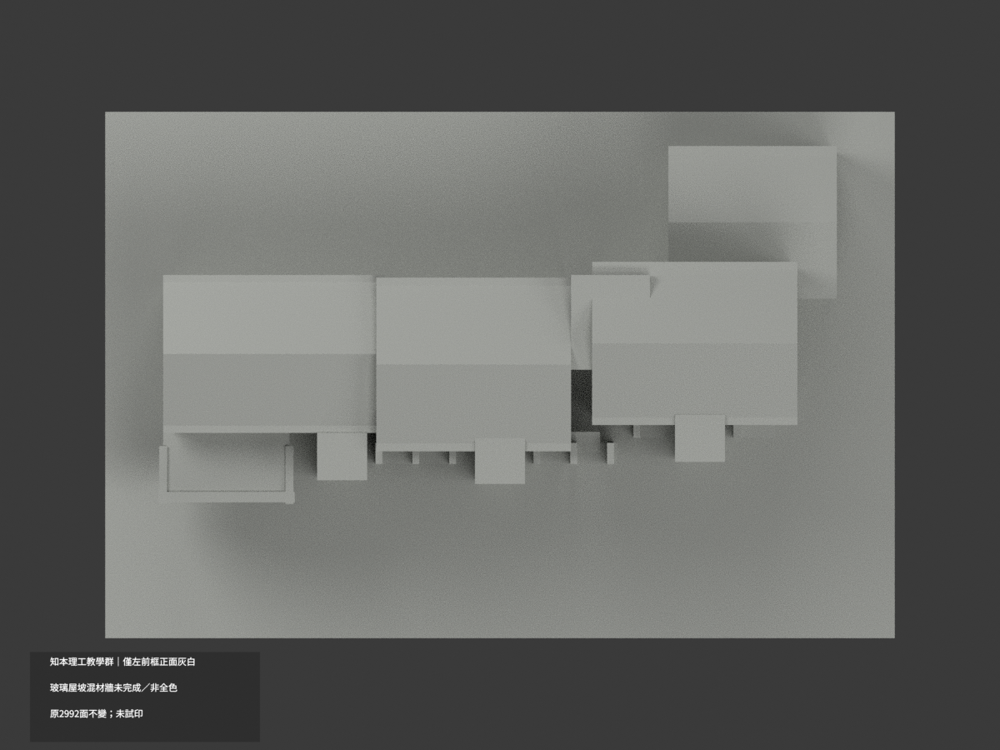
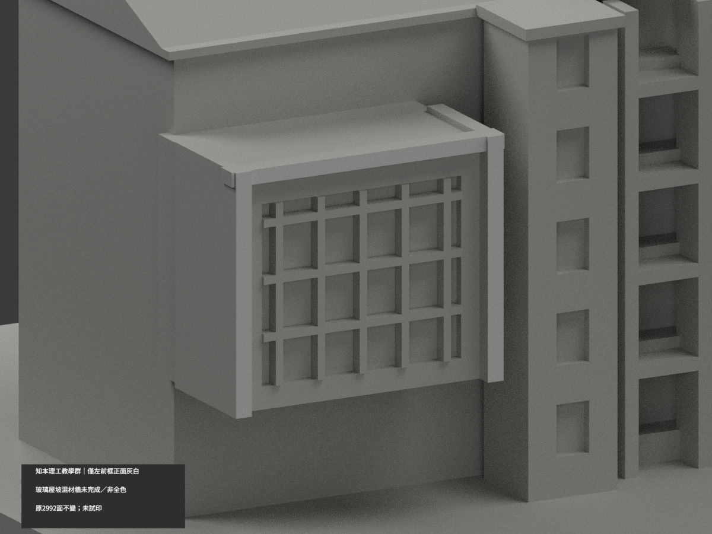
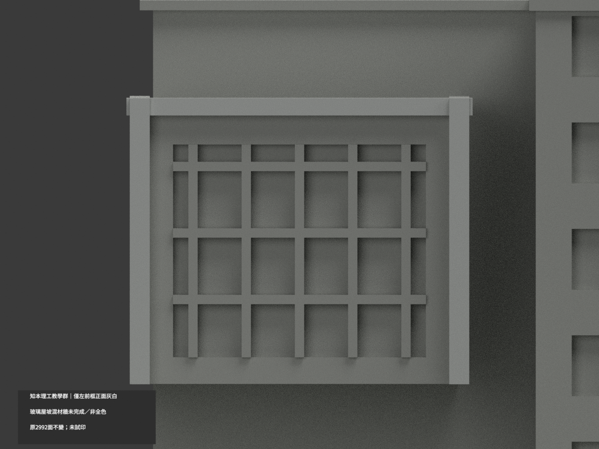
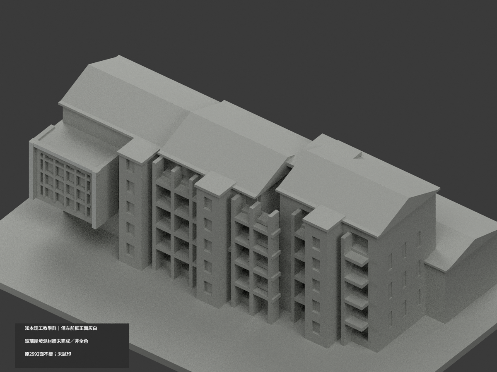

# 知本理工主要教學群｜左前框正面局部灰白

**局部補色未完成：僅左前凸玻璃盒上梁與兩側框正面10原三角灰白；玻璃屋坡混材牆未完成／非全色。** partial_color_incomplete=true、fully_colored_exterior=false。同項 zhiben-science-engineering／count_delta=0，原主要相連教學群不拆棟，不是全理工院落或2026現況測繪。

| 前斜視 | 後斜視 | 正面 |
|---|---|---|
|  |  |  |
|  |  |  |
|  |  |  |
|  | | |

## 材色範圍

枚舉原y−24.2全部三頂點共面6三角與y−24.5全部4三角，先不設x/z裁切，再共邊連通核3+2個完整矩形。上梁包含中央長面與兩側各0.25mm小外端，原柱遮擋分割所致，不能漏掉外端；兩側真框前面z15..36.5，不擴地面實填支撐。完整10面灰白、其他2982中性。原2992三角與頂點完全不改，不增分面或新框。

原三大屋坡缺照片白天窗/屋頂中斷，不整灰屋皮；玻璃凹背、梃、下方填實量體、框側頂底全部中性。主牆混白構造與黃綠板/暗窗，原無可靠界，全部中性。其他廊柱、簷棚、階、後面與底座中性。中性色不等於實景灰，資料覆蓋界不等於真正材料接縫。

## 來源與版本

親看校方正斜實景，左側凸玻璃盒灰白上梁/兩框可對原獨立前域。另綠建築合成圖上為另一理工入口，只作語義；下為師範學院，明確排除，不移色。拍攝日期未核，修改/發布日期不是capture，不宣2026現況。原列印厚化框/窄翼/窗洞近似保留，不以色審背書幾何精確。照片私人，不公開貼圖；未見CC不推商用，HEX僅名義色族。

## 檔案與 QA

原STL/build字節與2992原三角不變；immutable原包無OBJ，原builder只產STL，不聲稱保留原OBJ。原README保存ORIGINAL-MONOCHROME-README.md，舊單色previews/QA不替代新QA。appearance.3mf兩展示材與scene.blend真面材，color-mesh.npz同原幾何。精確requirements隔離build+color，核封閉正體積/完整三角、3MF材色/Blender重開、10張1200×900。重建保留不刪。未實際列印，非已驗多色切片。

## English limitations

Partial only: entire original upper-beam front plane y=-24.2,6 triangles in3 rectangles,plus two jamb fronts y=-24.5,4 triangles in2 rectangles. Both tiny beam ends beyond the jambs are included. Whole planes enumerated without x/z preclipping;all659 coplanar components uniform.10off-white triangles/2982neutral. Original2992 triangles and STL/build bytes unchanged,noimmutableOBJ,count_delta0. Missing roof skylights,glass/mullions,lower filled support mass,mixed walls and unknown rear remain neutral. Principal connected teaching facade group only,not entire college. Matching school exterior photograph is primary;alternate engineering entrance and unrelated teachers-college composite do not transfer color. Capture unknown,no2026survey or geometry-accuracy endorsement. No public source images/textures;not testprinted.
