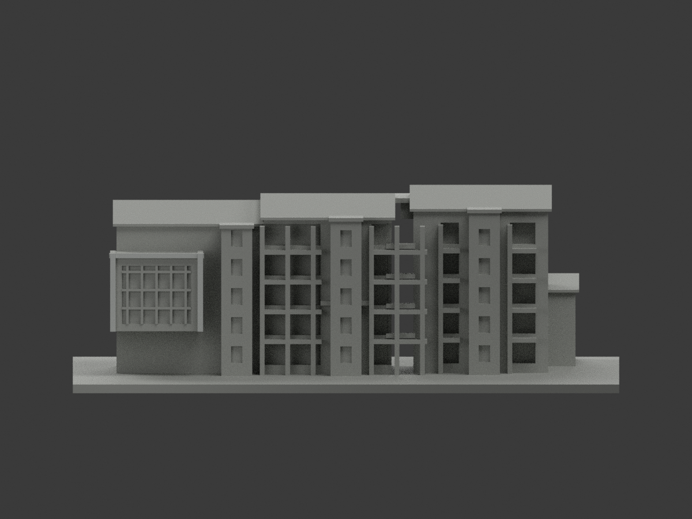
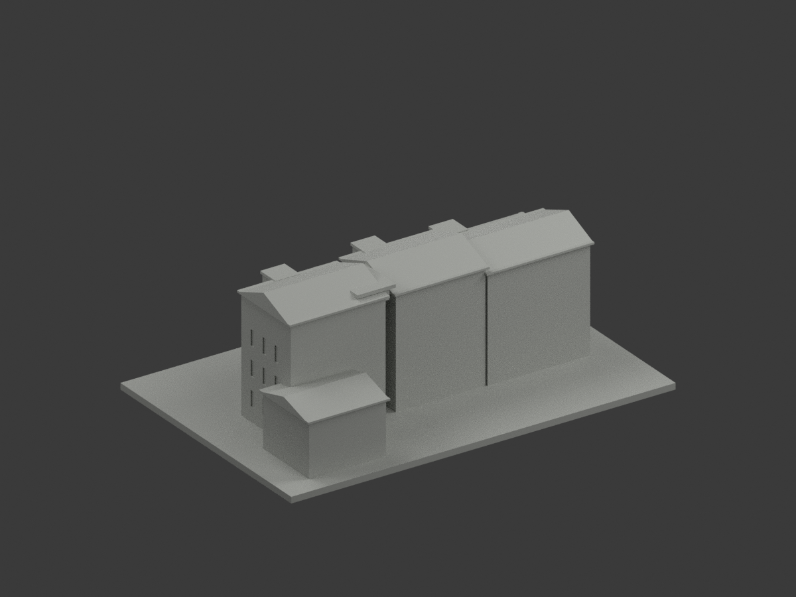
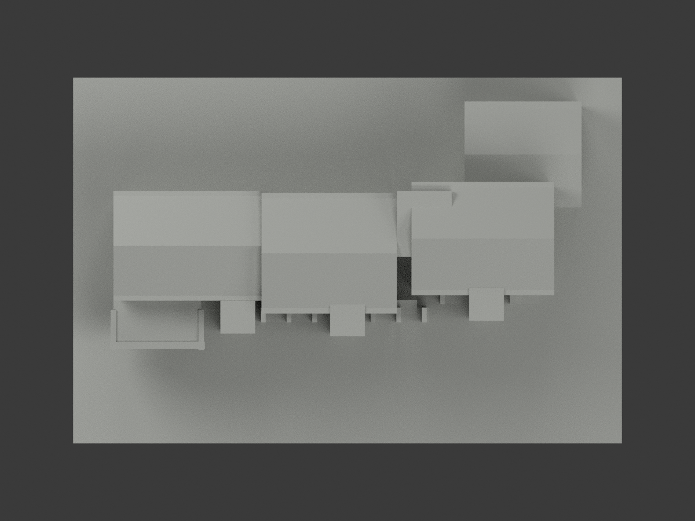
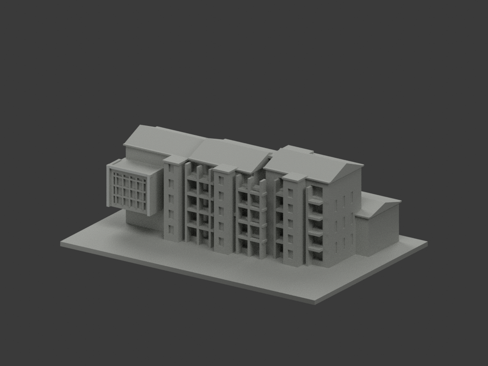
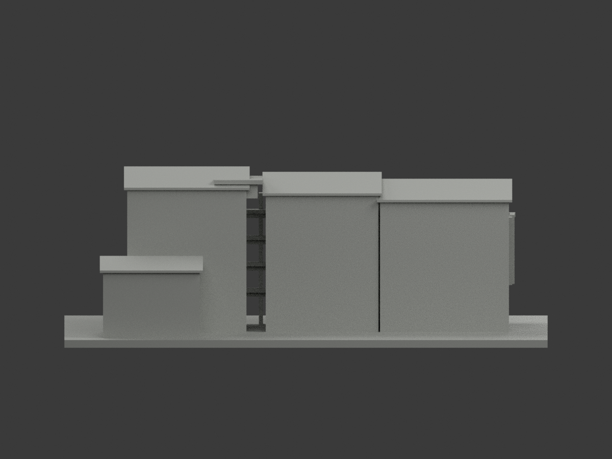
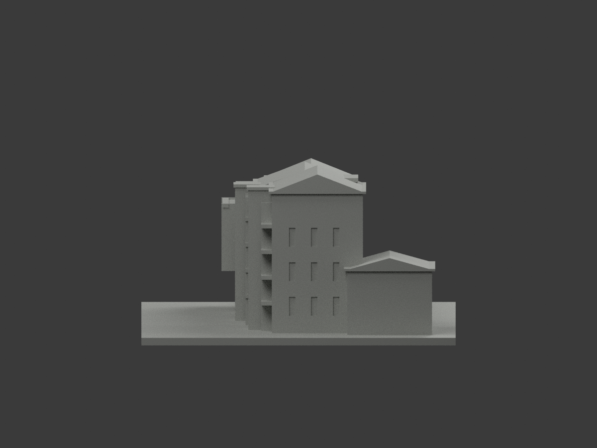
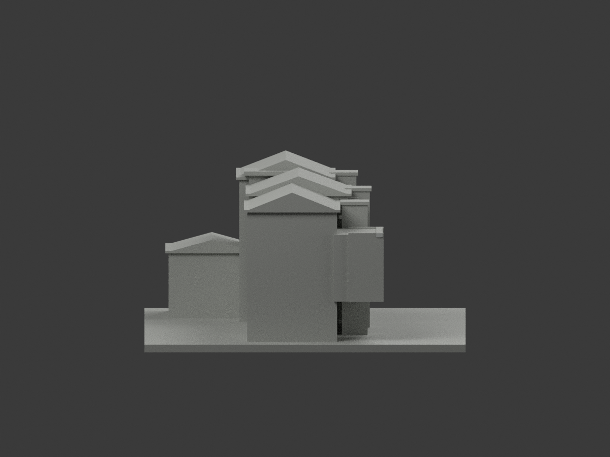
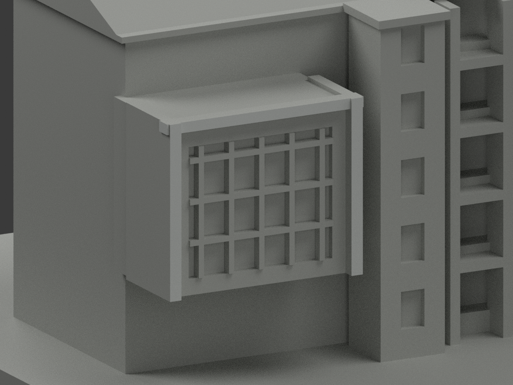
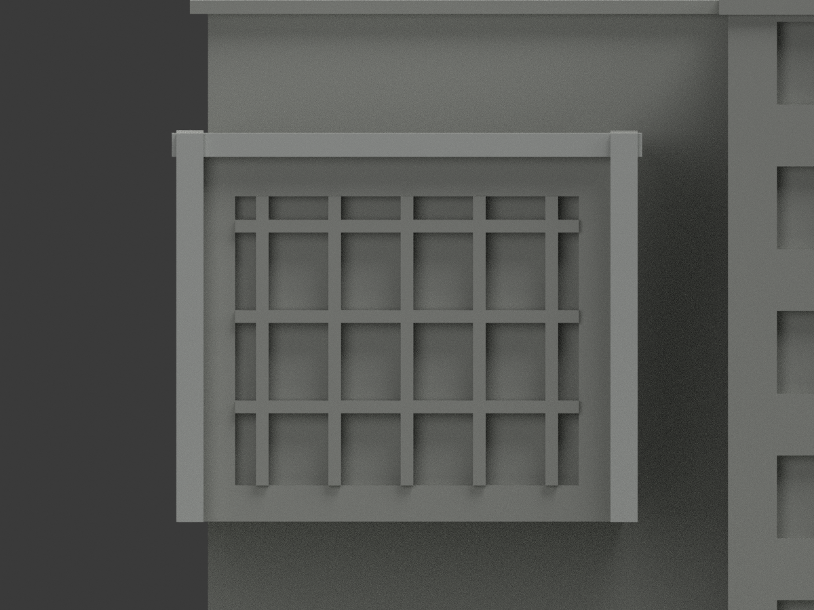
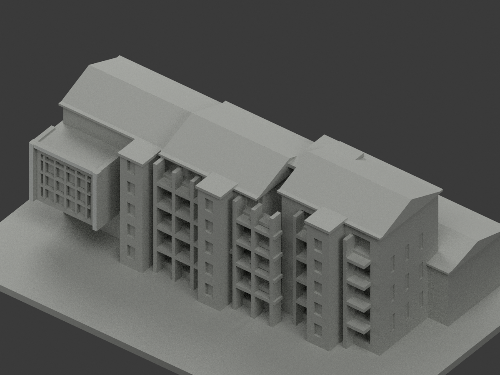

# 臺東大學知本校區｜理工學院主要教學群 WebP 預覽

這十圖為 2026-11-18 現行文件所列的局部補色模型。按該版原角度由原場景重繪，核對於原 PNG，完整檢視圖以無損 WebP 顯示。顏色僅在左前玻璃盒的上梁及側框小範圍成立，並非全色或實測，未實體試印。

[原模型說明、範圍與限制](../README.md) · [彩色 3MF](../appearance.3mf) · [原 STL](../model.stl) · [Blender](../scene.blend) · [工程資料原版清單](../COLOR-RELEASE-MANIFEST.json) · [渲染對照](render-proof.json) · [展示校驗](SHA256SUMS)

| 模型預覽 | 模型預覽 | 模型預覽 |
| :---: | :---: | :---: |
|  正立面 |  後斜視 |  頂視 |
|  前斜視 |  背立面 |  東側 |
|  西側 |  入口細節 |  框架細節 |
|  屋面細節 |  |  |
