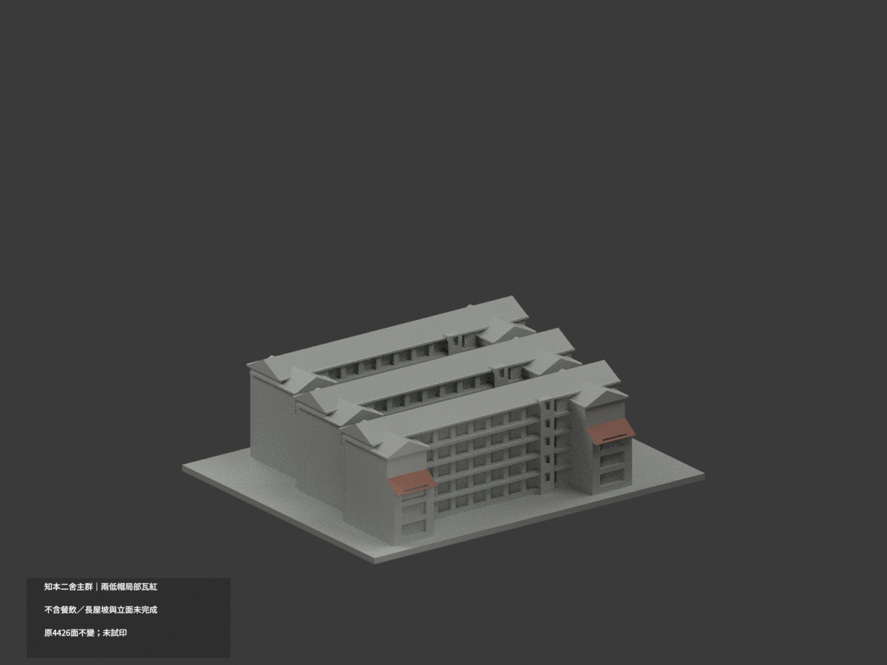
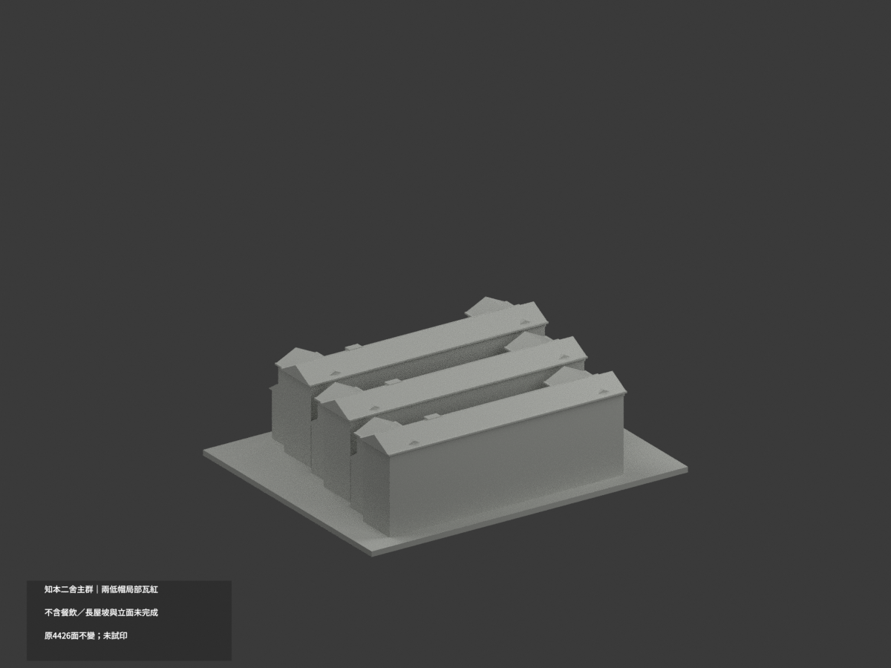
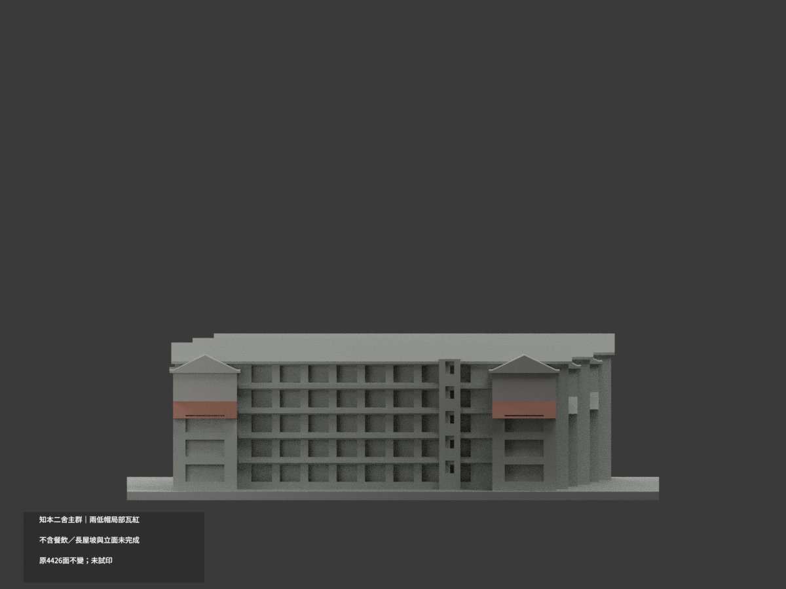
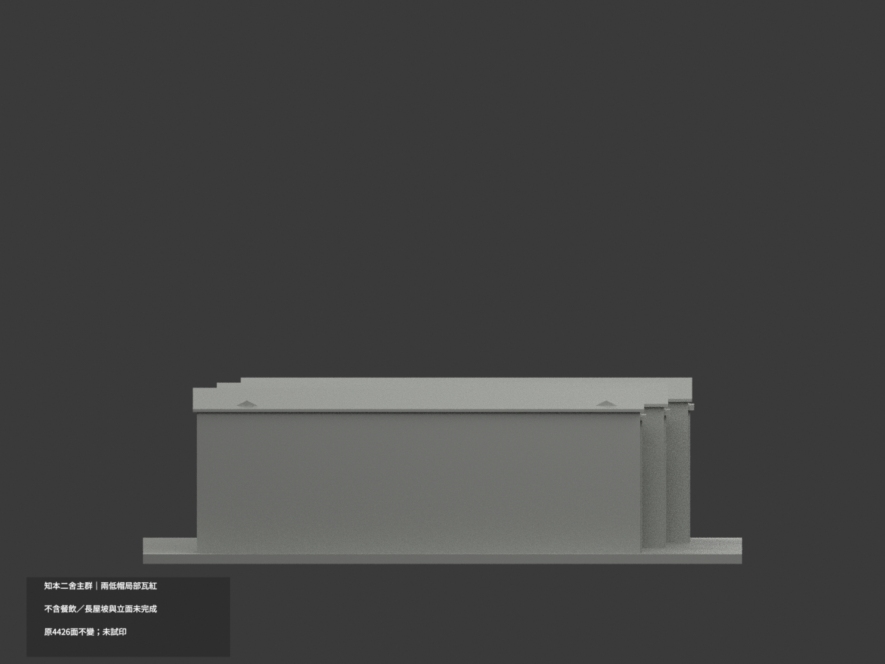
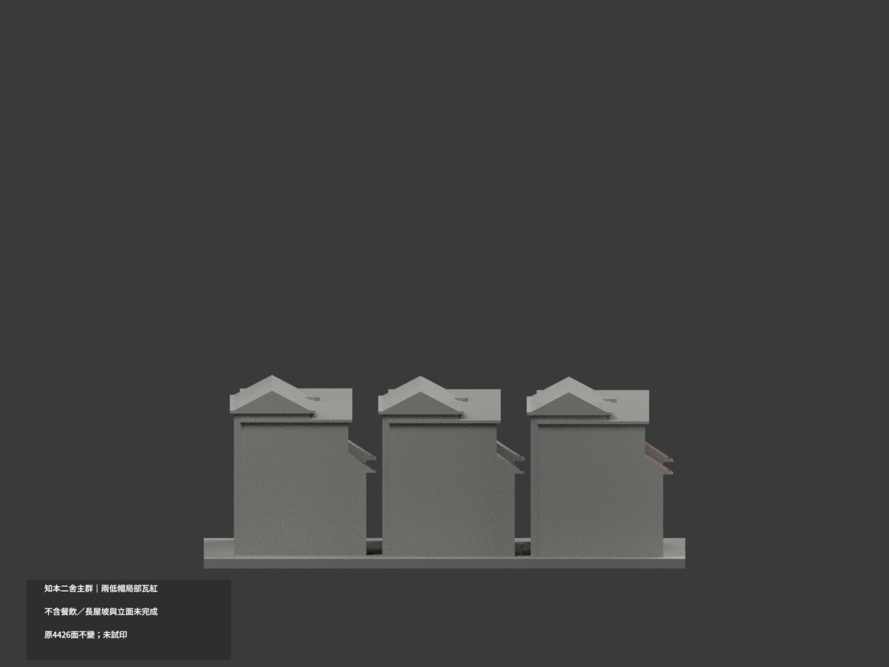
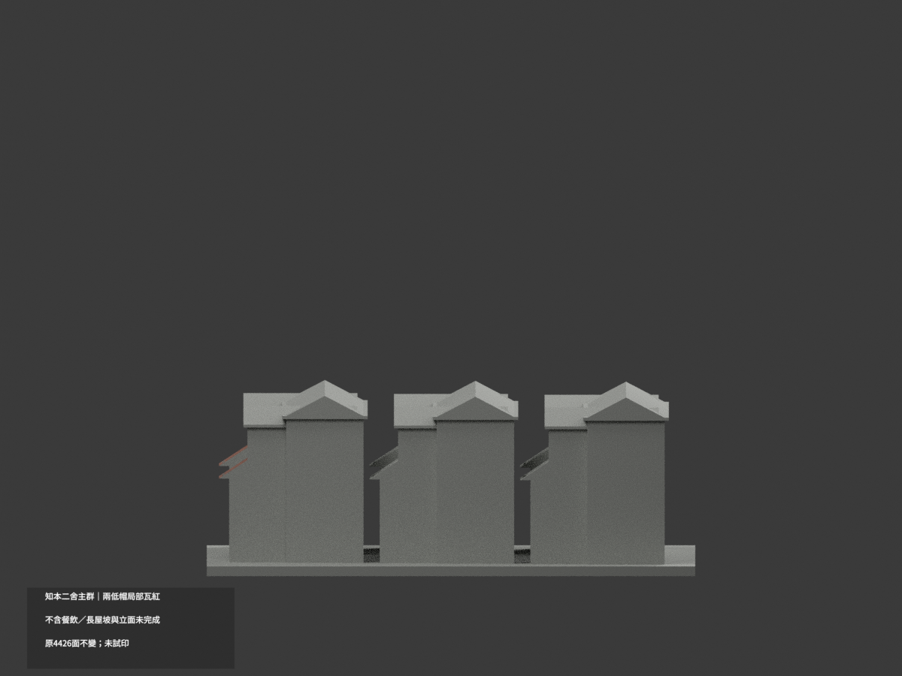
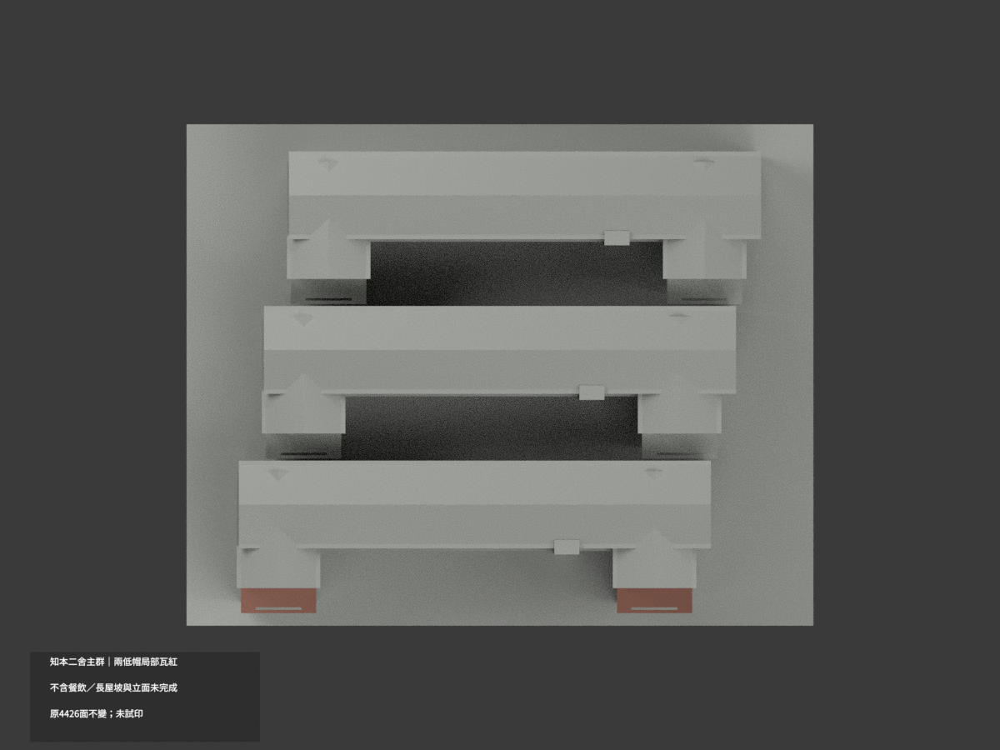
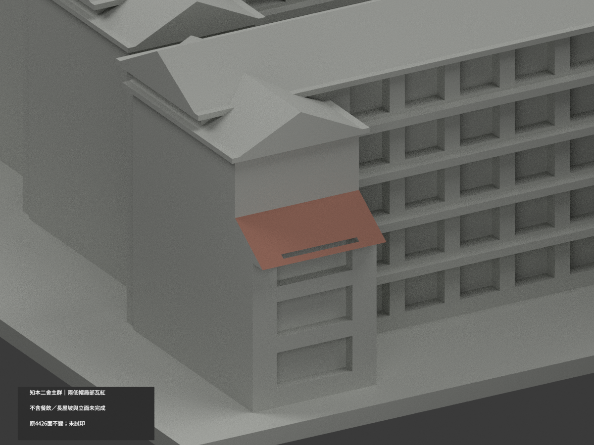
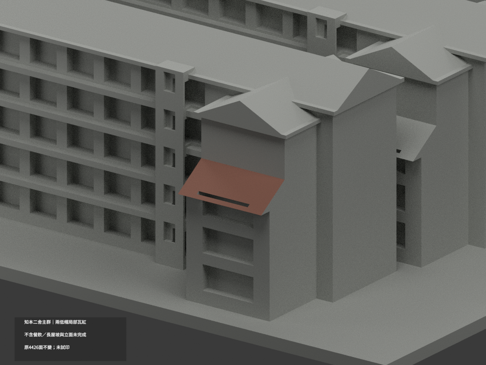
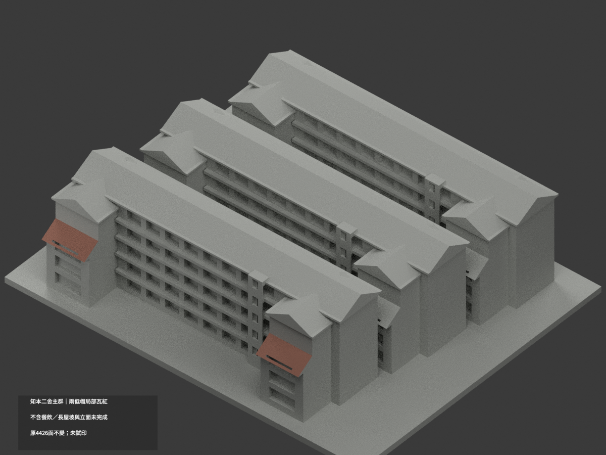

# 知本第二宿舍主群｜兩前低帽局部瓦色

**三列長屋坡、立面與其餘材域未完成分色。** partial_color_incomplete=true、fully_colored_exterior=false。僅前列兩低斜帽上皮局部土紅瓦族，不是全宿舍補色完成。

| 總覽 | 背側 | 正面 |
|---|---|---|
||||
||||
||||
||||

## 材色範圍
同 zhiben-second-dormitory 原項目，same-item、count_delta=0。4426原三角面、STL與build_model.py字節不變。三列近似住宅主體同一群，不含另棟餐飲中心，不拆套；不是逐棟精測或全宿舍校區。原公開包無OBJ，不假稱保存不存在的原件。
- 只前列兩低斜帽原上皮：原yz端點(−57,23)→(−37,36)、x−62..−44及28..46；各8Boolean原面，共16面名義低飽和土紅瓦族。
- 全三頂點符合原有限斜plane、切向與完整x拉伸邊界。整個無限plane原面恰等於兩有限域聯集，沒有normal／中心點篩掉碎面。原主體Boolean遮擋後自然露至y−50、z27.55，不是人工裁線；窗切口凹缺不填補。
- 其餘4410中性：全部三列長屋面／後坡、其他排低帽／橫屋坡、屋厚／檐／山牆／底、白灰紫混牆與欄板、樓梯、窗背框／內容、地面及未知背側。
- 原屋形與群體配置只是照片近似，不因本次材色背書幾何。材色／中性分界表達證據限制，不是真實材料接縫；不造材界、瓦紋或細節。

## 來源與日期
親看三校方已建成外觀實照，包括近景、整體外觀與空拍。只取可辨前低帽瓦色族，不把空拍當其他複雜屋坡可唯一對位證據。拍攝日期未知，發表／修改日期非已驗拍攝時間，不保證2026現況。
原照私人參考、不公開、不貼圖；未確認CC或再散布授權，不保證商用。HEX只是名義材色非校準色票。正式GO已發行，繼承的先期review-only文字不改其狀態，仍須builder QA。

## 格式與列印
[原STL](model.stl) · [逐面材色3MF](appearance.3mf) · [Blender](scene.blend)
原150×120mm展示底座，照片近似非測量比例。STL無色；3MF／Blender有真逐面材。兩材標籤不是驗證兩色／四色耗材切片，未實際列印，無切片路徑。

## 重建與 QA
原build_model.py → colorize_model.py → export_appearance.py → validate_color.py；Blender render_color.py／verify_color_scene.py。完整隔離原build＋color重建、原bytes／全三角multiset、閉合正體積、3MF逐面材、scene重開、十圖1200×900及圖文hash。原依賴隔離使用，不改原碼；程序不替代人工來源核對。
原README／previews／validation／renderer保留歷程，不冒充新QA；沒有刪檔。

## English scope
Partial only:16 original front low-cap upper-skin triangles(8+8 Boolean fragments), muted terracotta tilefamily;4410 unverifiedneutral. Original4426triangles unchanged,no originalOBJ. Three approximate residentialbars formonegroup;diningcentre excluded. Entire infiniteplane equalsunion offinite allvertex domains. NaturalBoolean clipping andwindownotches retained. Allmainroofs,walls,windows andothercaps neutral. Captureunknown;not fullcurrent survey or validatedfilament slicing;not testprinted.

## 版本 2 名稱勘誤

3MF 與 Blender 物件顯示名稱統一更正為「Zhiben Second Dormitory partial color」，並同步匯出、渲染與驗證程式的名稱。場景重新開啟與保存後，除物件名稱及非渲染執行期記錄外，網格、材質、變換、相機、燈光與字幕語義完全相同；場景檔案雜湊因此更新。原 STL、材色陣列與十張預覽位元不變，未重新渲染。原有局部補色及未試印限制不變。
