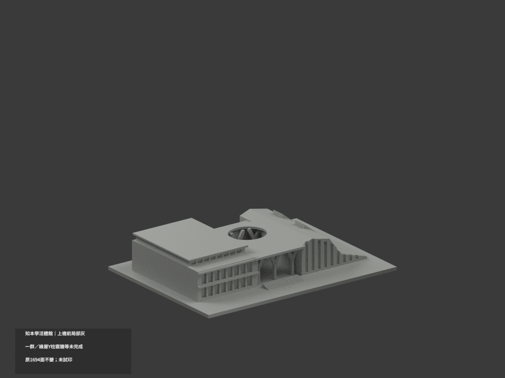
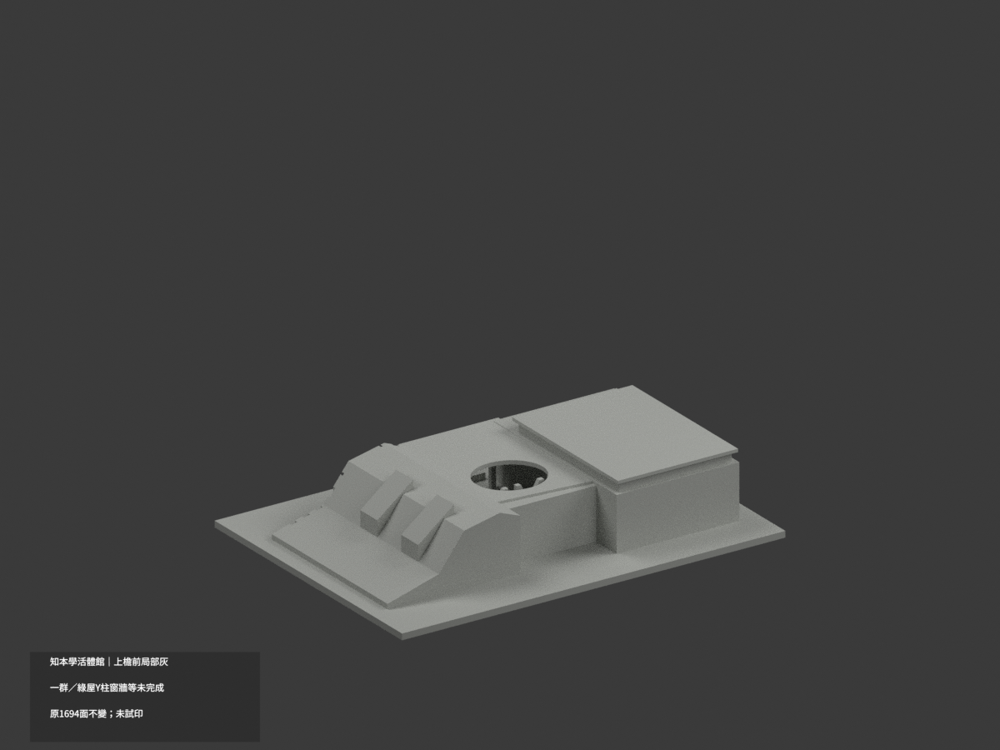
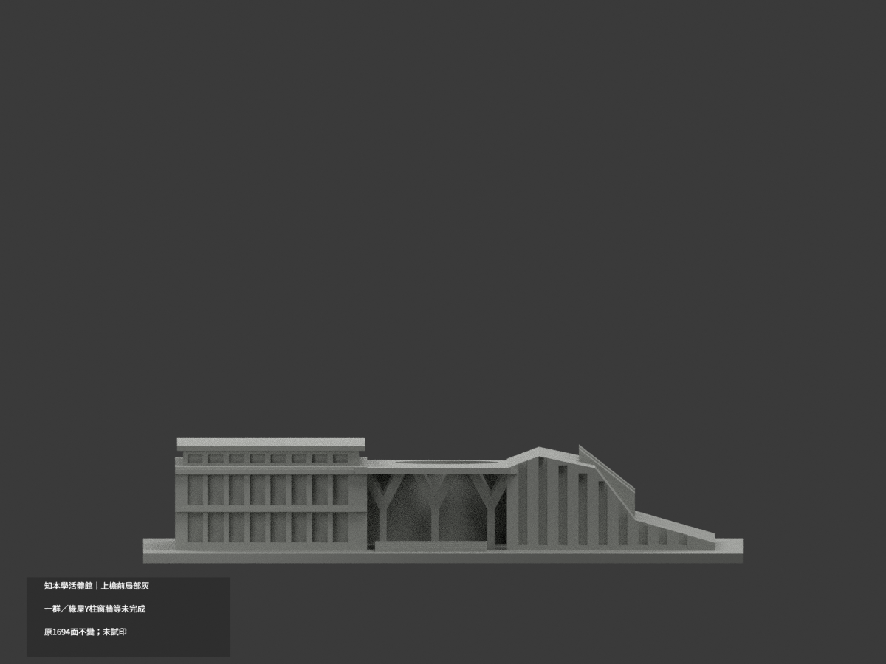
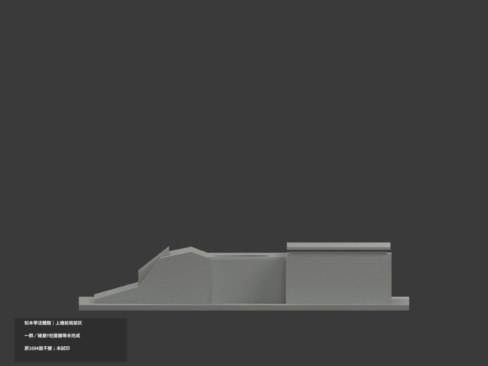
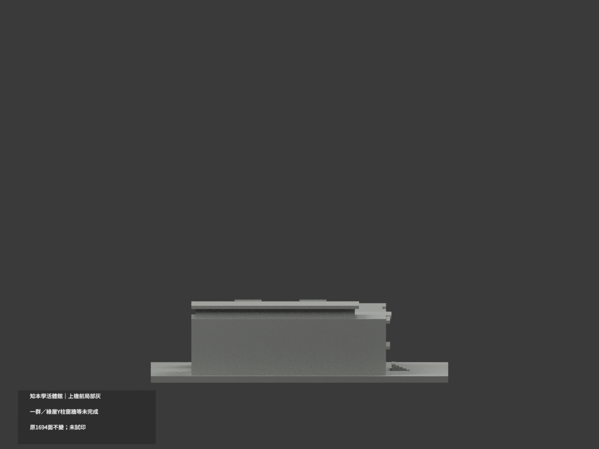
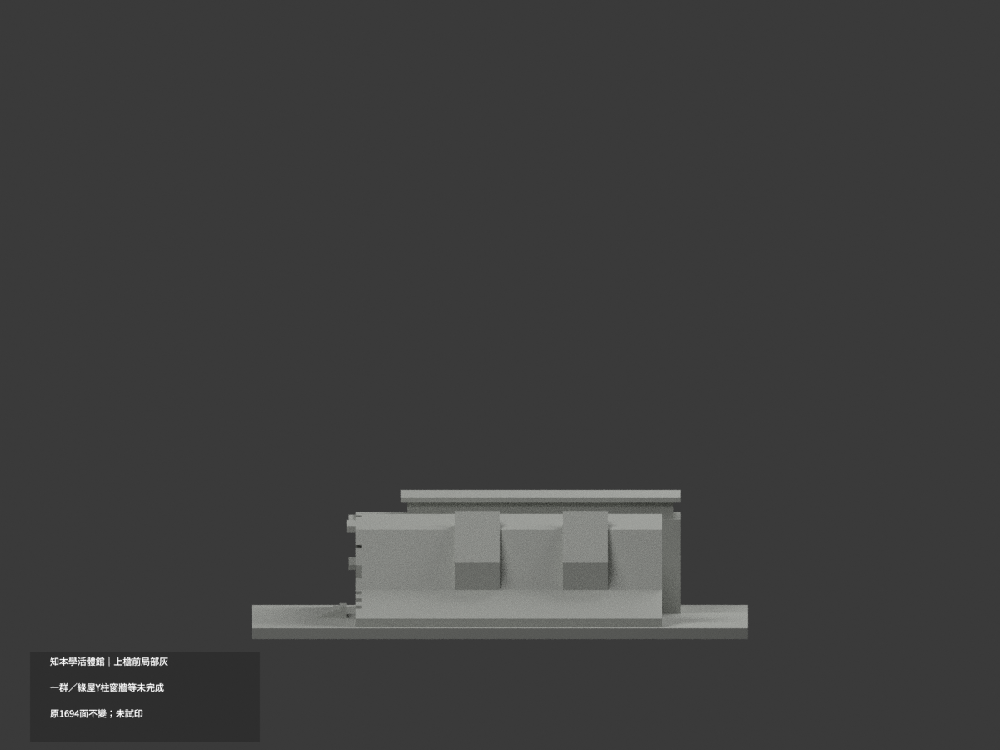
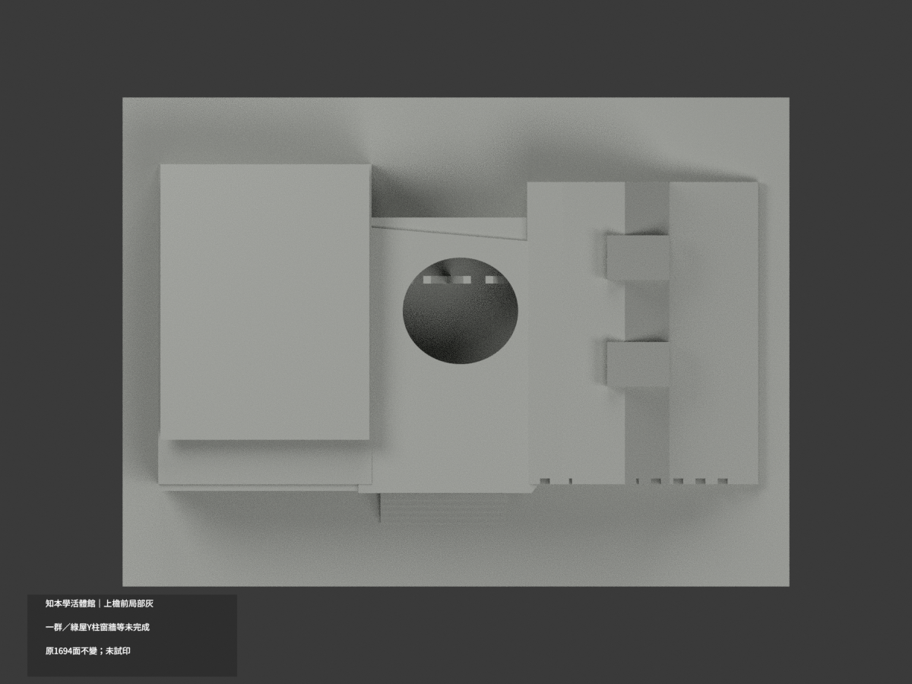
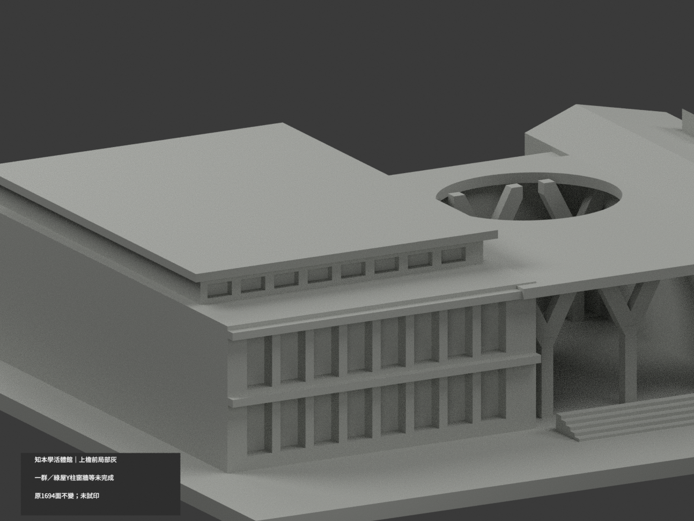
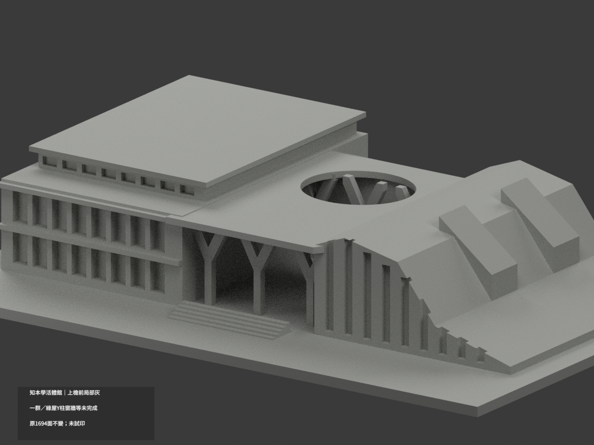
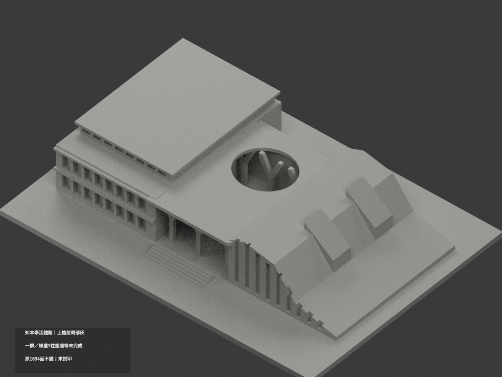

# 知本學活暨體館外觀群｜上檐前局部灰

**綠化屋、Y柱、窗牆與其餘材域未完成分色。** partial_color_incomplete=true、fully_colored_exterior=false。只低館上檐正面2原面局部灰色，不是全群完整補色。

| 總覽 | 背側 | 正面 |
|---|---|---|
||||
||||
||||
||||

## 材色範圍
同 zhiben-student-union-sports 原項目，same-item、count_delta=0。1694原三角面、STL與build_model.py字節不變。學生活動／體館／露天門廊外觀同一群，不拆套，不稱全校運動建築，沒有室內配置。原公開包無OBJ，不假稱保存不存在的原件。
- 原上檐板add(−43,9,27,47,62,1.2)的完整前垂直面：y−22、x−66.5..−19.5、z27..28.2，47×1.2矩形兩原三角，名義中淺灰。
- 全三頂點有限矩形核，整個無限y−22plane全部原面恰等於有限域，兩面共對角線組成完整矩形，不漏裁切片，不用normal／中心點取樣。
- 其餘1692中性：水平屋皮／側／底／其他檐、混植栽階路的折坡屋、原加厚Y柱與斜撐、窗背／高窗帶／混實板牆、下樓帶／門廊／橢圓孔緣、階／地面與未知側後。
- 原粗化投影與群體配置不因本次材色背書為實測。材色／中性分界是證據範圍，不是真實材接縫；不造植栽邊界、細框、燈具或支撐孔槽。

## 來源與日期
親看四張已建成外觀照片：校方日景、建築師遠景／側景／暮光外部門廊。日景可證低館上檐灰族；側景證屋面混材不可整綠，暮光只對位構件，不取照明色調。拍攝日未知，發表／修改時間不是拍攝日期，不保證2026現況。
原照私人參考、不公開、不貼圖；未確認CC或再散布授權，不保證商用。HEX只是名義材色非校準色票。正式GO已發行，繼承的先期review-only文字不改其狀態，仍須builder QA。

## 格式與列印
[原STL](model.stl) · [逐面材色3MF](appearance.3mf) · [Blender](scene.blend)
原150×110mm展示底座，照片近似非測量比例。STL無色；3MF／Blender有真逐面材。兩材標籤不是驗證兩色／四色耗材切片，未實際列印，無切片路徑。

## 重建與 QA
原build_model.py → colorize_model.py → export_appearance.py → validate_color.py；Blender render_color.py／verify_color_scene.py。完整隔離原build＋color重建、原bytes／全三角multiset、閉合正體積、3MF逐面材、scene重開、十圖1200×900及圖文hash。原依賴隔離使用，不改原碼；程序不替代人工來源核對。
原README／previews／validation／renderer保留歷程，不冒充新QA；沒有刪檔。

## English scope
Partial only:2 original triangles onthe complete upper lowhall roofedge frontfascia,nominalgray;1692unverifiedneutral. Original1694triangles unchanged,no originalOBJ. One studentunion/sportshall/openaircourt exteriorgroup,nointeriors. Entire infiniteplane equalsfinite allvertex rectangle. Roofskins,plantedmixedroof,Ysupports,windows,walls andothers neutral. Captureunknown;twilight usedforrecognition only. Not fullcurrent survey or validatedfilament slicing;not testprinted.

## 版本 2 名稱勘誤

3MF 與 Blender 物件顯示名稱統一更正為「Zhiben Student Union Sports partial color」，並同步匯出、渲染與驗證程式的名稱。場景重新開啟與保存後，除物件名稱及非渲染執行期記錄外，網格、材質、變換、相機、燈光與字幕語義完全相同；場景檔案雜湊因此更新。原 STL、材色陣列與十張預覽位元不變，未重新渲染。原有局部補色及未試印限制不變。
