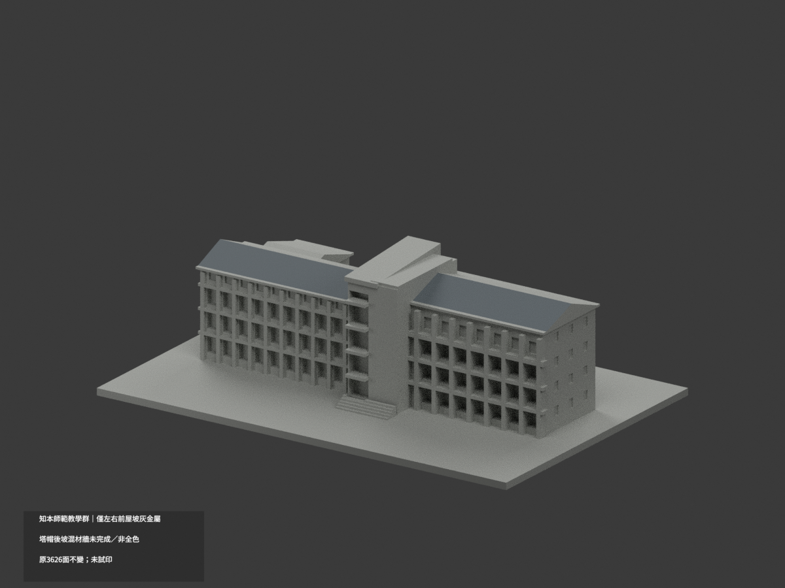
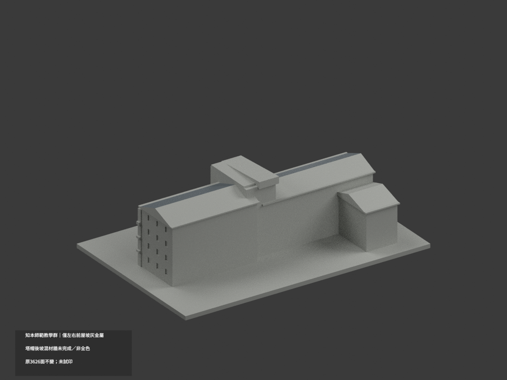
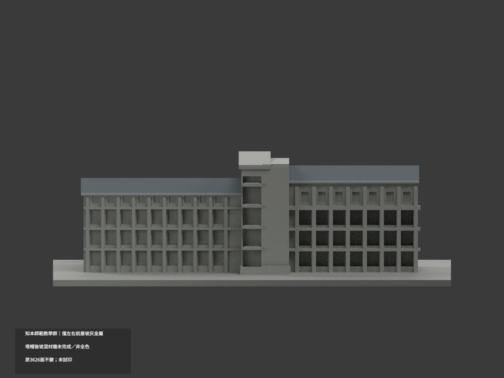
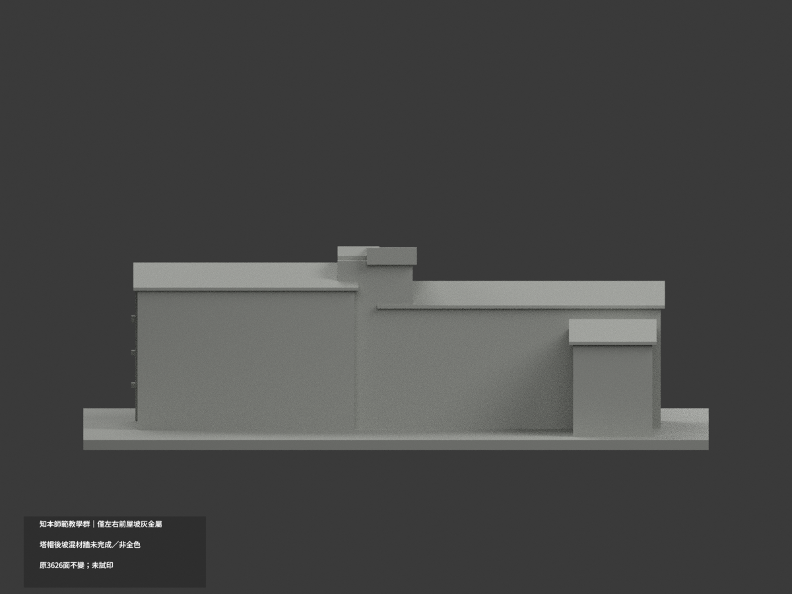
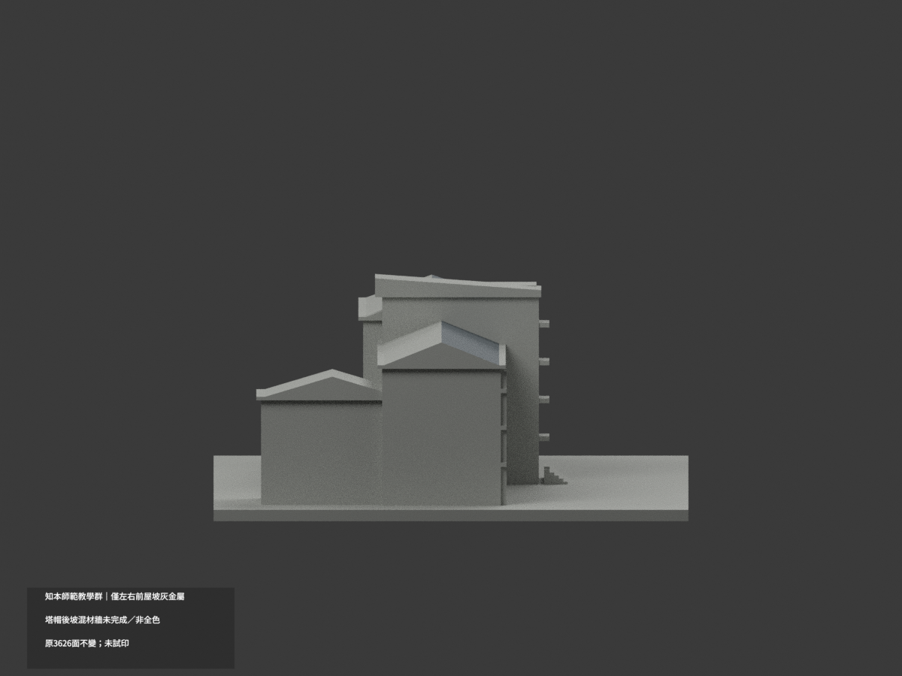
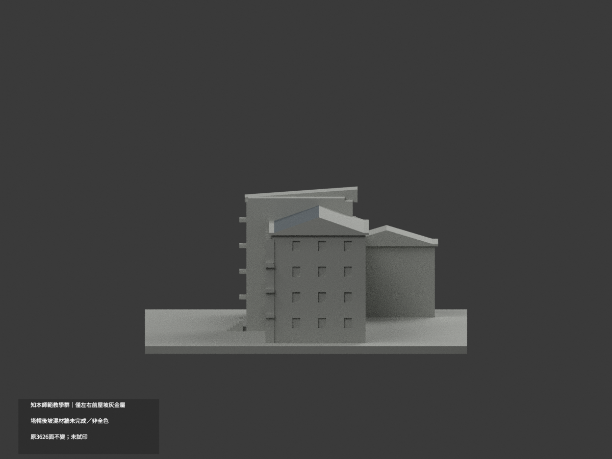
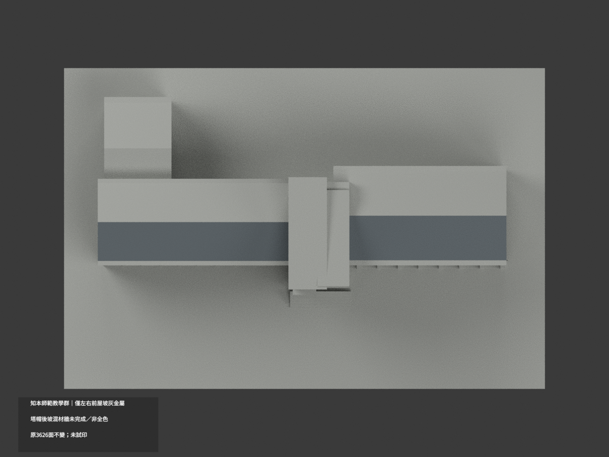
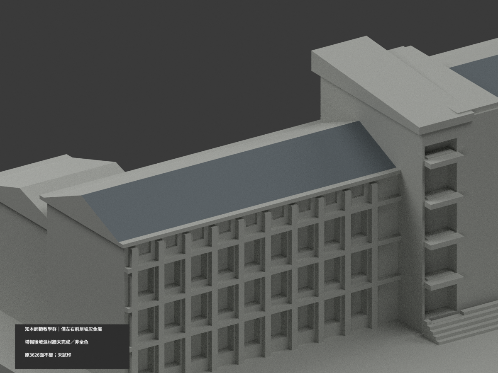
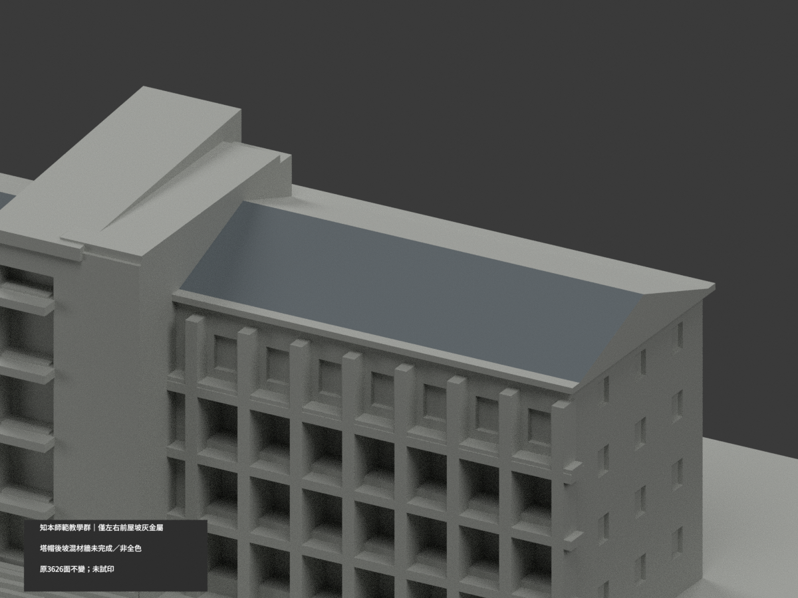
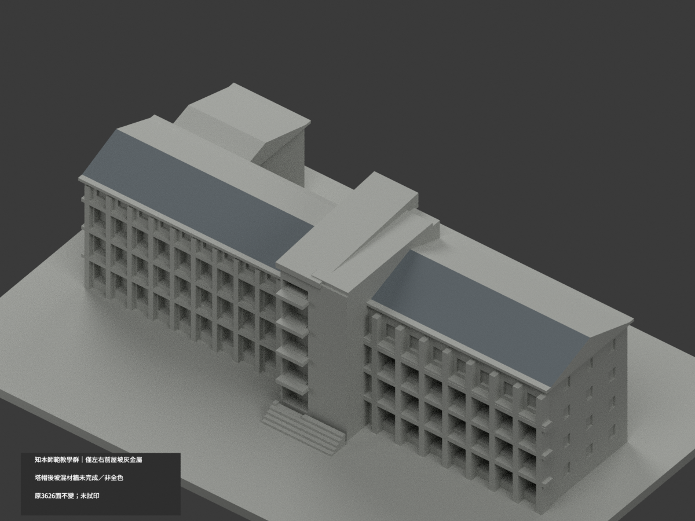

# 知本師範主要教學群｜左右前屋坡局部灰金屬

**局部補色未完成：僅左右主翼前屋坡4原三角名義灰金屬；塔帽後坡混材牆未完成／非全色。** partial_color_incomplete=true、fully_colored_exterior=false。同項 zhiben-teachers-college／count_delta=0，保留主要相連教學外觀一群，不是全師範院落或2026現況精測。

| 前斜視 | 後斜視 | 正面 |
|---|---|---|
|  |  |  |
|  |  |  |
|  |  |  |
|  | | |

## 材色範圍

左右原roof函式前側yz弦面，各2原三角，共4灰金屬、3622中性。左端點(y,z)=(-11.5,31.6)到(2,37)，原全x範圍−64.5..4.5；右端點(-11.5,36.2)到(4,41.6)，x9..63。所有三頂點須在完整plane、有限tangent區間與原全x範圍。獨立枚舉每個無限共面與有限域完全相同，兩三角共邊為一完整面，不依原ID或normal/面心猜色。

原檐板union遮住下屋條，左實際z32.15起、右z36.75起；原塔union使左實露終x−4、右起x14。這些是原幾何真界，不以任意bbox補回或重切漆界。原3626三角不變，不添屋板、窗或分面。

所有後坡與後垂直翼屋、塔不對稱實帽、其他平台、屋厚邊/端山牆/底、主牆與柱、窗背、字牌、階與底座全部中性。照片塔頂是真棚架而原簡化實帽無唯一面材映射，不自動整灰。混白牆/紅線/暗窗/金字無界亦不硬色。中性不等於實景灰，前後色差是來源覆蓋差而非實際不同屋材接縫。

## 來源與版本

親看校方主要正斜照與綠建築合成圖下方師範照片，左右前坡灰金屬族有據；上方理工照完全排除，不借鏡心紅磚。拍攝日期未核，發表/修改日期非capture，不宣2026現況。原主要教學群近似保留，不包含全部院落，也不以本次色審追認原幾何精度。照片私人參考、不公開貼圖，未見CC不推商用；HEX只是名義展示族。

## 檔案與 QA

原STL/build字節與3626完整三角不變；immutable無OBJ，原builder只輸出STL。原README保留ORIGINAL-MONOCHROME-README.md，舊previews/QA是單色歷程。appearance.3mf兩展示材、scene.blend真面材、color-mesh.npz原幾何。精確requirements隔離重建build+color，驗封閉正體積、3MF全三角與材色、Blender重開、10張1200×900。重建保留不刪，未實際列印，不是已驗多色切片。

## English limitations

Partial only: two entire front roof-slope components,2triangles each,4nominal gray-metal/3622neutral. Each original yz plane is independently enumerated and equals finite endpoint tangent/full-x domain. Original slab/tower Boolean truncations remain,not guessed paint cuts or filled gaps. All933 coplanar components uniform;original3626triangles/STL/build unchanged,noimmutableOBJ,count_delta0. Tower cap,rear slopes,roof thickness/gables/undersides,mixed walls/windows and unknowns neutral. Front/rear color difference denotes evidence coverage,not actual different roof materials. Official front and lower Teachers College composite photograph viewed;upper engineering photo excluded. Capture unknown,no2026current-state or geometric-accuracy claim. Principal connected teaching group only,not whole courtyard. No public source images or textures;not testprinted.
