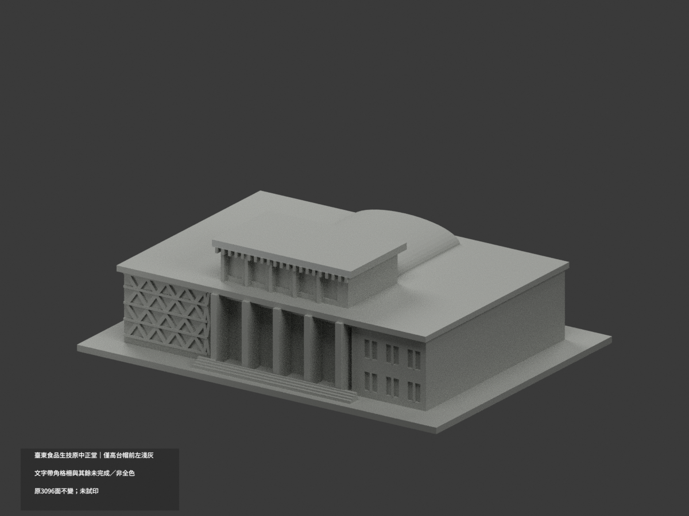
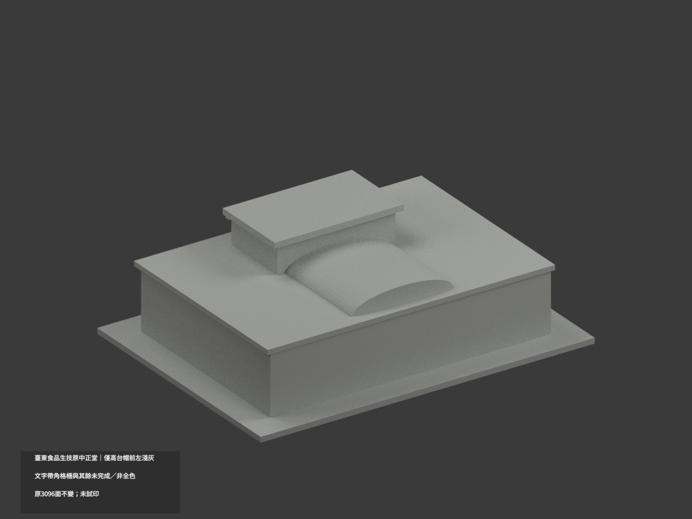
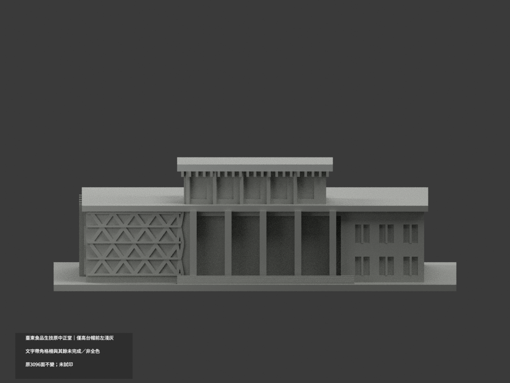
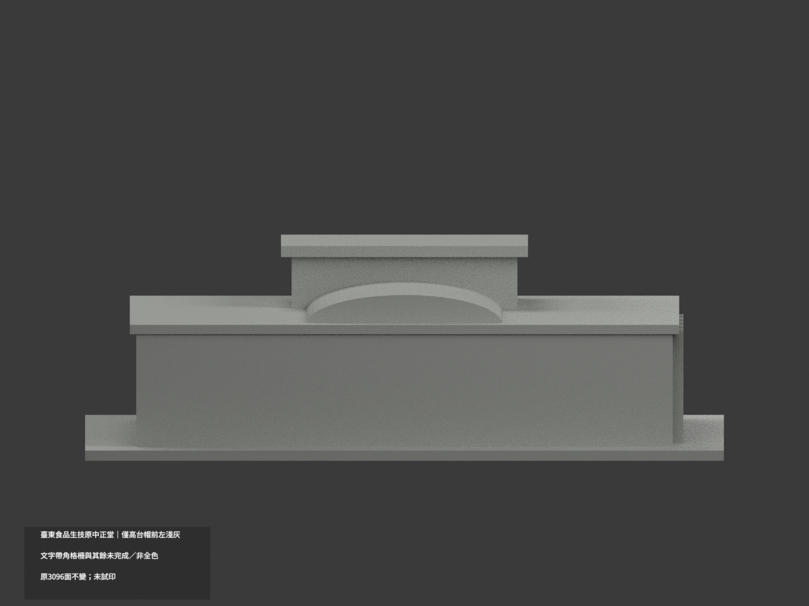
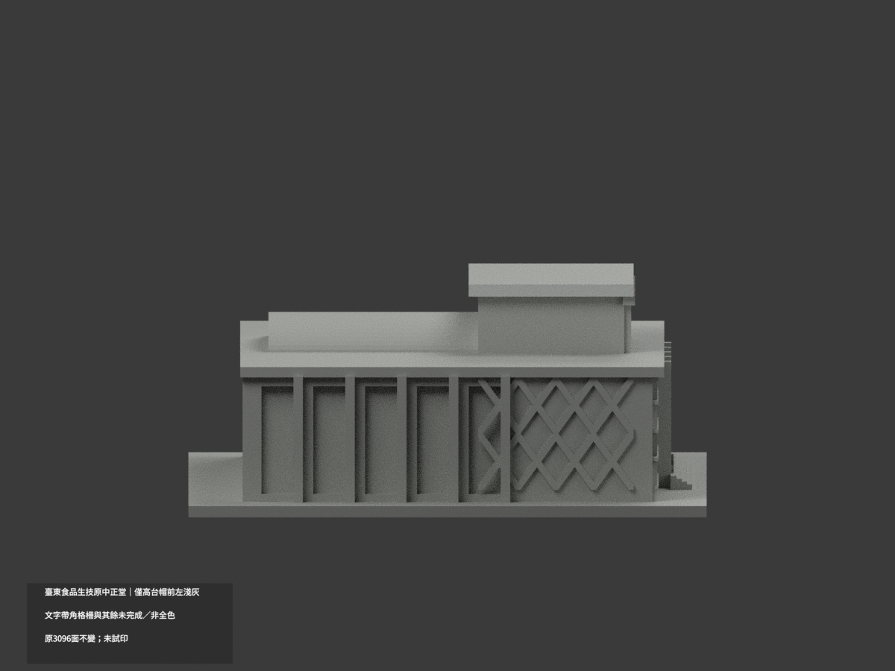
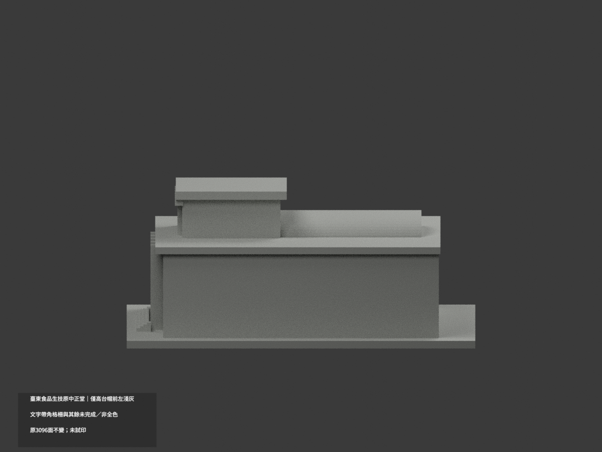
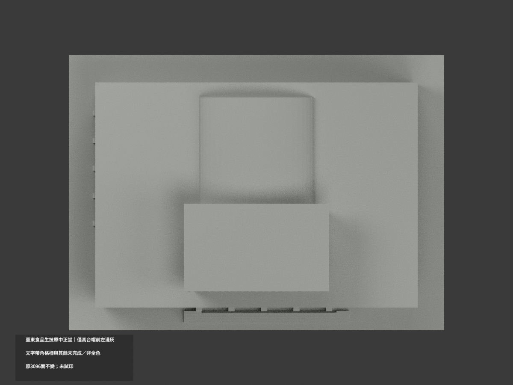
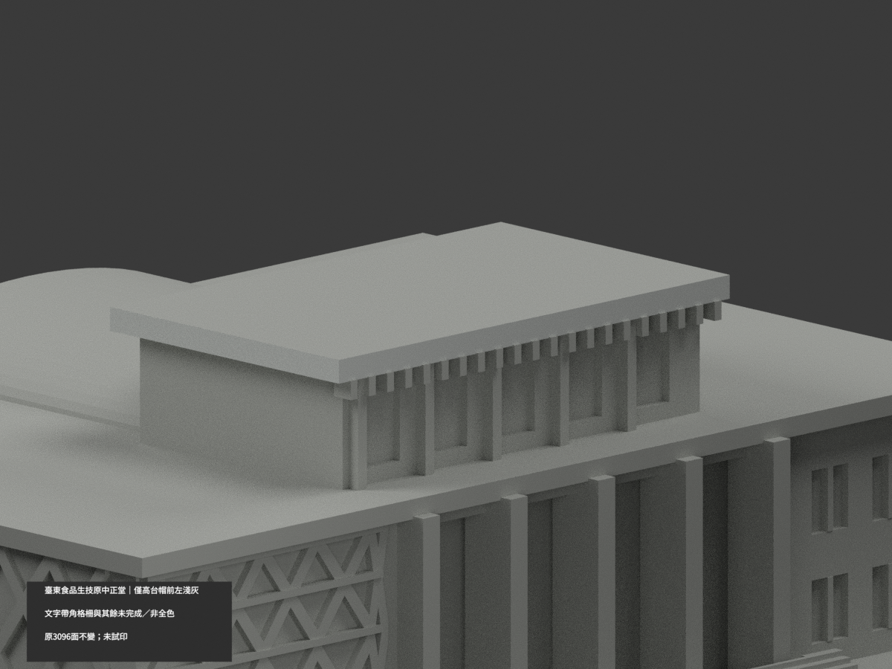
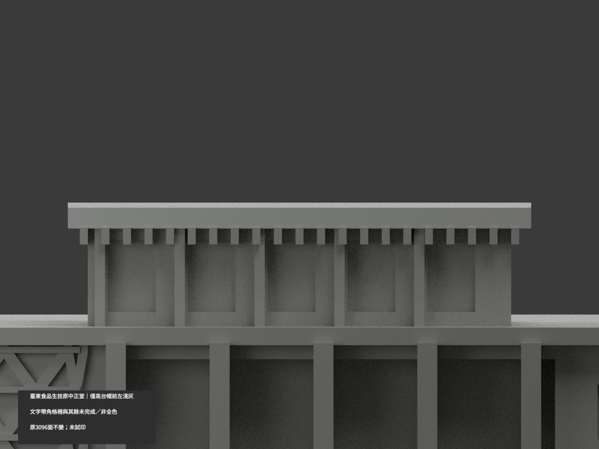
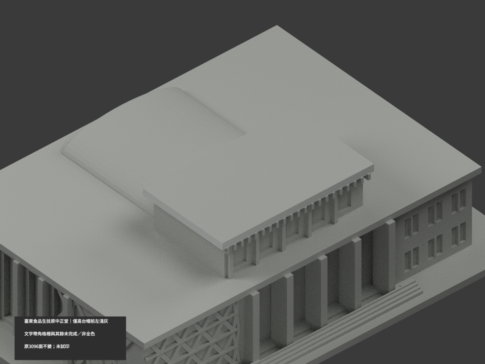

# 臺東食品生技實習工廠（原中正堂）｜高台帽前左局部淺灰

**局部補色未完成：只天窗高台帽正面86與左側2原三角淺灰；文字帶角格柵與其餘未完成／非全色。** partial_color_incomplete=true、fully_colored_exterior=false。同項 taitung-food-biotech-factory／count_delta=0，臺東校區，不是知本校區。原中正堂轉作食品生技實習工廠同一棟，不新增第二套。

| 前斜視 | 後斜視 | 正面 |
|---|---|---|
|  |  |  |
|  |  |  |
|  |  |  |
|  | | |

## 材色範圍

先枚舉原y−39.5與x−29全共面所有三頂點，再共邊連通分域。只完整落於原帽x±29、y−39.5..−4.5、z43.5..46.1的整個component：正面86與左側2，共88淺灰；其餘3008中性。正面完整保留所有齒飾union留下的Boolean碎面；同y平面低格柵2/4/2與同x平面17低階面另域，絕不因同plane全染。不是面心切色或任截高度，原3096三角與頂點不變。

高台帽頂、右後邊、底面、獨立齒飾其他面中性；低主屋帶有金黑文字而原無材界，整帶中性。角格柵原厚實背板代理透空與粉紅三角，不把全部背板或任意三角染粉。天窗背、柱槽、門廊柱/牆、後弧屋頂與端部、底座階及未知面均中性。中性不代表實景灰，資料覆蓋界不是實際材料接縫。

## 來源與限制

親看校方大幅外照與介紹海報中外觀照片，前/左高帽垂直邊淺灰連續；海報室內、設備與機能不作本模型來源。拍攝日期未知，不稱2026現況。原中正堂同一外觀建物群近似保持，原格柵厚化/槽孔簡化不以補色追認精確幾何。照片私人參考，不公開貼圖，不推未見CC為商用許可。HEX為名義展示族，不是現場測色或精確飾面。

## 檔案與 QA

原STL/build字節與3096三角不變；immutable原包無OBJ，原builder只輸出STL。原README保留ORIGINAL-MONOCHROME-README.md，舊單色previews/QA是歷程。appearance.3mf兩展示材、scene.blend真面材、color-mesh.npz同原三角。精確requirements隔離build+color，核封閉正體積、3MF座標/面材、Blender重開與10張1200×900。重建保留不刪，未實際列印，非已驗多色切片。

## English limitations

Partial only: elevated clerestory cap front86triangles and left2triangles palegray;3008neutral. Enumerate entire original y=-39.5 and x=-29 planes,then shared-edge components,then verify whole component within original cap bounds. Preserve all dentil-Boolean fragments. Separate lower lattice and stair components on the same planes stay neutral. All715 coplanar components uniform;original3096 triangles/STL/build unchanged,noimmutableOBJ,count_delta0. Main lettered fascia,solid-backed lattice proxy,cap top/otheredges/underside,window backs and rear barrel roof neutral. Former Chung-Cheng Hall and Food Biotechnology Pilot Plant are one building in Taitung city campus,not Zhiben. Exterior photographs only;poster interior/equipment not used. Capture unknown,no2026survey or geometry re-certification. No source photos/textures public;not testprinted.
