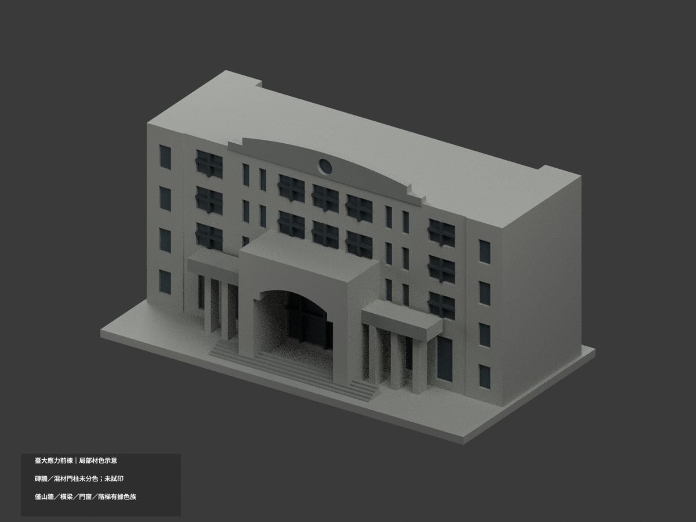
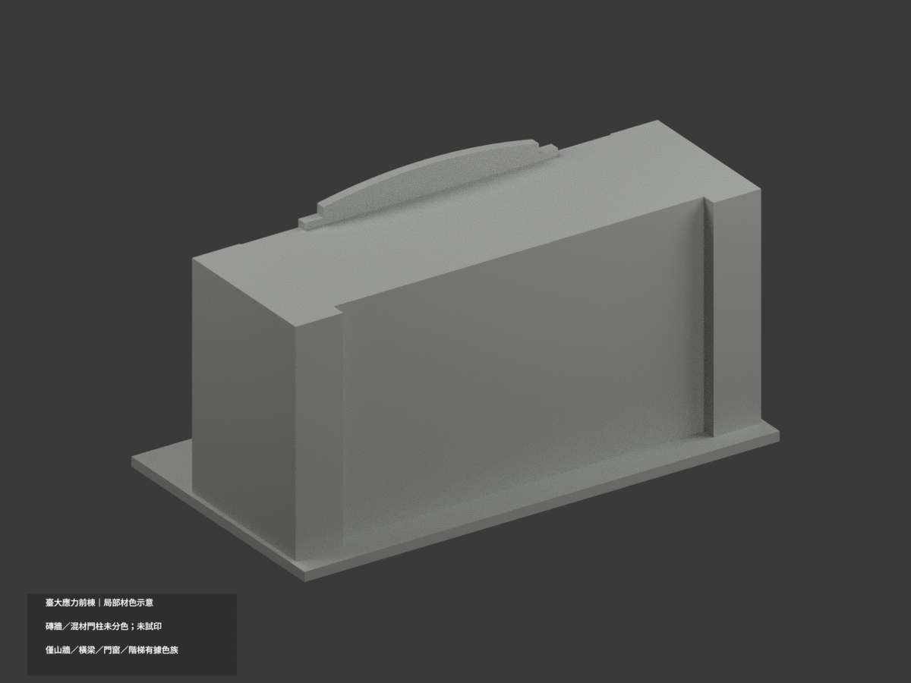
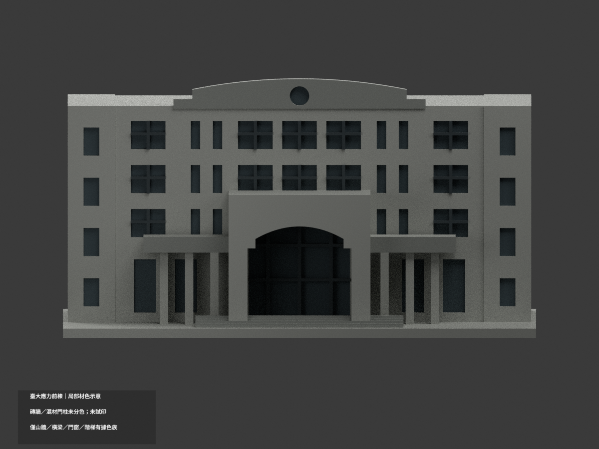
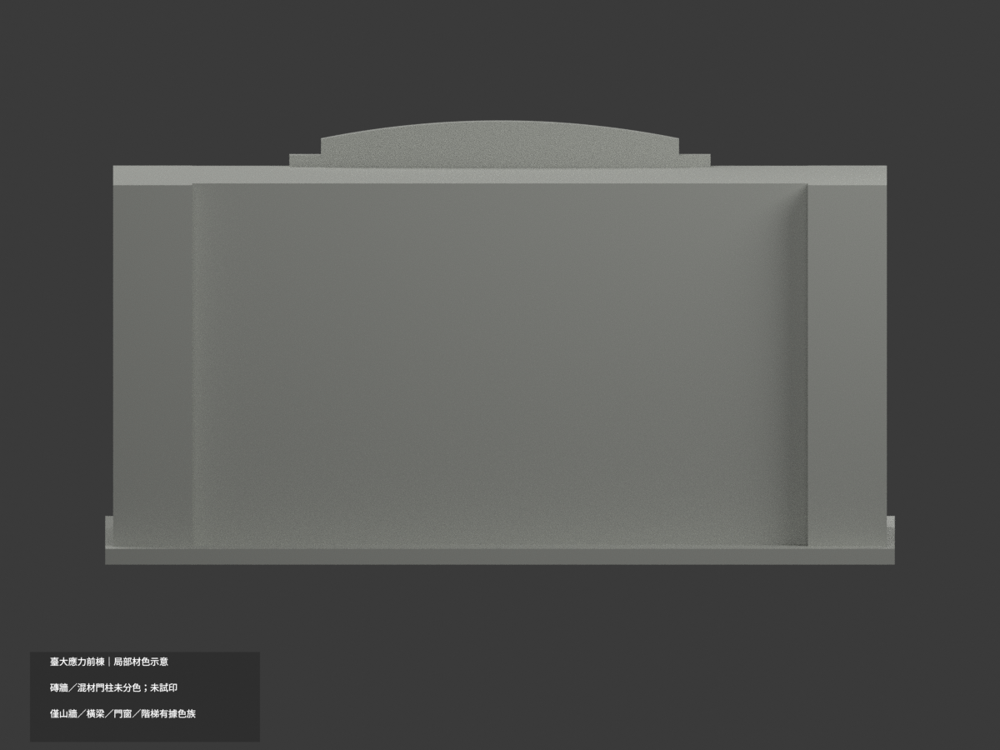
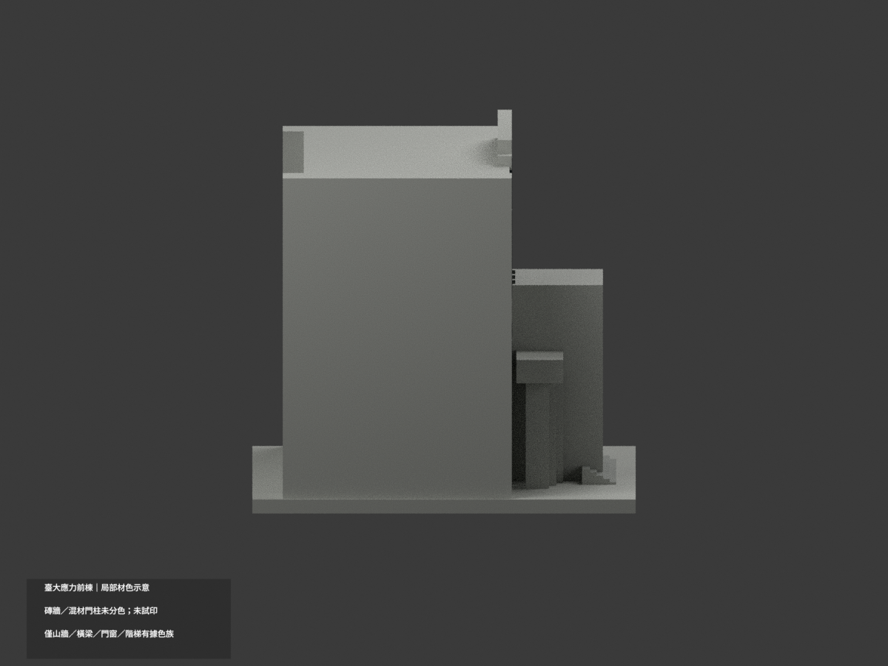
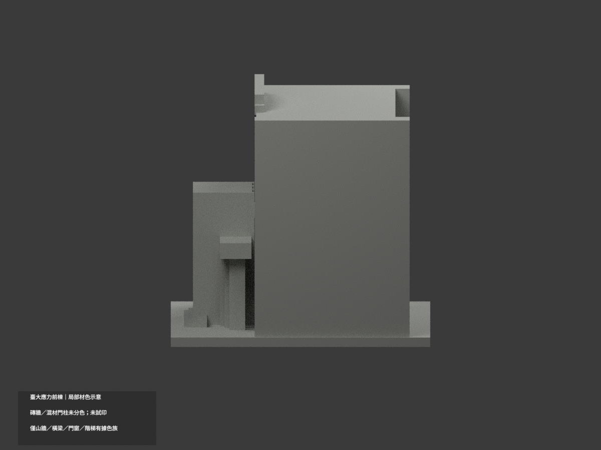
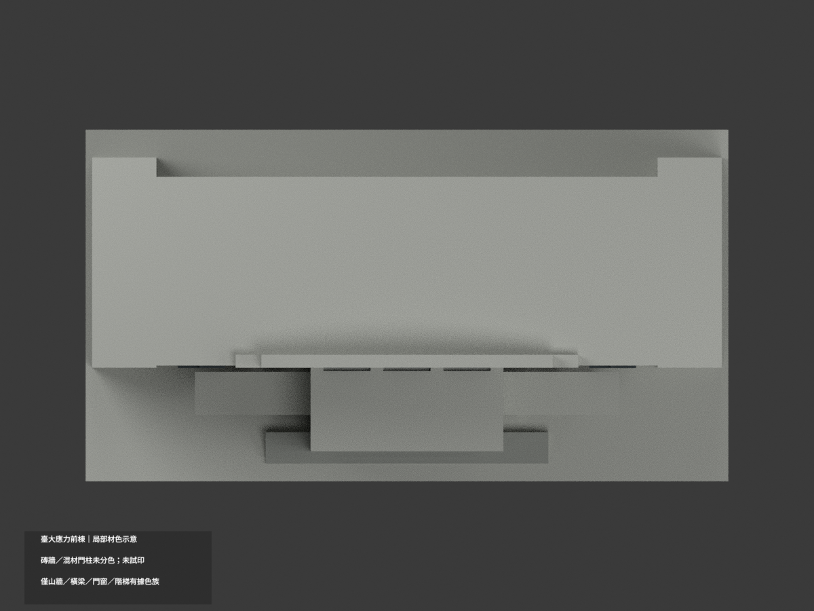
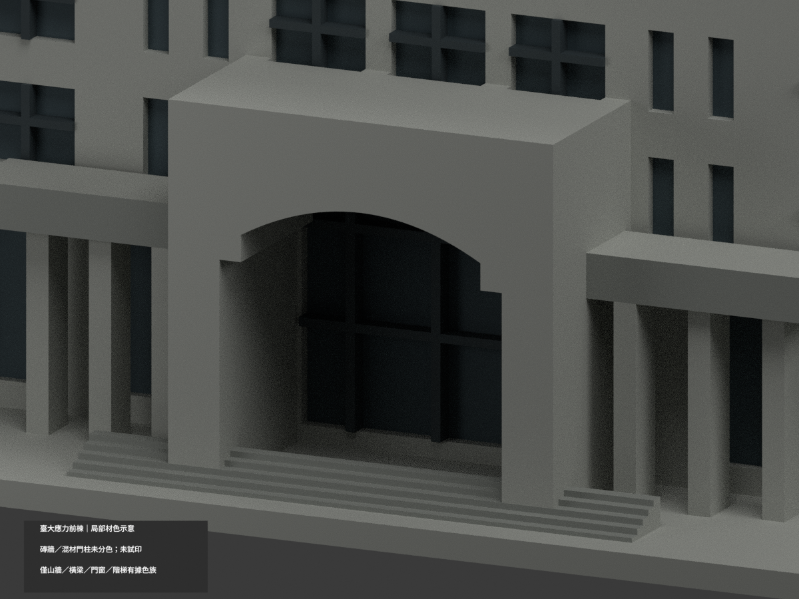
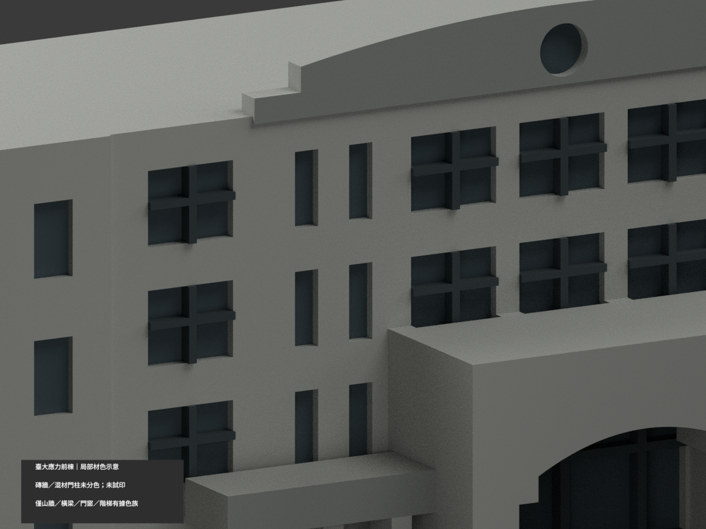
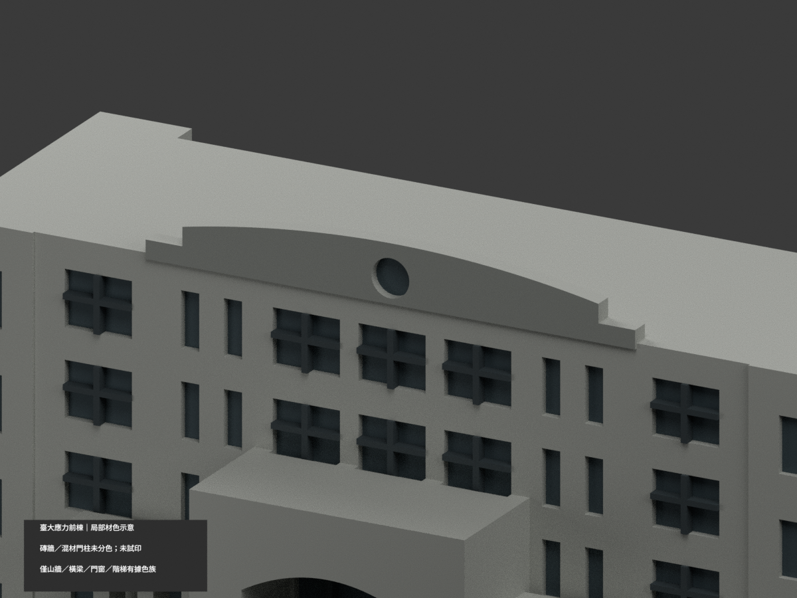

# 臺大應用力學研究所前棟｜局部材色示意

| 正前 | 後方 | 正面 |
|---|---|---|
||||
||||
||||
||||

## 材色範圍

**局部山牆、柱廊橫梁、門窗與階梯；磚牆和混材質門柱分色未完成。** `partial_color_incomplete=true`、`fully_colored_exterior=false`。這是局部材色包，不計作全面補色完成。

同一 `ntu-applied-mechanics-front` 原項目（same-item、count_delta=0），保留 **2904 個原三角面、頂點及 STL／OBJ／build_model.py 位元組**。只含原前棟近似範圍，不擴建為全院中庭建築群。沒有新增、切分或修正幾何。

採官方 N59 2010 照片與拍攝日期未核的所方 IAM.jpg 近似色族：獨立弧形山牆正面、下柱廊既有橫梁正面與階梯為灰色，真凹門窗背面為克制灰藍陰影，原有細梃為深灰。IAM 藍天反光不是玻璃固有鮮藍油漆，未仿製污斑、反光、植栽及招牌。

**主立面同一平面混紅磚、灰基座、灰女兒牆；原大型門柱與柱廊柱亦混磚身與灰腳，未被原拓撲分界，所以整個連續平面保持中性。** 不用高度門檻把上三角染色形成假斜楔。橫梁上面、主屋面、側端與後面未證保持中性；不虛造灰窗外框、欄杆或文字。

## 使用與重建

`scene.blend` 為實際多材質場景；`appearance.3mf` 使用基本材質標籤，`color-mesh.npz`、`palette.json` 與 `appearance-materials.json` 為原三角面材質對照。STL 自身不含顏色，原 OBJ／程式與 `ORIGINAL-MONOCHROME-README.md`、原 `previews/` 保留，不當作新色版 QA。

重建材色：`python colorize_model.py`、`python export_appearance.py`、`python validate_color.py`。原幾何仍由 `build_model.py` 重建。Blender：`blender -b -t 6 --python-exit-code 1 --python render_color.py`；以 `verify_color_scene.py` 重開檢查。

**未實際列印**；四種顏色標籤不是已配置或驗證的四色列印工作。原外觀近似與細件列印限制保持。本更新不宣稱精確竣工、完整現況或 2026 材料測繪。

## 來源與權利

官方來源列於 `COLOR-SOURCE-REGISTER.json`。來源照片未確認 CC／開放再散布授權，僅私人參照，不隨模型公開、不作貼圖、不保證商用。原模型授權不擴張到照片權利。來源與原包已私人保留，沒有刪檔。

來源 GO／原照獨立審核不等同成品通過；本包另有原三角座標一致性、3MF、Blender 材質、隔離重建、十視角與人工視覺 QA。HEX 是未校準色族，未知區域中性是明示未完成範圍。
