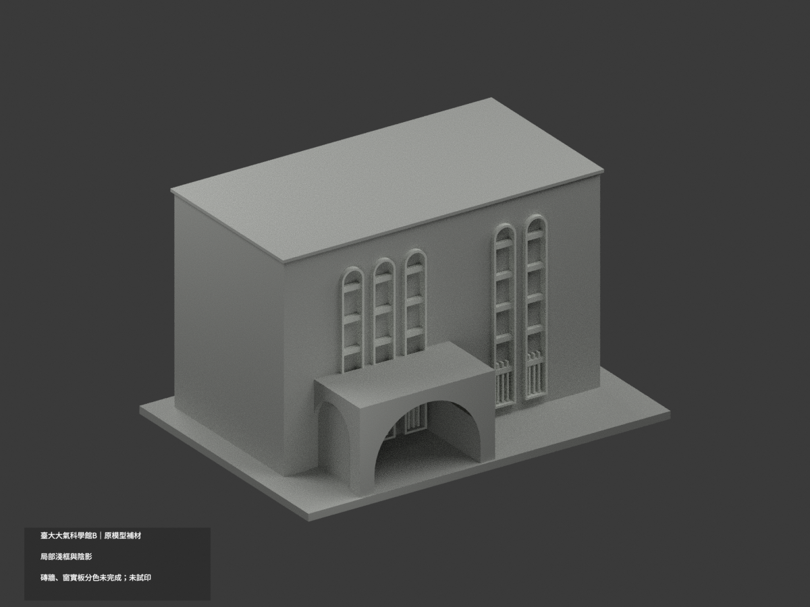
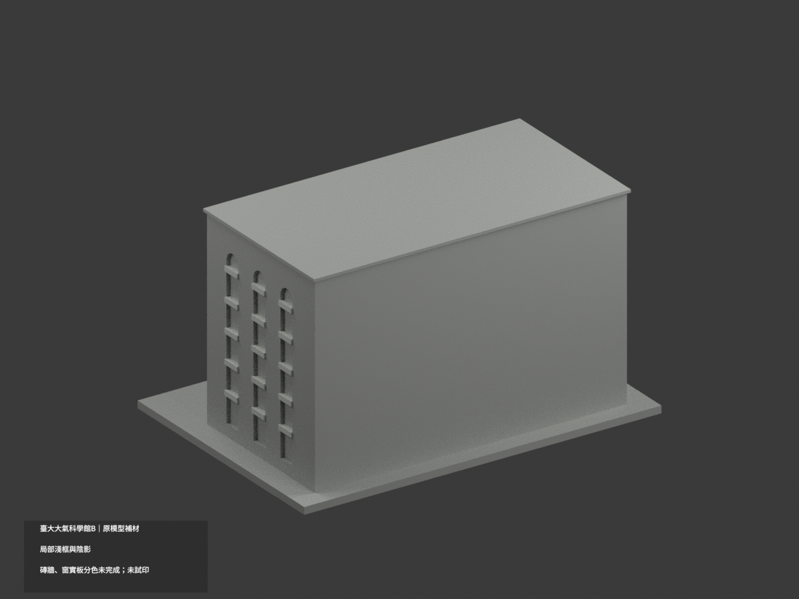
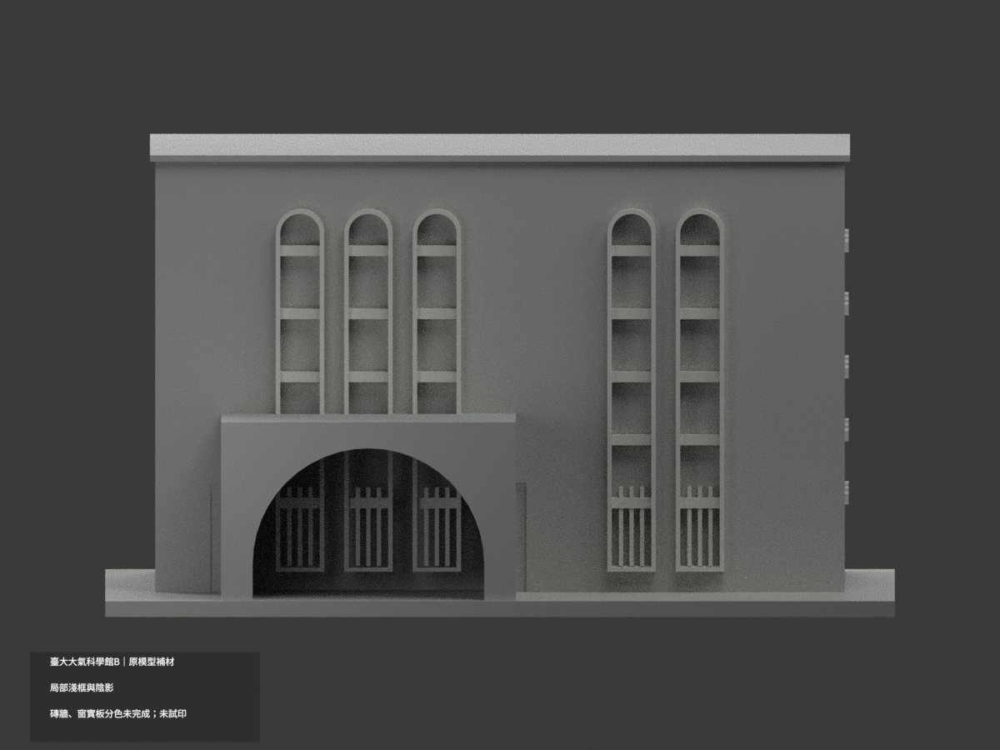
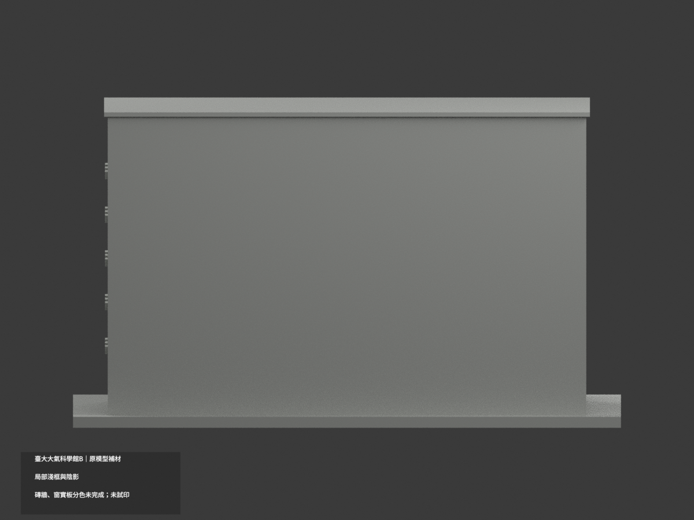
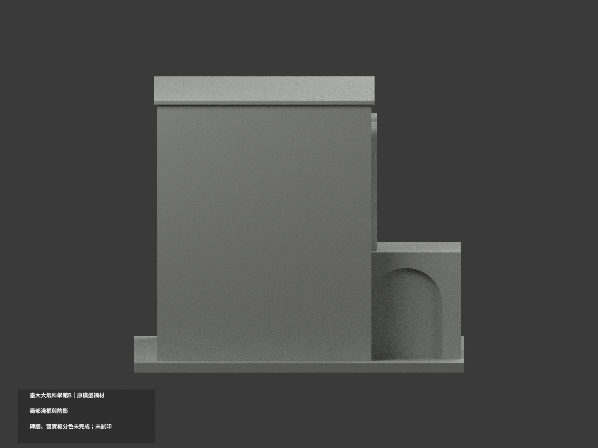
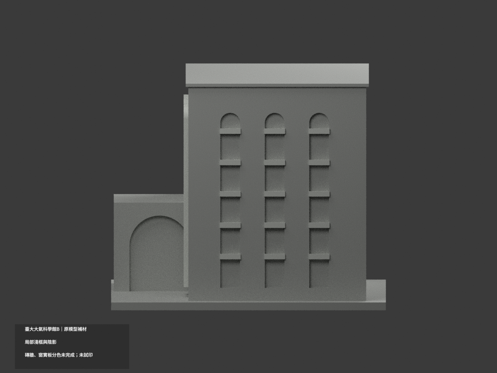
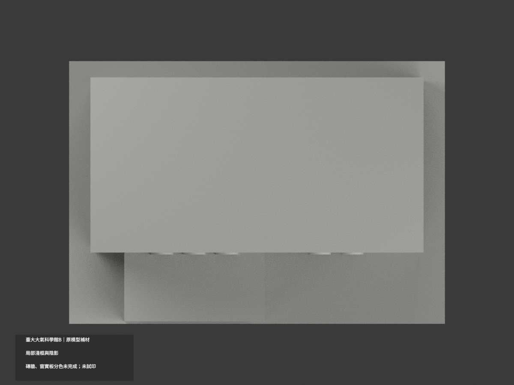
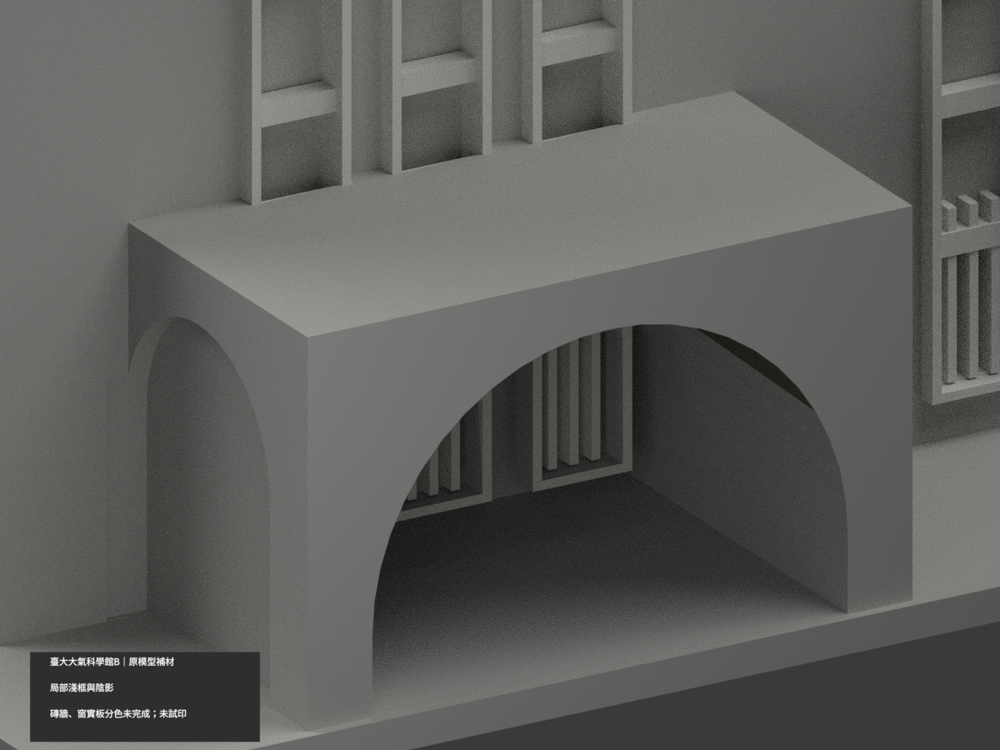
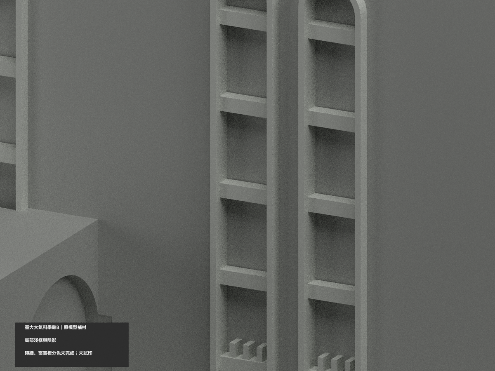
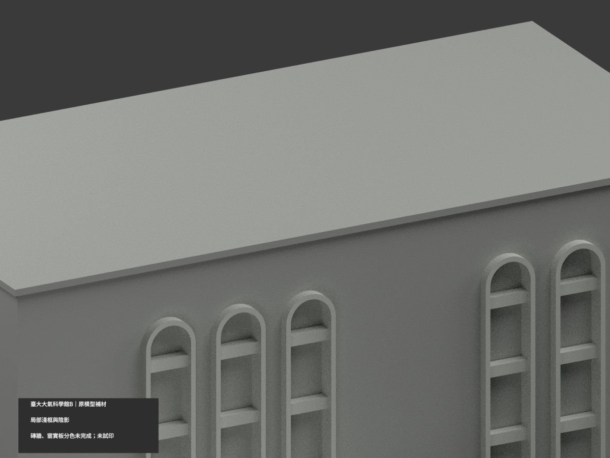

# 臺大大氣科學館 B｜既有模型局部材色更新

**僅既有淺框與門廊陰影；磚牆、深窗與實板分色未完成。** 原大面跨不同材料界線，保留中性而不切三角面補色。這不是全館精確滿色，2010 官照色族不代表 2026 現況。

| 總覽 | 背側 | 正面 |
|---|---|---|
|  |  |  |
|  |  |  |
|  |  |  |
|  |  |  |

## 材色範圍
- 同一 `ntu-atmospheric-science-b` 項目更新，count_delta=0；4270 個原三角形及座標不變。原 STL、OBJ、build_model.py 原位元組保留，不新增館舍、牆、窗或切面。
- 只將已獨立建模的正面拱框、橫梃、地層柵，以及右側橫梃賦予白灰色族。真實門廊內拱陰影不是玻璃。
- 主前及右大牆跨未分離的深色基座，整面中性；門廊外皮混窄深紅壓頂，無獨立面故不畫假色線。
- 高窗背板包含照片中的白色實心窗間板與暗窗，原幾何沒有可靠分域，全部保中性，不把整條長窗染黑或染白。此處並未完成磚牆、窗/板材色復原。
- 未見左側、背側、水平屋頂、平台保留中性，不從有證面鏡射推色。原幾何的窗距、拱、尺寸仍是舊有粗化近似，色彩不背書幾何精確。

## 來源與權利
依臺大官方 2010 S45 兩張外觀照片 `IMG_5829`、`IMG_5831`；只 B 館，不含 A 館、C 館及連接翼。原照及研究檔私人保存，未確認 CC 或開放重製授權；原圖不隨模型公開，不作照片貼圖，不保證商用權利。色值僅歷史照片未校色的展示近似。

## 格式與列印
[原 STL](model.stl) · [原 OBJ](model.obj) · [彩色 3MF](appearance.3mf) · [彩色 Blender](scene.blend) · [材質表](appearance-materials.json) · [原模型說明](ORIGINAL-MONOCHROME-README.md)

3MF basic materials 與 Blender 實際面材質可視化；STL 本身不含色。三種材質標籤不是已驗證三色/四色耗材切片專案。毫米單位，原模型含底座150 mm長，非實測比例。未實際列印，未產生切片工具路徑；門廊懸垂、細框及支撐仍需使用者檢查。

## 重建與 QA
以原 requirements 安裝依賴後依序執行 `build_model.py`、`colorize_model.py`、`export_appearance.py`、`validate_color.py`；Blender 執行 `render_color.py`，再執行 `verify_color_scene.py`。
`COLOR-FORMAT-GEOMETRY-QA.json` 記錄原 STL byte hash、逐三角座標、閉合正體積、3MF 幾何/材質索引與完整隔離重建。`SCENE-QA.json` 重開場景檢查真正指派材質，`DELIVERY-QA.json` 綁定十圖及 mesh hash；程式 QA 不取代人工來源/外觀核對。

舊 `previews/`、`render_preview.py` 及舊 validation 等原檔保留供歷程，它們是單色舊版，不能取代上方新十圖與新材色 QA。不刪任何原件。
