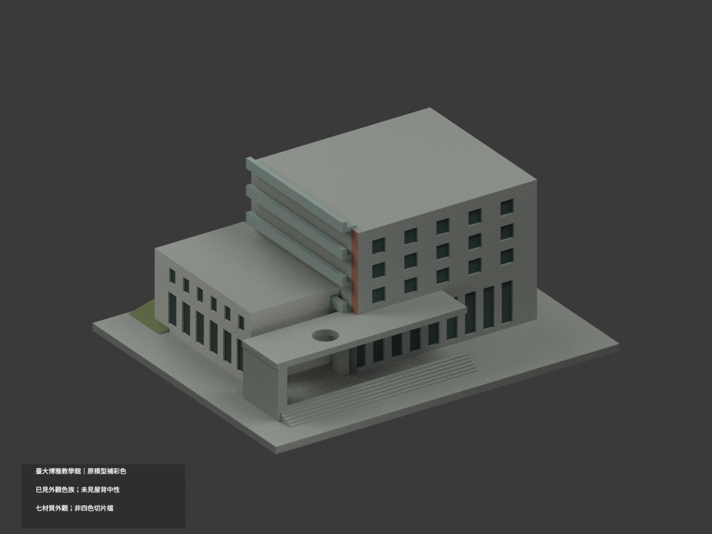
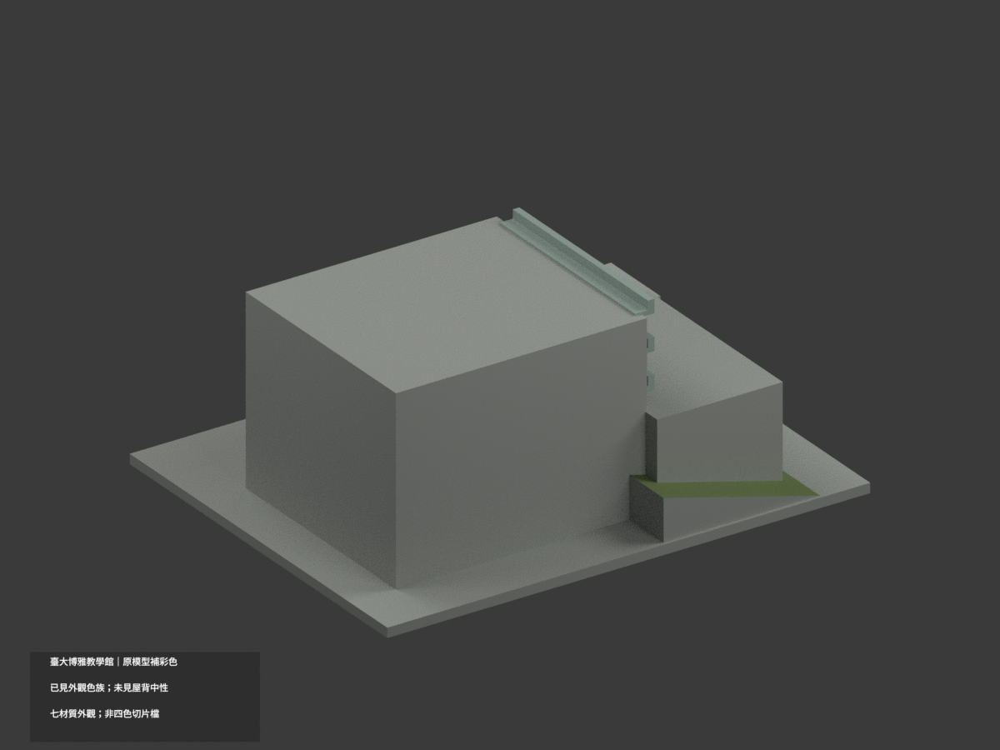
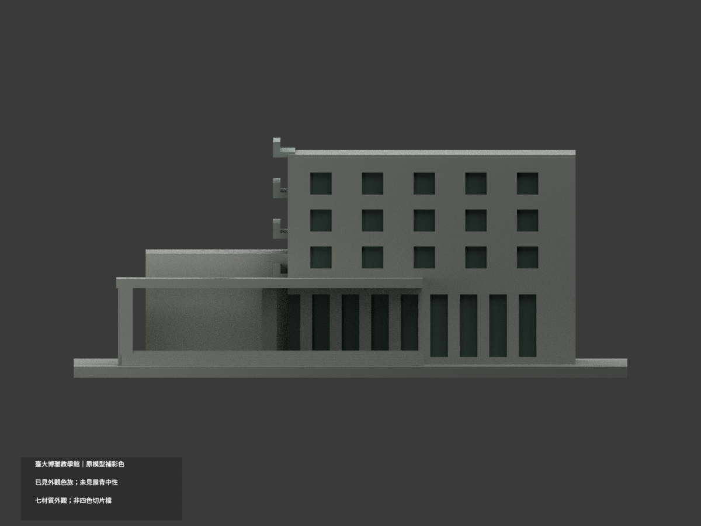
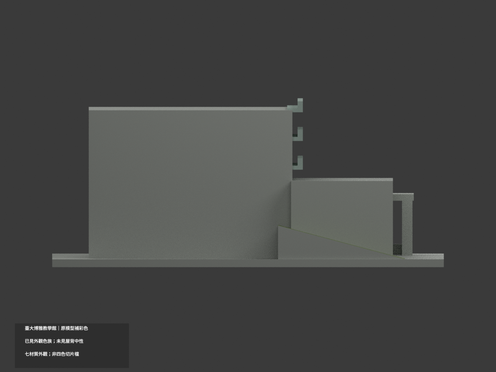
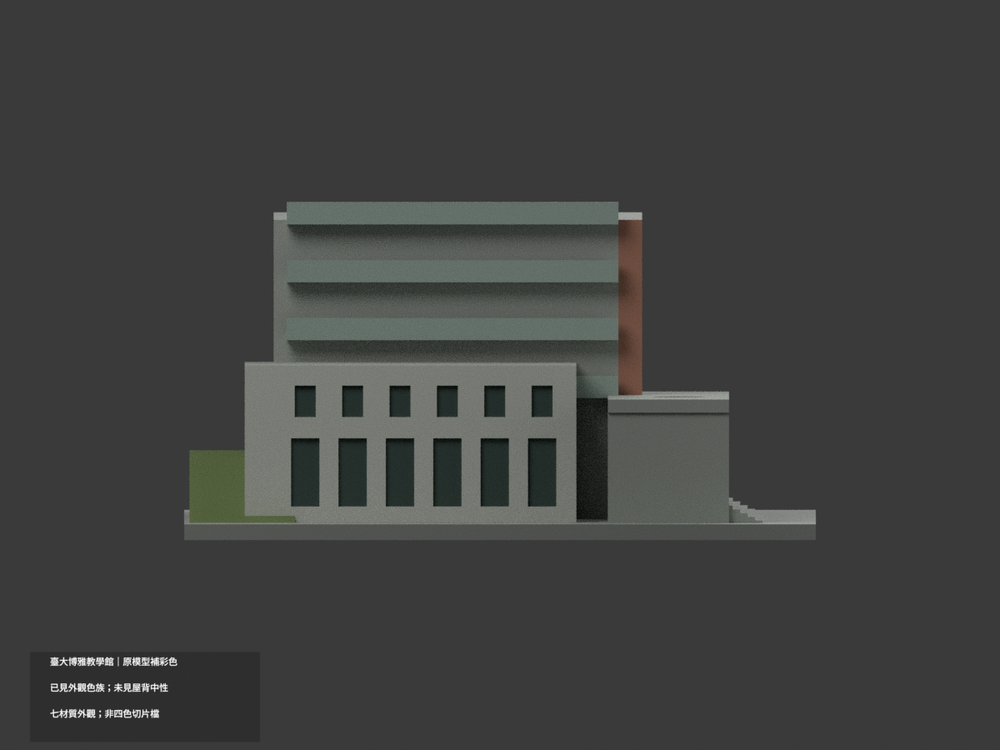
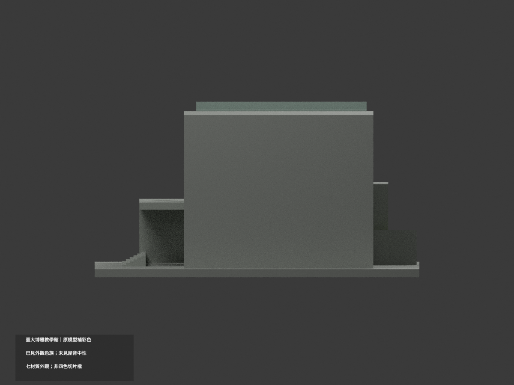
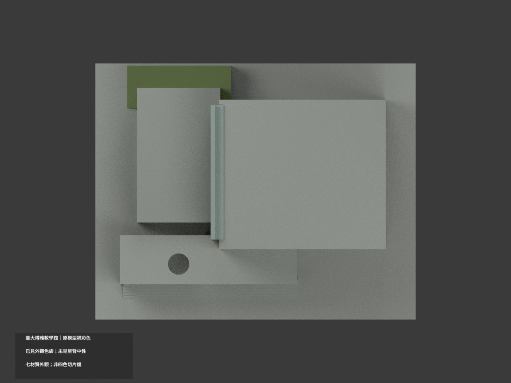
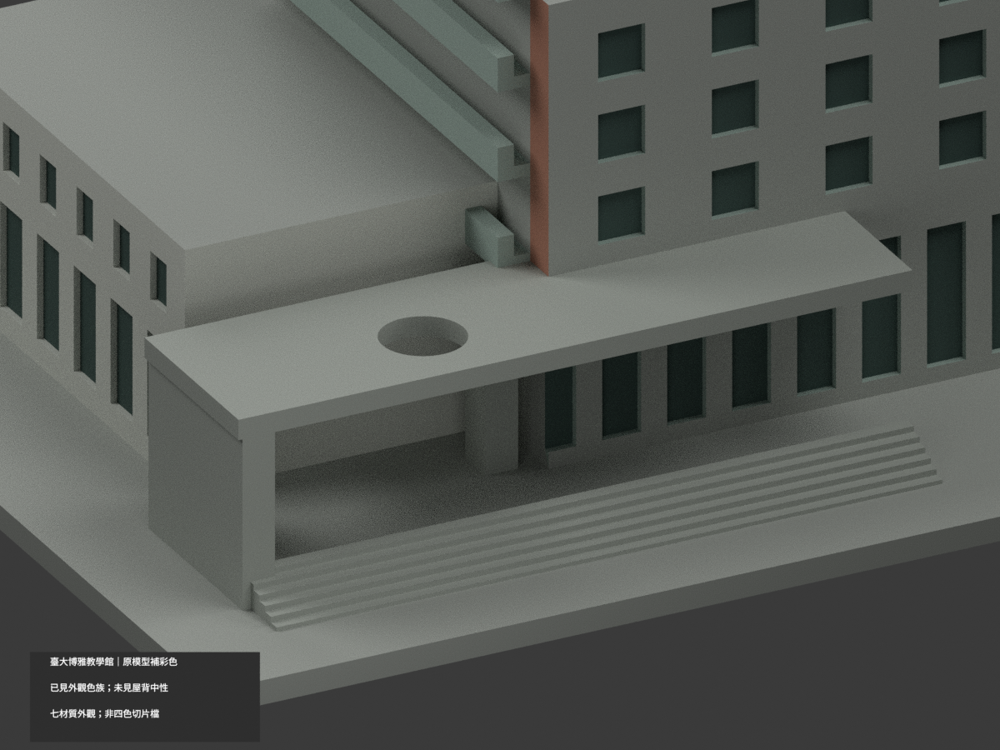
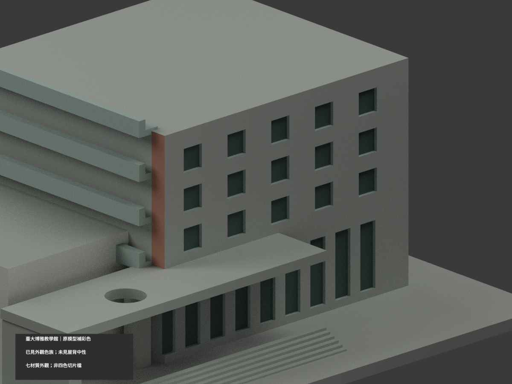
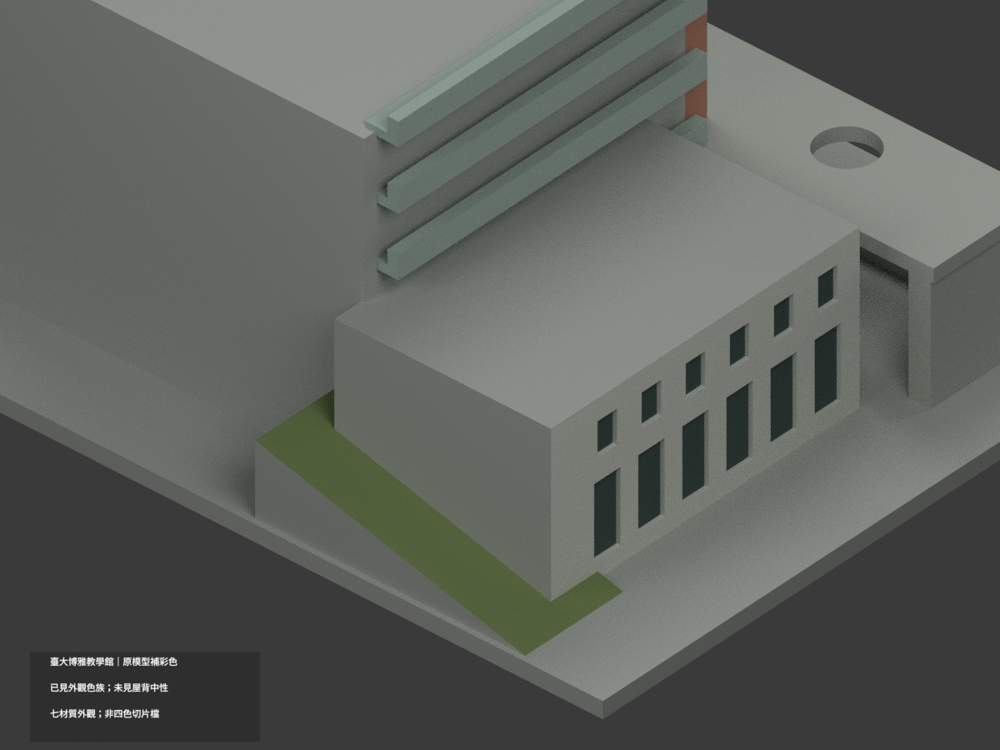

# 國立臺灣大學｜博雅教學館：原幾何補彩色

## 彩色模型預覽

**同一項目材色更新（count_delta = 0），原 1092 三角面不變。照片雖證主前牆上部為磚，原大三角跨上磚／下框界線，故主前平面整面保中性，避免假斜色；僅可分的前緣返面保磚色。不是全館精確實景色復原。**

| 正面斜視 | 背面斜視 | 正面 |
|---|---|---|
|  |  |  |
|  |  |  |
|  |  |  |
|  |  |  |

## 材色範圍與限制

- 主前 y = −27 的完整原平面保中性，不能把中性色當現場真漆。左主返面僅前緣 y = −27..−22.5 的原完整域採近似磚色；陽台內後實牆未充分證色仍中性。
- 既有大門廊、圓孔內壁、支柱及入口階為清水混凝土灰；不新增照片欄杆、磁磚紋或精密構造。原低翼已見外側與前面淺灰，離散窗凹底灰綠陰影。
- 原粗化陽台唇／欄板採灰金屬色族，不以色線虛畫照片細欄杆。窗凹只分既有面，不新增遮陽片或連續玻璃幕牆。
- 官照高視角可證草坡；綠色只限原後側楔形的向上斜面，垂直端壁／側壁不塗綠。不移植周遭草地、鄰棟或往普通館空橋。
- 主／低翼平屋面、遠側與後面、底座及未證面中性；照片只供近似色族，不是校準色票或同年全館測繪。補彩不背書原模型尺寸與細部精度。
- 不增刪幾何；遇大三角跨材界，整片中性或既有完整面統一處理，絕不切面湊精色。

## 格式、重建與驗證

原 `model.stl`、`model.obj`、`build_model.py` 位元組不變；原 STL／OBJ 不當本次彩色輸出。`appearance.3mf` 七基本材質逐面指派，`scene.blend` 有實際 shader，`color-mesh.npz` 保存原面座標。七材質外觀不是已驗證四色／多耗材切片專案；未實際列印，未執行切片器驗證。

```sh
python build_model.py
python colorize_model.py
python export_appearance.py
python validate_color.py
blender -b -t 6 --python render_color.py
blender -b --python-exit-code 1 --python verify_color_scene.py
```

沿原 requirements 安裝 NumPy、trimesh、manifold3d，另使用 Blender 4.3.2。隔離重建目錄保留不刪除。新 QA 為 COLOR-FORMAT-GEOMETRY-QA.json、SCENE-QA.json、DELIVERY-QA.json、INDEPENDENT-COLOR-VISUAL-QA.json；原單色 previews、render_preview.py 和舊檢查檔保留為歷程，不當本次材色重建入口。七全景有完整邊界檢查；三細景刻意局部構圖。

## 色源與權利

來源為臺大博雅官方介紹外觀合照，以及 Harvard 對博雅入口的實景照片；合照室內部分未用於本次外觀材色。精確頁面／圖片公開網址與權利見 COLOR-SOURCE-REGISTER.json。

原照／網頁與核圖私人保存，原圖不隨模型公開，不作貼圖。未見通用 CC 授權；保留各原作者、臺大及 Harvard 來源權利，不把專案開源授權套於照片、不保證商用權利已清。Harvard 頁面此次存取失敗，但已成功取得原直圖，只依實際取得圖片核色。

## 原模型說明與歷程

以下保留原說明；本次材色入口以上文優先，舊單色預覽保留為歷程。

# 國立臺灣大學 博雅教學館

## 模型預覽

| 模型預覽 | 模型預覽 | 模型預覽 |
| :---: | :---: | :---: |
| 正面<br> | 背面<br> |  |

[返回校區圖鑑](../../README.md) · [返回臺大總圖鑑](../../../README.md)

## 實際 STL 正面與背面


[下載 STL](model.stl) · [Blender 場景](scene.blend) · [參數化來源](build_model.py) · [驗證結果](validation.json)

[新增34件列印幾何補查與細節警示](../../../qa/printability-20261013/README.zh-TW.md)


官方索引代碼 N13。公開外觀近似模型，非測繪或BIM。

## 範圍與比例
以官方外觀照片組與Harvard實景照片作簡化主館量體。側翼與斜坡相對尺度為目測，背面及屋頂配置未充分確認；不包含連往普通館的空橋。

保留辨識特徵：高低樓翼、紅磚主體方窗、階梯式側陽台、入口大型門廊、雨棚圓孔及低矮斜坡量體。

尺寸 [150.0, 120.0, 63.20000076293945] mm，含底座最長150 mm。各館獨立比例，不是可拼接的共同尺度校園沙盤。尺寸、厚度、窗距均為照片目測和列印簡化，不是原建物實測。

## 列印
- 底座向下，毫米單位。參考起點：0.4 mm噴嘴、0.16–0.2 mm層高、3道外牆、15–20%填充。須依自己的切片器調整。
- 大型入口雨棚為跨距懸空結構，需支撐；側露台上緣亦建議局部支撐。圓孔為穿透雨棚的開孔。
- 新增細浮雕名義最小約0.9 mm；這不是全模型最小壁厚的測量結果。零碎設備、文字招牌、樹木、電線及細緻裝飾沒有加入。
- 門窗背牆與實心量體避免隱藏內殼；實際填充由切片器決定。
- 未實際列印；未用PrusaSlicer、Cura等生成工具路徑。不宣稱無支撐或無風險可印。

## 驗證與檔案
- model.stl、model.obj；scene.blend是由實際STL匯入的可編修網格。
- build_model.py為獨立參數來源；Python3.12，依requirements.txt裝依賴後執行python build_model.py。
- Blender4.3.2：blender -b -t 2 -P render_preview.py。previews/front.png、rear.png、elevation.png均直接渲染交付STL。
- python validate_model.py：原始法向、水密、流形邊／頂點、單一連通表面、無分離封閉內殼、正體積、150mm、獨立重建SHA256及已儲存Blender/STL三角幾何一致性。結果validation.json。
- python check_layers.py：每0.2mm水平截面幾何檢查，共 316 層，所抽樣截面全部閉合。首層採z=0.071mm避免重合平面退化，非實際列印首層設定。
- layer-check.json另記向下超45度面積指標與各層輪廓；它不是切片器、最小壁厚測試或實體試印。閉合截面不保證擠出連續、橋接、支撐可拆、床面附著或局部細節可印。
- SHA256SUMS可核對檔案；更改參數後需重建、重繪、重驗證。

## 公開來源
查閱及圖像像素檢視：2026-10-13。來源照片未隨檔重新散布。
- [臺大校務資訊：博雅教學館](https://ntuinfo.ntu.edu.tw/p1_3_6.html)
- [實際檢視官方外觀照片組（僅取外觀作建模依據）](https://ntuinfo.ntu.edu.tw/img/a3_6_pic4.jpg)
- [Harvard Taipei Academy：Campus](https://sites.harvard.edu/harvard-taipei-academy/campus/)
- [實際檢視入口近景照片](https://bpb-us-e1.wpmucdn.com/sites.harvard.edu/dist/8/289/files/2024/09/Boya-2.jpg)
- [臺大官方建物索引，檢索標題2026-08-17](https://cpo.ntu.edu.tw/map/C_01_list.pdf)

照片版權屬原權利人；沒有轉授原建築設計或照片權利。不同拍攝日期不等於已核實目前全部外觀。
