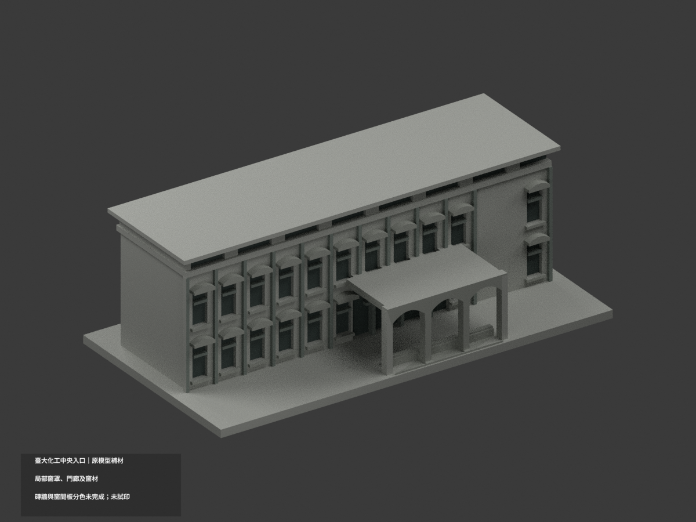
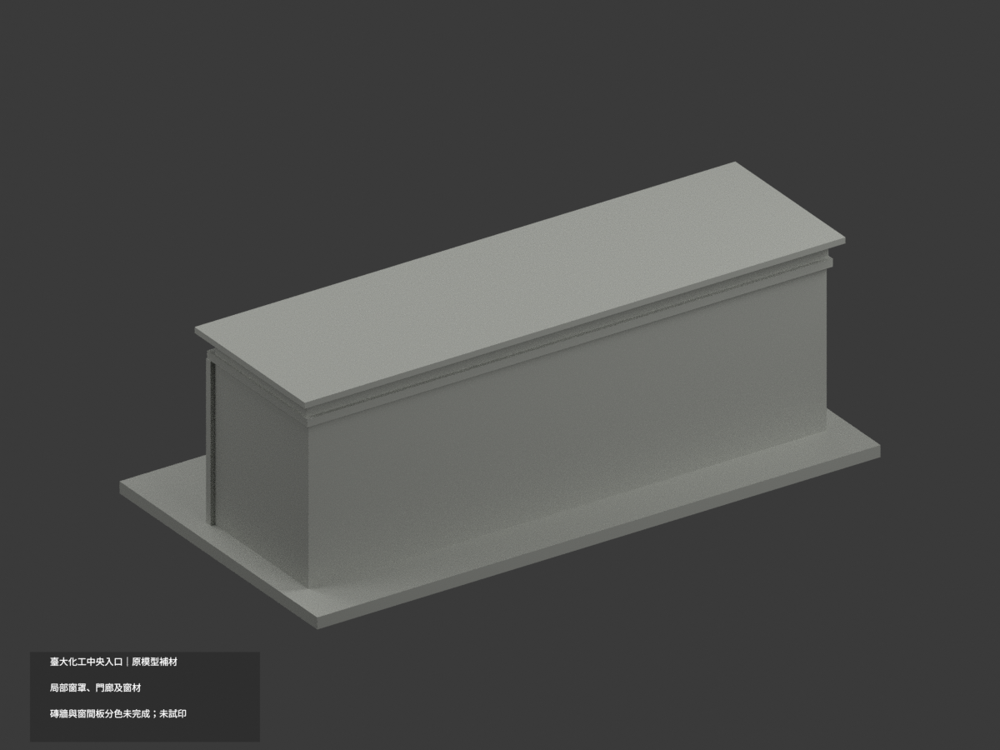
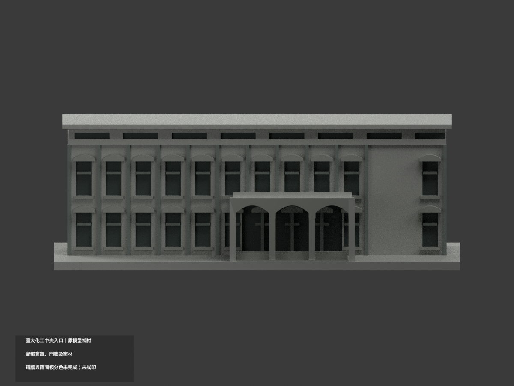
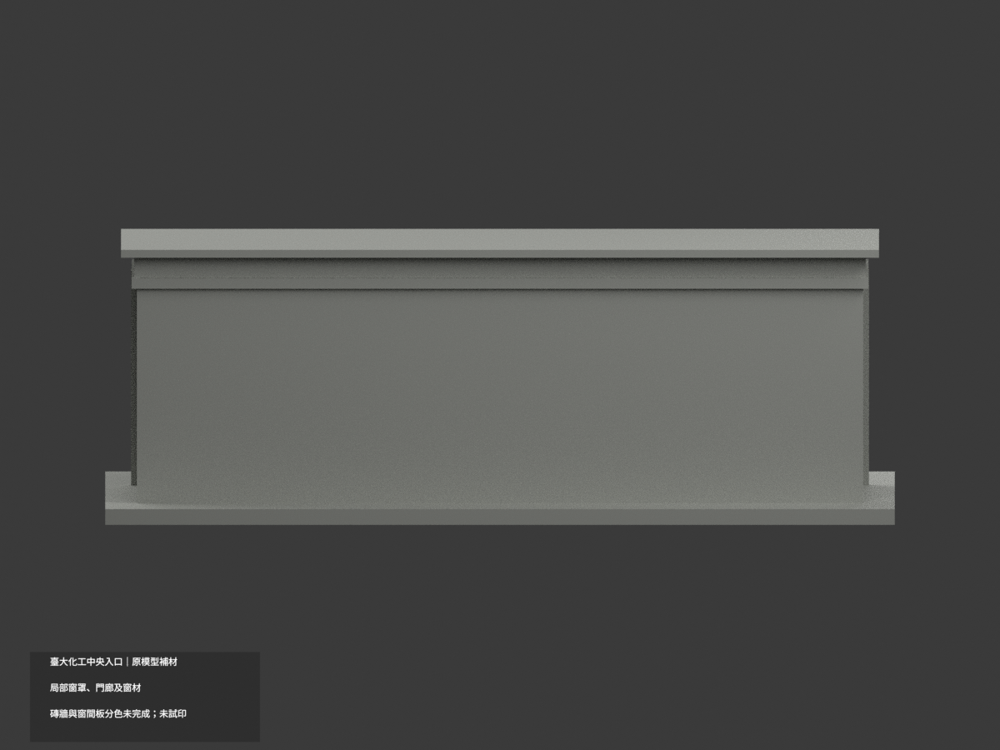
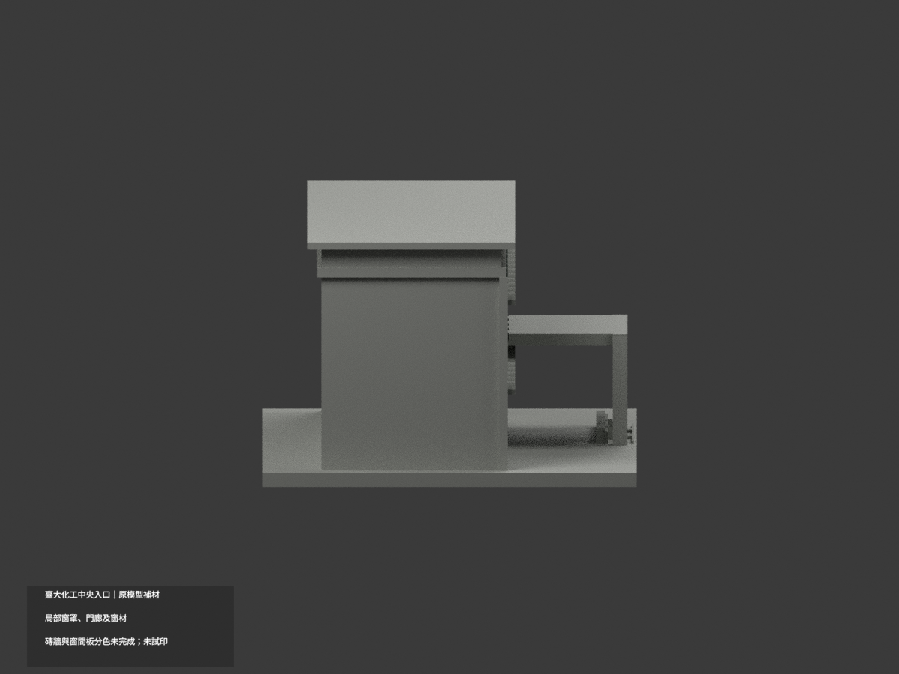
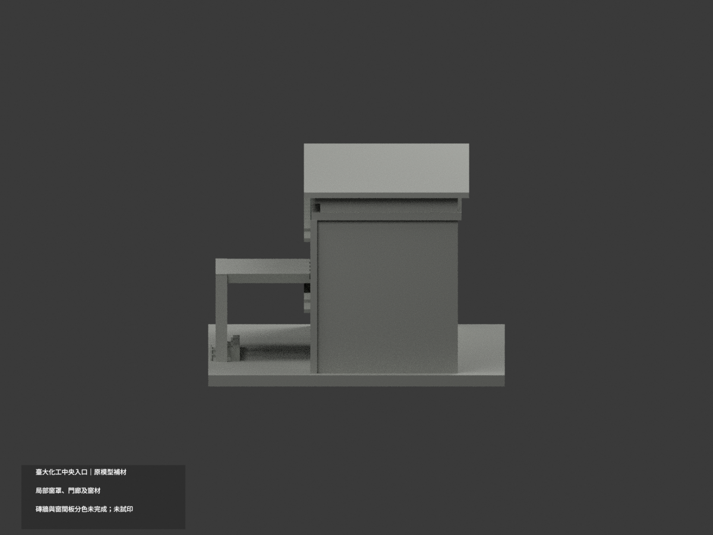
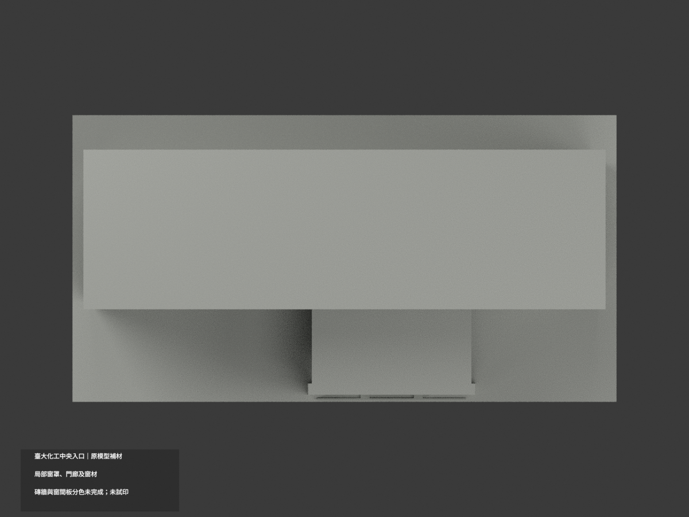
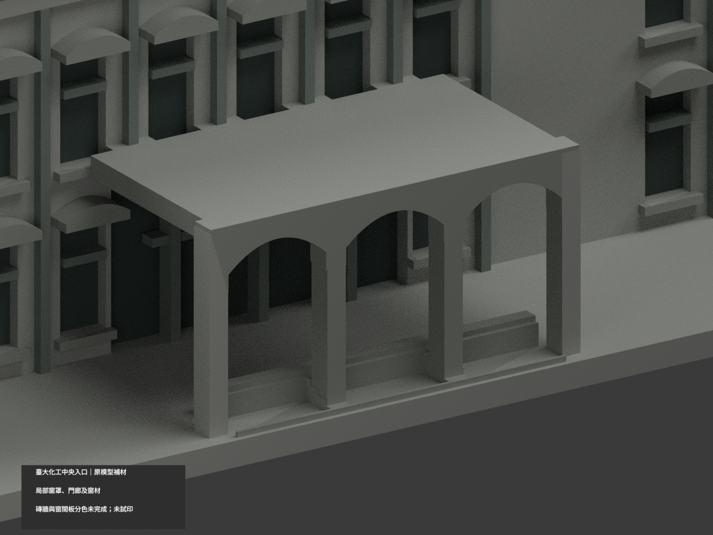
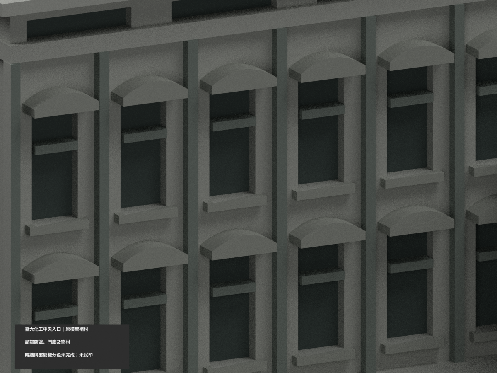
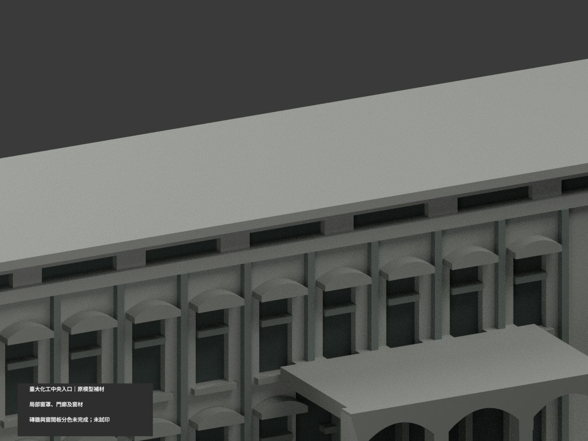

# 臺大化工館中央入口｜既有模型局部材色更新

**局部窗罩、窗台、細柱、三拱門廊與門窗；磚牆及窗間實板分色未完成。** 同一原入口片段，不是全館完整外觀；不因色彩更新增加東西延伸翼或後接實驗室。

| 總覽 | 背側 | 正面 |
|---|---|---|
|  |  |  |
|  |  |  |
|  |  |  |
|  |  |  |

## 材色範圍
- 原 `ntu-chemical-engineering-entry` 項目，count_delta=0；4262 個原三角形及座標完全保留。原 STL、OBJ、build_model.py 位元組不改，不新增、切割或細分幾何。
- 依實照，原獨立曲面窗罩、窗台、細柱及三拱門廊採灰石/混凝土色族；已有各個獨立窗洞背面、入口及通風凹口採深灰綠/陰影，不表示已重建室內。
- 主前牆同一連通平面混紅褐磚及灰色窗間實板，原模型缺這些分域，因此整片中性。右側大盲牆與同平面相連，不用 x 座標或三角形斜邊假造磚色界線。
- 後面、端面、水平屋頂及門廊頂面未充分見於照片，保中性。沒有補曲面窗間板、冷氣、樹、文字或相鄰翼。
- 原形體是公開外觀近似片段，色彩不背書其窗距、樓高、拱/窗罩形狀或尺寸精確。

## 來源與權利
採臺大總務處公開入口/前立面兩照；網頁發布/更新日為2026-09-29，**照片實際拍攝日期未確認**，不是2026精測現況。原照及研究檔已私人備份，原圖不公開、不作貼圖；未確認 CC 或開放重製授權，不保證商用權利。HEX 是未校色展示近似。

## 格式與列印
[原 STL](model.stl) · [原 OBJ](model.obj) · [彩色 3MF](appearance.3mf) · [彩色 Blender](scene.blend) · [材質表](appearance-materials.json) · [原模型說明](ORIGINAL-MONOCHROME-README.md)

3MF basic materials 及 Blender 真正面材質分配；STL 本身不含色。四材質標籤不是驗證過的四色耗材切片專案。毫米單位、原含底座150 mm長，非測繪比例。未實際列印，未產生切片工具路徑；拱底、窗罩及細柱支撐需另檢查。

## 重建與 QA
按原 requirements 安裝依賴後執行 `build_model.py`、`colorize_model.py`、`export_appearance.py`、`validate_color.py`；Blender 執行 `render_color.py`，再 `verify_color_scene.py`。
`COLOR-FORMAT-GEOMETRY-QA.json` 核原 STL bytes、逐三角座標、閉合正體積、3MF 幾何/材質索引與完整隔離重建；`SCENE-QA.json` 重開真正場景材質，`DELIVERY-QA.json` 綁定十圖。程式 QA 不替代人工來源/視覺核對。

舊 `previews/`、`render_preview.py` 與原 validation 檔保留，是單色歷程而非本次材色 QA。上方十圖及新 appearance 產物才是本次局部材色；未刪原件。
