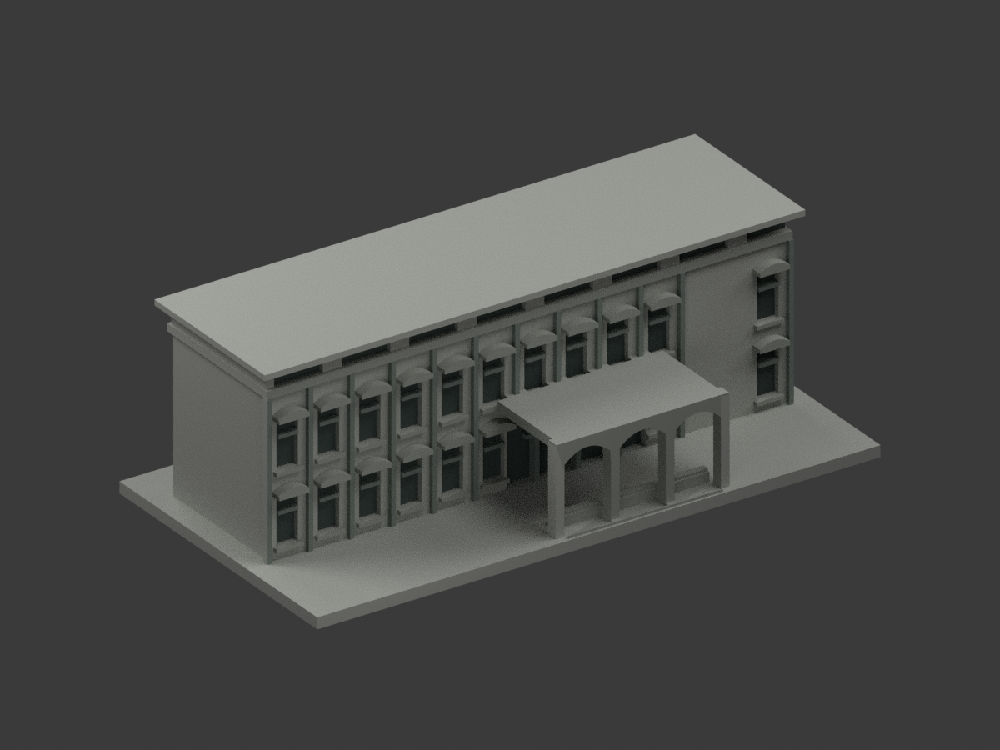
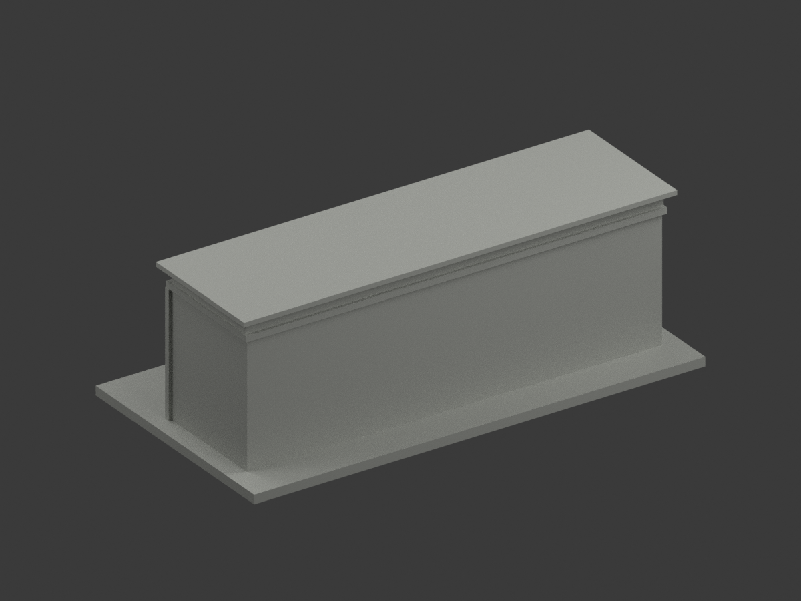
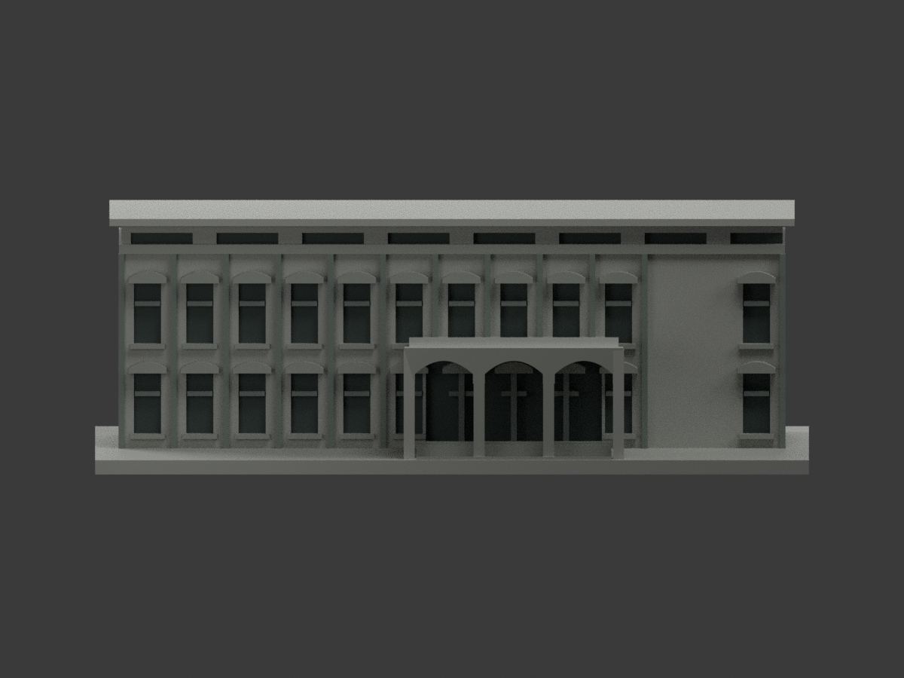
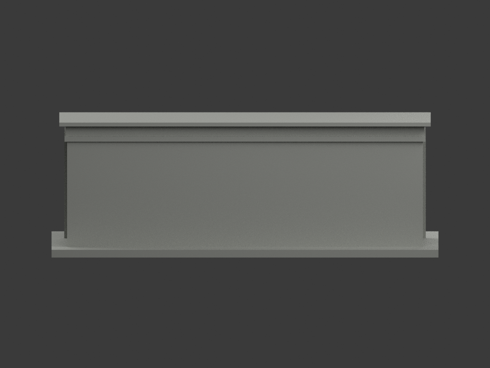
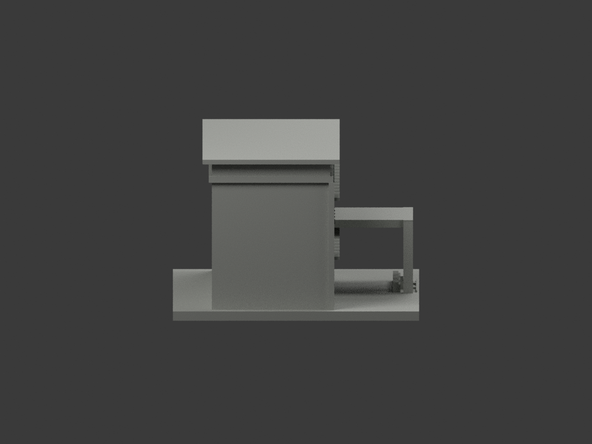
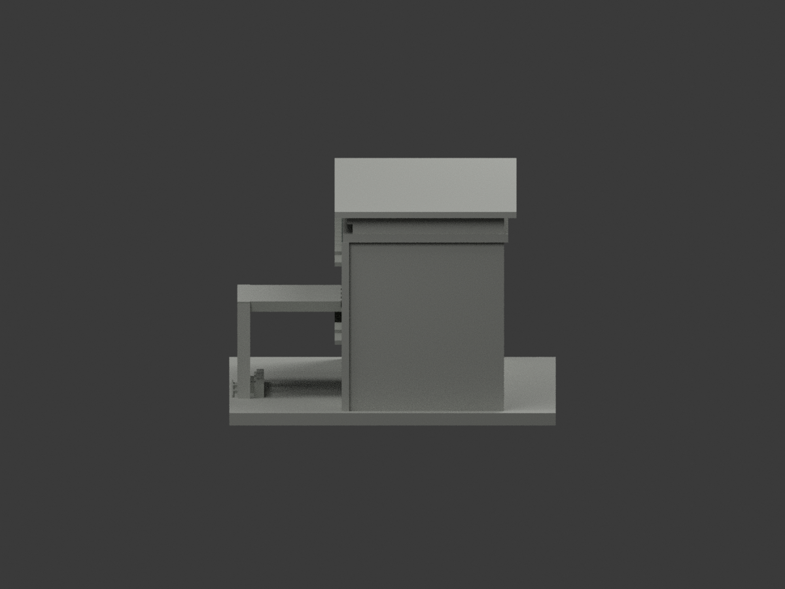
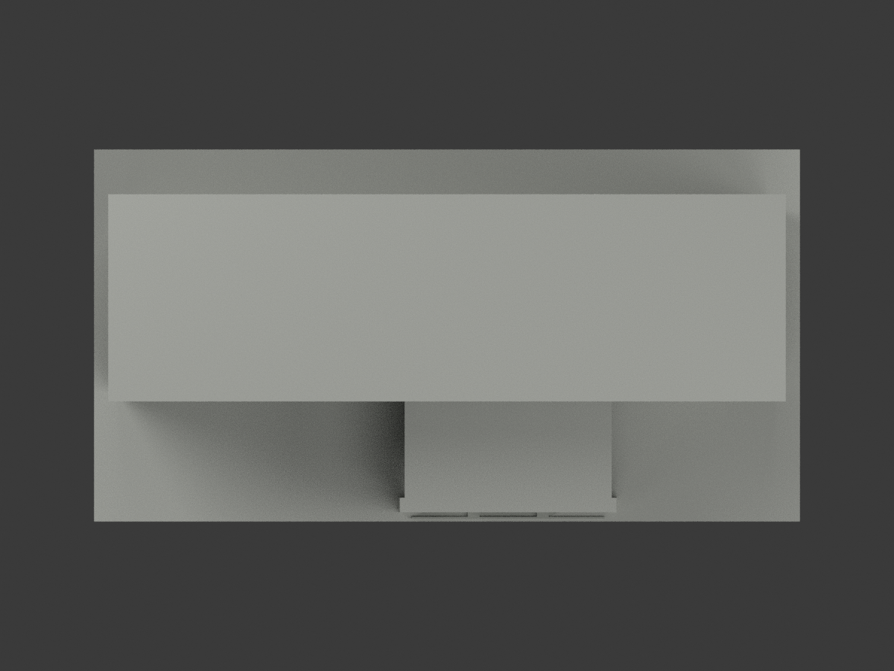
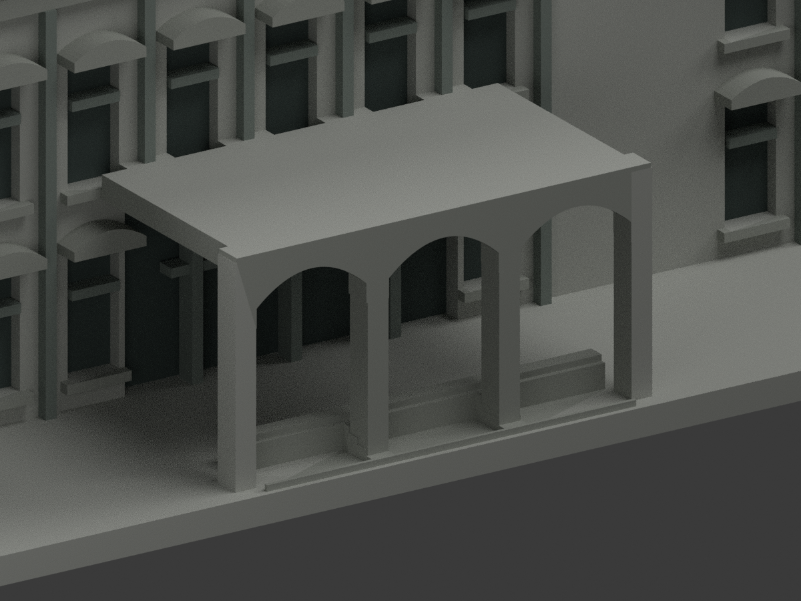
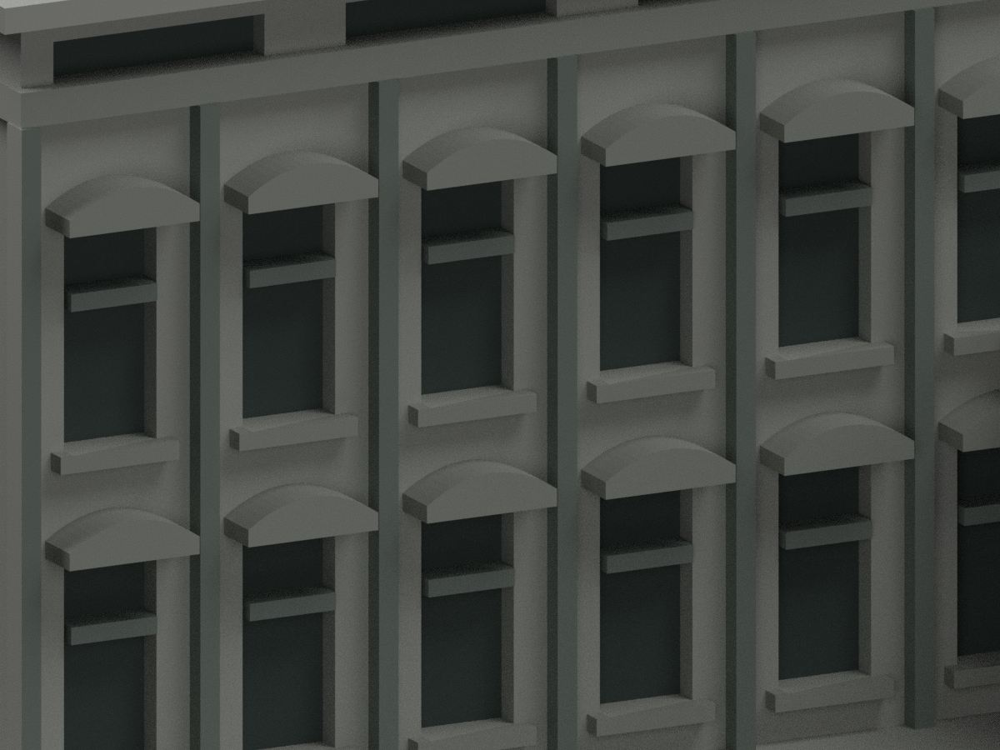
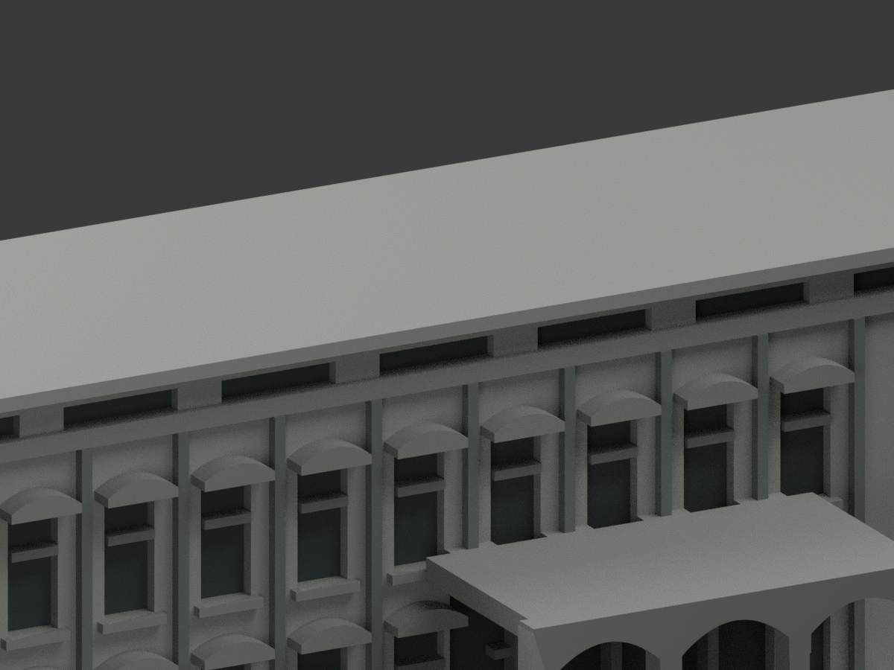

# 國立臺灣大學化學工程館（正門入口段）

| 模型預覽 | 模型預覽 | 模型預覽 |
| :---: | :---: | :---: |
|  總覽 |  背側 |  正面 |
|  背面 |  左側 |  右側 |
|  頂面 |  門廊 |  窗罩 |
|  屋面 |  |  |

[目前 Blender 色版](../scene.blend) · [目前 3MF 色版](../appearance.3mf) · [單色幾何 STL](../model.stl)

十張圖皆由目前局部上色場景以原相機重跑，與已發布的圖逐像素相符。現版包含下主簷正面 39 個既有三角面的灰色近似；上金屬屋緣、通風板、主簷頂底與側返仍未納入這次配色。未更動幾何，也未實體試印。

[原模型說明與來源限制](../README.md) · [原模型校驗](../SHA256SUMS) · [展示來源記錄](render-proof.json) · [展示檔檢查](SHA256SUMS)
