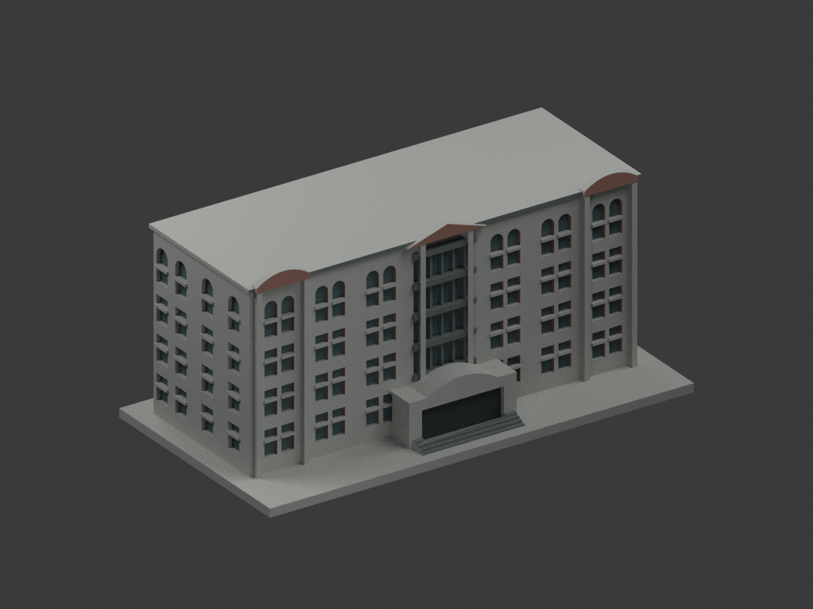
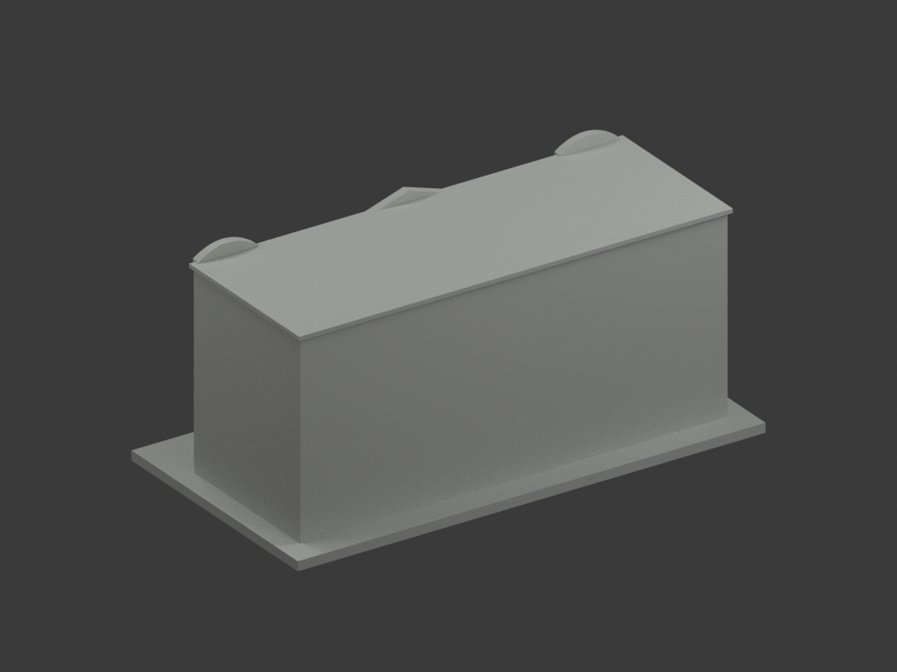
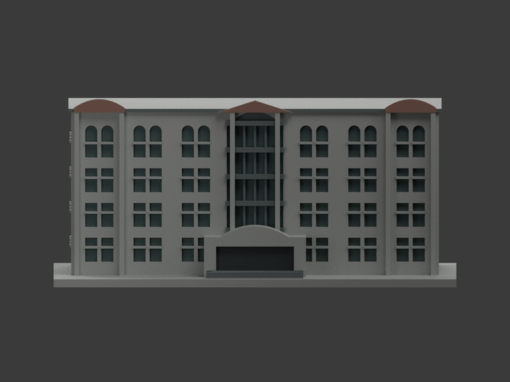
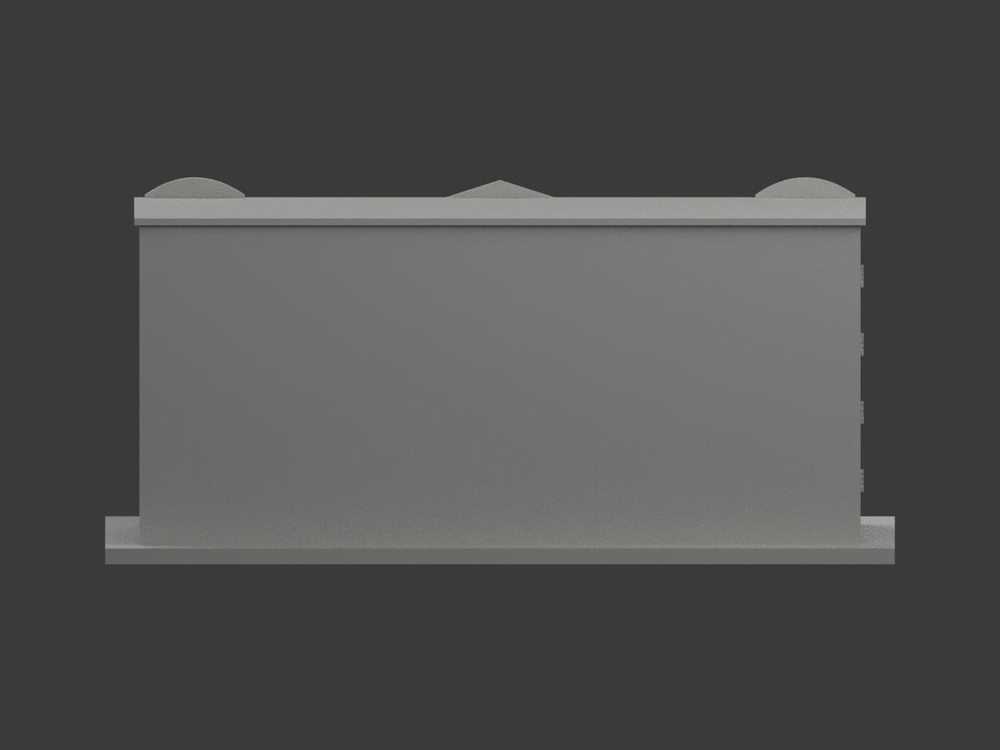
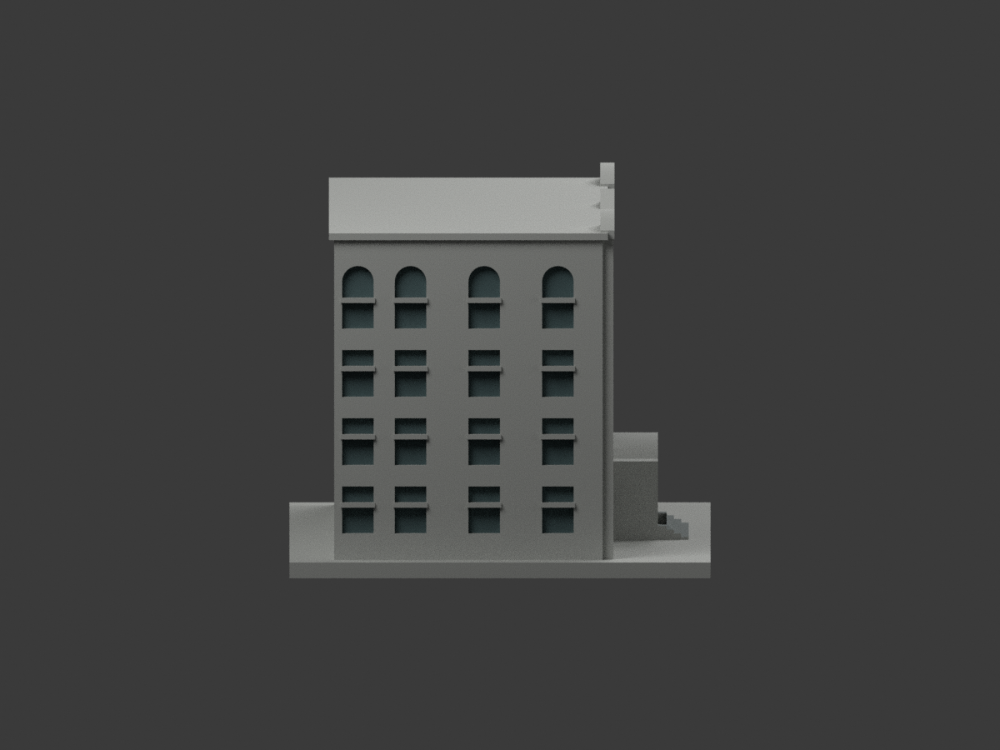
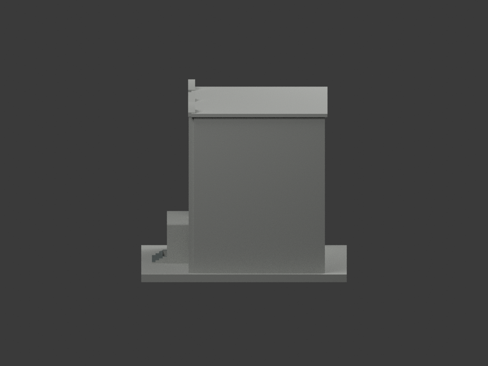
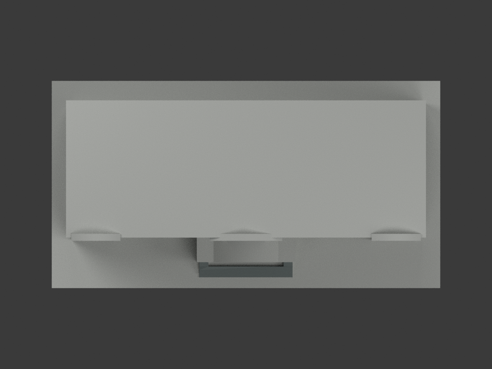
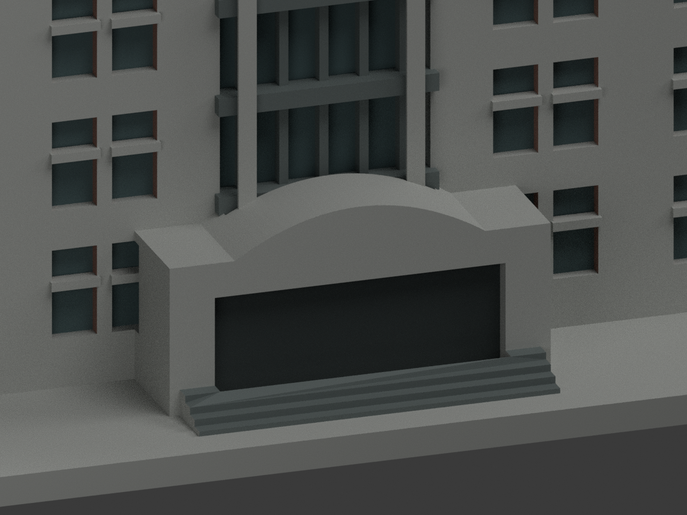
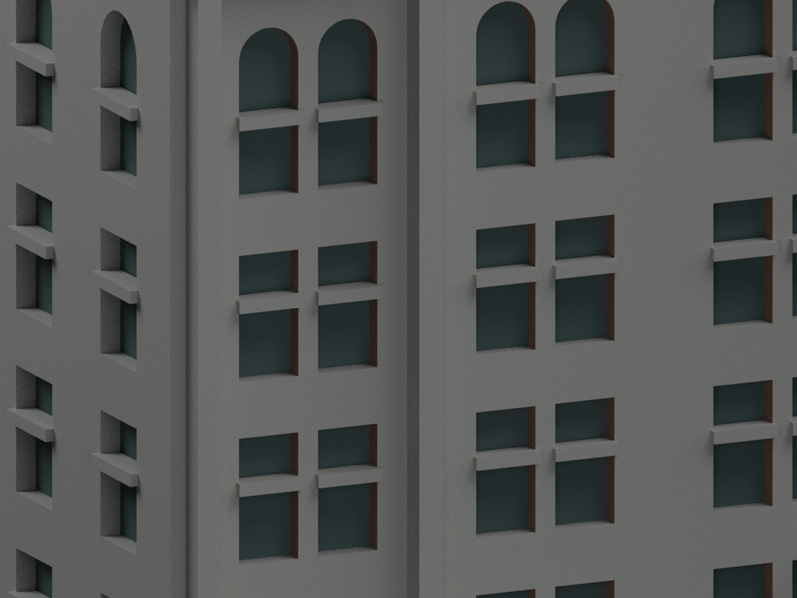
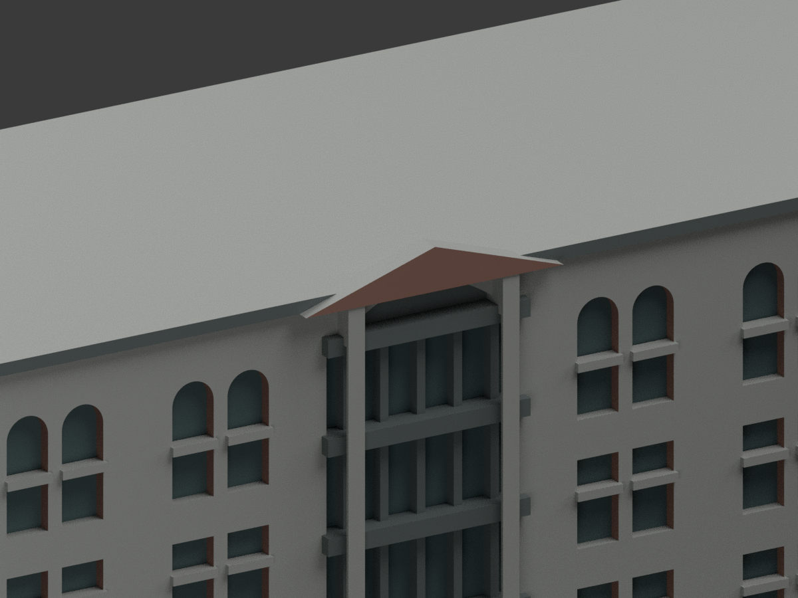

# 臺大電機二館E3｜低門廊弧帽過度磚色指派撤回勘誤

本次不是新增配色。原低門廊弧帽29個磚色面撤回中性，原2801配色/3517中性改為2772配色/3546中性，6318原三角不變。原五palette、其餘索引、STL/OBJ/build及全部歷史工程與previews aliases均保留。README.zh-TW.md仍是原單色歷程，未改寫為新色成果。

重新實看原官方2010影像組IMG_5952.JPG（336×448）及原像素裁切，可辨低門廊弧帽有灰嵌板、磚弧環及暗色壓頂線。原shallow_arch實填帽沒有對應內部材界，原將有限上半29面全指派磚色的依據不足；本次撤回這個過度指派，不宣稱29面全是灰、全是錯紅或得出新實景色。是舊照重新核讀，沒有新拍照、2026現況或測繪精度主張。

29改面原屬y=-30的完整41面共面連通域（其餘12面原中性），整域現在中性；不以重心切色，不切三角，不補灰嵌板/黑線/磚環。原混共面域5減為4，其他4個混域的每面索引精確保留，**不宣稱全模型共面配色一致或混域歸零**。原全高柱與牆跨灰基腳等限制、最高三角山牆與照片淺弧不一致、側背/屋頂未證等全部保留。

照片及裁切私人研究不公開貼圖、不推定再授權，HEX仍名義色族。Commons2022南側門廊圖未成功取得，沒有拿未實看的新圖作證；系史及現系網亦未提供可用新角度。原包47件完整保留，另2個repo外部工程QA在私人調查區分開保存，不混作包內檔。未試印、未驗多料切片、不修幾何、不追認全色外觀。PORTAL-CAP-WITHDRAWAL來源QA固定pending快照；最終獨審另檔，qa/portal-cap-withdrawal-previous保存原色版歷程。以下原版說明只對舊版本，被本勘誤取代之低帽磚色敘述不再適用。

## 原版說明與工程限制（歷史全文）

# 臺大電機二館 E3｜原模型有界材色更新

| 材色預覽 | 材色預覽 | 材色預覽 |
|---|---|---|
|  |  |  |
|  |  |  |
|  |  |  |
|  | | |

## 材色範圍
同一既有 E3 主立面近似模型補材（count_delta 0），原 6318 三角面、頂點、STL、OBJ 與 build_model.py 不變，不新增冷氣、金字、窗扇或修正原比例。採官方 **2010 建築影像**色族，不稱當前精確外觀或竣工測繪。

- 原前、左大牆以及全高凸柱跨越實景下方灰基座與磚牆，沒有獨立材域邊界，故**整面中性**。不按面中心切成假斜色，不整面紅色掩蓋灰基座，也不新增切面或紋理。
- 只在可分辨原高帽前面、窗洞返面採低飽和磚色；既有橫梃、窗間帶與前窄檐灰色，實際窗凹底灰綠。不是把整牆當玻璃。
- 中央最高淺弧內填在官照為灰色實心嵌板，原凹底採灰色，**不是玻璃**。原模型中央三角山牆與照片淺弧不同，本次不修幾何，不因補色背書其形狀。
- 低入口上帽前面磚色，真正原切口底深灰陰影；前階灰色。大門廊融合面未有可靠細框邊界者保持中性，不畫假門扇。
- 未證右端、背面、水平屋面及展示底座中性；照片無法唯一對應的大面亦保守中性。色域截止是資料範圍，不是實景換漆線；HEX 非校準色票。
- 五個外觀材質標籤不是已驗證四色耗材切片檔；**未實際列印**，不保證免支撐。STL 不存顏色，原尺寸與列印幾何保留。

## 檔案與重建
[材色 3MF](appearance.3mf) · [Blender 場景](scene.blend) · [原 STL](model.stl)

build_model.py 重建原幾何；colorize_model.py 只指定原面材料；export_appearance.py 輸出3MF基本材料；render_color.py 產生十圖與場景。validate_color.py 驗原檔、三角座標、3MF及隔離重建，verify_color_scene.py 重開shader與面索引。依賴 numpy、trimesh、manifold3d、Pillow、Blender 4.3.2。隔離重建目錄私人保留，不刪除。

## 來源與權利
臺灣大學官方2010影像三張，網址及SHA256見 COLOR-SOURCE-REGISTER.json。未核得明示CC授權；公開可讀不等於自由再授權。原照片僅私人備存，不公開、不作紋理、不保證商用；只建築外觀，無人物或室內新增。

## QA 與原件歷程
新色版 QA 為 COLOR-FORMAT-GEOMETRY-QA、SCENE-QA、FRAMING-QA、DELIVERY-QA 與獨立視覺審核。舊預覽、報告、README.zh-TW.md及ORIGINAL-MONOCHROME-README.md保留原樣作歷程，不是本次色版入口。以上十圖及scene.blend是新版；所有原檔不刪，不增加套數。
