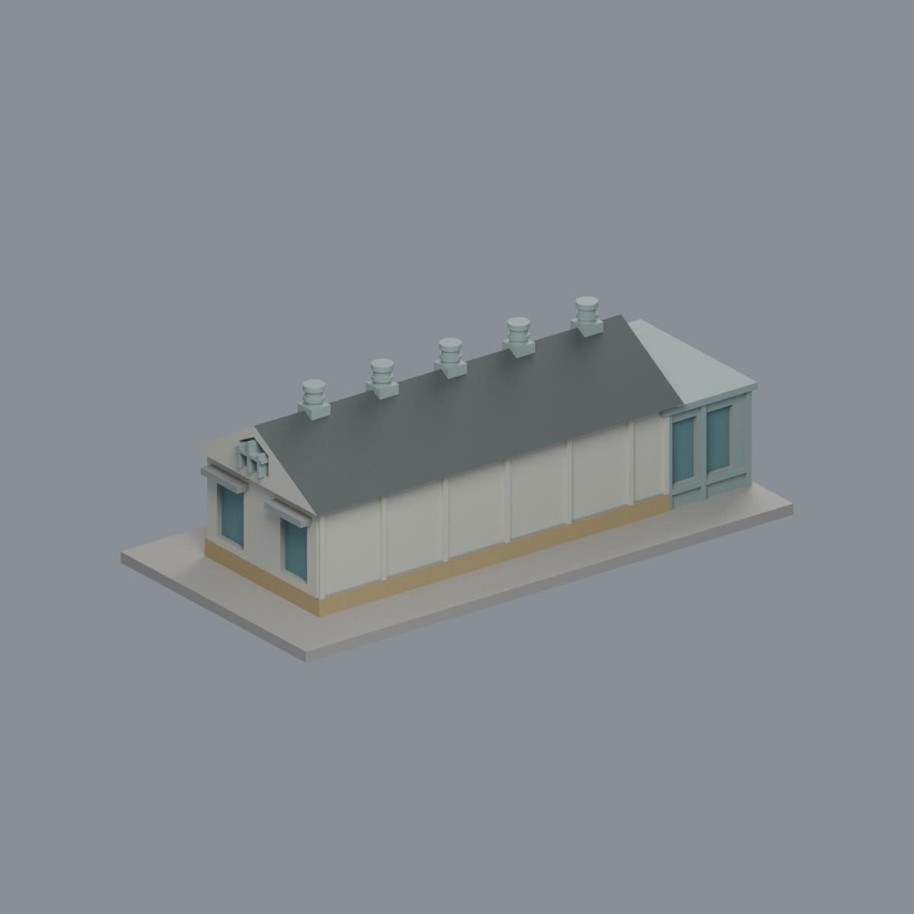
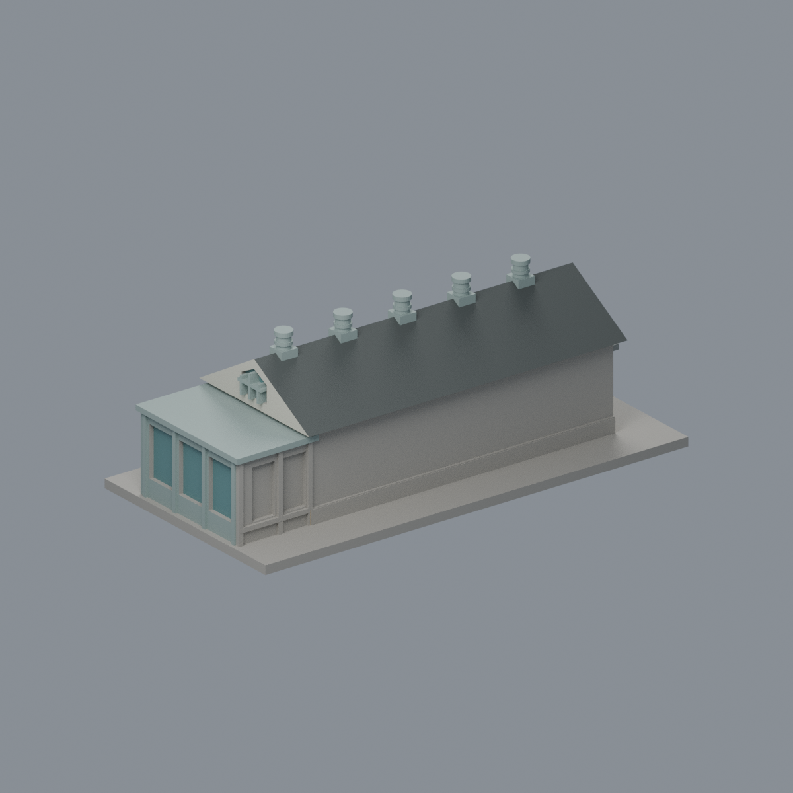
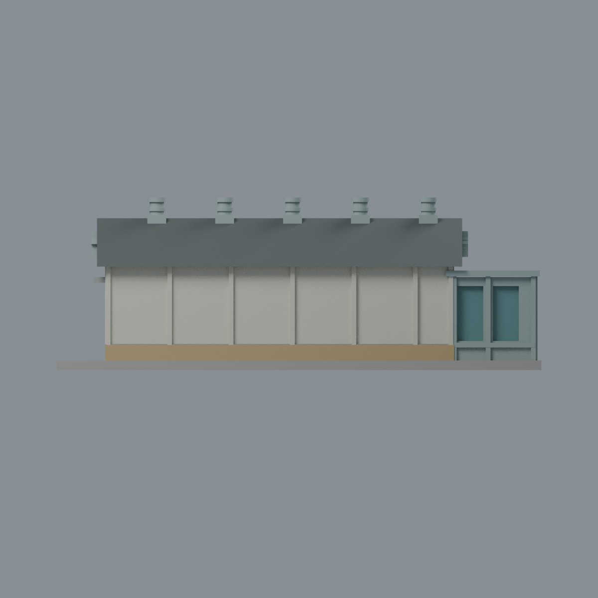
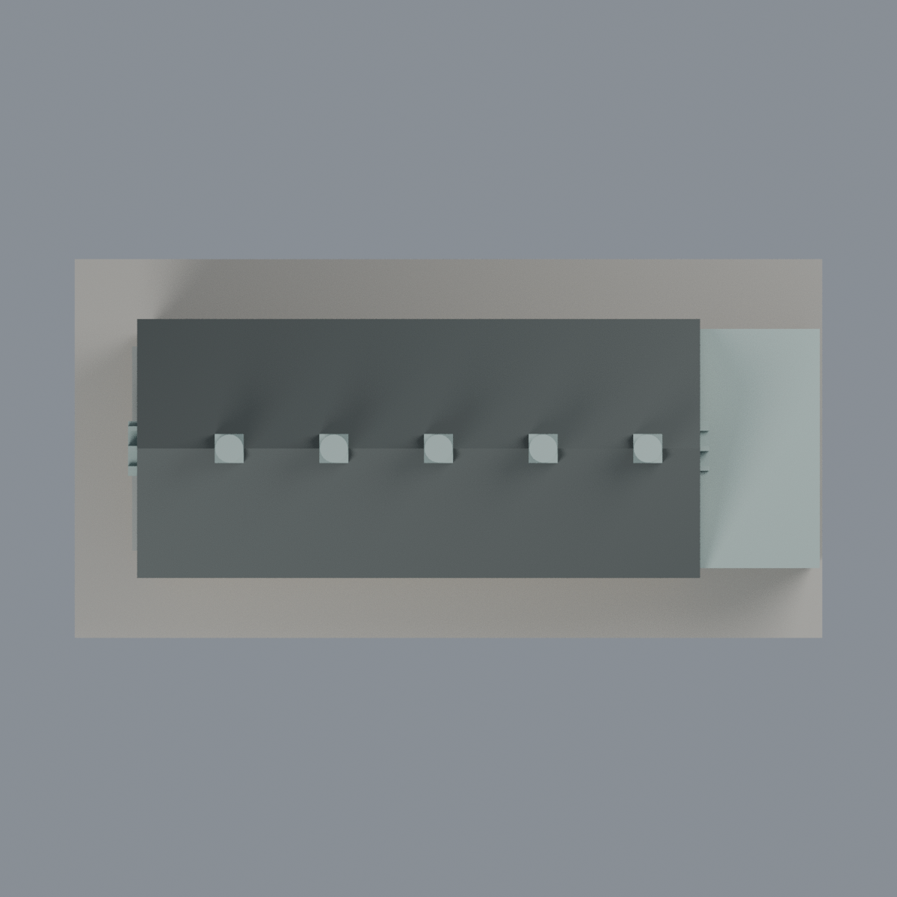

# 國立臺灣大學地質標本館小屋

| 模型預覽 | 模型預覽 | 模型預覽 |
| :---: | :---: | :---: |
|  正面 |  背面 |  正立面 |
|  頂視 |  |  |

[目前 Blender 色版](../appearance/scene.blend) · [目前 3MF 色版](../appearance/ntucottage-appearance.3mf) · [單色幾何 STL](../model.stl)

四張圖皆從現有七材質場景以原相機渲染。現版僅將雙直窗端的五邊窗兩個原斜內返共 4 個既有三角面納入淺抹面近似；其他窗內返、另一端和深簷底未擴色；未重新測繪、補色或更動幾何。本模型為公開外觀近似，沒有重建室內，也未實體試印。

[原模型說明與列印限制](../README.md) · [目前模型校驗](../PUBLIC-MODEL-SHA256SUMS) · [展示來源記錄](render-proof.json) · [展示檔檢查](SHA256SUMS)
