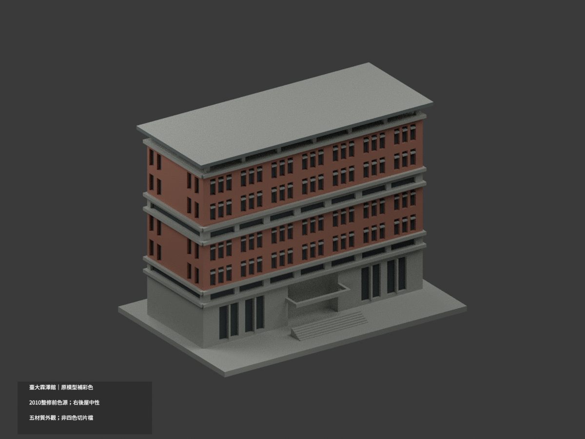
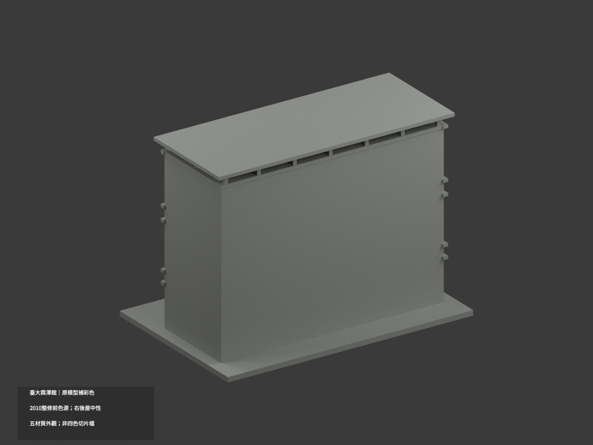
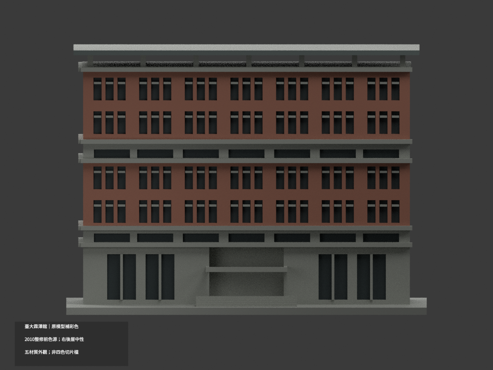
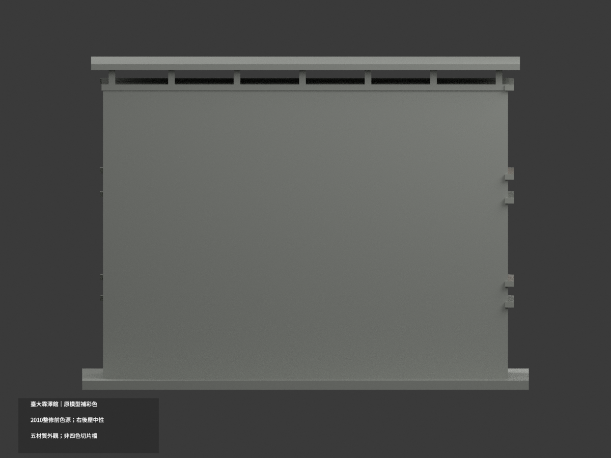
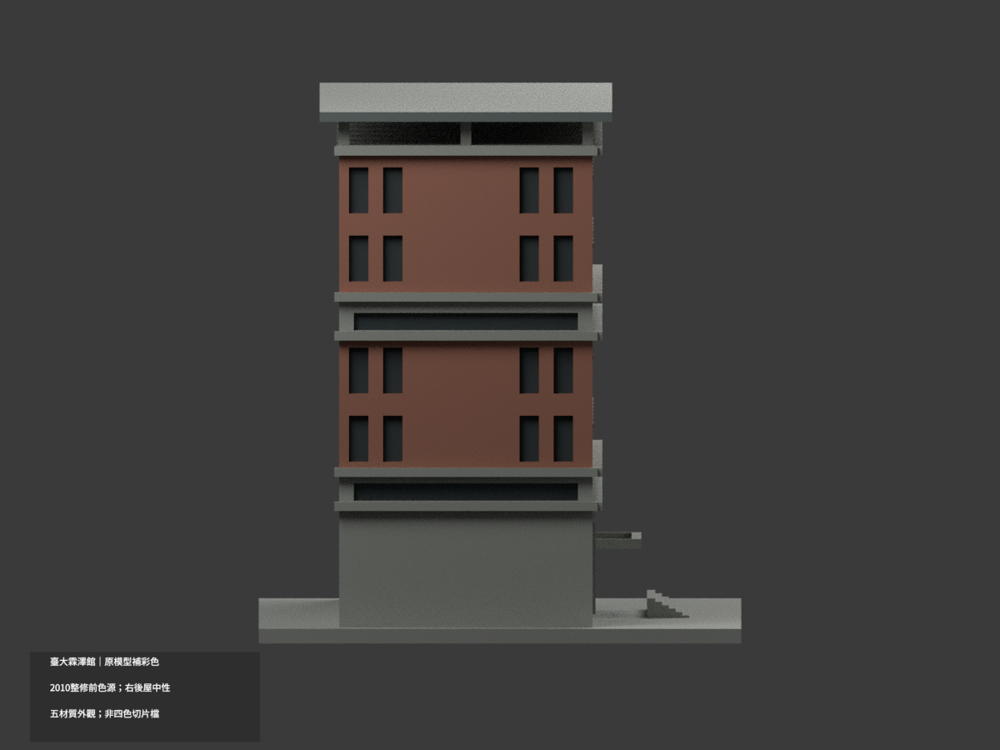
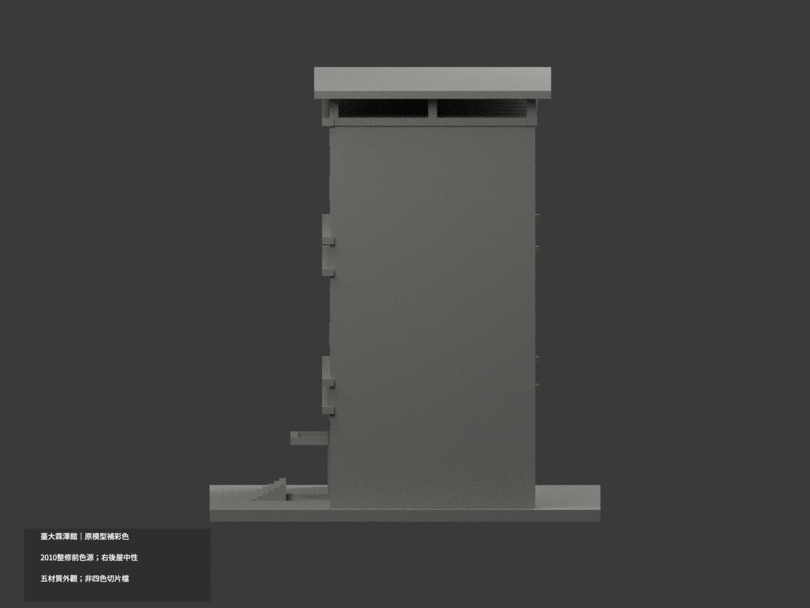
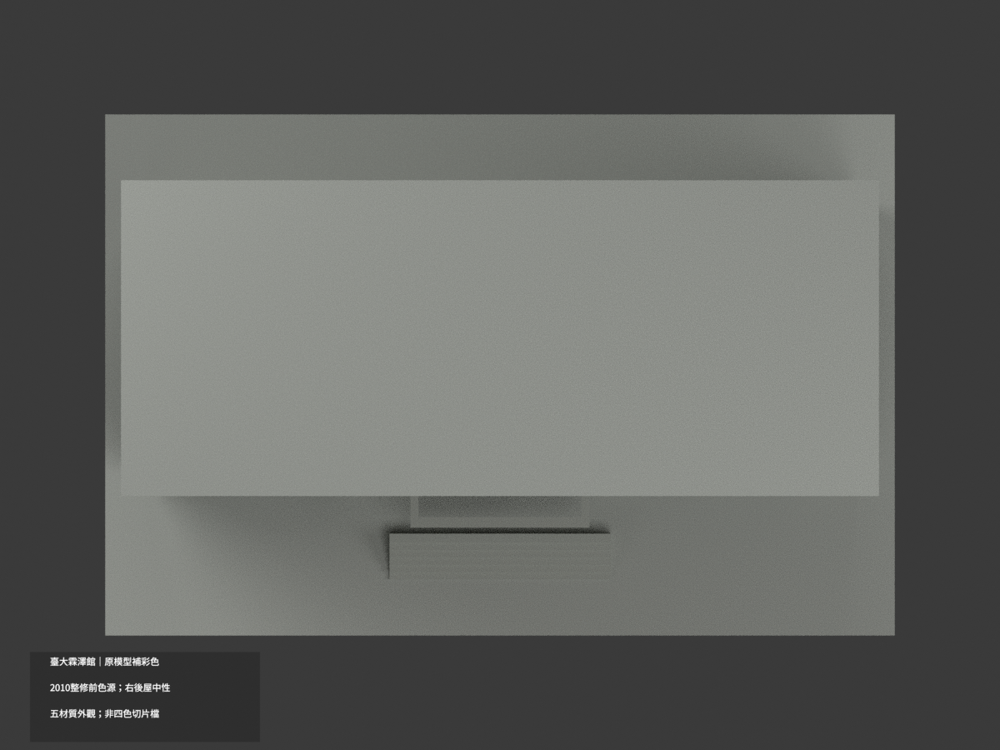
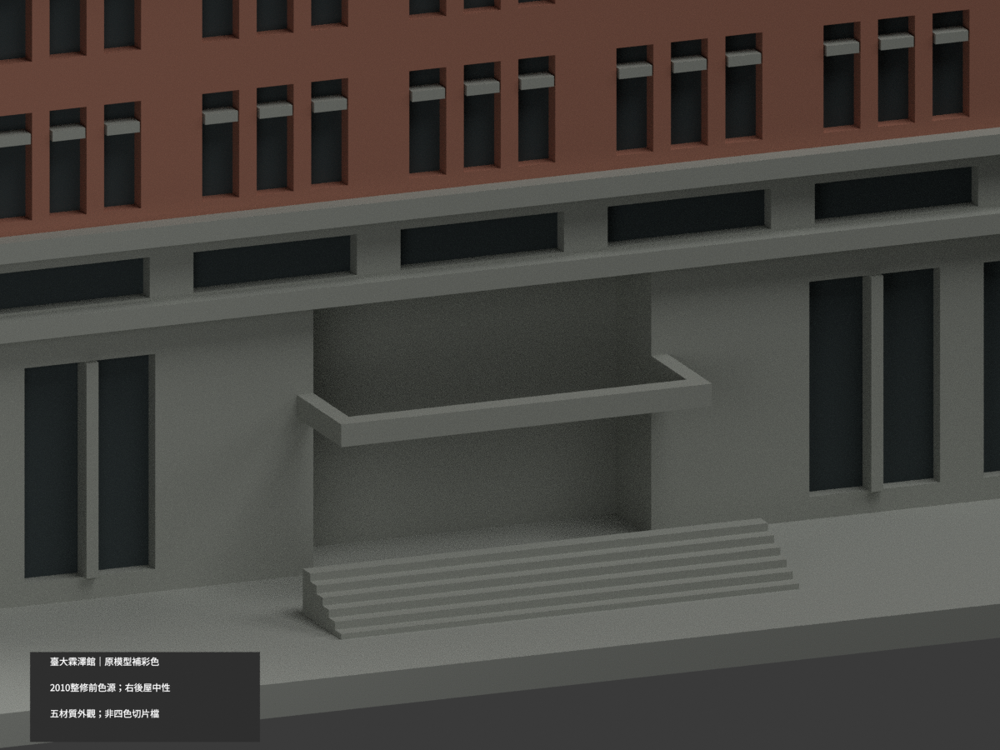
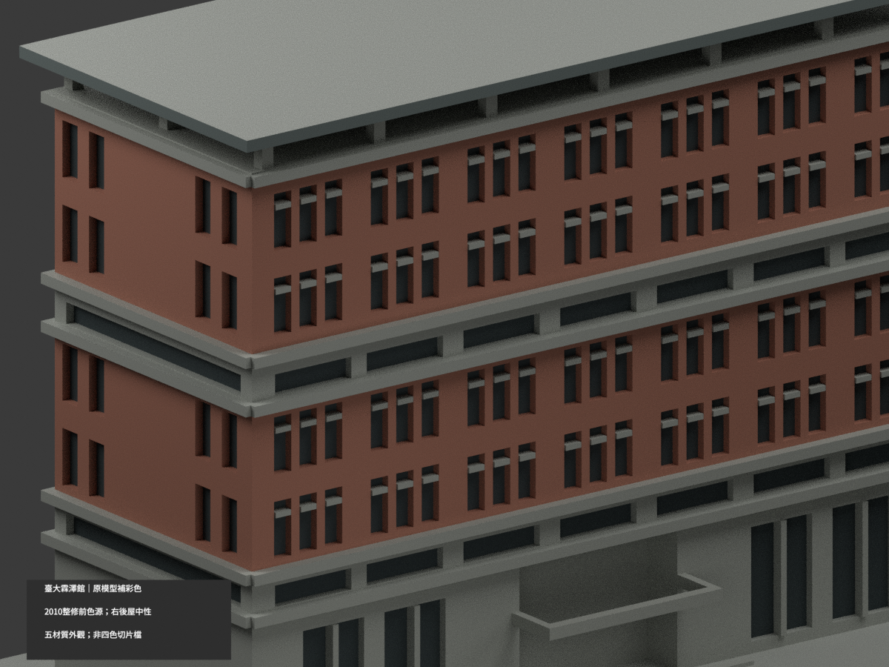
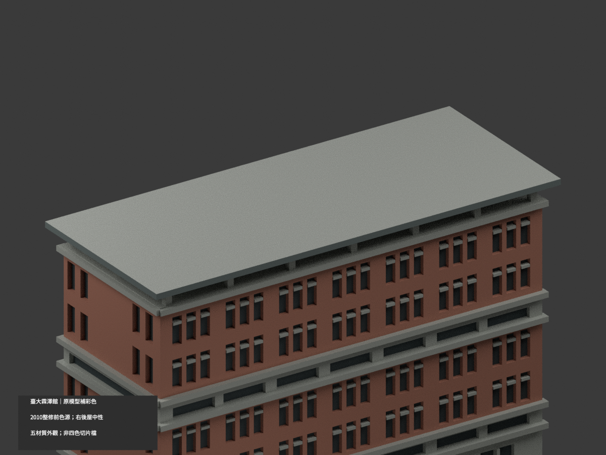

# 臺大霖澤館主棟｜2010 整修前色源補彩

| 彩色預覽 | 彩色預覽 | 彩色預覽 |
|---|---|---|
|  |  |  |
|  |  |  |
|  |  |  |
|  | | |

## 材色範圍
本次為同一項目材色更新（count_delta 0），保留原 4150 三角面、頂點、STL、OBJ 與 build_model.py，不新增幾何。**2010 官網影像早於 2017–2018 外牆整修；不是今日現況色彩，也不是整修竣工復原。** 本次色彩不為原近似幾何精度背書。

- 正面及照片對位的左短端：紅褐磚、灰混凝土基座／水平帶、淺灰既有窗梃、暗灰窗凹面。
- 入口只映射既有混凝土凹口與小簷，不添門扇、招牌或金字。屋頂挑板只對有證前／左垂直邊著灰，水平屋皮中性。
- 右短端、背面、屋頂水平面及未能乾淨映射的原面中性。照片中的低附屬講堂、連橋與池不屬本模型，未加入。
- 色票為展示近似，非現場校色。五個材質標籤不是已驗證四色或多色耗材切片方案；**未實際列印**。STL 本身不含色。

## 檔案與重建
[彩色 3MF](appearance.3mf) · [彩色 Blender](scene.blend) · [原 STL](model.stl) · [原 OBJ](model.obj)

原 build_model.py 可重建原幾何；colorize_model.py 使用原 STL 指派既有三角面材質，export_appearance.py 匯出 3MF；render_color.py 產生十張彩色圖與場景。validate_color.py 檢核原檔、三角座標、3MF 及保留的隔離重建；verify_color_scene.py 重開核對真正材質 shader。實作與報告所需 numpy/trimesh/manifold3d/Pillow 由既有工具環境提供，Blender 4.3.2。

## 來源與權利
校方 2010 建築影像 E51 的 IMG_6026 / 6028 提供主棟色族；6029 為附屬量體，不作主館材色。原官照未確認 CC 授權，公開不等於可自由轉授權；原照片只私人保存，不公開、不貼圖，不保證商用。來源網址與核查雜湊見 COLOR-SOURCE-REGISTER.json。

## 檢查與歷程
格式／幾何 COLOR-FORMAT-GEOMETRY-QA.json、場景 SCENE-QA.json、十圖 DELIVERY-QA.json、人工 INDEPENDENT-COLOR-VISUAL-QA.json。所有原檔與舊單色 previews 保留；ORIGINAL-MONOCHROME-README.md／.zh-TW.md 為舊說明，舊 validation/layer/thin 報告不是本次材色 QA。色版 scene.blend 與上方十圖才是本次入口。沒有刪檔，原幾何權利不由色源官照推導。
