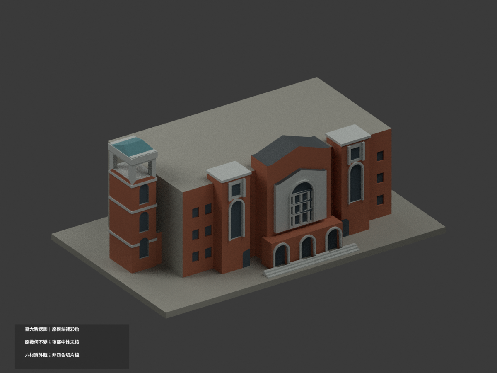
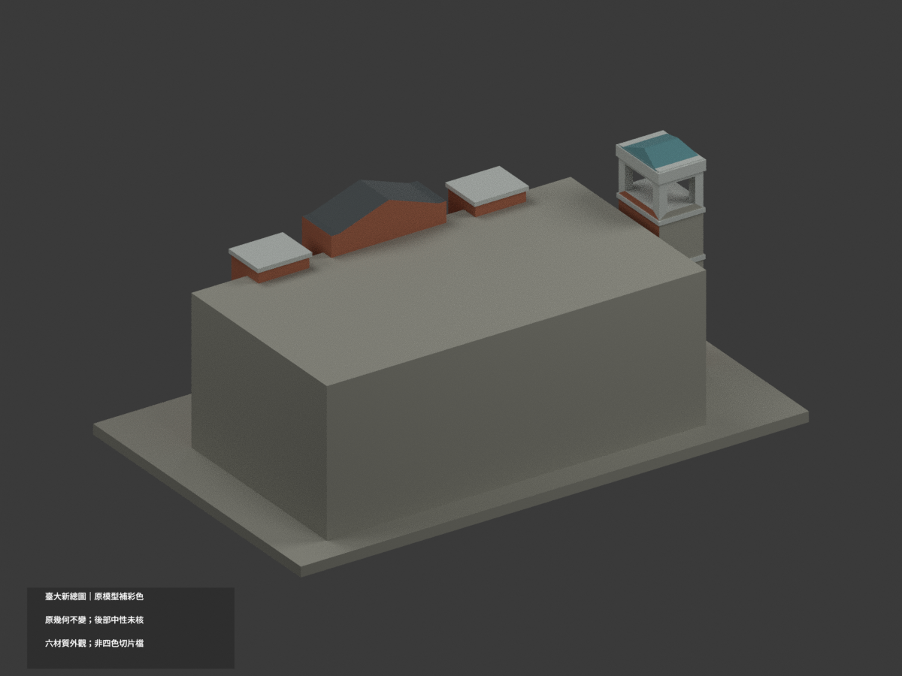
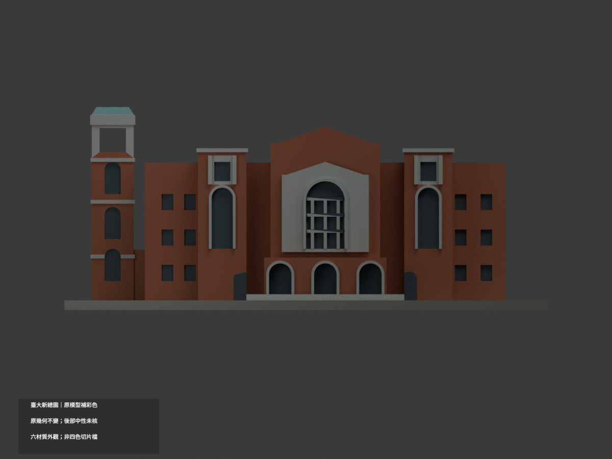
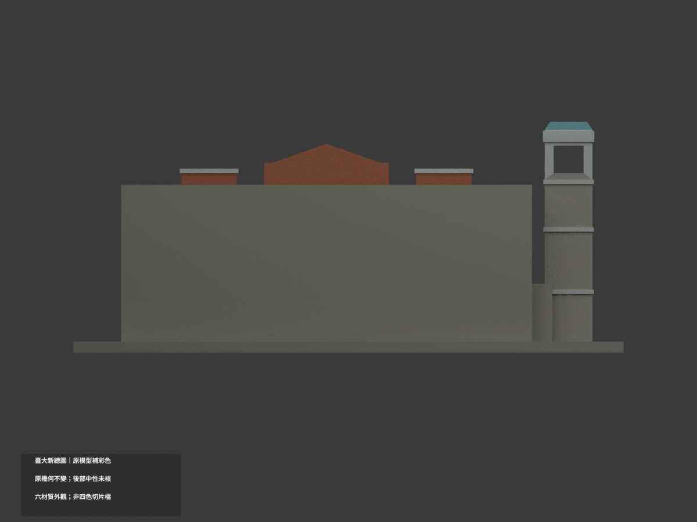
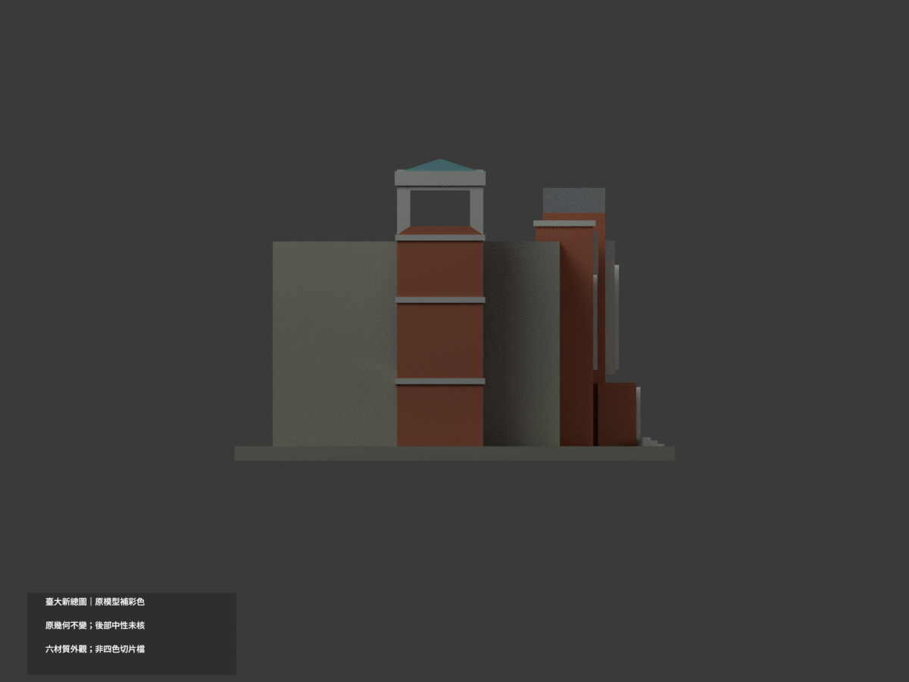
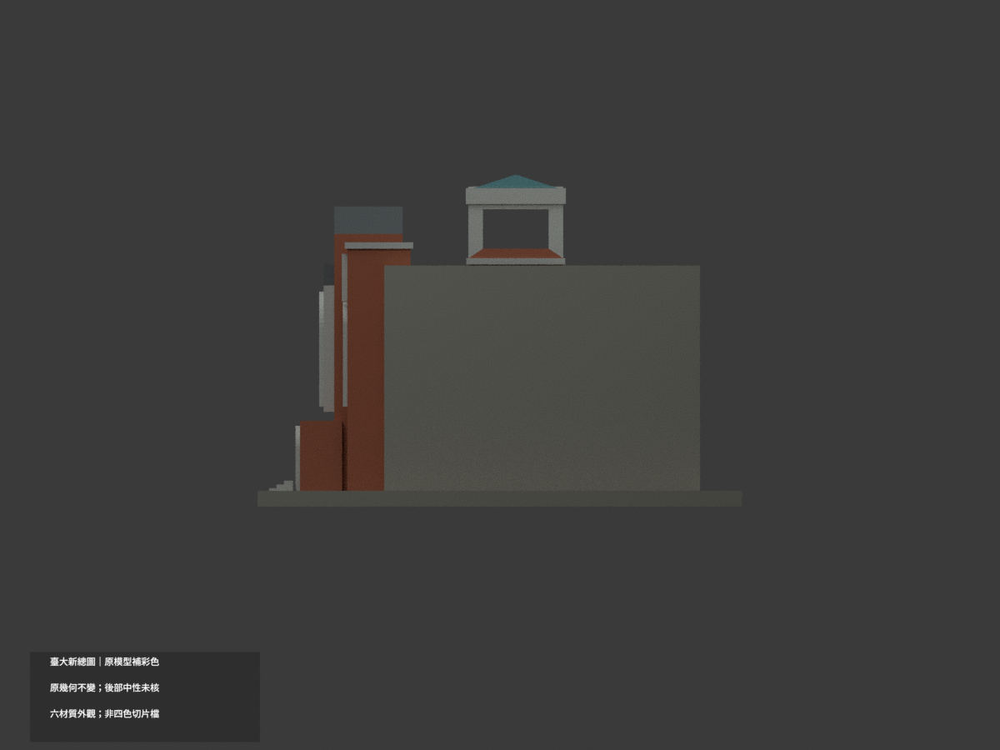
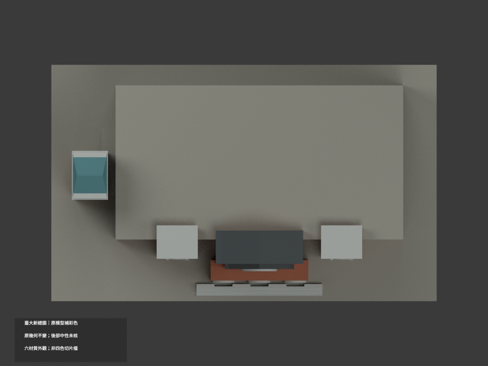
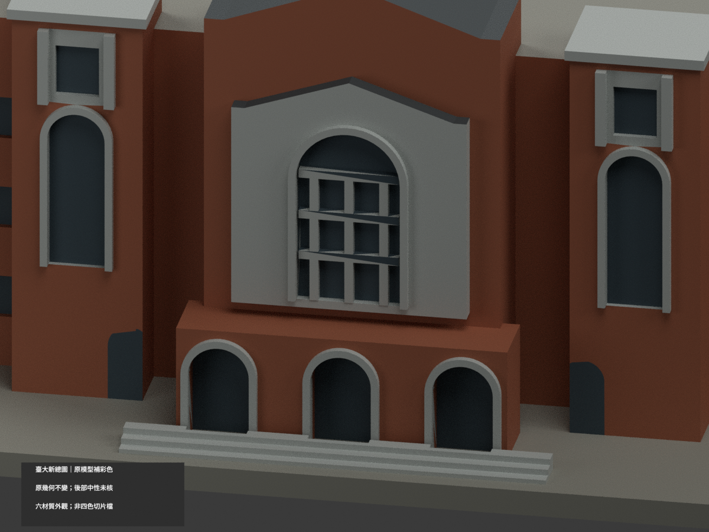
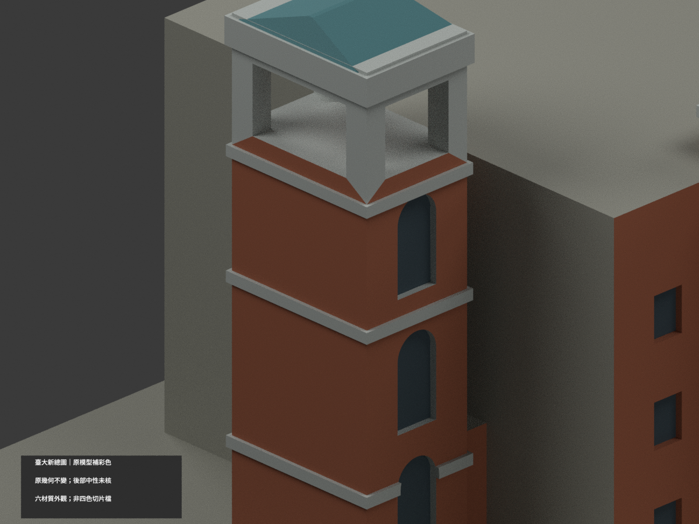
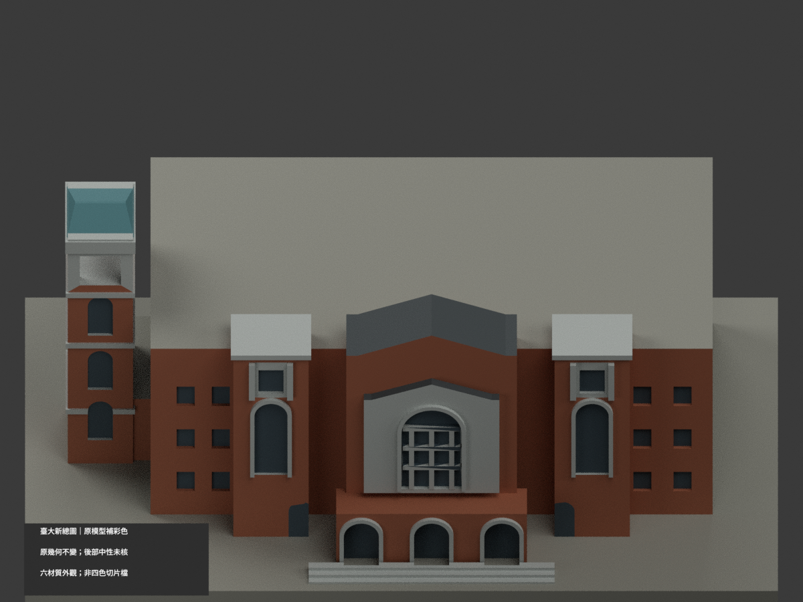

# 國立臺灣大學新總圖書館｜同項目彩色更新

## 彩色模型預覽

**原模型幾何完全不變：150×92×63 mm、3264 三角面，原 STL 位元組保留。** 本次僅按官方照片為原有表面分材質、增加彩色 3MF 與重渲染，**不是更精密的建築重建，不增加模型套數**。後部／長側與大平屋面原本資料不足，保持中性未核，不冒稱實景全方位配色。

| 整體 | 反向／未核後部 | 正向 |
|---|---|---|
|  |  |  |
|  |  |  |
|  |  |  |
|  |  |  |

## 彩色檔案與列印差別

- [彩色外觀 3MF](appearance.3mf)：毫米單位，六種基本材質逐面指派；[材質表](appearance-materials.json)。
- [彩色 Blender 場景](scene.blend)：與原 STL 相同三角幾何，可編修材質。原模型源碼 `build_model.py` 不改；`colorize_model.py` 為可重現的材質分區程式。
- [原 STL](model.stl)／[原 OBJ](model.obj) 保持原檔，**STL 本身不含顏色**。不能因新增彩色預覽便稱 STL 成為彩色檔。
- 六材質外觀 **不等於已可直接用四色機列印**。尚未製作或驗證四色耗材映射、切片器的材質匯入、換色／支撐或實際列印。玻璃以不透明深灰示意，不保證透明列印。
- 材質為照片支持的色族：紅褐磚、淺灰石、深灰藍窗、灰黑斜屋面、低飽和藍綠塔帽，加上未核後部／展示支座的中性色。HEX 是展示近似，非校色現場色票。
- 原三角網格未細分，細小材色界線受原幾何簡化與現有三角面限制。沒有新增原圖未建的窗、門扇、瓦片或貼附官方照片。

## 重現與查核

先 `python build_model.py` 重建原幾何，再 `python colorize_model.py`、`python export_appearance.py`；`blender -b -P render_color.py` 產生十視圖及場景；`python validate_color.py`、`blender -b -P verify_color_scene.py` 執行格式／重建／重開查核。幾何重建及材質重建均保留隔離測試，不自動刪檔。

`COLOR-FORMAT-GEOMETRY-QA.json`、`SCENE-QA.json`、獨立來源／視覺檢查記錄為本次證據。原 `previews/` 單色圖與舊 `validation.json` 是既有版本歷程，不是本次彩材／四色列印驗證；原檔保存，不移除。舊 `render_preview.py` 會重建單色外觀，日後請使用 `render_color.py`，勿誤覆彩色場景。

## 色彩來源與權利

採[臺大訪客中心總圖書館頁](https://visitorcenter.ntu.edu.tw/News_Content_n_74842_s_81635.html)及其[官方正面實景照片](https://visitorcenter.ntu.edu.tw/001/Upload/photoedittemp/9ad8b3c8-6143-4770-a110-00d9f6dbc734.jpg)，2026-11-02 實際像素檢視。另一官方插畫不是實景色彩量測，未用來確定細部色票。未核背面維持中性；照片拍攝年代與今日是否完全一致未證。

原照片與裁圖僅私人研究，**不隨模型公開，也不當貼圖**。原圖版權仍屬權利人；沒有因公開瀏覽而宣稱 CC 授權或商用權利。原創材質遮罩、幾何與渲染的發布，不重新授權第三方照片或建築設計。細節見 `COLOR-SOURCE-REGISTER.json`。

## 原模型幾何範圍與限制（繼續有效）

公開外觀照片衍生的簡化列印模型，非測繪模型。官方索引代碼：M12。

## 範圍與可靠程度
中央正面與北側鐘塔外觀近似模型；整體後部深度為估計，未重建真實後立面及屋頂設備。

保留辨識特徵：巨大拱窗、前方三拱入口、中央雙層山牆、階梯式前量體、左側獨立鐘塔與低連接量體。

所有尺寸均為照片目測比例，沒有取得實測長寬高。建物深度、背面、屋頂後部及樹木遮蔽部分證據不足，以無裝飾實體量體表示。窗數、柱距、屋頂坡度不是竣工測量值。沒有推估室內、地下室或設備配置。建物外觀可能已與拍攝時間不同。

最長邊 150 mm（含底座），每棟獨立縮放，不同模型不能按共同校園比例拼接。尺寸為 [150.0, 92.0, 63.0] mm。

## 列印建議與限制
- 底座朝下，單位 mm。建議先用 0.4 mm 噴嘴、0.16–0.2 mm 層高、3道外牆、15–20%填充作切片試算。
- 中央上部拱圈、鐘塔通孔頂部及入口拱頂建議局部樹狀支撐；避免把支撐填滿淺凹窗。
- 最細新增浮雕約 0.9–1.1 mm。瓦片、字體、植物、排水管、細石雕及空調未加入，以免把未觀察細節捏造為精準模型。
- STL 是單一連通封閉表面；凹窗有背牆。實心幾何的實際填充密度由切片器設定。
- 已檢查原始 STL 法向與繞向、水密性、邊與頂點流形、正體積、單一表面、可重建雜湊、Blender/STL 三角幾何一致性。完整結果見 validation.json。
- 尚未實際列印或完成切片器支撐檢驗；不宣稱任意機器都可無支撐列印。沒有聲稱進行完整三角形自交掃描。

## 檔案及重建
- model.stl：列印檔。model.obj：交換格式。
- scene.blend：由交付 STL 匯入的單網格場景，可編修網格；參數化來源為 build_model.py。
- previews/front.png、rear.png、elevation.png：直接渲染交付 STL，非概念圖。
- Python 3.12；pip install -r requirements.txt；python build_model.py。
- Blender 4.3.2：blender -b -t 2 -P render_preview.py。
- python validate_model.py。此檢查會在暫存目錄獨立重建及重新開啟已儲存場景，並不修補交付 STL。
- 可直接改 build_model.py 的毫米參數；修改後需重新渲染與驗證，150 mm規格亦須重新檢查。

## 公開來源
查閱與像素檢視日期：2026-10-13。來源照片僅供研究，未隨模型重新散布。
- [臺大訪客中心：總圖書館](https://visitorcenter.ntu.edu.tw/News_Content_n_74842_s_81635.html)
- [實際檢視的官方正面照片](https://visitorcenter.ntu.edu.tw/001/Upload/photoedittemp/9ad8b3c8-6143-4770-a110-00d9f6dbc734.jpg)
- [臺大官方臺北校區建物索引，檢索標題日期2026-08-17](https://cpo.ntu.edu.tw/map/C_01_list.pdf)

來源頁的照片版權屬原權利人；本資料夾不含來源照片或校徽貼圖。腳本與幾何為依公開外觀重新製作；未授予第三方建築設計或照片的權利。
