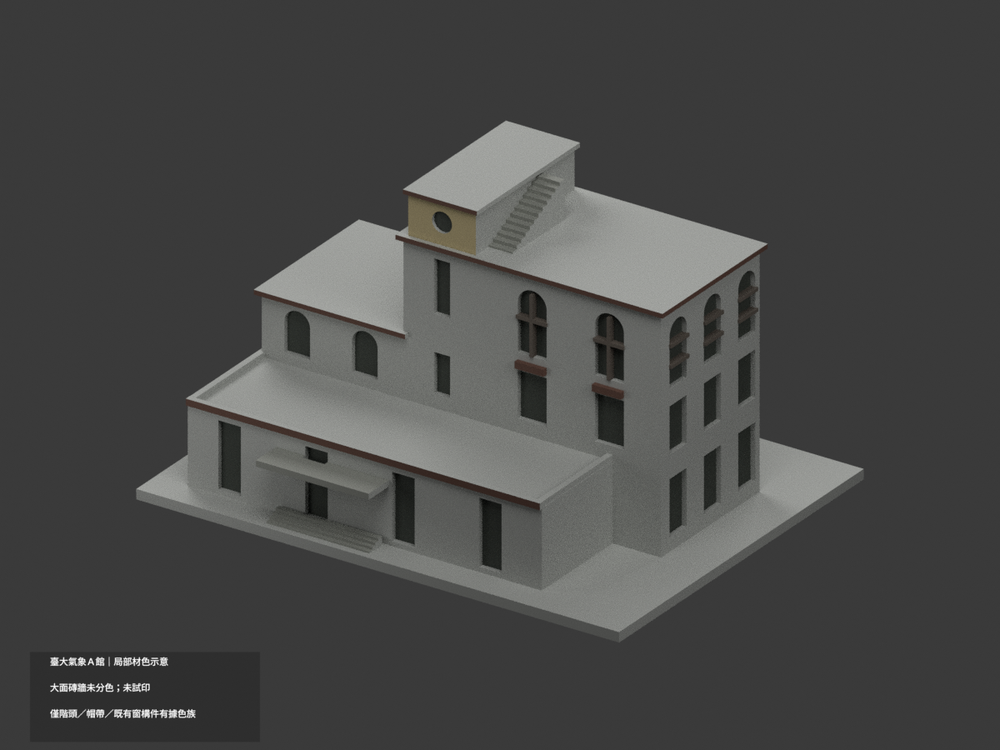
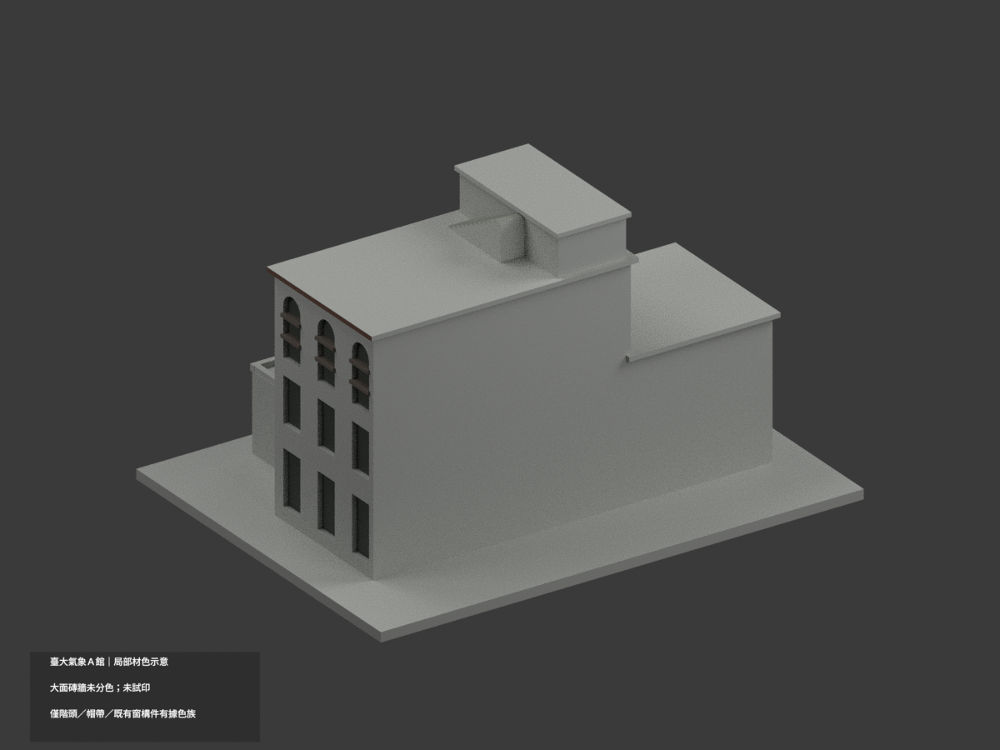
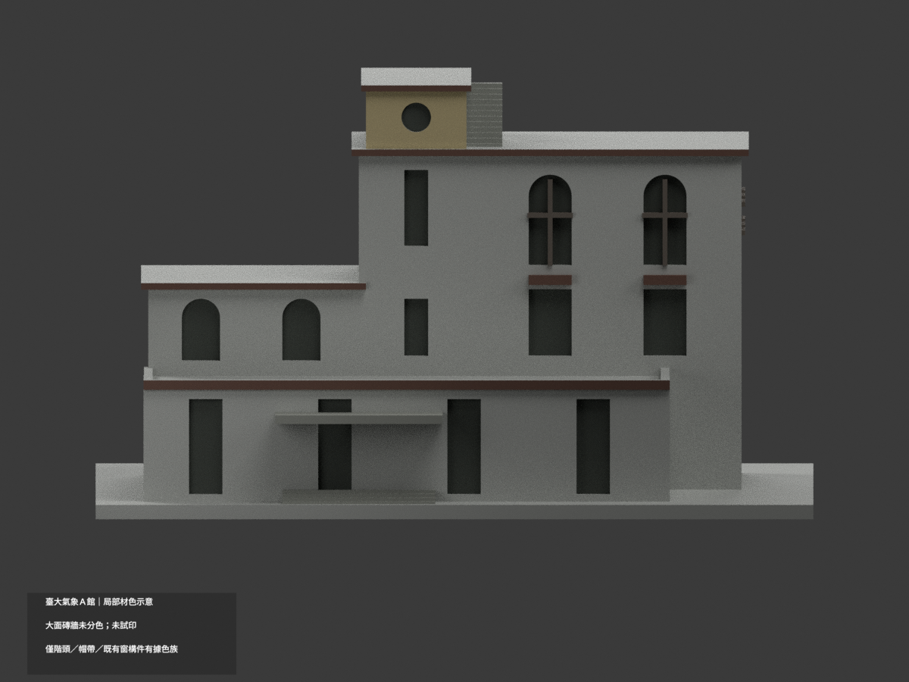
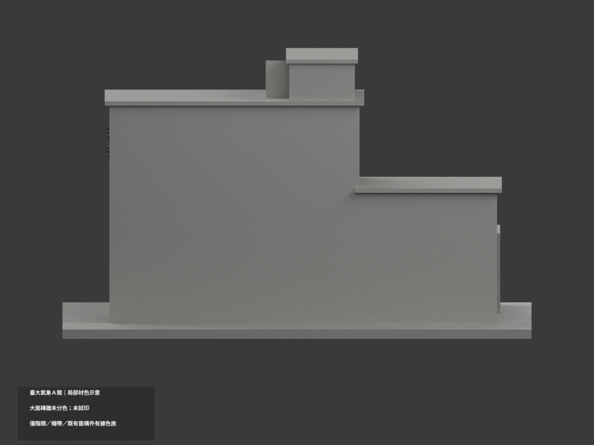
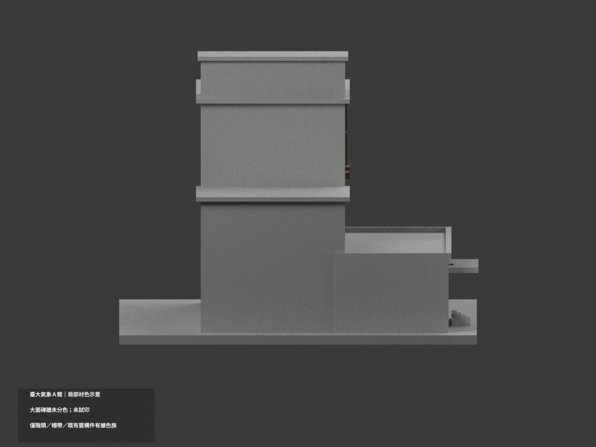
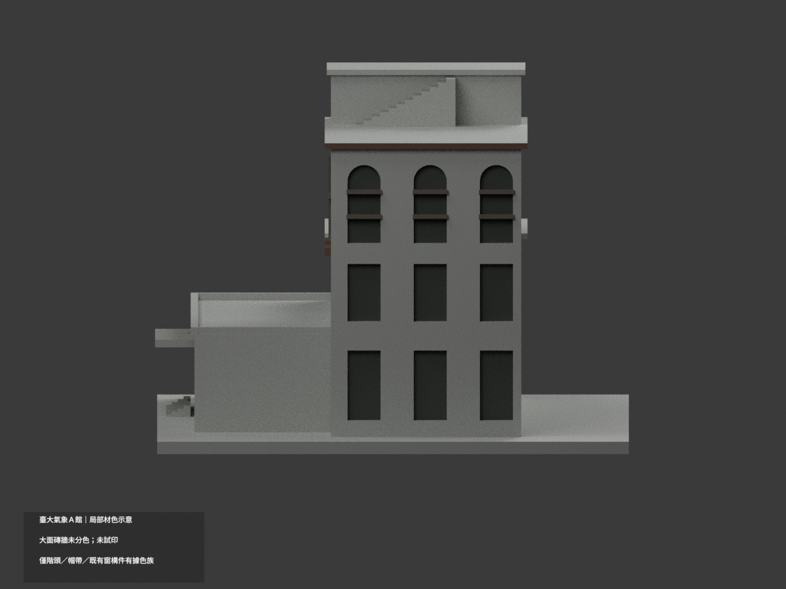
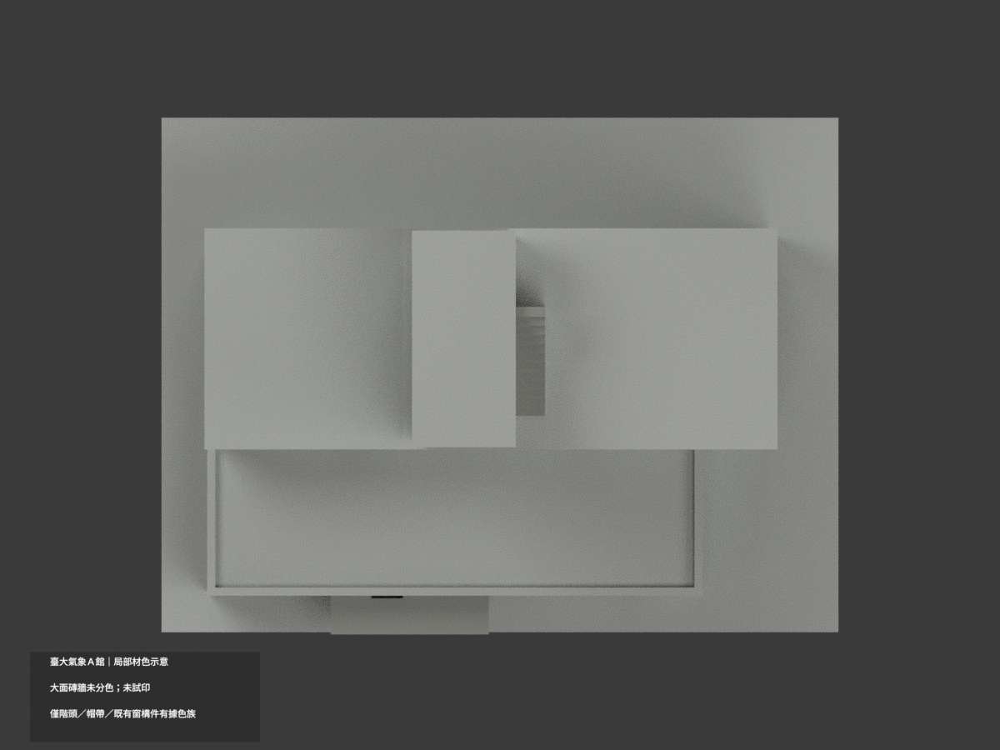
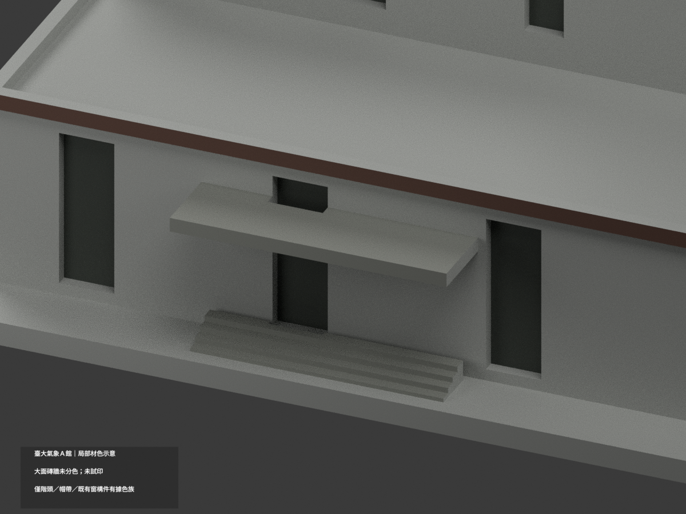
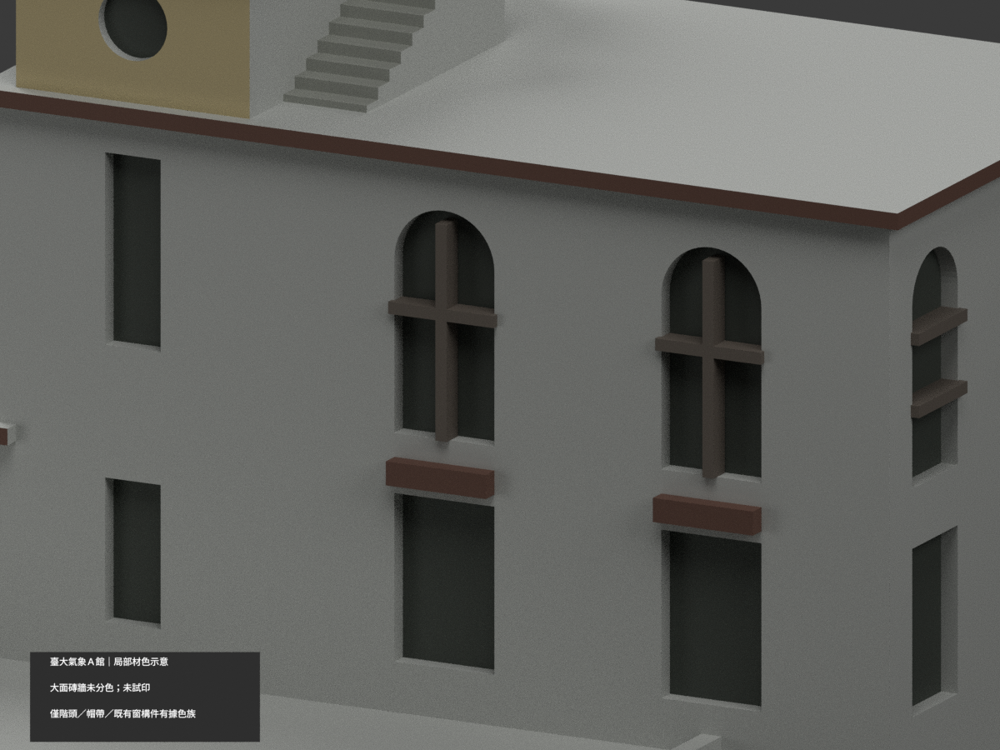
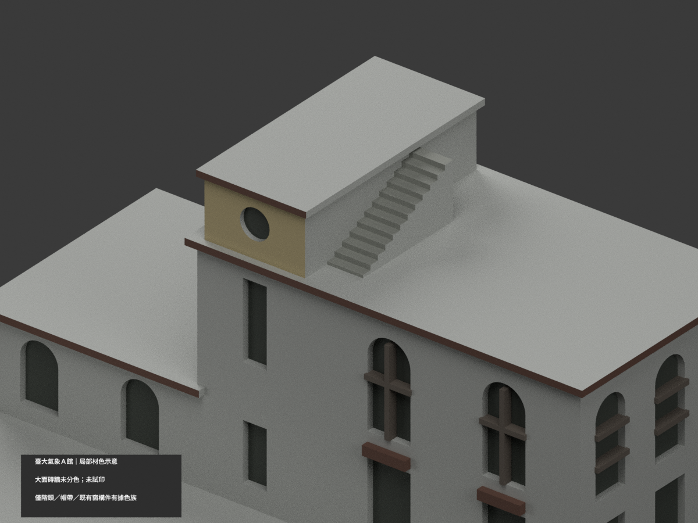

# 臺大氣象 A 館｜既有模型局部材色示意

| 正前 | 後方 | 正面 |
|---|---|---|
||||
||||
||||
||||

## 材色範圍

**大面磚牆未分色；僅階頭／帽帶／既有窗構件有據色族。屋面、細節與全館完整材色未完成。** `partial_color_incomplete=true`、`fully_colored_exterior=false`。這是局部包，不計作全面補色完成。

這是同一 `ntu-meteorology-a` 原項目的材質更新（same-item、count_delta=0），**原 1988 個三角面、頂點及 STL／OBJ／build_model.py 位元組均保留**。不新增、切分或改造幾何，不增加模型套數。

採洪致文公開攝影頁 2013-10-05 兩張外觀照片的近似色族：獨立上階梯頭前面暖米磚、既有窄帽邊紅褐色、實際凹窗暗影、原有梃構件灰褐色及局部水泥雨庇／階梯灰。HEX 僅展示近似，並非校準色票、現況測繪或 2026 全館保證。第三張來源為第二張相同位元組，不算另一獨立色證。

**原面拓撲限制：照片上的赭色外拱圈未被原模型獨立建出，不能在大牆三角面塗假拱圈。** 主前、右及左翼連續大牆為避免三角色楔，整個平面保持中性（包含跨未建深色基座的原面）；未證背面／西側、整片水平屋面與露臺保持中性。照片設備、空調、欄杆、管線、植栽、污漬及相鄰 B/C 館均不新建。原窄帽帶只是粗化色族，不聲稱實際磚縫或精確寬度。

## 使用與重建

- `scene.blend` 為實際多材質場景；`appearance.3mf` 使用基本材質標籤；`color-mesh.npz`、`palette.json` 及 `appearance-materials.json` 為相同原三角面分色資料。
- `model.stl` 本身不含顏色；原 OBJ 與原建模程式未改。`ORIGINAL-MONOCHROME-README.md`、原 `previews/` 及原單色檔案保留作歷程，不是新色版 QA。
- 執行 `python colorize_model.py`、`python export_appearance.py`、`python validate_color.py` 可重建材色／格式。原幾何仍由 `build_model.py` 重建。
- Blender：`blender -b -t 6 --python-exit-code 1 --python render_color.py`；再以 `verify_color_scene.py` 重新開啟檢查。
- 六種材質標籤**不是已配置或測試的四色列印工作**；本模型**未實際列印**，原幾何簡化與細件可列印性限制仍適用。

## 來源與權利

外觀來源為洪致文公開攝影文章（2013-10-05，`COLOR-SOURCE-REGISTER.json` 列出來源與版本）。未確認 CC 或其他照片再散布授權；照片只作私人參照，不隨模型公開、不貼圖、不保證商用。色材及原創渲染不代表取得照片權利；原模型原有授權範圍保持，不擴張至來源照片。

正式來源 GO、獨立來源審核、原包 SHA、逐面幾何與場景驗證、十視角渲染 QA 皆分開記錄；程式驗證不取代實景對位及人工視覺檢查。未核面保持中性，是明示限制而非完整上色宣稱。
