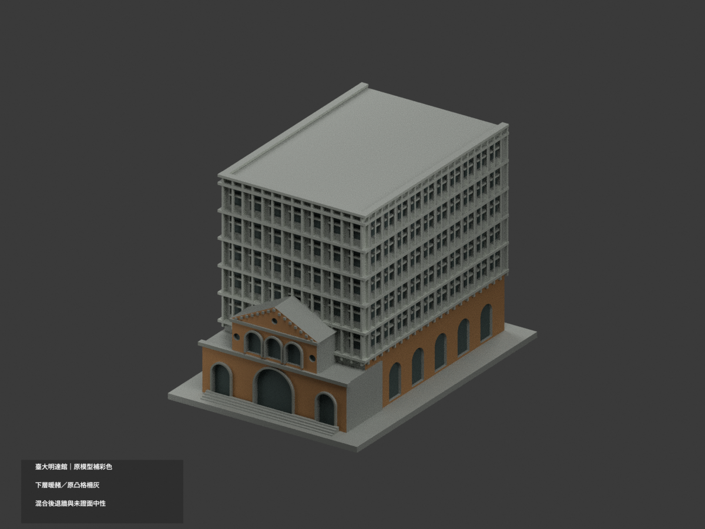
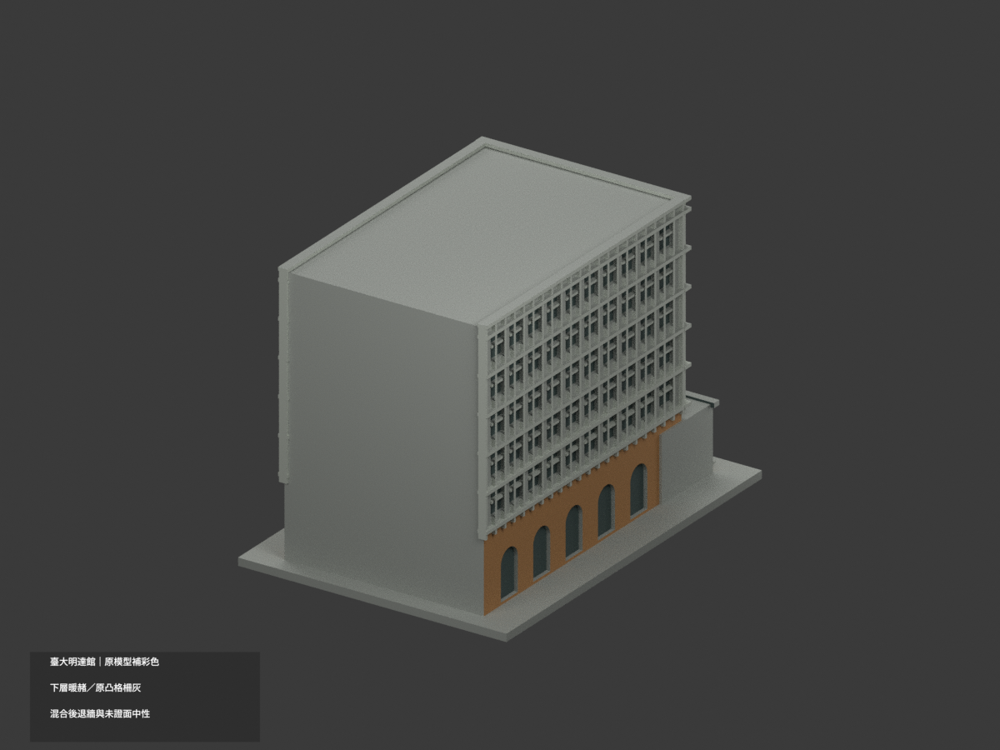
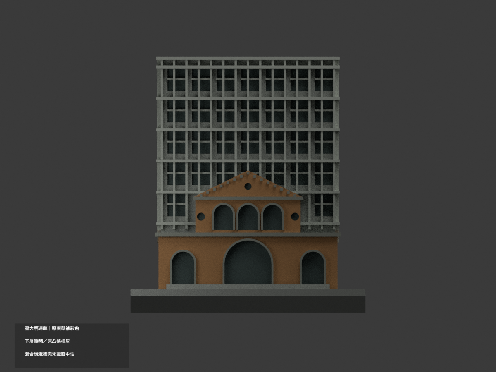
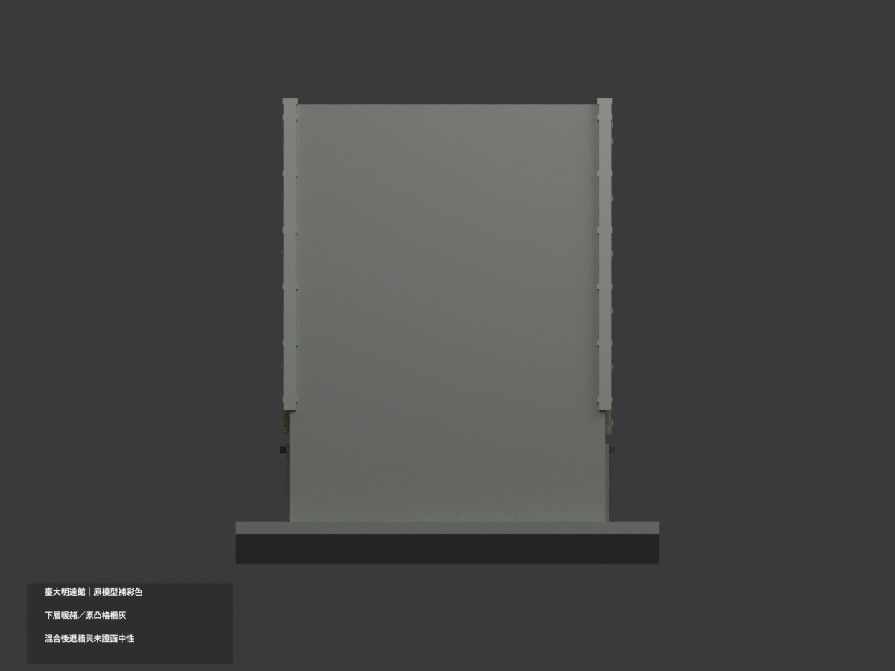
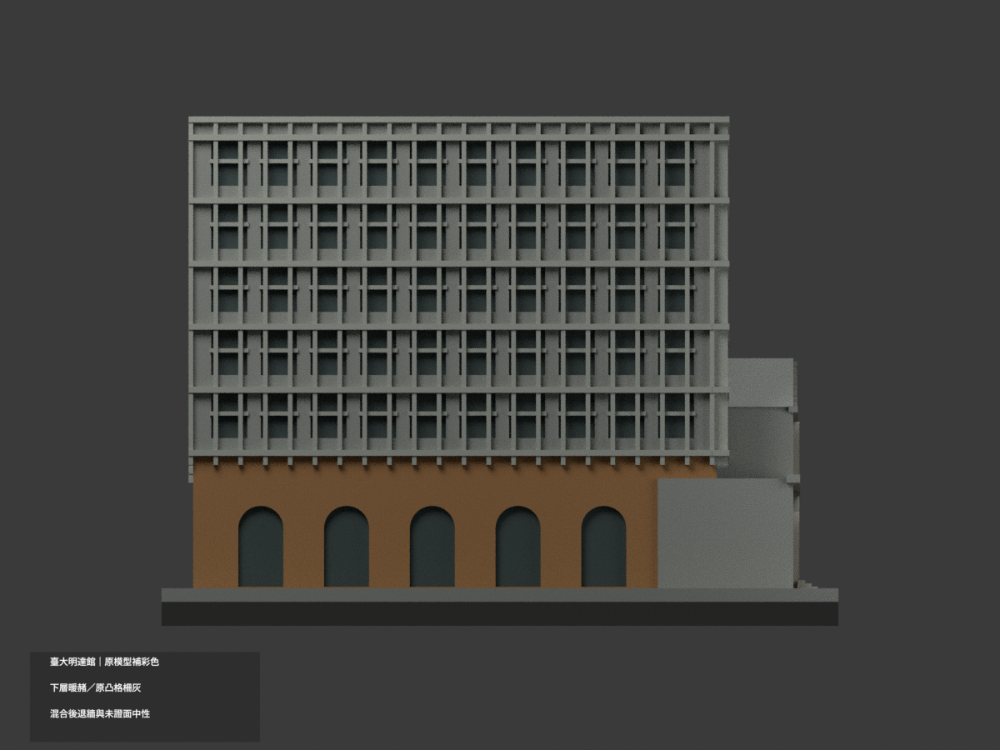
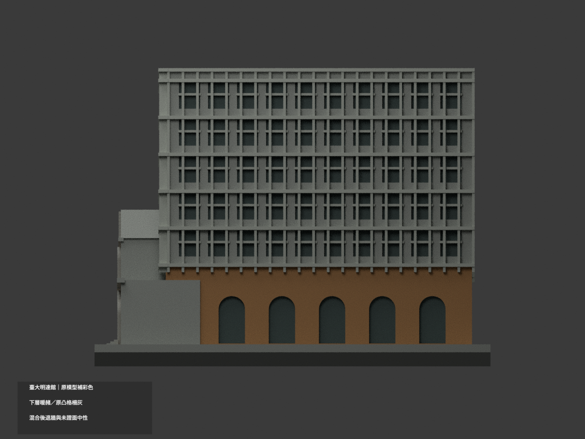
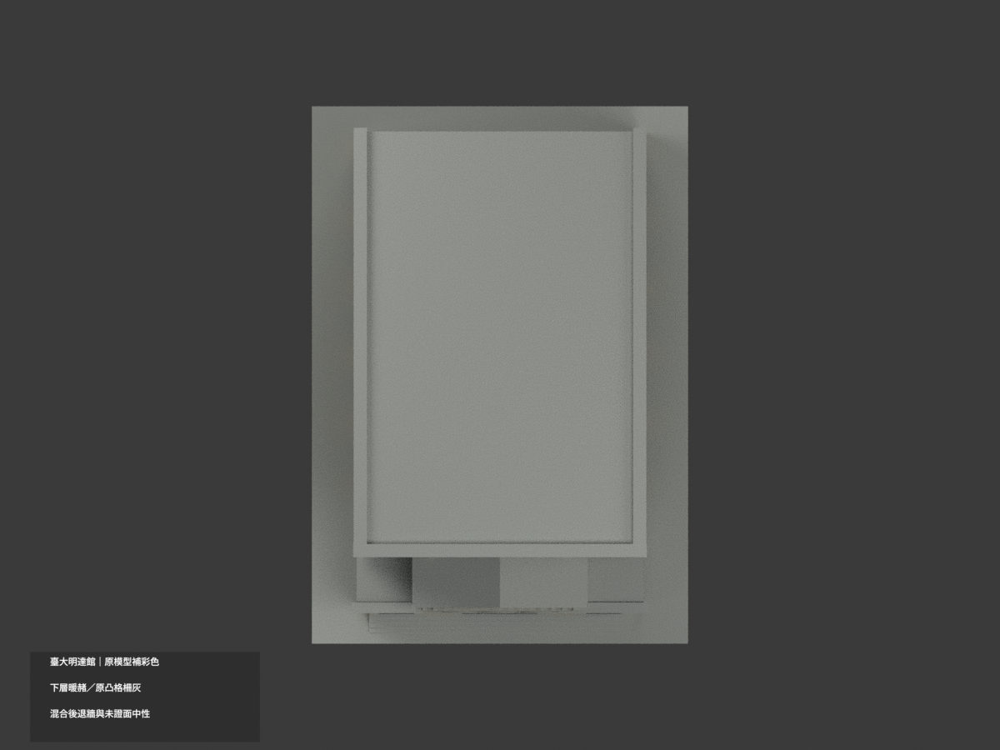
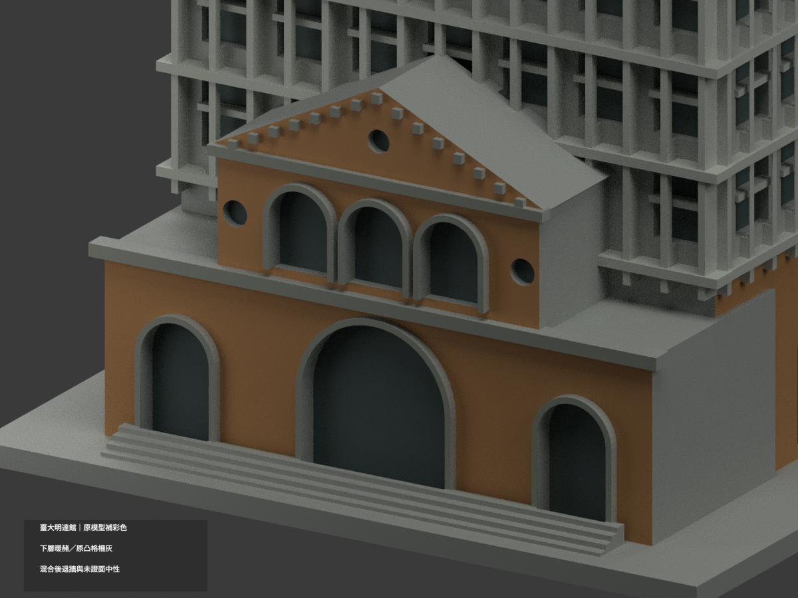
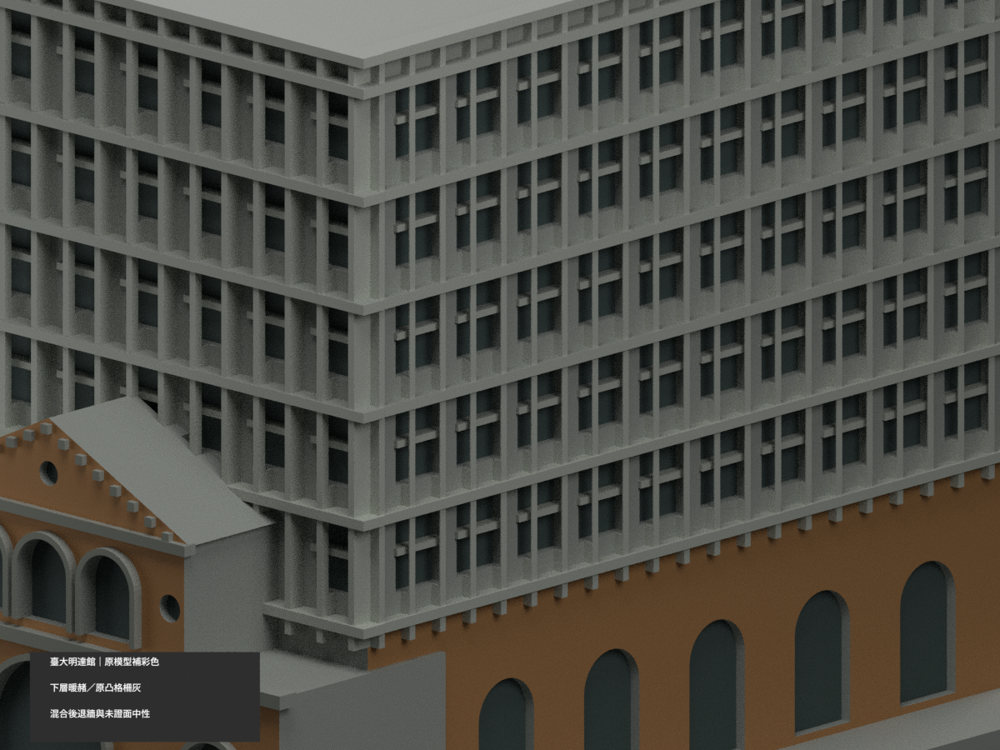
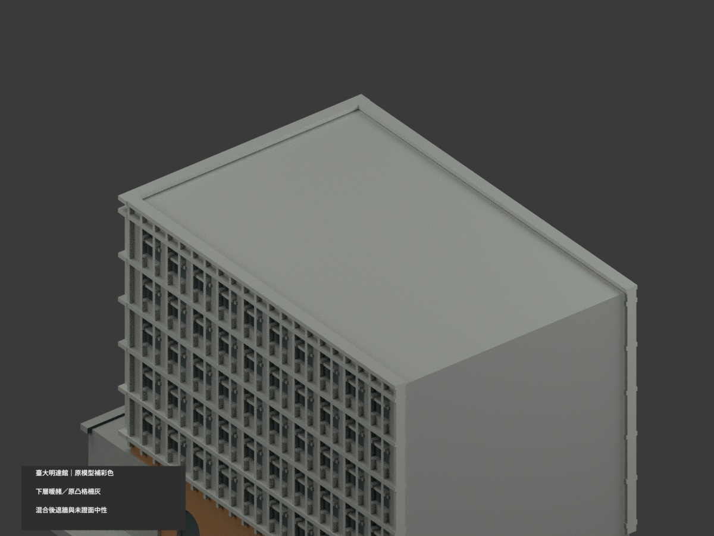

# 國立臺灣大學｜明達館：原幾何補彩色

## 彩色模型預覽

**同一項目材色更新（count_delta = 0）。前低基座與兩長側低層暖黃褐、原凸格柵灰；上層混合材色後退牆整面中性。不是全館精準材質重建，未證背面及水平屋面中性。**

| 正面斜視 | 背面斜視 | 正面 |
|---|---|---|
|  |  |  |
|  |  |  |
|  |  |  |
|  |  |  |

## 材質範圍與限制

原 21884 三角面及全部頂點位置、原 STL／OBJ／建模碼 bytes 保持一致，不切面、不新增窗格、字、牆或貼圖。補彩不背書原近似幾何之尺寸與窗位。

- 前低牆與山牆暖黃褐／赭磚，不是鮮紅。原已有凸拱圈、橫帶與可分齒飾灰；原無獨立山牆外框面，不新增畫條紋。
- 兩長側下層有日景支持暖黃褐。原網格在 z31 有跨界三角，採首橫帶底的既有完整 z33 面界概化，使整面一致；不是實測31或33漆色分界，不切三角湊色。
- 上層僅原凸直肋、橫帶、窗中短梃淺灰。後退牆照片包含褐色樓帶、灰金屬與窗等混合，無完整原面界可精分，因此整後退牆中性，不全磚、全玻璃或按重心產生斜楔。
- 既有離散上窗凹底低飽和灰藍／暗灰；不聲稱每個凹口皆已證實玻璃形式。下層拱凹與圓飾凹底為陰影，未新建門窗。
- 後端完整立面、水平大屋頂、未證屋面設備與低處遮蔽部分中性；中性不是真實漆色。只採本棟，不借照片圍牆、植栽或鄰樓材色。
- 官方頁為2010年建築影像組，非每張EXIF拍攝日證明，不稱2026現況；色族未測色校準。

## 格式、重建與QA

原 `model.stl` 與 `model.obj` 不變；STL本身不含材色。`appearance.3mf` 五種基本材質逐三角指定，`scene.blend` 實際shader，`color-mesh.npz` 原幾何與面材質。五材質外觀不是已驗證四色／多耗材切片專案；未實際列印、未作切片器列印驗證。

```sh
python build_model.py
python colorize_model.py
python export_appearance.py
python validate_color.py
blender -b -t 3 --python render_color.py
blender -b --python-exit-code 1 --python verify_color_scene.py
```

使用原 requirements 與 Blender 4.3.2。隔離重建保留，不自動刪除。新QA見 COLOR-FORMAT-GEOMETRY-QA、SCENE-QA、DELIVERY-QA、SOURCE-VISUAL-QA。七全景檢模型完整框界；三細景刻意裁切。原 validation、layer-check、source-model-comparison、previews、render_preview.py 及 README.zh-TW.md 保留為舊單色歷程，不當本次彩色重建入口，當前限制以此README優先。

## 官方來源與權利

- [臺大校園建築影像E區頁](https://homepage.ntu.edu.tw/~cpo/about_campus_archeitectureimage_E.html)
- [官方斜視5986](https://homepage.ntu.edu.tw/~cpo/2010photo/E/E71/IMG_5986.JPG)
- [官方長側5989](https://homepage.ntu.edu.tw/~cpo/2010photo/E/E71/IMG_5989.JPG)
- [官方正面5987](https://homepage.ntu.edu.tw/~cpo/2010photo/E/E71/IMG_5987.JPG)

原照片與頁面僅私人研究保存，原圖不隨模型公開、不貼圖。官方公開不等於 CC，未見通用再授權，不以模型／程式license涵蓋原照，不保證商用權利已清。精確來源與對應限制見 COLOR-SOURCE-REGISTER.json。

## 原單色模型說明與歷程

下列原文保留，其舊場景／驗證入口以本次新說明優先。

# 國立臺灣大學 明達館（電機四館）

## 模型預覽

| 模型預覽 | 模型預覽 | 模型預覽 |
| :---: | :---: | :---: |
| 正面<br> | 背面<br> |  |

[返回校區圖鑑](../../README.md) · [返回臺大總圖鑑](../../../README.md)

## 實際 STL 正面與背面


[下載 STL](model.stl) · [Blender 場景](scene.blend) · [參數化來源](build_model.py) · [驗證結果](validation.json)

[新增34件列印幾何補查與細節警示](../../../qa/printability-20261013/README.zh-TW.md)


官方索引代碼 E71。公開外觀近似模型，非測繪或BIM。

## 範圍與比例
依臺大2010年三張公開斜角與入口正面照片。主館長邊進深、上層格柵密度及樓層高度比為目測，未確認的後端立面與屋頂設備留白；不是精密復刻或2026裝修現況。

保留辨識特徵：低層三拱入口、上層三連拱窗、三角山牆與圓飾、山牆下齒飾、上方長矩形高樓及密集垂直肋／水平窗帶。前棟與高樓合為實心，不造室內。

尺寸 [105.0, 150.0, 108.30000305175781] mm，含底座最長150 mm。各館獨立比例，不是可拼接的共同尺度校園沙盤。尺寸、厚度、窗距均為照片目測和列印簡化，不是原建物實測。

## 列印
- 底座向下，毫米單位。參考起點：0.4 mm噴嘴、0.16–0.2 mm層高、3道外牆、15–20%填充。須依自己的切片器調整。
- 密集格柵凸邊、拱上緣、山牆小齒飾均須評估局部支撐與可拆性。細格柵加厚並有背牆，沒有懸空真百葉。
- 新增細浮雕名義最小約0.9 mm；這不是全模型最小壁厚的測量結果。零碎設備、文字招牌、樹木、電線及細緻裝飾沒有加入。
- 門窗背牆與實心量體避免隱藏內殼；實際填充由切片器決定。
- 未實際列印；未用PrusaSlicer、Cura等生成工具路徑。不宣稱無支撐或無風險可印。

## 驗證與檔案
- model.stl、model.obj；scene.blend是由實際STL匯入的可編修網格。
- build_model.py為獨立參數來源；Python3.12，依requirements.txt裝依賴後執行python build_model.py。
- Blender4.3.2：blender -b -t 2 -P render_preview.py。previews/front.png、rear.png、elevation.png均直接渲染交付STL。
- python validate_model.py：原始法向、水密、流形邊／頂點、單一連通表面、無分離封閉內殼、正體積、150mm、獨立重建SHA256及已儲存Blender/STL三角幾何一致性。結果validation.json。
- python check_layers.py：每0.2mm水平截面幾何檢查，共 542 層，所抽樣截面全部閉合。首層採z=0.071mm避免重合平面退化，非實際列印首層設定。
- layer-check.json另記向下超45度面積指標與各層輪廓；它不是切片器、最小壁厚測試或實體試印。閉合截面不保證擠出連續、橋接、支撐可拆、床面附著或局部細節可印。
- SHA256SUMS可核對檔案；更改參數後需重建、重繪、重驗證。

## 公開來源
查閱及圖像像素檢視：2026-10-13。來源照片未隨檔重新散布。
- [電機系官方系館介紹：電機四館／明達館，2007年啟用](https://web.ee.ntu.edu.tw/about6.php)
- [臺大校訊：明達館](https://sec.ntu.edu.tw/epaper/article.asp?num=865&sn=6970)
- [實際檢視2010官方外觀 5986](https://homepage.ntu.edu.tw/~cpo/2010photo/E/E71/IMG_5986.JPG)
- [實際檢視2010官方外觀 5987](https://homepage.ntu.edu.tw/~cpo/2010photo/E/E71/IMG_5987.JPG)
- [實際檢視2010官方外觀 5989](https://homepage.ntu.edu.tw/~cpo/2010photo/E/E71/IMG_5989.JPG)
- [臺大官方建物索引，檢索標題2026-08-17](https://cpo.ntu.edu.tw/map/C_01_list.pdf)

照片版權屬原權利人；沒有轉授原建築設計或照片權利。不同拍攝日期不等於已核實目前全部外觀。
