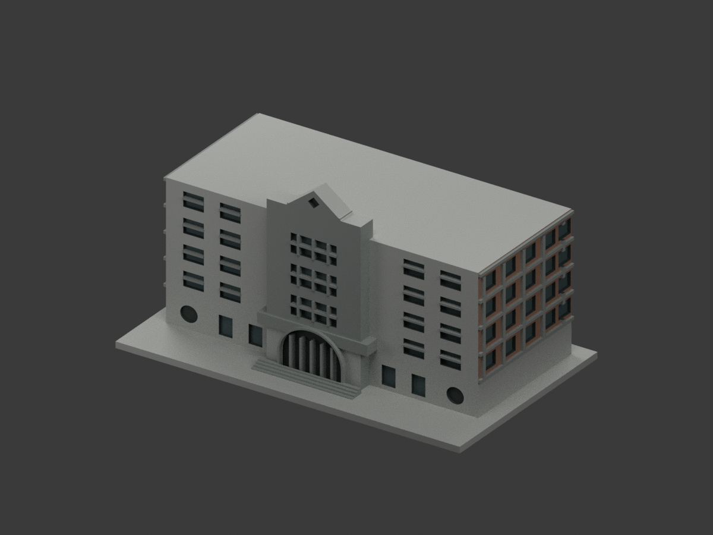
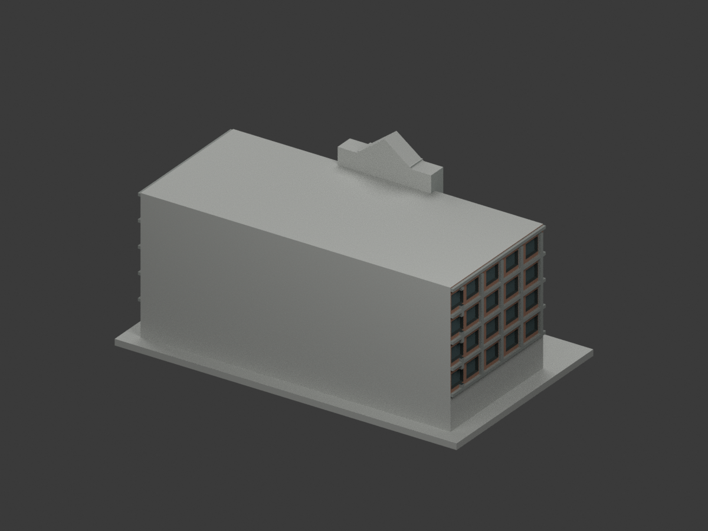
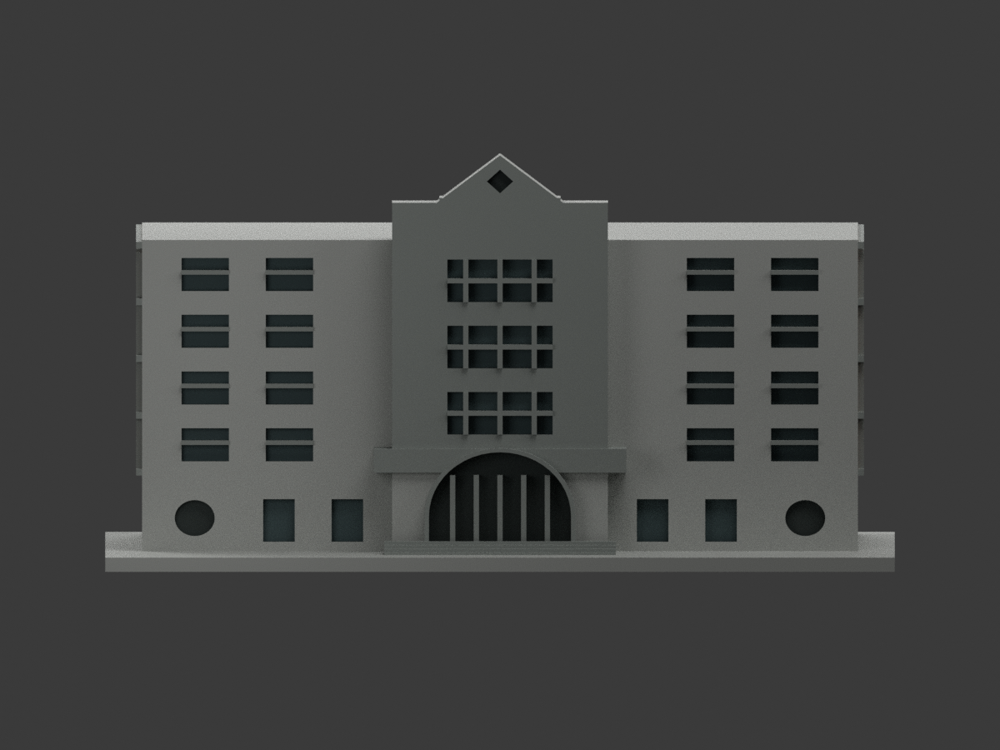
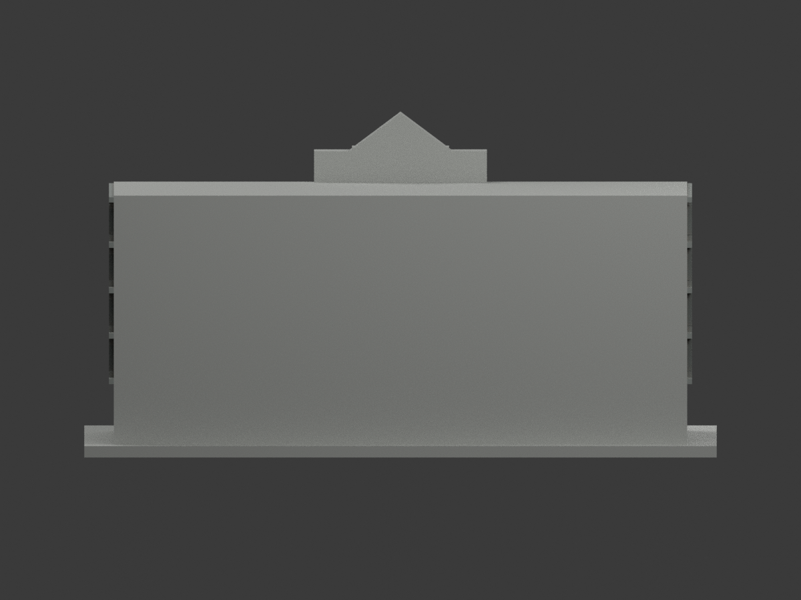
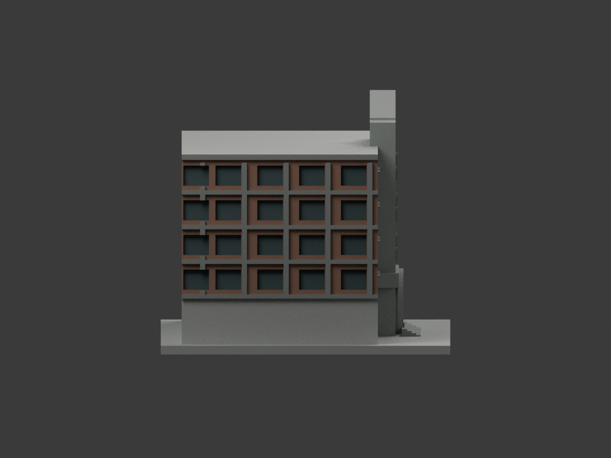
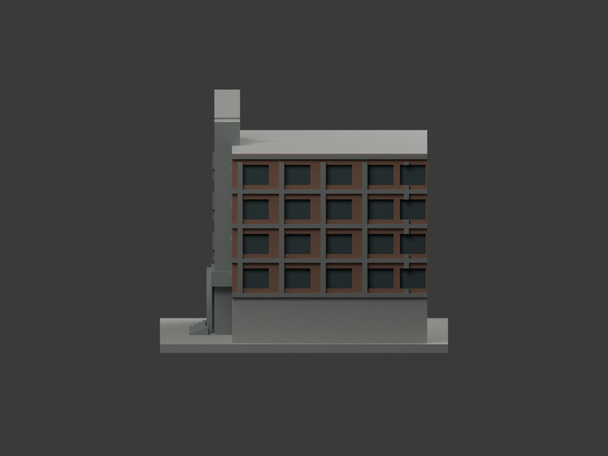
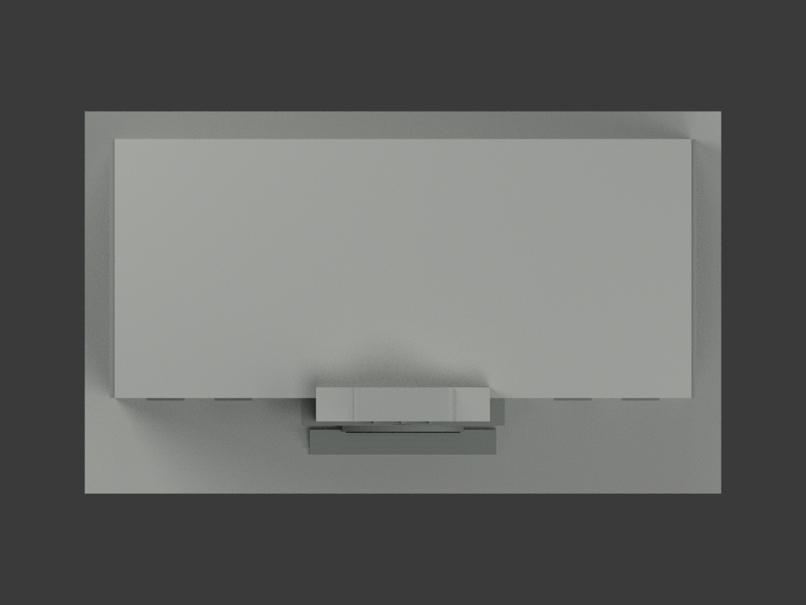
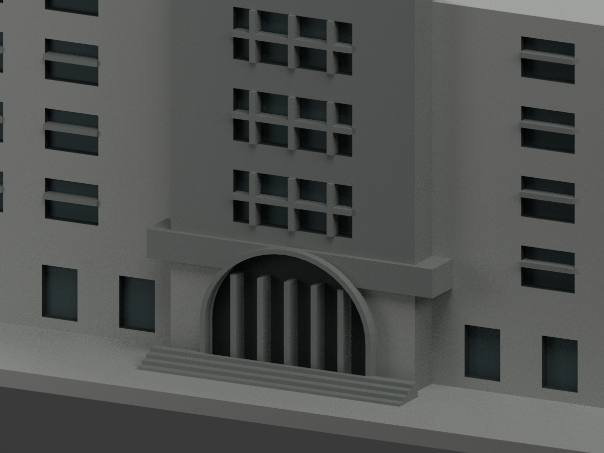
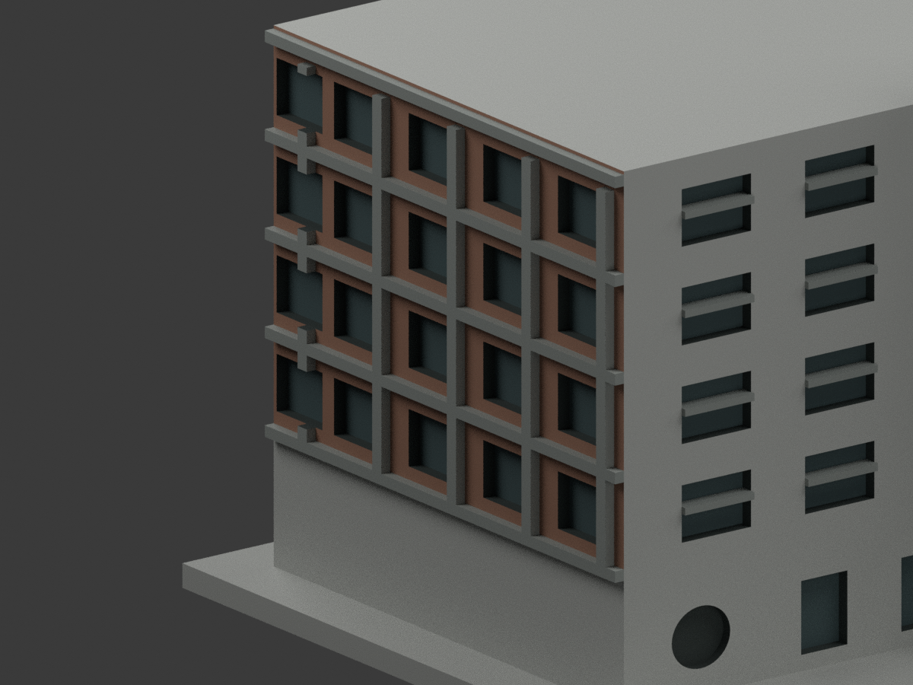
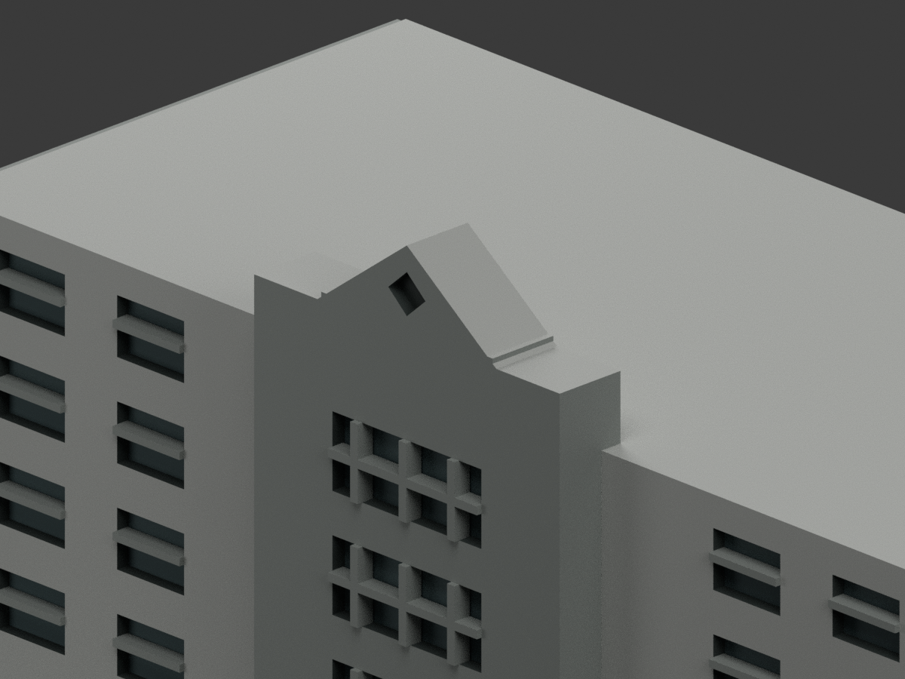

# 臺大國發所E10｜入口低塔整石過度指派撤回

本次是有限撤色勘誤，不新增實景色。兩個入口低塔前片各10面，原stone index1撤為neutral index4，共20面。原3677配色/435中性變為3657配色/455中性，4112原三角、原五palette及未選索引不變。原STL/OBJ/build、工程與previews aliases完整保留；README.zh-TW.md保留原歷史版本。

新取得臺大學輔中心官方定位頁公開入口原圖3787×2840（拍攝日期未知），可直接辨認低塔灰石上兩道紅磚橫圈。原實體沒建這些材界，不能全片認石，也不能改全磚。只撤y=-28、x[-20.5,-9.5]/[9.5,20.5]、z[3,20]（原lookup縮放前）的兩完整共面域，不切面或用重心劃假色界。中性表示原均質石色依據不足，不表示每面實景皆非石。高處純灰前片、原冠前/背/頂、拱圈與其他未選面均不變，不以本次結果追認它們的幾何或材色精確性。

原19個混材共面域逐域材料索引保持，沒有新增混域；不稱全模型共面一致。仍按原2010 E10建築近似模型工作，舊三照另核hash，新來源不是搬遷後新館、2026現況或測繪資料。原z×0.9只在選面時逆轉查找，輸出頂點不改。前側大牆跨灰基座、未證冠背/冠頂27面等原限制保留。

官方照片僅私人研究，未核明示可再授權，不公開照片或裁切、不作貼圖；HEX仍名義色族。46原包全件Git blob核。未試印、未驗多料切片。LOWER-PORTAL-WITHDRAWAL來源QA維持pending快照，最後獨立模型審核另檔。以下歷史原版只描述前一版本，被本勘誤撤回之20面整石指派不再適用。

## 歷史原版說明

# 臺大國發所 E10｜既有模型局部補彩

本次只依臺大官方 **2010 E10 外觀照片組**，為既有簡化模型可對位面補上近似展示色；不代表搬遷後新館或 2026 全面現況，照片組年份不是精確拍攝日期。**前方與側方跨越灰基座的大牆整面保持中性**，不宣稱全立面已完整精確上色。原 4112 三角形、頂點、STL／OBJ 與建模程式不變；同項目更新，count_delta = 0。

|  |  |  |
|---|---|---|
|  |  |  |
|  |  |  |
|  | 原幾何保留 | 未證面中性 |

## 材質範圍

- 可由原格柵劃分的側牆填面採低飽和暖磚色；原灰石外格、中央入口塔、階梯、拱圈、既有梃與階梯式冠部採灰色；格柵端面作同構件色族連續概化，並非逐面實景校色；中央冠部只保已證正面灰，未證冠背與冠頂 27 個原面保留中性（菱孔真內返不誤併入）。
- 原窗凹底採節制灰綠展示色，其他洞內用通用深陰影；圓孔與入口不一律當玻璃，不增門扇或內部。
- 原前牆大三角與其同平面連通面跨越磚牆／灰基座材色界線，**整個混合牆域保持中性**；不切面、不用重心染成假斜色。僅已有獨立邊界的側格填面可染磚色。
- 原 primitive 只供完整面對位；原程式最後 Z × 0.9，材域查找先反算此縮放，輸出座標仍完全不動。
- 後牆、水平屋面、遮蔽或無唯一對位的面保留中性。中性不是實景油漆色；材色分界亦非新建真實縫線。
- HEX 為未校色照片的展示近似，不是量測色票。未增加題字、菱形裝飾、空調、植栽、精細格柵或任何新幾何。既有簡化形體／比例未因補色獲得實測精度背書。

## 檔案與重建

`model.stl`、`model.obj`、`build_model.py` 保留原檔位元；STL 本身無彩色。`appearance.3mf` 以逐面 base-material 標籤保存五種材色，`scene.blend` 使用實際節點材質；`color-mesh.npz` 保存原頂點／面序與材質索引。

```sh
python -m pip install -r requirements.txt -r color-requirements.txt
python build_model.py
python colorize_model.py
python export_appearance.py
python validate_color.py
blender -b -t 3 --python render_color.py
blender -b --python-exit-code 1 --python verify_color_scene.py
```

原環境版本見 `requirements.txt`；彩色查面另需 `color-requirements.txt`。隔離重建保留，不自動刪除。十張圖由同一實際彩色模型渲染；相機／取景見 `FRAMING-QA.json`。檢核見 `COLOR-FORMAT-GEOMETRY-QA.json`、`SCENE-QA.json`、`DELIVERY-QA.json`、`SOURCE-VISUAL-QA.json`。

## 來源與權利

臺大營繕組官方 2010 E10 圖片：
- [正面 IMG_6020](https://homepage.ntu.edu.tw/~cpo/2010photo/E/E10/IMG_6020.JPG)
- [側面 IMG_6021](https://homepage.ntu.edu.tw/~cpo/2010photo/E/E10/IMG_6021.JPG)
- [側面 IMG_6022](https://homepage.ntu.edu.tw/~cpo/2010photo/E/E10/IMG_6022.JPG)

來源原照只私人核對，沒有公開貼圖或隨包重散布；未確認 CC 授權，不保證商用或以倉庫授權涵蓋原照。來源判讀與雜湊見 `COLOR-SOURCE-REGISTER.json`。原單色檔及舊渲染歷史保留，彩色新增檔是本次入口。`README.zh-TW.md`、`previews/`、`validation.json`、`source-model-comparison.json`、`layer-check.json` 與原檢核／單色渲染腳本皆屬舊版紀錄，不作本次材色 QA 結果。

## 列印限制

**未實際列印**。五種展示材質並非已測試的四耗材專案；未提供已驗證的換料、可分件、支撐、壁厚或設備設定。保留既有模型的簡化與可列印性限制，不因格式檢核通過而稱已試印。
