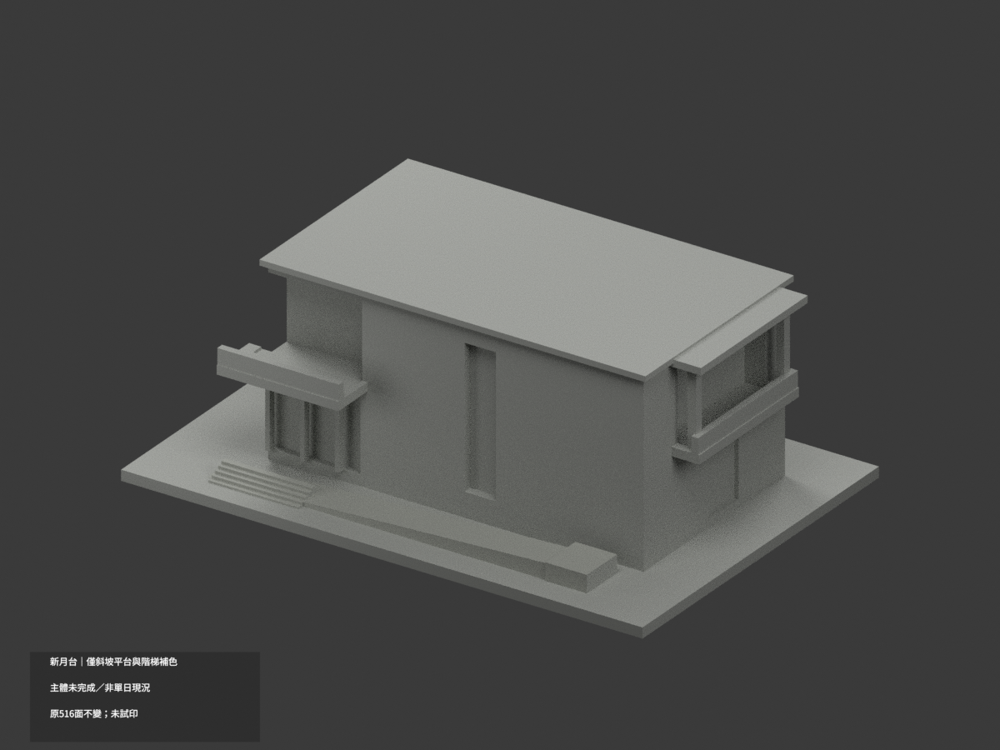
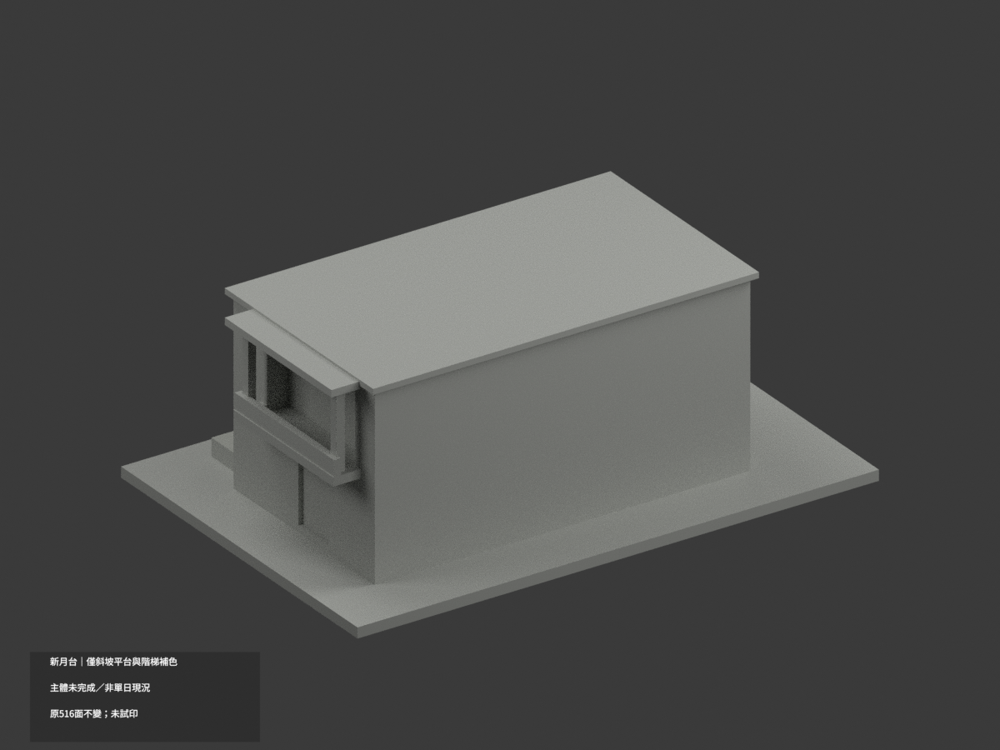
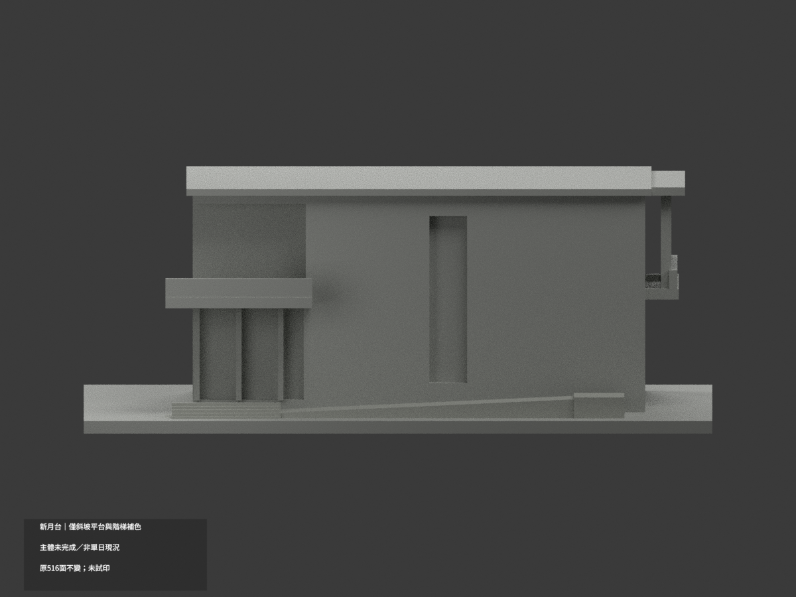
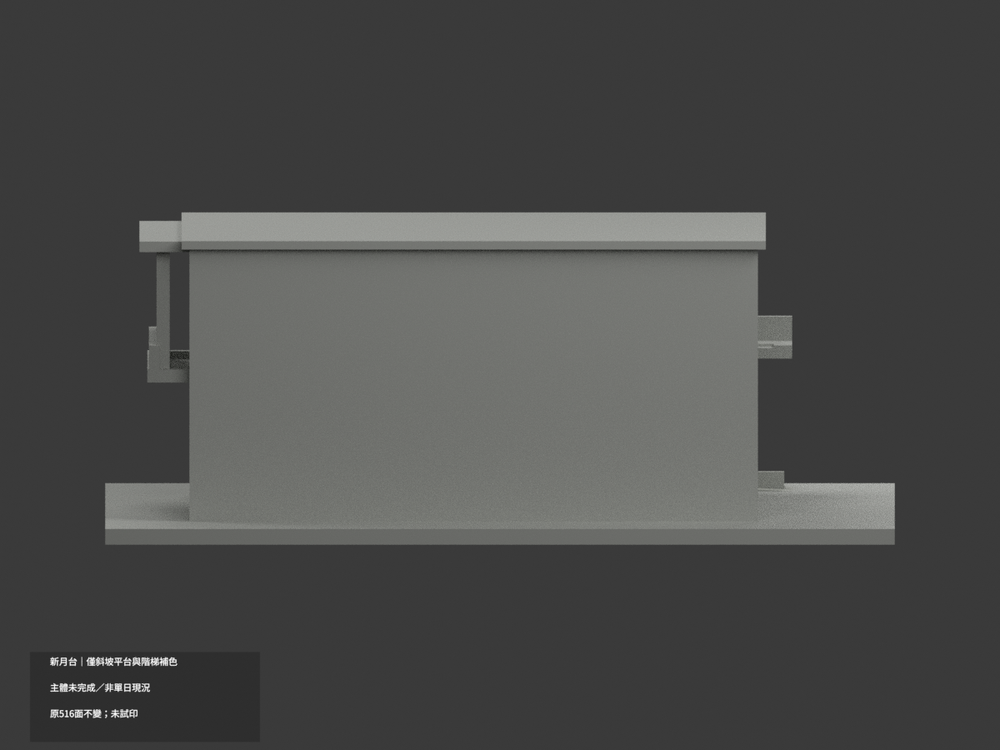
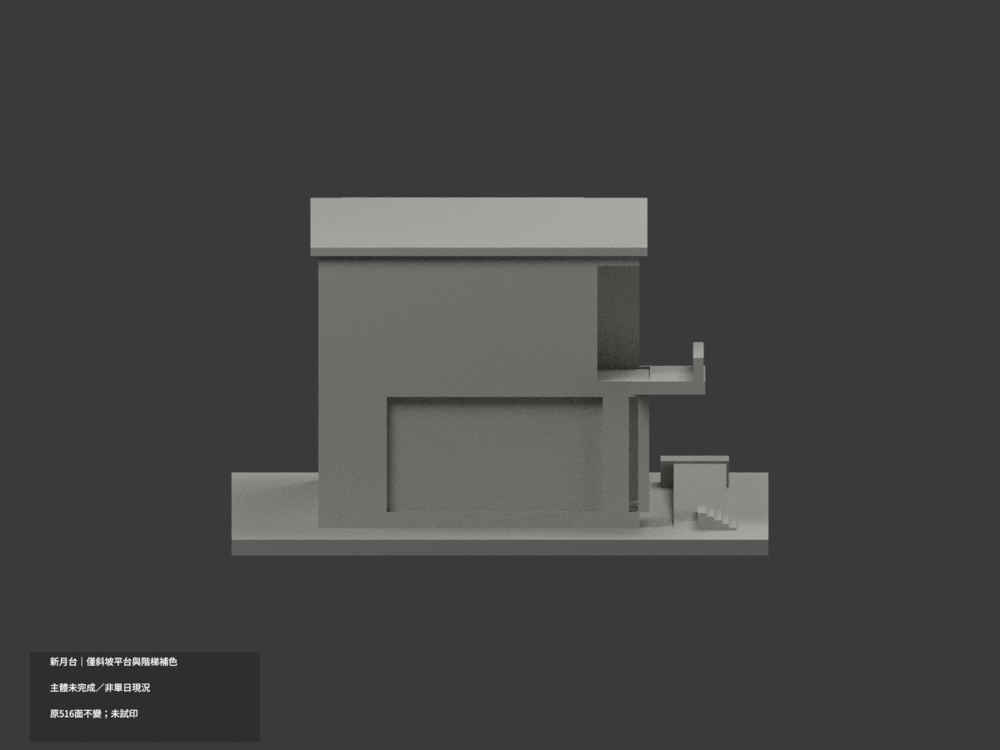
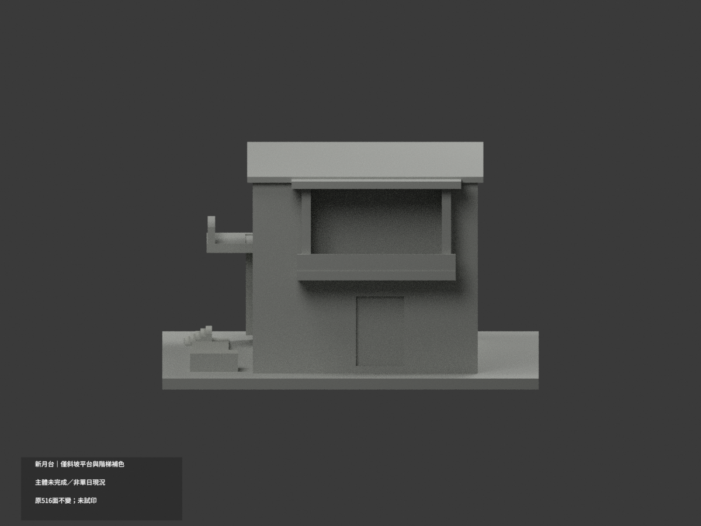
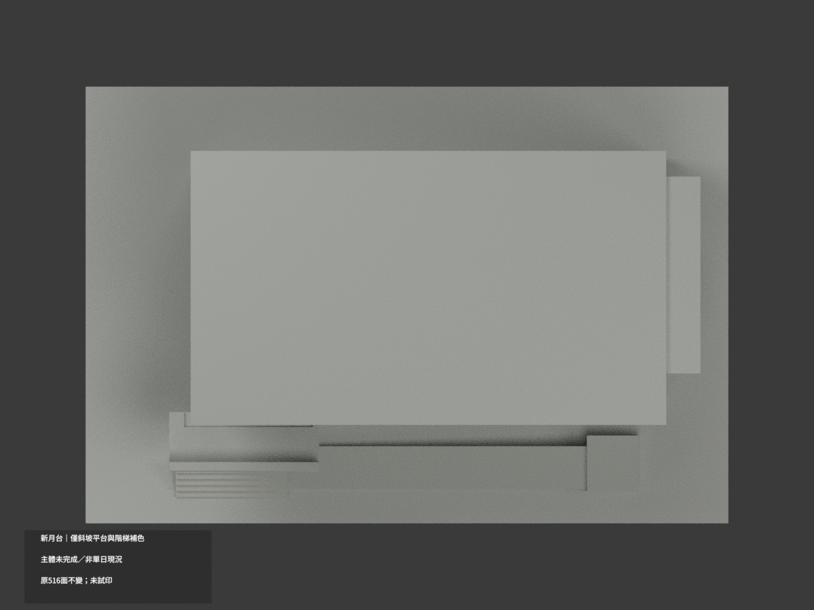
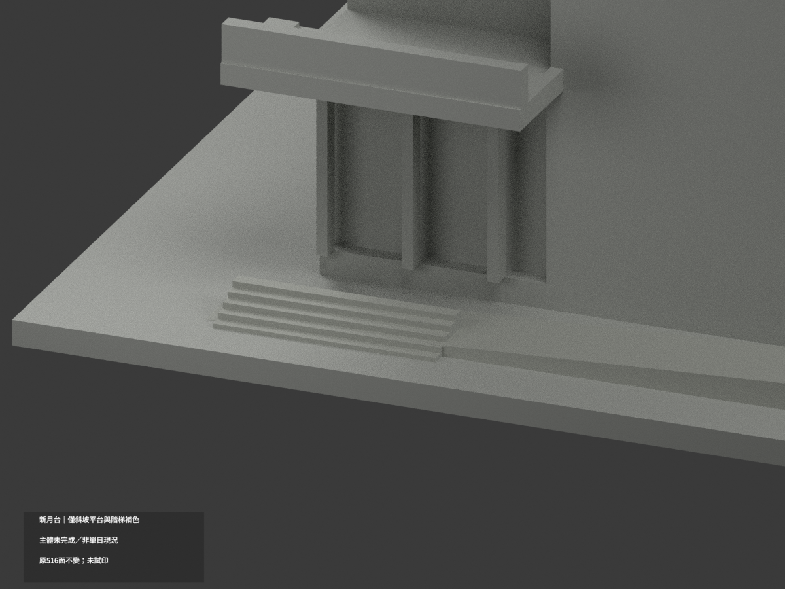
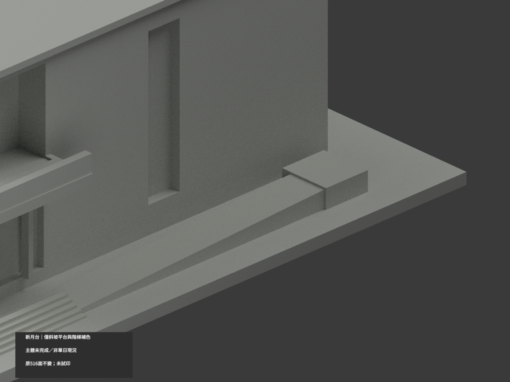
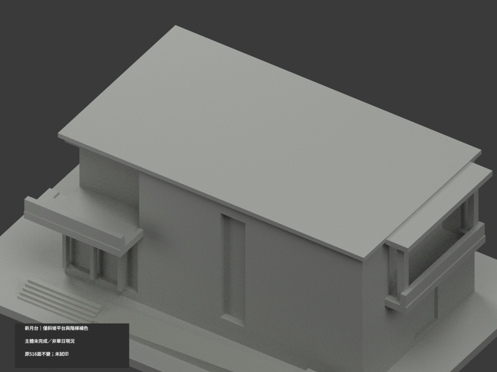

# 臺大新月台｜極限縮局部參考補色

**僅公共斜坡、平台及入口階梯少量補色；建築主體仍中性，主牆／窗框／欄杆／屋面未完成。** `partial_color_incomplete=true`、`fully_colored_exterior=false`。同項目 `ntu-new-moon-pavilion`／`count_delta=0`，不新增套數。保留**改裝前後共同形體近似，非單日完整現況**限制。

| 前斜視 | 後斜視 | 正面 |
|---|---|---|
|  |  |  |
|  |  |  |
|  |  |  |
|  | | |

## 材色範圍

公共斜坡真正上斜面與前側17面、平台頂／前4面、5原階露出踏面／前立面23面，共44面為低飽和淺灰石材近似。其餘472面未知中性，**不是實景灰色證明**。

斜坡採原`z=2.8+(x+60)*5/108`實際上表面與前側輪廓，並核全頂點與真正表面方向；平台及階梯只原頂／前面。原126個共面連通域全部材色一致，不用centroid或高度切牆，不新增分割。

主體磚牆與淺灰基底在原大平面沒有分界，完整中性；改裝前淺框與改裝後藍框不同年代，窗背反射亦無單一物材證據，不強選。原實心欄代替實景透空金屬，不塗黑冒充實心黑牆。屋面、雨庇灰板／黑梁混域、未知後部皆中性。

原兩層主體近似，參考2024改裝後入口與改裝前官照，只保共同可確認量體，不混充某日完整現況；地下停車空間未重建、背面未確認而簡化。補色不追認原幾何，原516三角／坐標／尺寸／STL／build字節完全不變。

## 來源與權利

[臺大BEATS 2025年4月文章](https://ntubeats.ntu.edu.tw/enews/010/16.html)報2024-12-26啟用及12-27營業；[臺大舊官方新聞](https://sec.ntu.edu.tw/epaper/article.asp?num=1609&sn=29138)報2024-06-28捐贈改裝。照片拍攝日期未獨立確認，發文或事件日期不是拍攝日期。精確圖URL/hash及GO2217/獨審2216-v1在`COLOR-SOURCE-REGISTER.json`。

未確認CC授權，原照私存、不隨公開包或貼圖；來源權利不被repo license取代，不保證商用。材色只是近似展示，非色票校準。人像與標字均未建。

## 檔案與重建

`appearance.3mf`含2展示材，`scene.blend`含實際面材／相機，`color-mesh.npz`原三角與material index。STL無色且原字節不變。原公開包無OBJ，隔離原build生成OBJ只私存，不聲稱原件有OBJ。

依`requirements.txt`執行`python colorize_model.py`、`python export_appearance.py`、`python validate_color.py`；Blender執行`render_color.py`及`verify_color_scene.py`。完整原build＋color隔離重建保留不自動刪。原件私存；`ORIGINAL-MONOCHROME-README.md`、舊`previews/`、舊QA／SHA清單皆歷史，不是本次補色驗證。

## QA與列印限制

原STL／三角multiset、封閉正體積、3MF索引與隔離重建見`COLOR-*QA.json`；重開見`SCENE-QA.json`；10張1200×900圖與三欄/hash見`DELIVERY-QA.json`。人工視看另交父獨審。

**未實際列印。** 2展示材非驗證過的四色列印工程，材料映射、支撐、薄件強度和切片須另驗，不保證直接多料成功。
