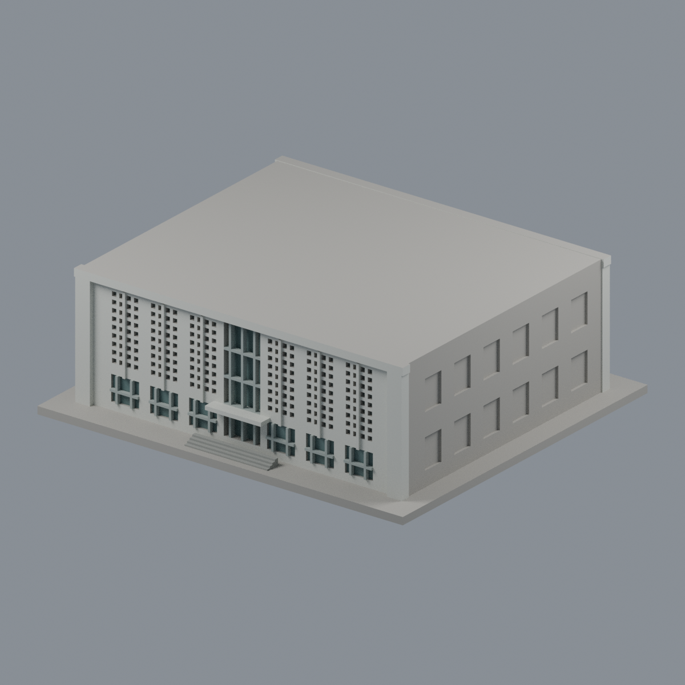
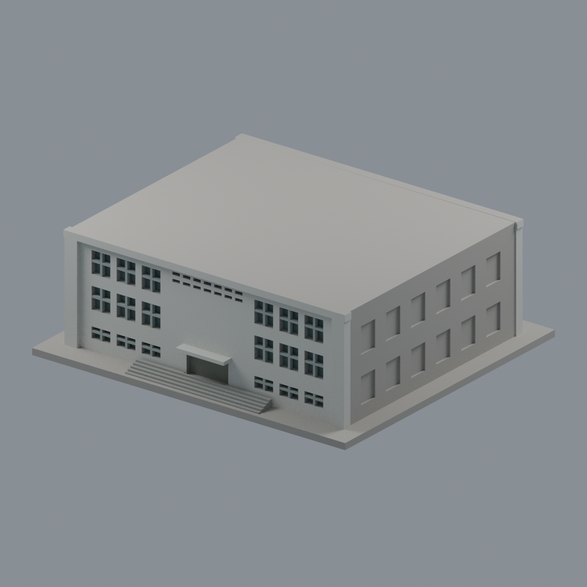
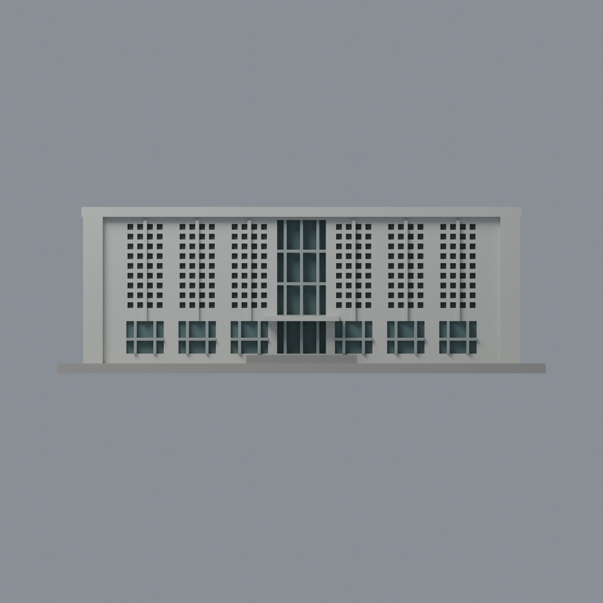
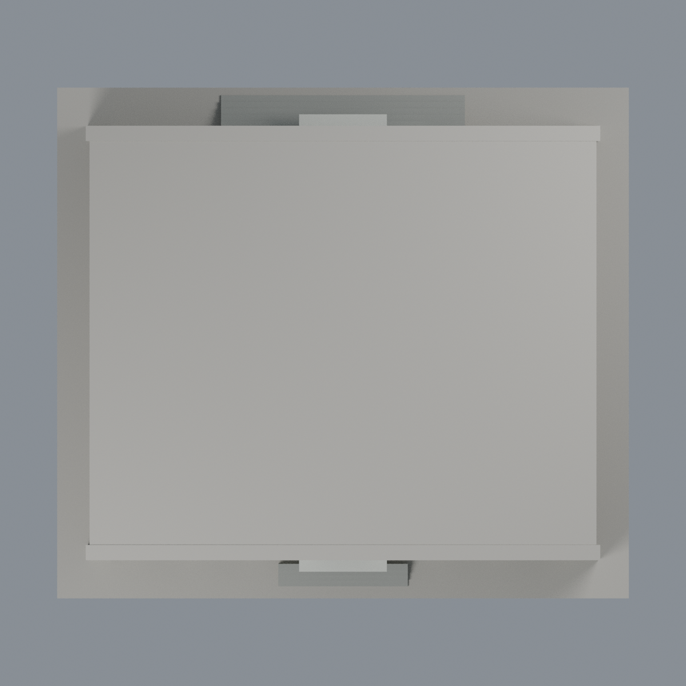

# 國立臺灣大學舊體育館

<table>
  <tr>
    <td align="center" width="50%"> 正面</td>
    <td align="center" width="50%"> 背面</td>
  </tr>
  <tr>
    <td align="center" width="50%"> 正立面</td>
    <td align="center" width="50%"> 頂視</td>
  </tr>
</table>

[目前 Blender 色版](../appearance/scene.blend) · [目前 3MF 色版](../appearance/ntuoldgym-appearance.3mf) · [單色幾何 STL](../model.stl)

四張圖皆從現有七材質場景以原相機渲染。現版包括後側大框主梁底條兩面延用同梁淺白的有限配色；樹遮部分為同梁推估，不延伸至相鄰部位；未重新測繪、補色或更動幾何。本模型為公開外觀近似，沒有重建室內，也未實體試印。

[原模型說明與列印限制](../README.md) · [目前模型校驗](../PUBLIC-MODEL-SHA256SUMS) · [展示來源記錄](render-proof.json) · [展示檔檢查](SHA256SUMS)
