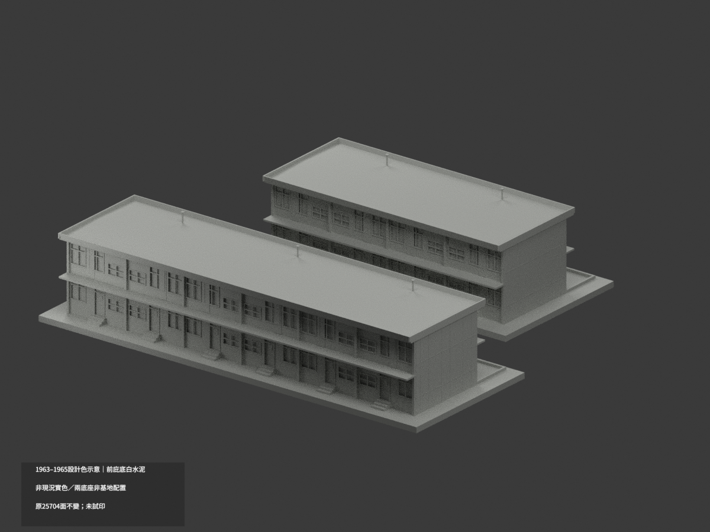
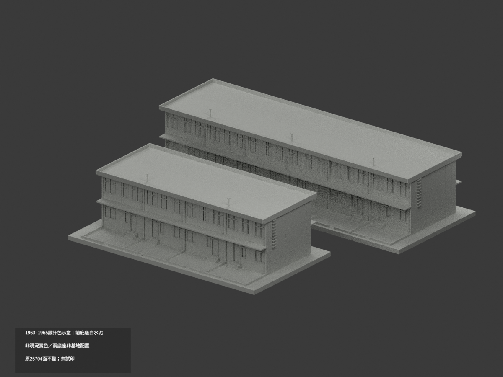
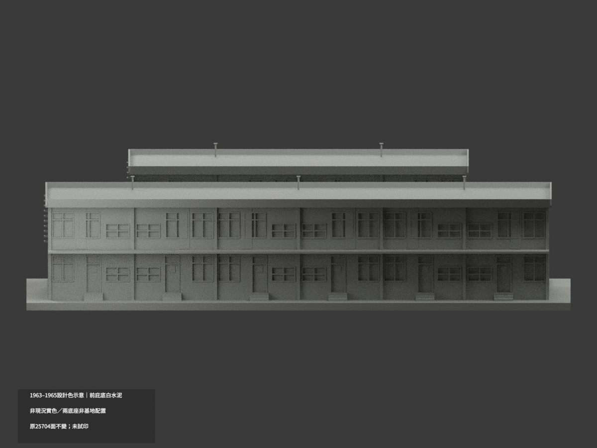
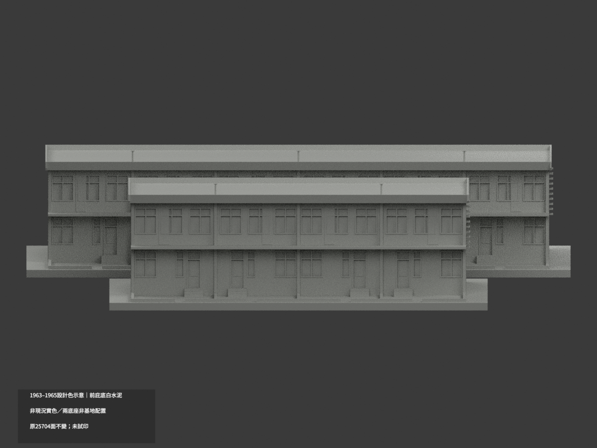
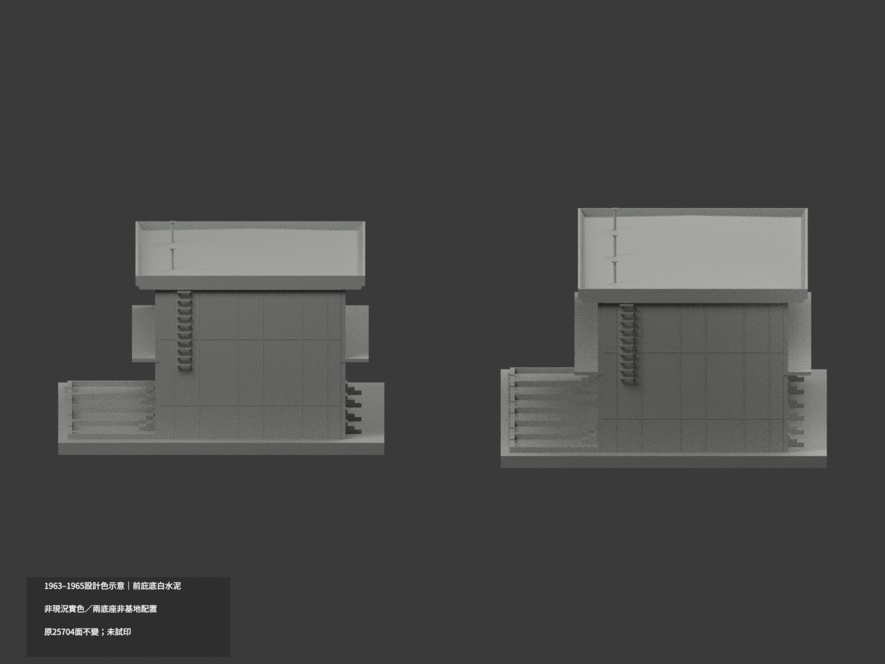
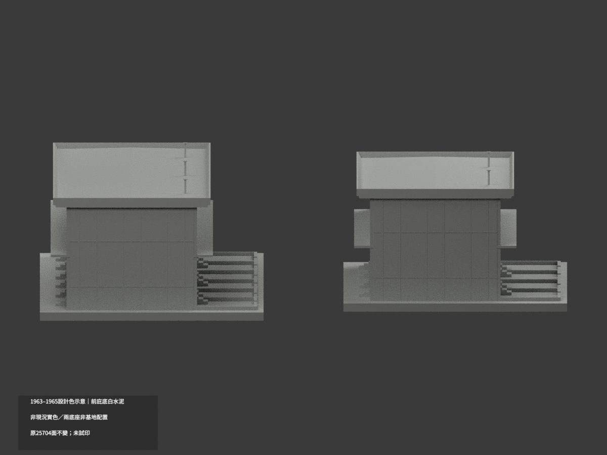
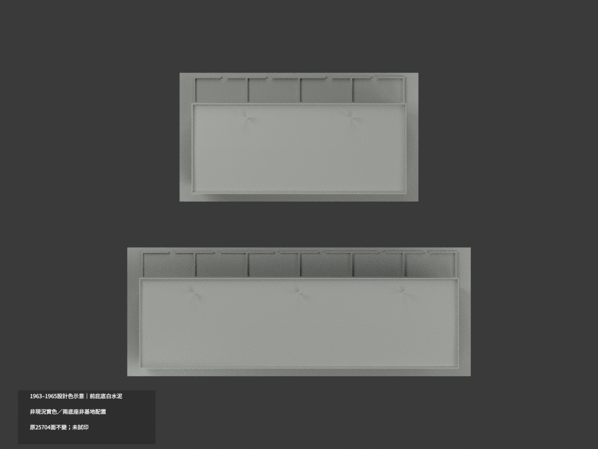
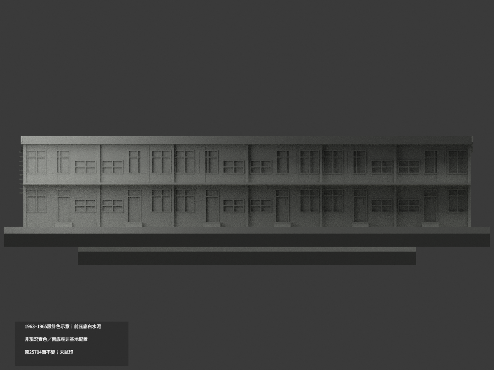
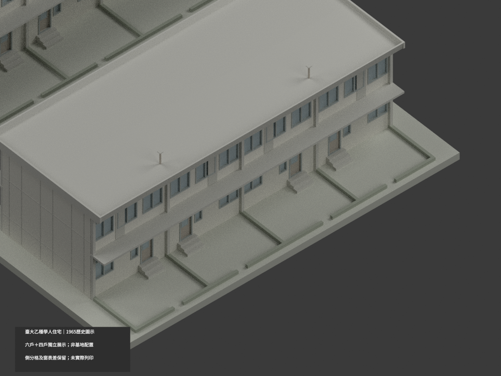
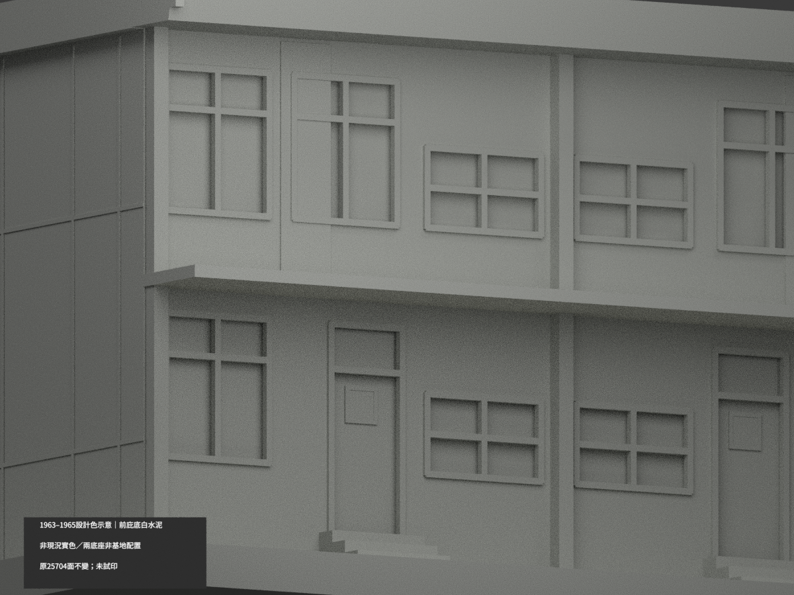

# 臺大乙種學人住宅本期六戶連＋四戶連｜1965 歷史圖示

## 模型預覽與範圍

**一包兩組，共十戶；兩個獨立展示底座的相對位置不是基地復原。** 本模型依 1963–1965 不同日期圖版重建歷史外觀，不是今日現況測繪。後院牆高未載，後院僅以深色、20 cm 高的界線足跡示意，**不是歷史院牆高度復原**。未實際列印。

| 正面斜視 | 背面斜視 | 正面 |
|---|---|---|
|  |  |  |
|  |  |  |
|  |  |  |
|  |  |  |

## 原案與取捨

原題為「國立台灣大學回國留學生宿舍乙種學人住宅新建工程」，館藏 NCMD130，原設計署名 **台大營繕組**、審核呂芳勝；原收藏國立台灣大學，數位典藏為國立臺灣博物館臺灣現代建築圖說／文化部平台。A0 的本期六戶連及四戶連合為一包；排除兩排原有六戶、預期擴建虛線、其他舊建物及 A7 劃叉圖。

臺博館 2014 官方研究對母案作衛星空照存續判斷，並未現勘；母案名稱含四棟，不能據此宣稱本期兩列已逐棟核實。**兩列精確現址未證，不混王大閎 1970 長興街住宅，不宣稱 1965 同日竣工或 2026 現況一致。**

## 幾何依據與公開限制

- A1 主平面：每戶 5.70 m，鏡配雙戶 11.40 m；六戶 34.20 m、四戶 22.80 m，主深 **750 cm**。這是控制尺寸，不是包含雨庇、院界的外包框。
- GL 至一層 0.45 m、二層 3.45 m；外挑屋簷最高 **7.05 m**。完成屋皮以局部詳圖推導名義 **6.70 m**，採 1:50 微坡的外觀協調，垂直定位約 ±0.10 m，不宣稱逐點精確標高。A2 外挑簷與肋板可並存；A3 後濕區 50 cm／15.5 cm 構造鏈不套整棟。
- 側立面粉刷分格鏈 `50+120+183+120+183+120+50=826 cm`，與主深 **750 cm** 相差 76 cm。主體採多處平面控制；側分格按相對圖形簡化，**未改字湊數、未假稱全圖尺寸閉合**。
- 各戶首／二層、正／背面開口按 A1 分域，非整面鏡射。窗中心多為圖量 ±0.15 m。W1/W4 圖高 175、表高 180 cm；W3 圖高 97.5、表高 95.5 cm；採圖示可見輪廓並保留差異，無證據把差異硬解為框／扇基準。
- D1/D2 保上亮及門扇玻璃區的外觀材質分別；不重建鎖／五金。D2 圖總256 cm，但局部分鏈60+201=261 cm不閉合，採外框總高並保留5 cm差，不硬改字。
- W2 室內送菜窗的圖寬 60／表寬 117 cm 不影響本外觀範圍；內部未建。D6 的刪除記號只指上亮，不當作整門取消；同屬未建內部。
- 前後近門短階、120 cm 雨庇依剖詳；細小收邊／門中心保圖量。每雙戶一支後通氣管；管帽名義 GL7.65、突出屋緣約0.60 m，±0.15 m 圖量，並非最高屋頂設備實測。只建原背立面右端可交證的 50 cm 寬嵌牆踏桿，不無證加另一端。
- 每戶後院深4 m、界牆厚20 cm有圖；**牆頂高度無直接證據**。本包只以深色20 cm高足跡標記位置／門洞，不能視作已完整復原院牆。地下、化糞池、室內生活配置、既有道路與周邊建物不建。
- 兩底座、排列、配色及不透明玻璃是展示約定；不是地形、實際相鄰棟距或材料色彩測量。

## 列印與檔案

比例 **1:200**，毫米輸出。包含兩個獨立水密實體，可由切片器依連通體拆件；不是以假地形橋強行連成一體。兩件合併展示範圍約 **187 × 165 × 41 mm**。框桿名義 8 cm 加厚對應0.40 mm，原1吋嵌桿亦做可見加厚；懸挑雨庇／薄件／支撐需自行試印評估。**未實際列印，不保證免支撐或任何機器一次成功。**

- `model.stl`：兩組毫米網格；`model.3mf`：同幾何與示意材質。
- `scene.blend`：可重開渲染場景；`mesh.npz`、`components.json`、`palette.json`：可驗證中間資料。
- `build_model.py` + `geometry_helpers.py`：完整幾何來源；`export_3mf.py`、`validate_model.py`、`render_model.py`、`verify_scene.py` 為重建及檢核入口。

```bash
python build_model.py
python export_3mf.py
python validate_model.py
blender -b --python-exit-code 1 --python render_model.py
blender -b --python-exit-code 1 --python verify_scene.py
```

需要 Python 的 numpy、trimesh、manifold3d，以及 Blender 4.3 相容環境。檢查記錄與 SHA256SUMS 綁定本次輸出；程式／格式 PASS 不等於史料所有歧義已消除。

## 原始來源及權利

[A0 配置](https://collections.culture.tw/docomomo_collectionsweb/Collection?GID=MQMSMRM7M4)（1963-03-20）、[A1 平立剖](https://collections.culture.tw/docomomo_collectionsweb/Collection?GID=MPMSMRM7M4)（1965-07-15）、[A2 牆剖](https://collections.culture.tw/docomomo_collectionsweb/Collection?GID=MKMSMRM7M4)（1963-03-20）、[A3 局部詳圖](https://collections.culture.tw/docomomo_collectionsweb/Collection?GID=M8MAMSM7M4)（1965-10-05）、[A4 門窗](https://collections.culture.tw/docomomo_collectionsweb/Collection?GID=MLMAMSM7M4)（1965-08-30）。逐張 hash／角色另見 SOURCE-REGISTER.json。

五張圖像頁標示 **CC BY-NC**，未註版本；來源署名與非商業限制須保留。原圖、版面、裁切及私人審核影像不隨模型公開。本包提供自行重建幾何、程式及渲染；專案授權不替代建築設計／原始圖像權利，**不保證商用權利**。
