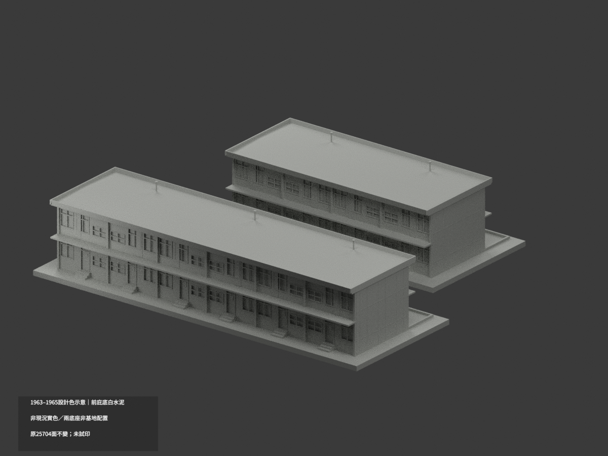
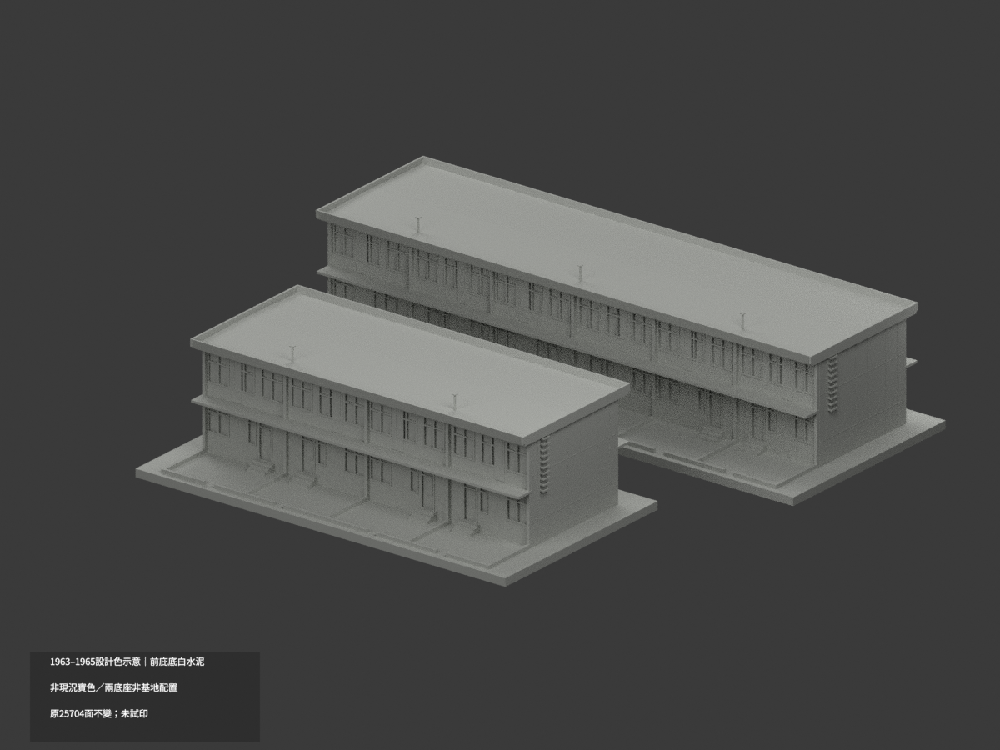
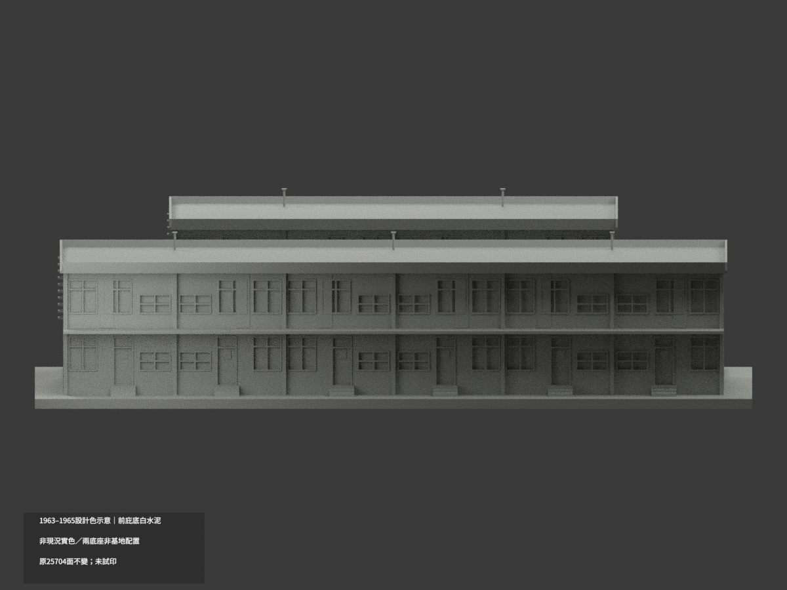
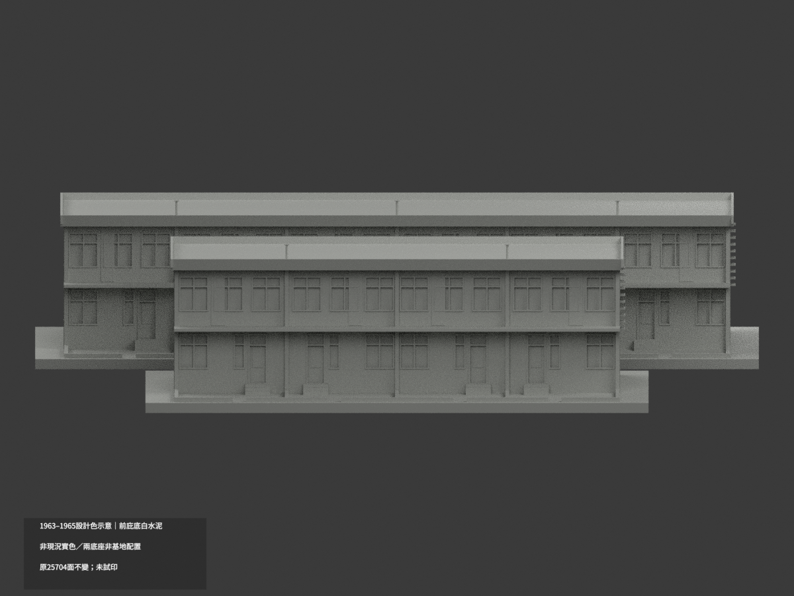
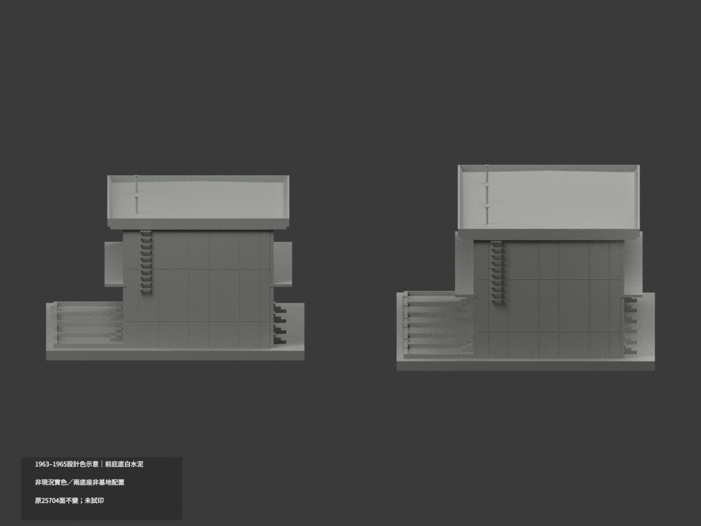
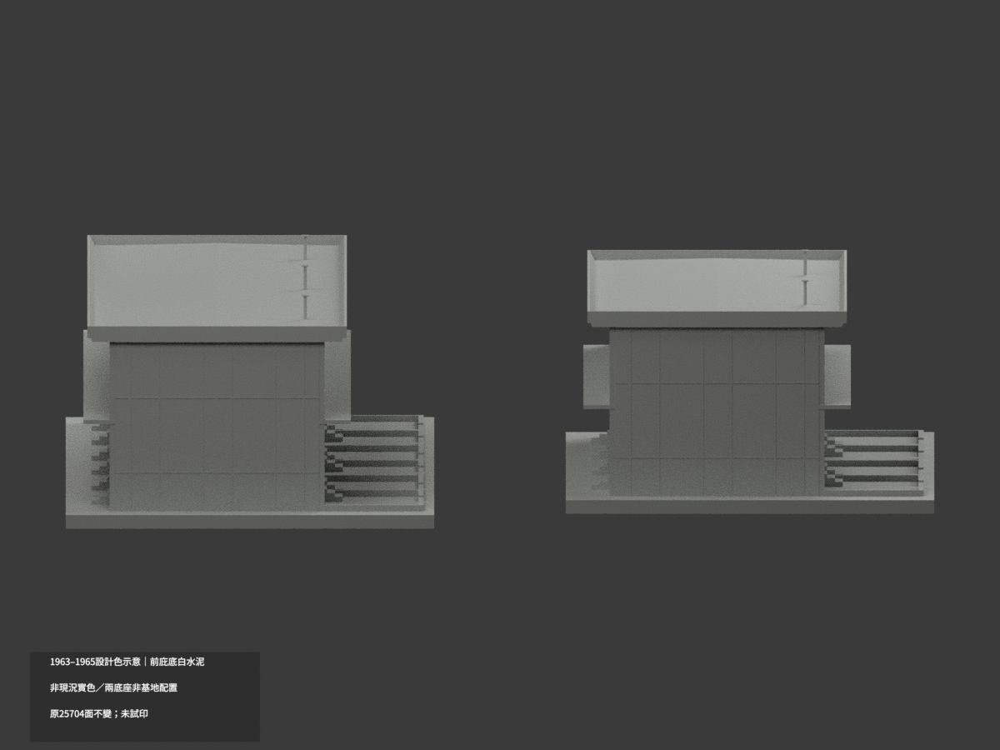
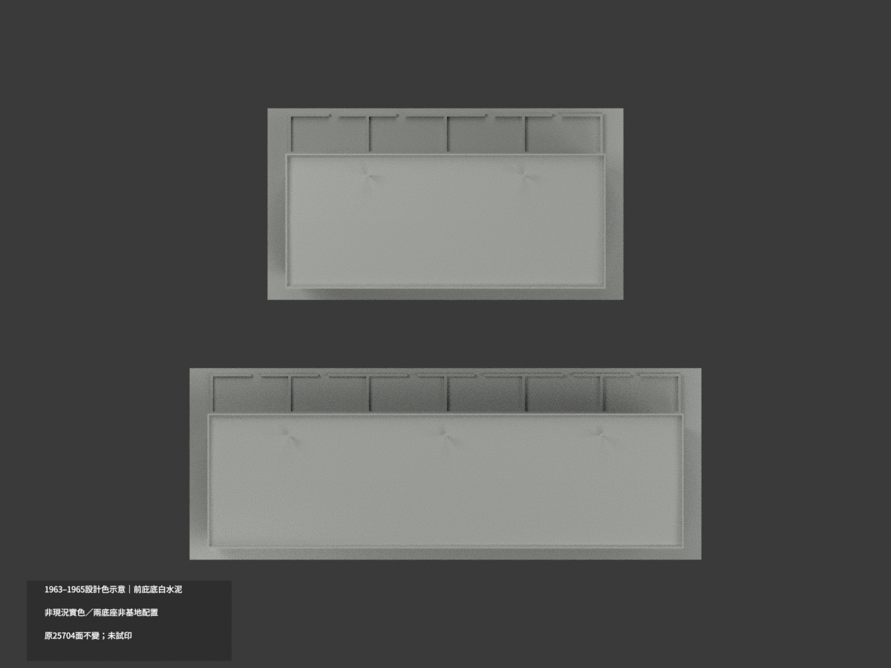
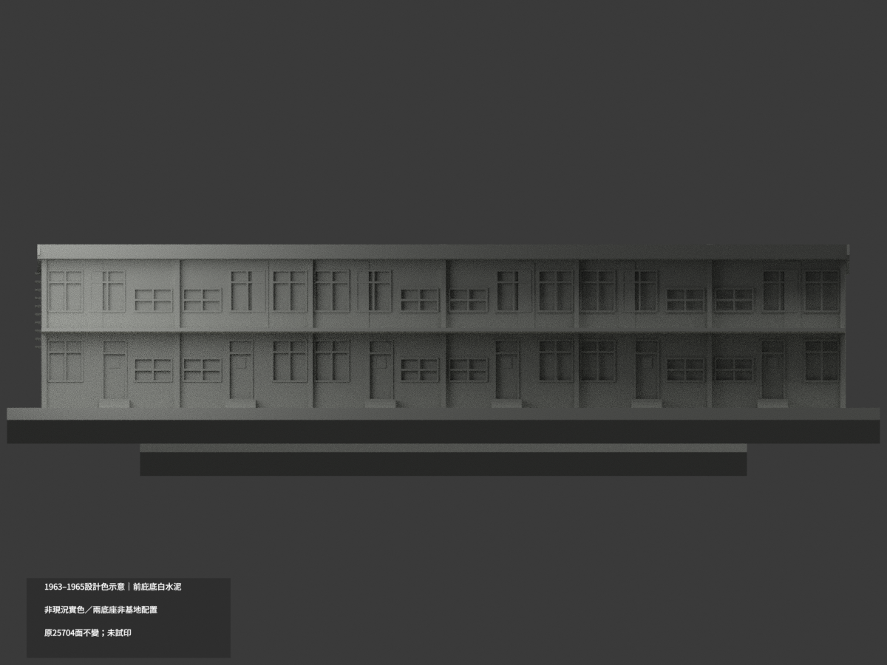
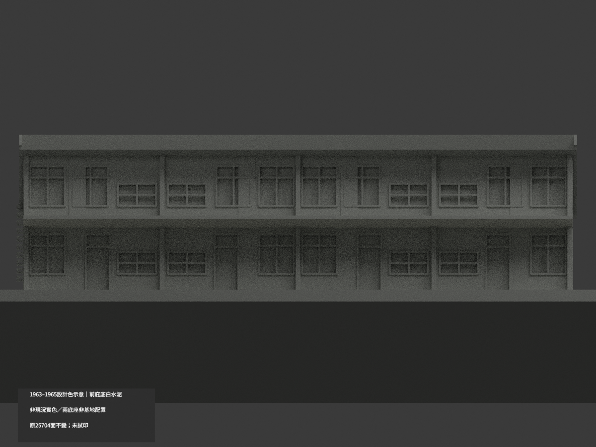
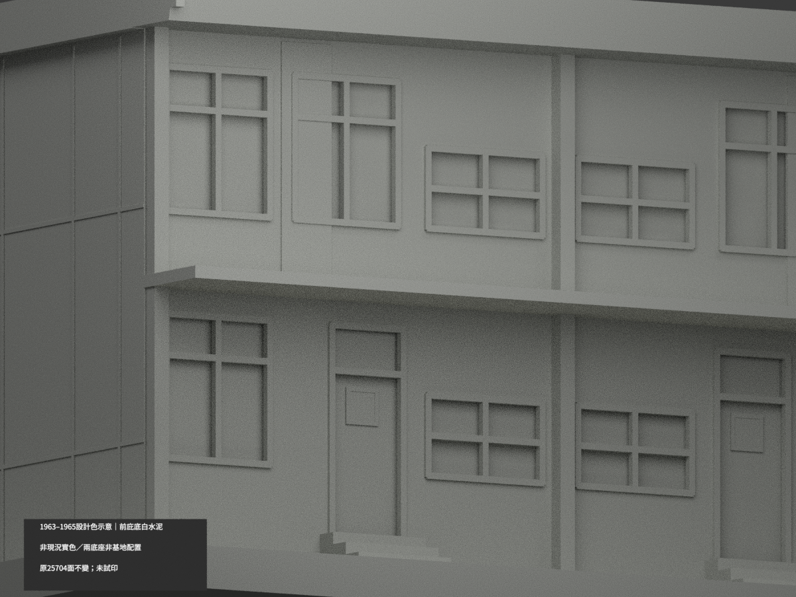

# 臺大乙種學人住宅六戶連＋四戶連｜1963–1965設計色示意

**設計白水泥庇底，非竣工或現況實色。** A2 1963-03-20「WHITE CEMENT FIN」指向120cm前庇底，僅原兩列完整庇底57面白水泥設計族，其餘25647面未知中性。partial_color_incomplete=true、fully_colored_exterior=false。原八材展示非單色，全部保留；兩底座相對位置不是基地配置，不混王大閎1970住宅。

| 總覽 | 背側 | 正面 |
|---|---|---|
||||
||||
||||
||||

## 設計色範圍與原群
同 ntu-scholar-residence-two-rows-1965-design，same-item/count_delta=0，六戶連與四戶連一包，不是四排母案全建。25704原三角、37原件bytes不改，原無OBJ不新增。原z19.25前庇底完整連通域35＋22=57，前120cm庇底白水泥設計色族HEX非校準樣板；不染庇頂/立邊/後庇、綠條、整牆或門窗。
A2為1963-03-20，A1/A3/A4為1965不同日期，不能稱同日竣工。2014官方僅案級衛星空照判讀未現勘，本期兩列精確現址未證；非1970長興街案、非2026現況。

## 保留原版與幾何限制
完整原37件及八分類scene/model.3mf/mesh/palette/十圖/所有QA在 original-classification-version/；原README/scene另有 ORIGINAL-SOURCE-GAP- alias，原render_model.py保持bytes。舊QA移入original-classification-qa-aliases，僅綁原完整子包，不綁新圖，不改舊hash。新appearance.3mf/scene及十圖為局部設計色variant，不否定或覆寫舊展示。
後院4m深與20cm厚有據但牆高缺證，原20cm高深色足跡僅原創標示非歷史院牆。主深750cm與側分格826cm差76cm、窗表175/180與97.5/95.5差、D2總256/分鏈261差均保。屋最高7.05m與皮6.70±.10m、通氣帽7.65±.15m、窗位±.15m圖量、後濕區構造不套全棟；地下/內裝/既有兩排/周邊不建。
原1:200毫米，187×165×41mm，兩個獨立水密展示實體非假地形橋。框桿8cm→.40mm及1吋嵌桿加厚、封背不透明玻璃均保，未試印/未全域壁厚或支撐認證；原QA不由本色審追認。

## 來源與格式
[原A2典藏](https://collections.culture.tw/docomomo_collectionsweb/Collection?GID=MKMSMRM7M4)，台大營繕組設計、呂芳勝審核，臺博館NCMD130；來源圖像CC BY-NC未註版本，不自動套專案授權、不保證商用。掃描/裁切私人研究不公開貼圖。
[原STL](model.stl) · [新增逐面設計色3MF](appearance.3mf) · [新Blender](scene.blend)
物件 NTU Scholar Residence Two Rows 1965 Design partial color。兩材不是四色耗材切片試印。原build_model.py+geometry_helpers.py精確隔離重建；colorize_model.py/export_appearance.py/validate_color.py/render_color.py/verify_color_scene.py僅驗本variant。

## English scope
1963–1965 DESIGN finish only,not asbuilt/current color.57complete front120cm canopy soffit faces whitecement;25647neutral.Original8material presentation and37originalfiles retained;25704triangles unchanged,noOBJ,sameitem/count0. Two authored independent displaybases,not site reconstruction; six+four currentphase rows,not1970WangDaHong project.Original dimensional contradictions,approximate levels/locations,thickening and untested manufacturing limitations remain.
