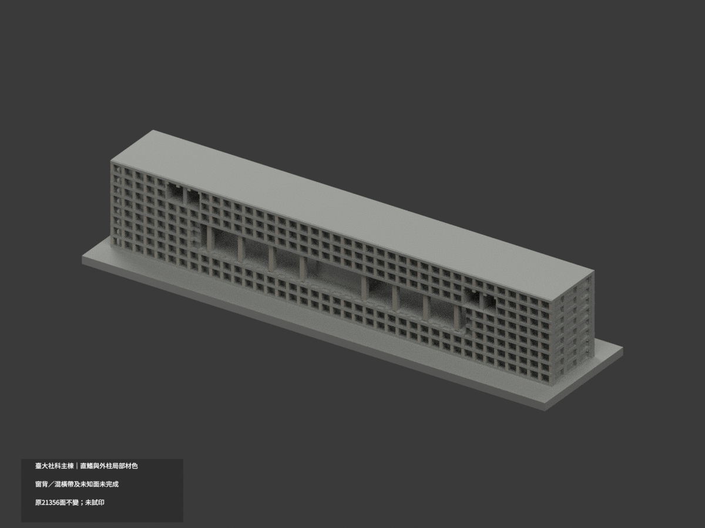
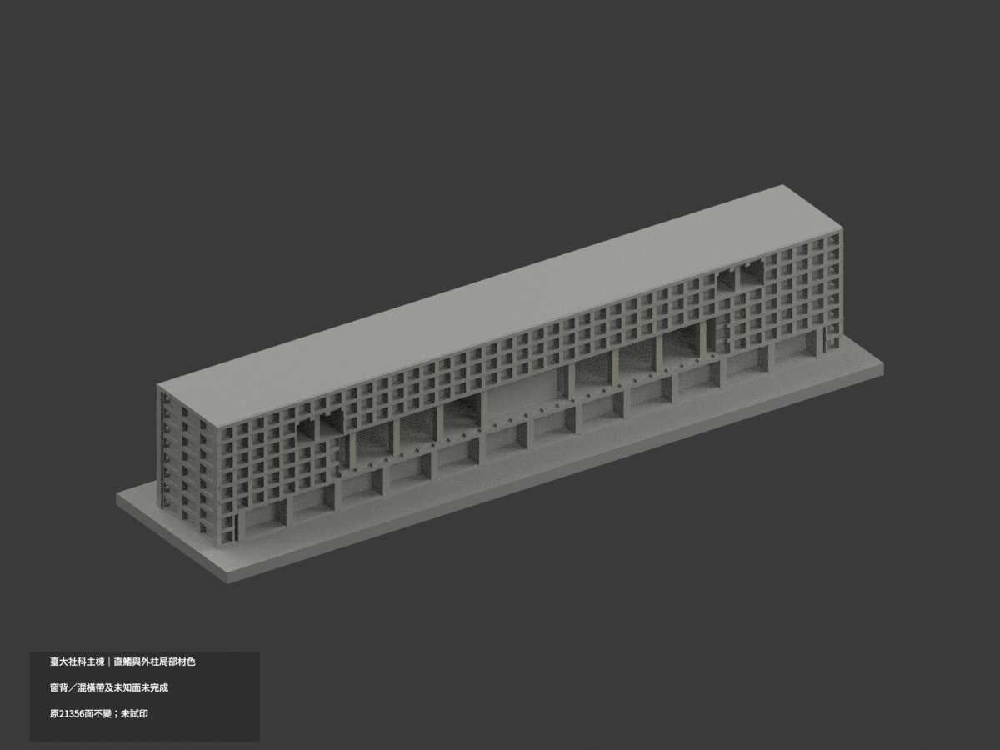
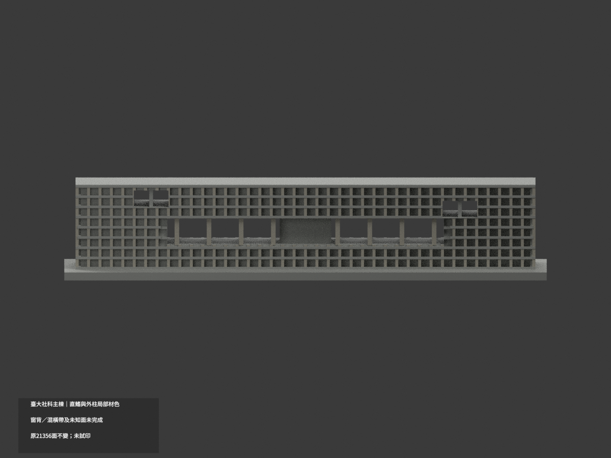
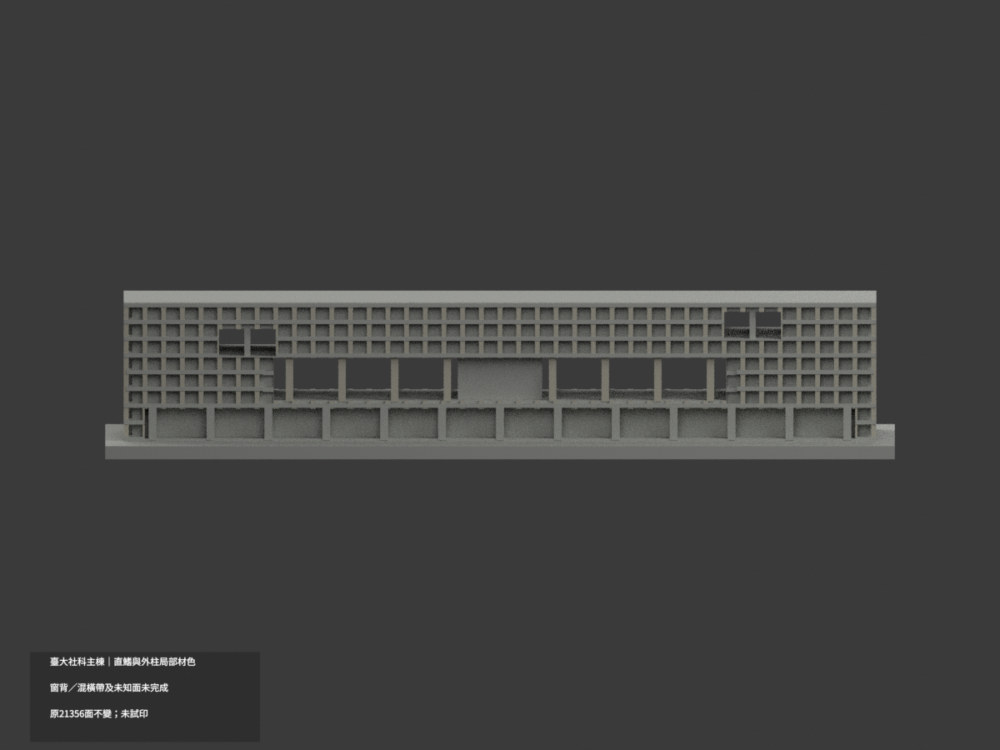
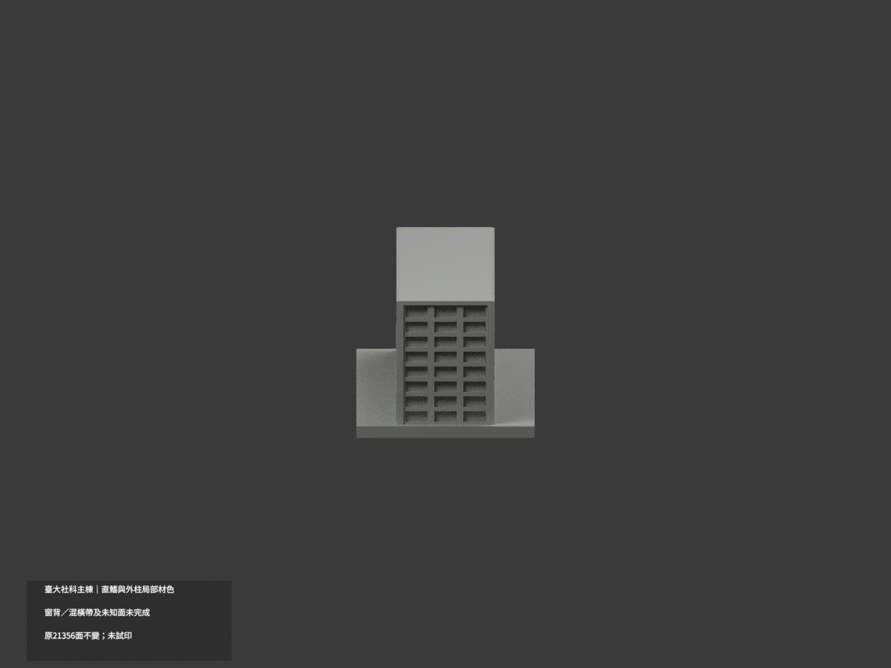
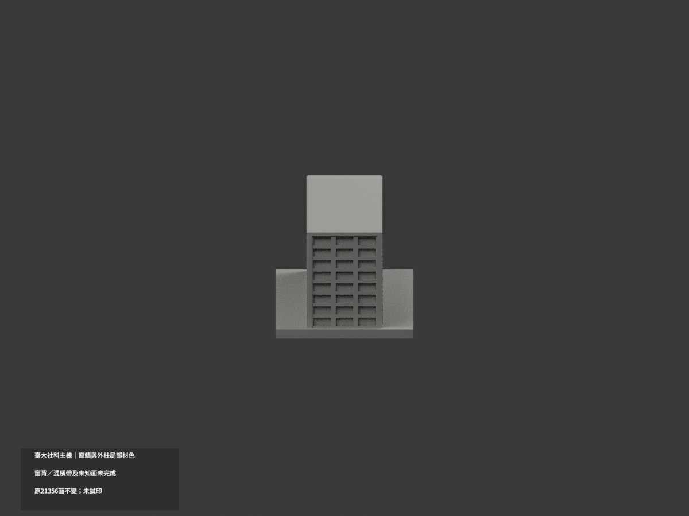
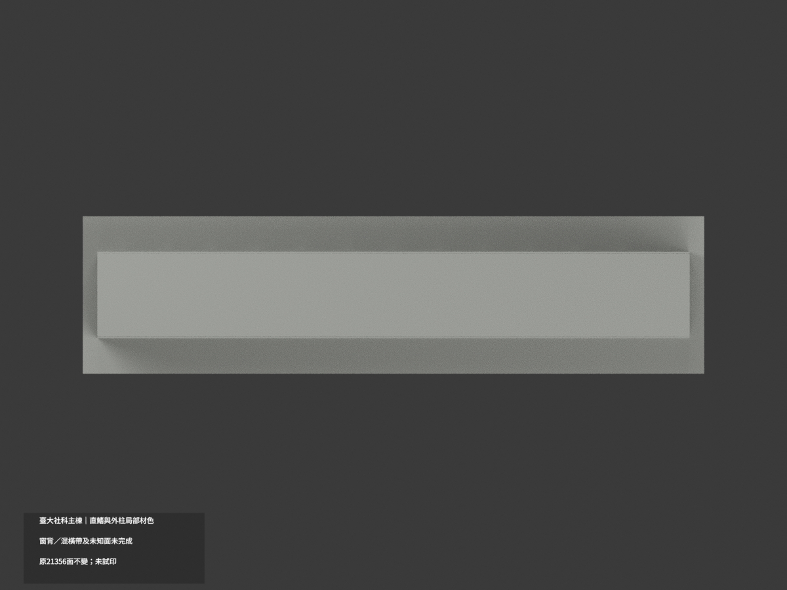
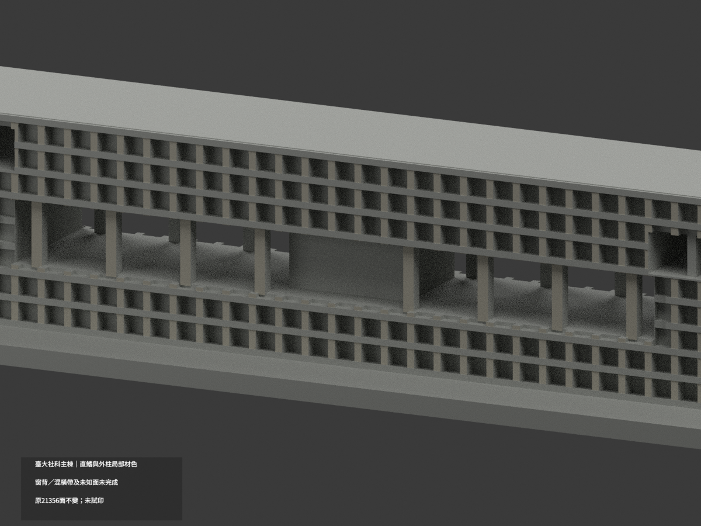
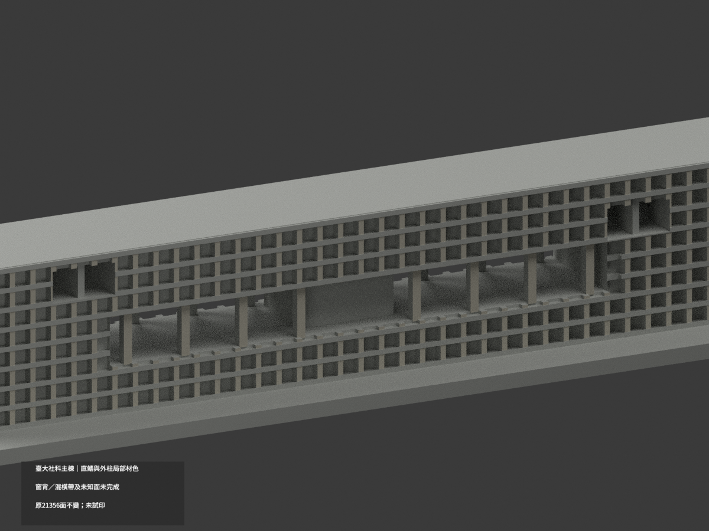
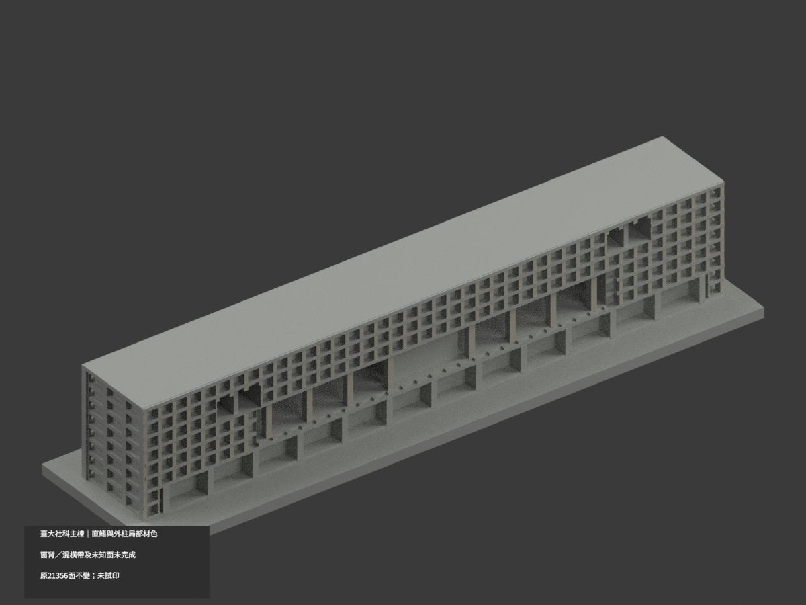

# 臺大社會科學院主棟｜直鰭與外柱局部材色

**窗背、混材橫帶與未知面未完成分色。** `partial_color_incomplete=true`、`fully_colored_exterior=false`。只主棟有據前後直鰭與中央外柱正面補灰，並非全館完成；不含低層閱覽廳。

| 總覽 | 背側 | 正面 |
|---|---|---|
||||
||||
||||
||||

## 材色範圍
同 `ntu-social-sciences-main` 原項目，same-item、count_delta=0。**21356原三角面及STL/build_model.py位元組不變**；不切面、新增幾何或重背書原外觀精度。原公開包含OBJ並保留字節。
- 真獨立直鰭外向平面 y±10.35，共2732原面，以及中央原柱 y±9.6 的64外向面，共2796面近似暖灰混凝土。
- 以原碼構件中心／寬度、全頂點與法線實核，不盲用來源審核面號。整個共面連通域均一；此案0候選撤色，無斜三角人造材界。
- 其餘18560面中性：連續厚橫帶混半透明欄板／薄樓板而無分界、窗背混淡黃牆／簾／玻璃／細框、直鰭側返、端部百葉與牆、屋頂、地板、天花及中央會議體。
- 不把端百葉填深棕玻璃，不把兩向背板一律黃／藍，不把低層前景圖書館菌傘屋面納入。不新增字樣、植栽或人物。
- 色／中性邊界是本次證據與拓撲範圍，並非真實材接縫。原幾何粗化不因補色得到新放行。

## 來源／時間與權利
參考Ikue Yamada之Architecture Tour公開外觀照片image11、40、41，原包以2013尺度及2017/2018訪視資料作近似；頁面訪視年份不能獨立證明每張照片拍攝日，**不是2026精測或某年全館校色**。
原照只私人來源保存，不公開、不作貼圖；未確認CC／再散布授權，不保證商用。HEX是展示色族，不是校準色票。

## 格式與列印
[原STL](model.stl) · [材色3MF](appearance.3mf) · [Blender](scene.blend) · [原說明](ORIGINAL-MONOCHROME-README.md)
150×38mm展示底座，原主體168:22.3:31.2比例控制但外框加粗，非施工精測比例。STL不含色，3MF與Blender真正逐面材質。兩材質標籤不是已驗證兩色／四色耗材切片；**未實際列印**，不產生切片工具路徑。

## 重建與 QA
原`build_model.py` → `colorize_model.py` → `export_appearance.py` → `validate_color.py`；Blender執行`render_color.py`與`verify_color_scene.py`。
原位元組、三角座標multiset、閉合正體積、3MF頂點／材號及完整隔離重建；scene重開、十圖1200×900與README綁hash核對。程式不代替人工材域來源判讀。
原previews／render／validation保留為單色歷程，不當新版材色QA；無刪檔。
