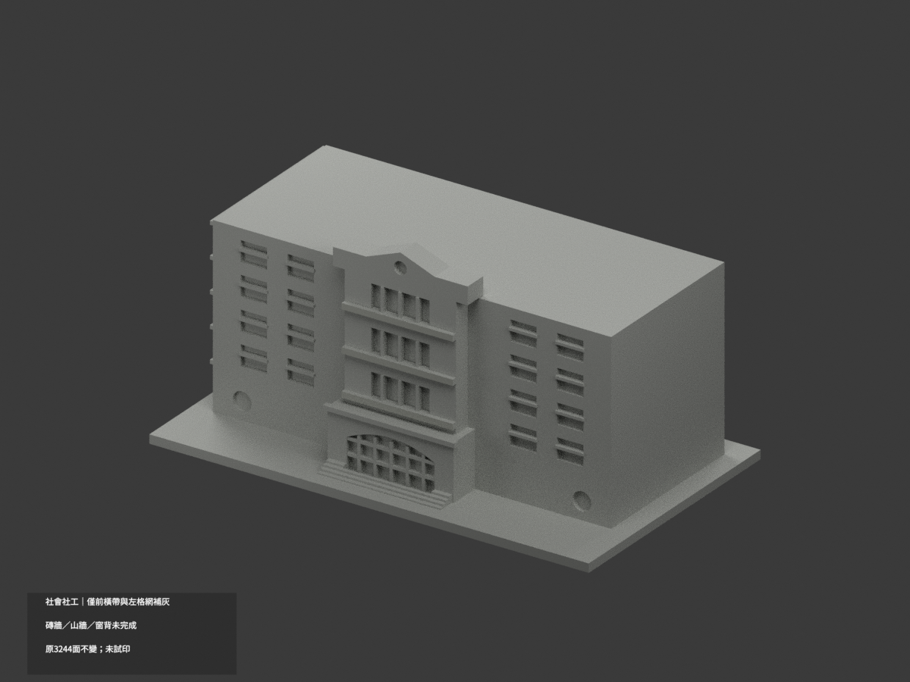
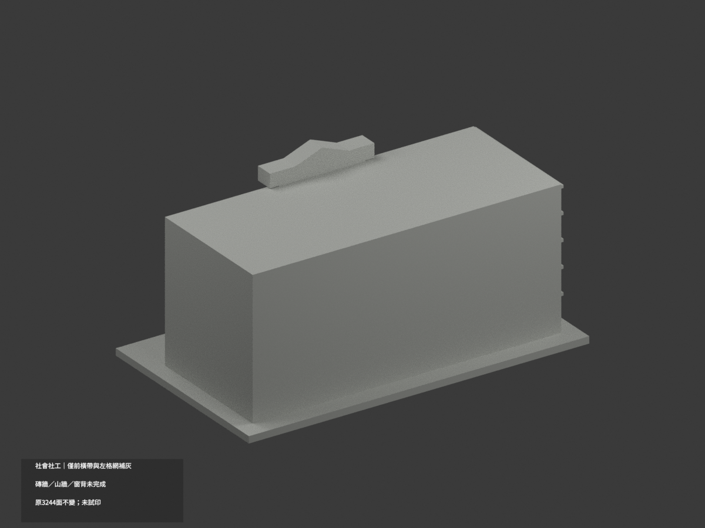
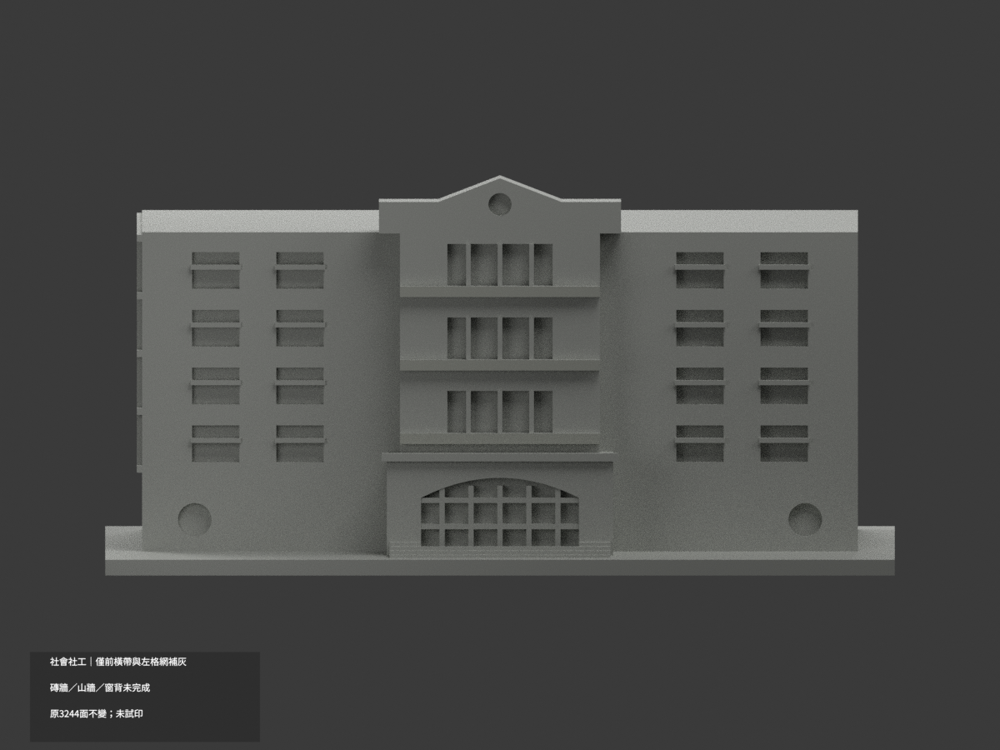
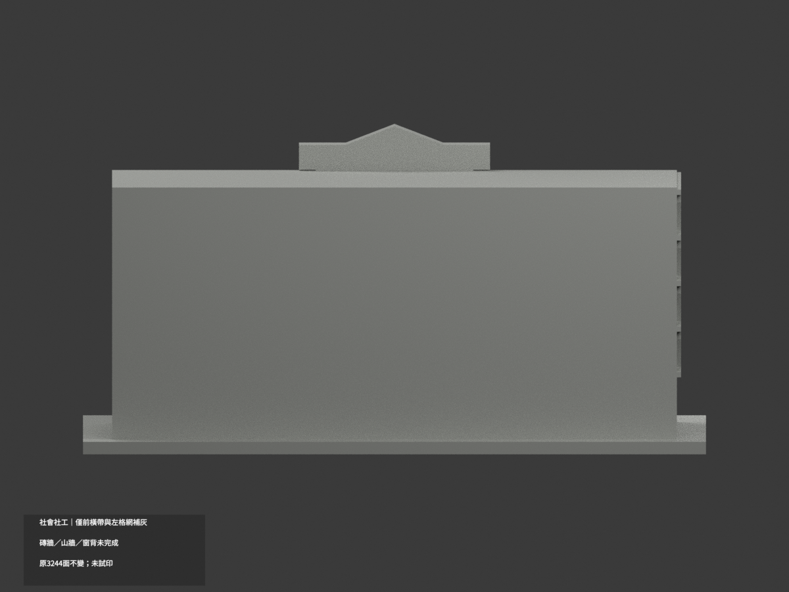
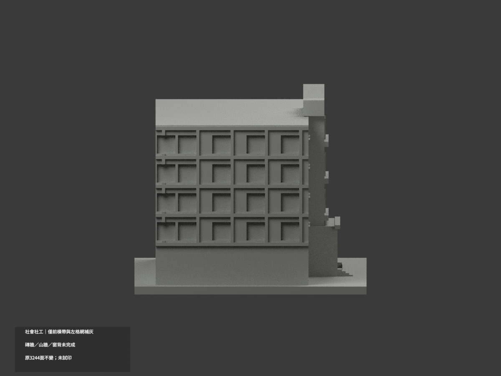
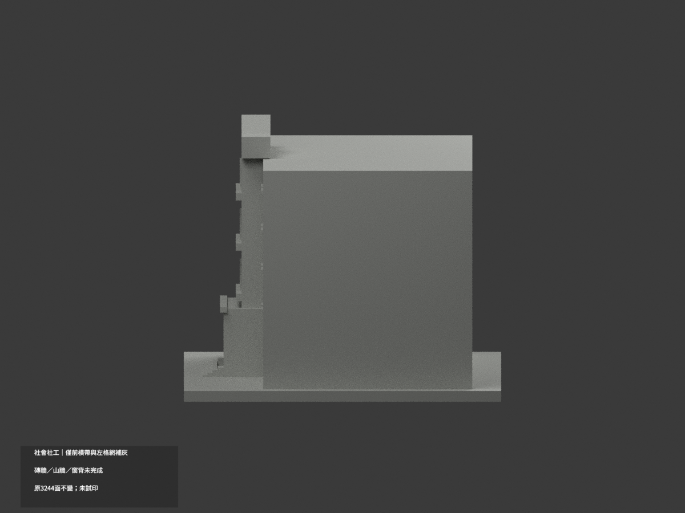
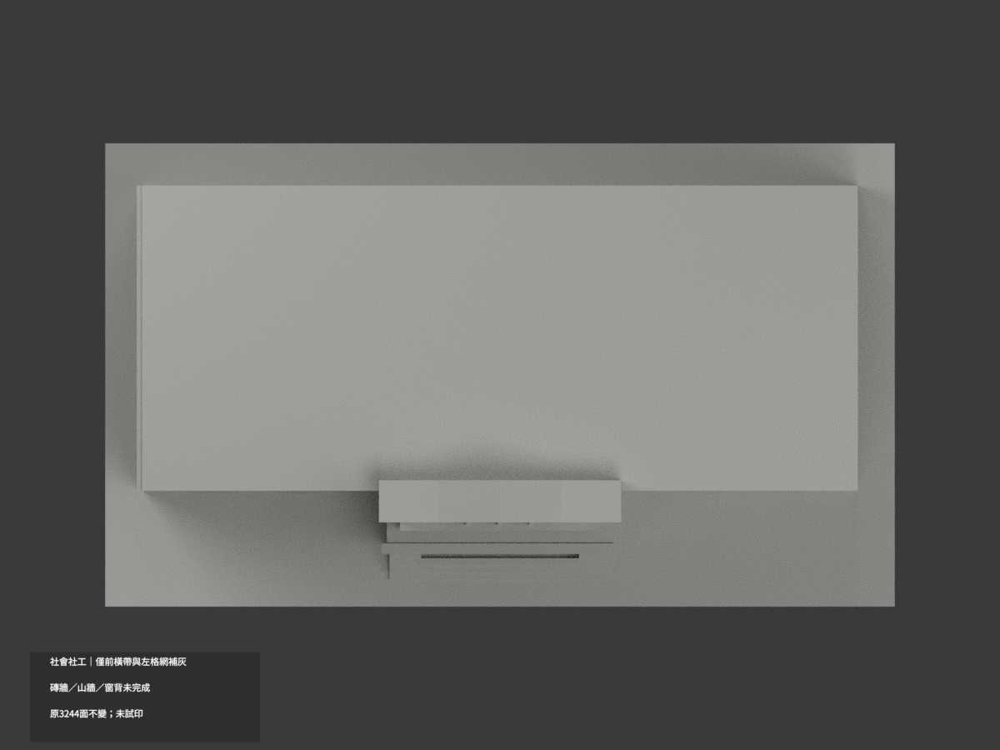
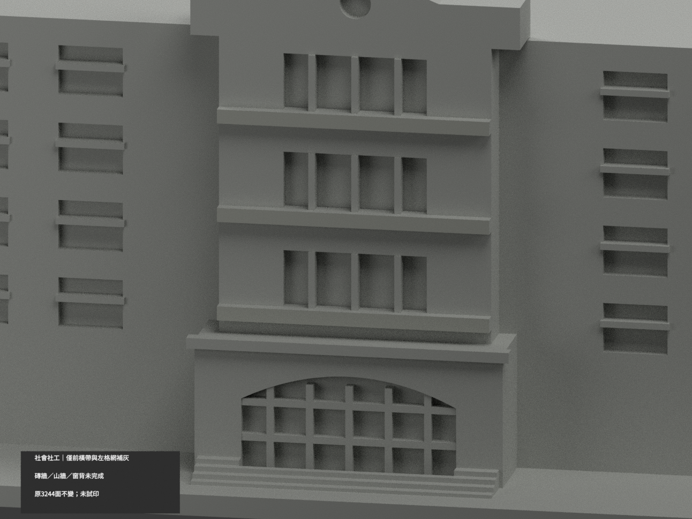
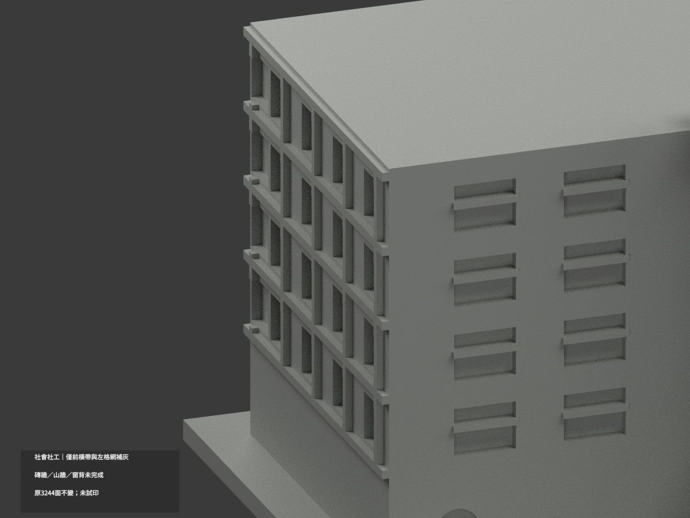
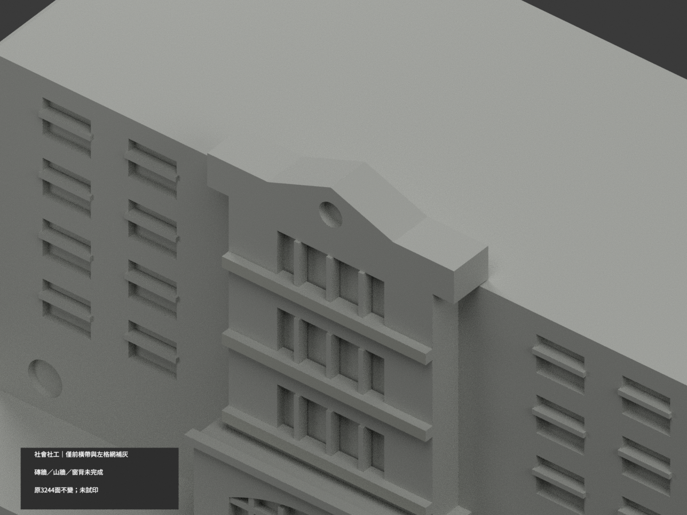

# 臺大社會社工館｜局部結構面參考補灰

**局部補色未完成：僅中央三道獨立水平帶與左外格網局部補灰；磚牆、山牆與窗背未完成，入口基座及未知面仍中性。** `partial_color_incomplete=true`、`fully_colored_exterior=false`。同項目 `ntu-sociology-social-work`／`count_delta=0`，不新增套數。

| 前斜視 | 後斜視 | 正面 |
|---|---|---|
|  |  |  |
|  |  |  |
|  |  |  |
|  | | |

## 材色範圍

中央三道原凸水平帶正向面y=-29.6，共6三角；照片可證左側格網向外x=-69的202三角，合208面為低飽和暖淺灰石材近似。其餘3036面未知中性，**不是實景灰色證明**。

依原幾何的真正外平面與各原box組合之投影聯集重新判讀，不盲抄來源face index。776個共面連通域全部材色一致，不centroid切色、不生成任何新邊界。橫帶及格網側返不自動推定同色。

中央山牆灰面和下方磚牆在原y=-28融合成共面，完整中性，不按z64取上部三角。入口門廊跨灰石上段與深色基底，原無物材界，整件中性。窗背／門格／圓窗背混框、簾、玻璃及實板，不能全黑或白。主牆灰框／腰帶／基座未有分面，不能全磚紅；屋頂、背面、基座與遮蔽面中性。

原3244三角、坐標、尺寸、STL、OBJ及build字節均不變，沒有新增窗框或修補幾何。既有原模型省略未核背面，不鏡射正門；補色不追認原幾何或稱完整現況。

## 來源與權利

臺大官方2010影像路徑下三張[6010](https://homepage.ntu.edu.tw/~cpo/2010photo/E/E9/IMG_6010.JPG)、[6011](https://homepage.ntu.edu.tw/~cpo/2010photo/E/E9/IMG_6011.JPG)、[6012](https://homepage.ntu.edu.tw/~cpo/2010photo/E/E9/IMG_6012.JPG)建築外照。2010路徑只是來源時期背景，拍攝日未獨立確認，不稱當今完整實測。精確hash及GO2225/獨審2224-v1見`COLOR-SOURCE-REGISTER.json`。

未確認CC授權，照片私存、不公開或作貼圖；原圖權利不被repo license取代，不保證商用。展示色不是精確色票。植物、人像、招牌不建模。

## 檔案與重建

`appearance.3mf`含2展示材，`scene.blend`實際面材／相機，`color-mesh.npz`原三角及material index。原STL自身無色、原OBJ未補材且兩者字節保留。

依`requirements.txt`執行`python colorize_model.py`、`python export_appearance.py`、`python validate_color.py`；Blender執行`render_color.py`及`verify_color_scene.py`。完整原build+color隔離重建保留、不自動刪。原件私存；兩個`ORIGINAL-MONOCHROME-README*`、舊`previews/`、舊QA／SHA清單是單色歷程，不是本次補色QA。

## QA與列印限制

原STL／三角multiset、封閉正體積、3MF索引及隔離重建見`COLOR-*QA.json`；重開見`SCENE-QA.json`；10張1200×900圖及三欄/hash見`DELIVERY-QA.json`。人工視看另交父終審。

**未實際列印。** 2展示材非驗證過四色列印工程，切片、材料映射、支撐及薄部強度另驗，不保證直接多料成功。
