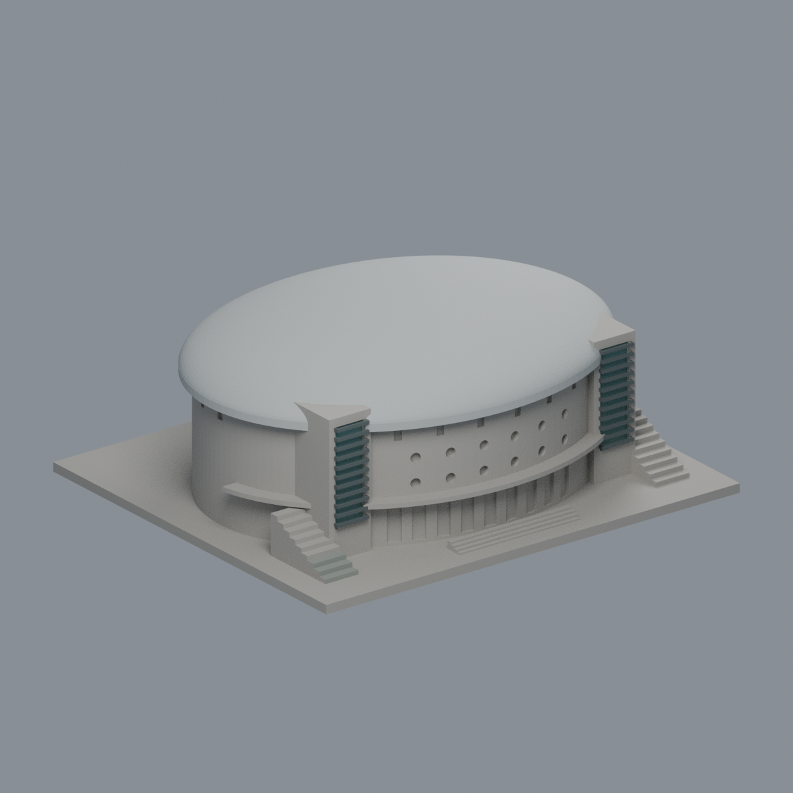
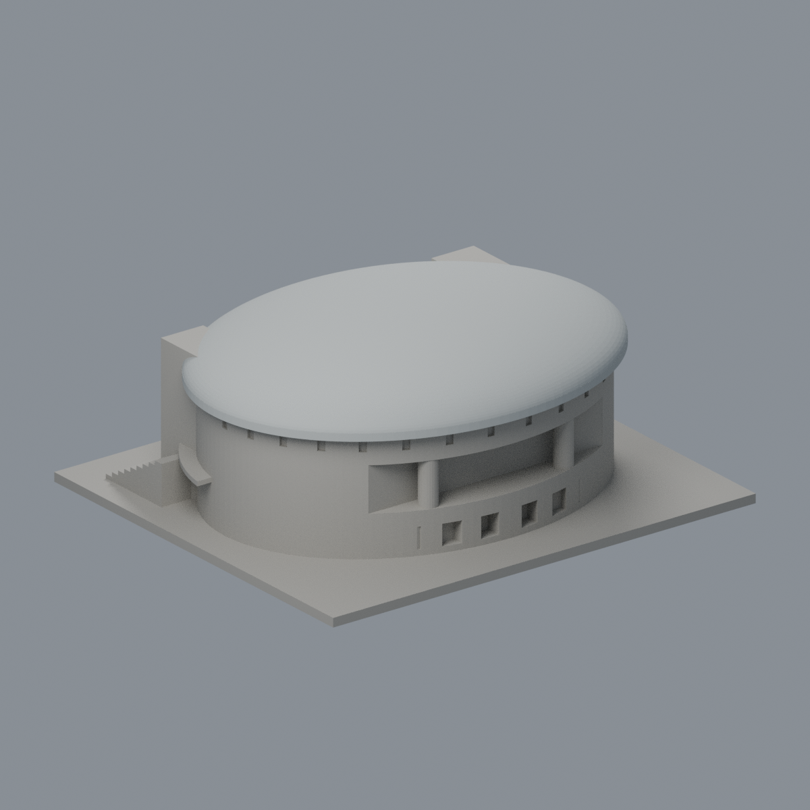
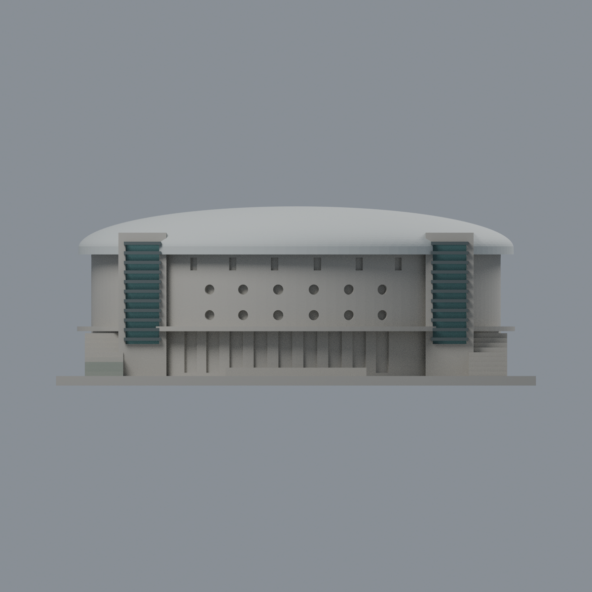
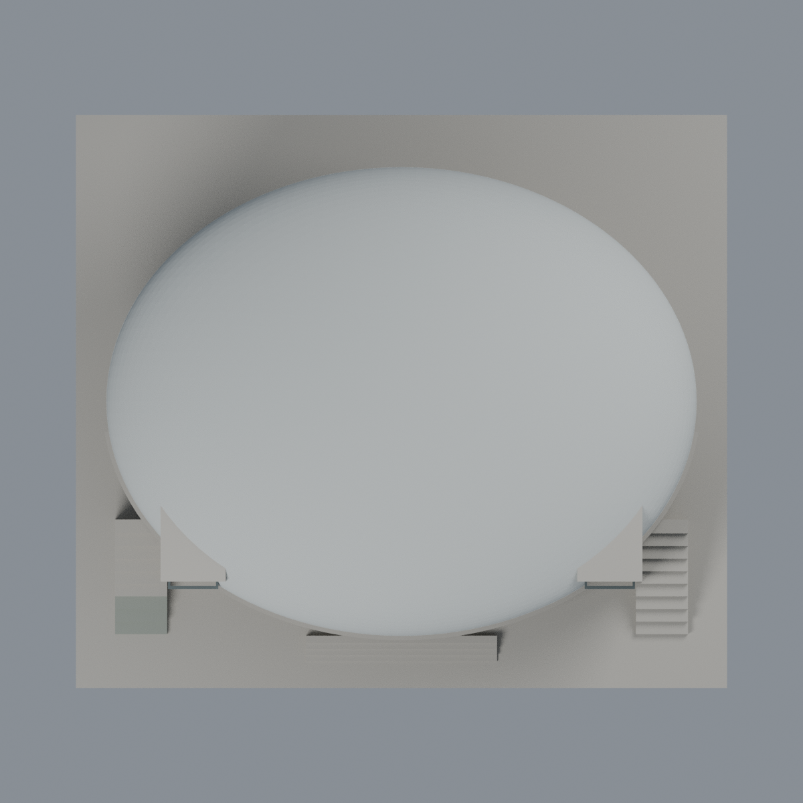

# 國立臺灣大學綜合體育館

<table>
  <tr>
    <td align="center" valign="top"> 正面</td>
    <td align="center" valign="top"> 背面</td>
    <td align="center" valign="top"> 正立面</td>
  </tr>
  <tr>
    <td align="center" valign="top"> 頂視</td>
    <td></td>
    <td></td>
  </tr>
</table>

[目前 Blender 色版](../appearance/scene.blend) · [目前 3MF 色版](../appearance/ntusports-appearance.3mf) · [單色幾何 STL](../model.stl)

四張圖皆從現有五材質場景以原相機渲染。限定配色包括屋蓋與簷圈、入口塔玻璃代理、塔金屬橫條與入口踏步的灰色近似；未重新測繪、補色或更動幾何。本模型為公開外觀近似，沒有重建室內，也未實體試印。

[原模型說明與列印限制](../README.md) · [目前模型校驗](../PUBLIC-MODEL-SHA256SUMS) · [展示來源記錄](render-proof.json) · [展示檔檢查](SHA256SUMS)
