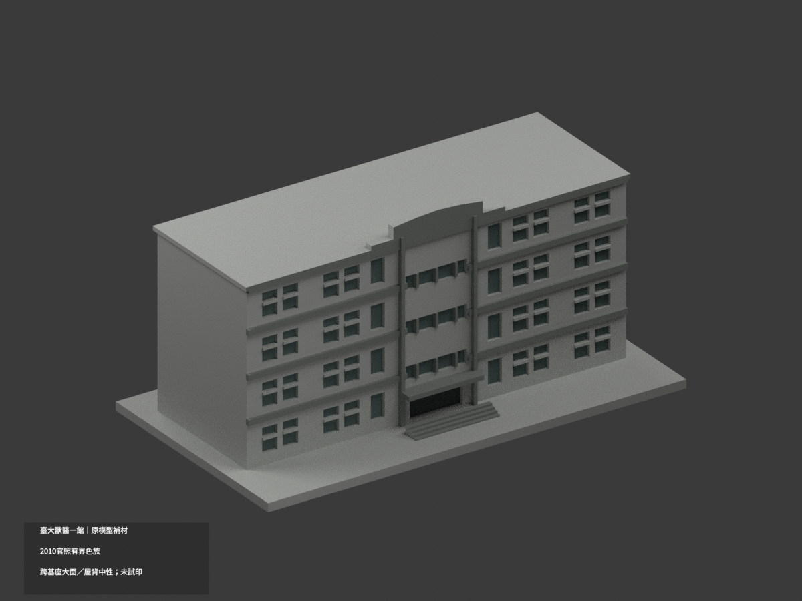
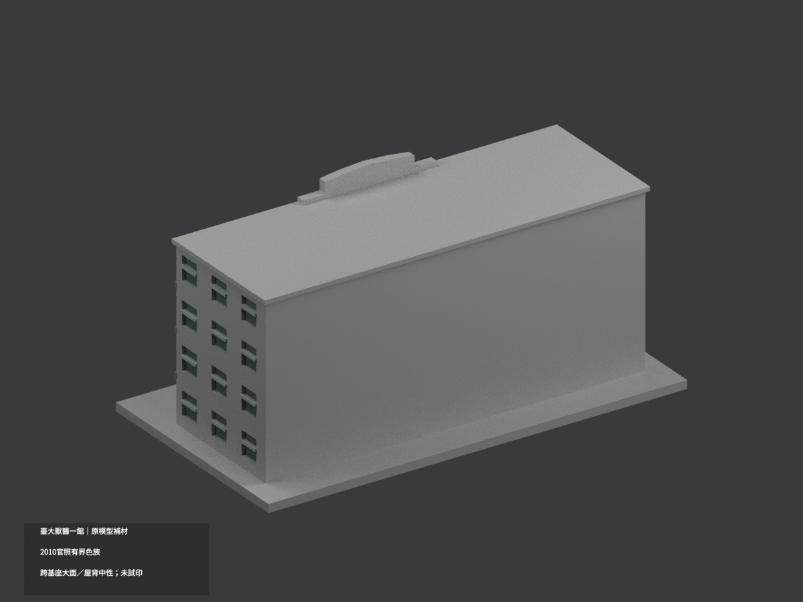
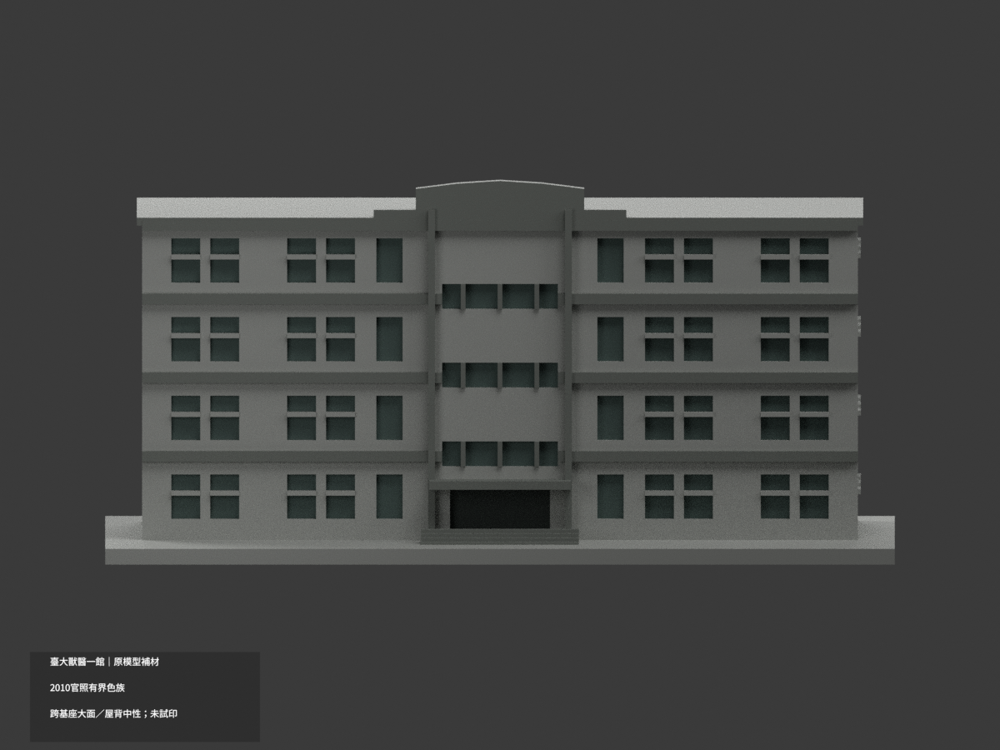
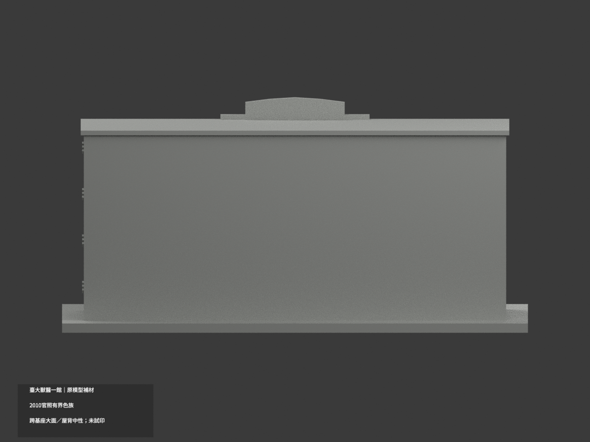
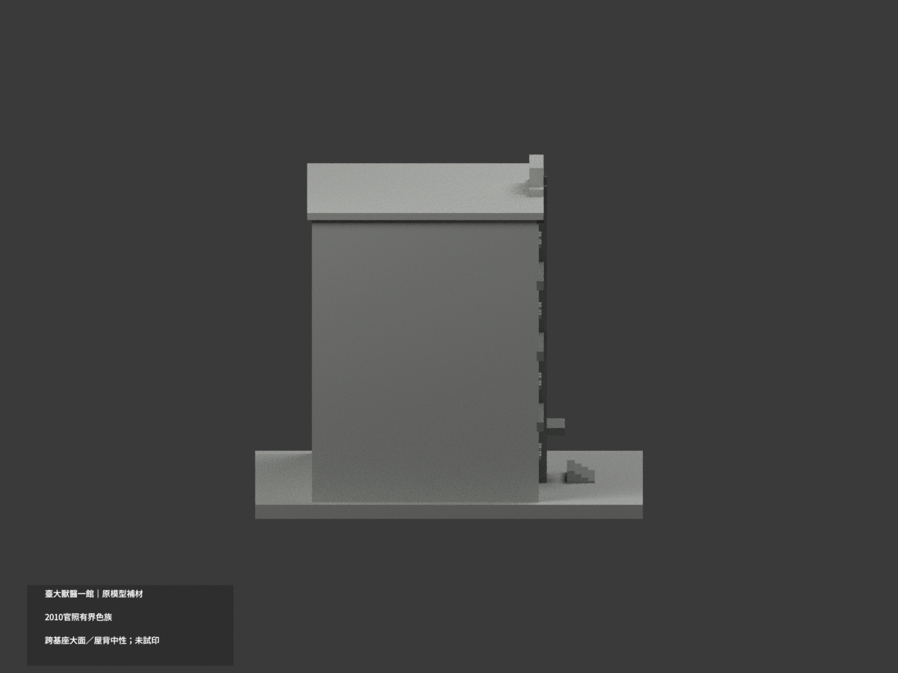
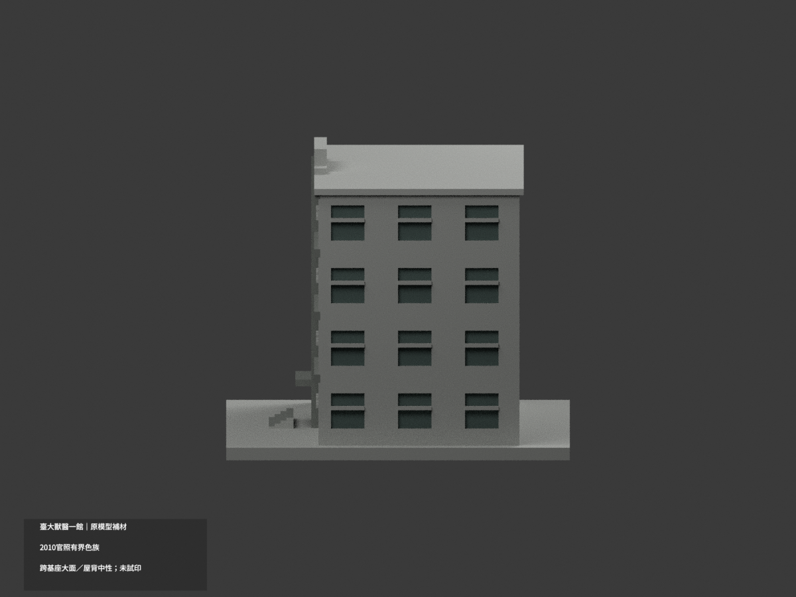
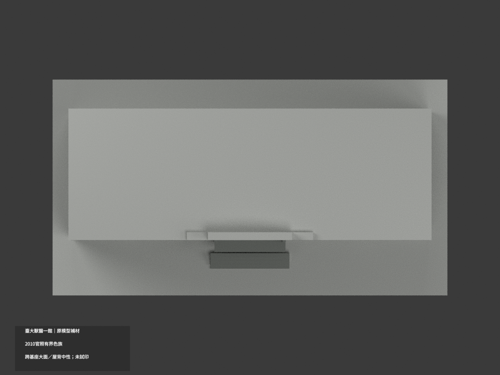
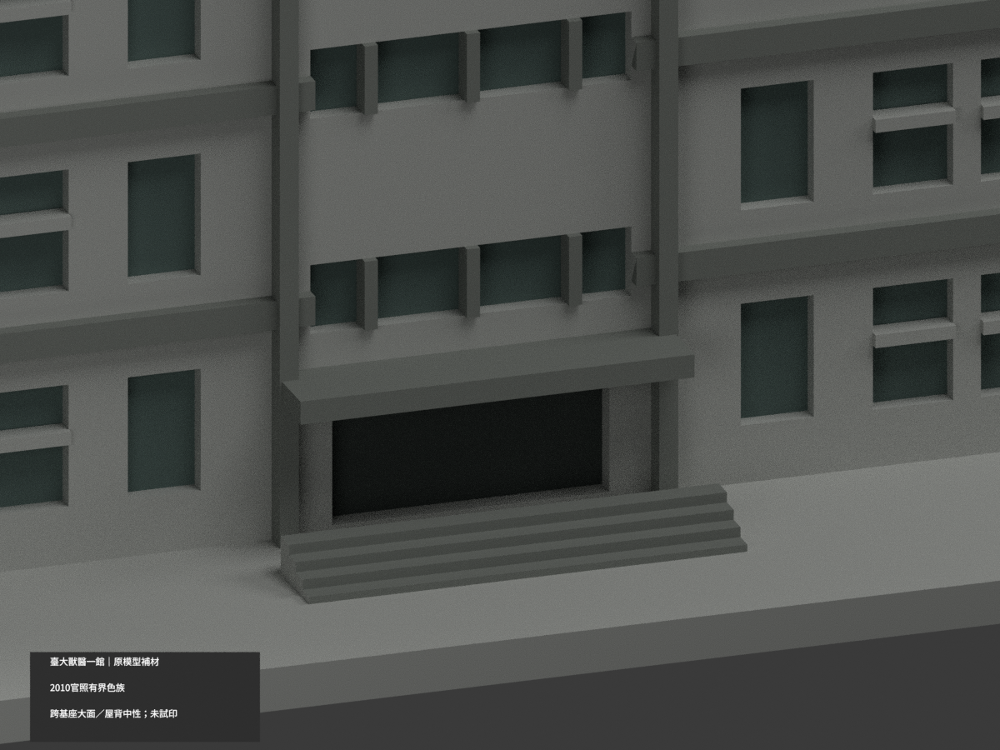
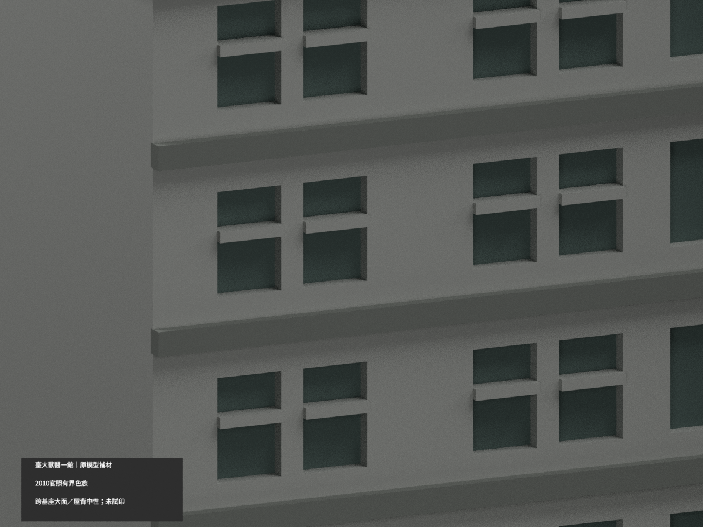
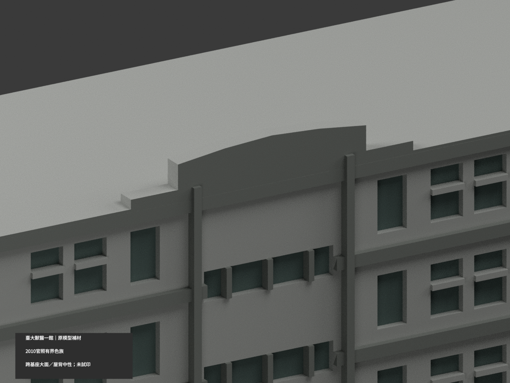

# 臺大獸醫一館 E1｜原模型有界材色更新

| 材色預覽 | 材色預覽 | 材色預覽 |
|---|---|---|
|  |  |  |
|  |  |  |
|  |  |  |
|  | | |

## 材色範圍
同一既有 E1 主立面近似模型補材（count_delta 0），原 2890 三角面、頂點、STL、OBJ 與 build_model.py 不變，不新增冷氣、金字、窗扇或修正原比例。採官方 **2010 建築影像**色族，不稱當前精確外觀或竣工測繪。

- 前與右端照片可見黃褐磚填面及灰縱橫框，但原模型缺若干灰縱框的獨立面邊界，因此**混合大牆整面中性**，不為增加色塊而把灰框一起染磚色。下灰基座與磚跨面的原三角同樣不分切。
- 既有獨立橫帶、中央凸條、窗梃、門簷與階採灰族；實際窗凹底灰綠，真入口凹底深陰影。不增冷氣、郵箱、鐵窗網或金字。
- 中央階梯形頂帽採灰色概化；實景局部磚向上伸入的圖樣沒有原面界，**不畫假鋸齒磚色**。原頂帽輪廓仍粗化，材色不是新精測幾何驗證。
- 右側藤蔓是植物，不能當綠牆漆；左側、背面、水平屋頂與展示底座未證部分中性。這不是獸醫醫院或二、三館，沒有新增相鄰樓。
- 色域界線是原幾何／來源限制，不是實景換漆線；HEX只代表非校準2010照片色族，不稱精確當前現況。
- 四個外觀材質標籤不是已驗證四色耗材切片檔；**未實際列印**，不保證免支撐。STL不存顏色，尺寸與列印幾何保留。

## 檔案與重建
[材色 3MF](appearance.3mf) · [Blender 場景](scene.blend) · [原 STL](model.stl)

build_model.py 重建原幾何；colorize_model.py 只指定原面材料；export_appearance.py 輸出3MF基本材料；render_color.py 產生十圖與場景。validate_color.py 驗原檔、三角座標、3MF及隔離重建，verify_color_scene.py 重開shader與面索引。依賴 numpy、trimesh、manifold3d、Pillow、Blender 4.3.2。隔離重建目錄私人保留，不刪除。

## 來源與權利
臺灣大學官方2010影像三張，網址及SHA256見 COLOR-SOURCE-REGISTER.json。未核得明示CC授權；公開可讀不等於自由再授權。原照片僅私人備存，不公開、不作紋理、不保證商用；只建築外觀，無人物或室內新增。

## QA 與原件歷程
新色版 QA 為 COLOR-FORMAT-GEOMETRY-QA、SCENE-QA、FRAMING-QA、DELIVERY-QA 與獨立視覺審核。舊預覽、報告、README.zh-TW.md及ORIGINAL-MONOCHROME-README.md保留原樣作歷程，不是本次色版入口。以上十圖及scene.blend是新版；所有原檔不刪，不增加套數。
