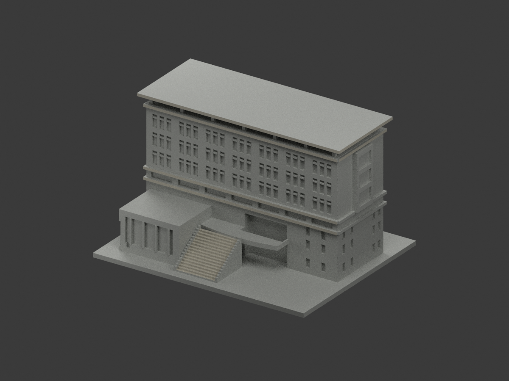
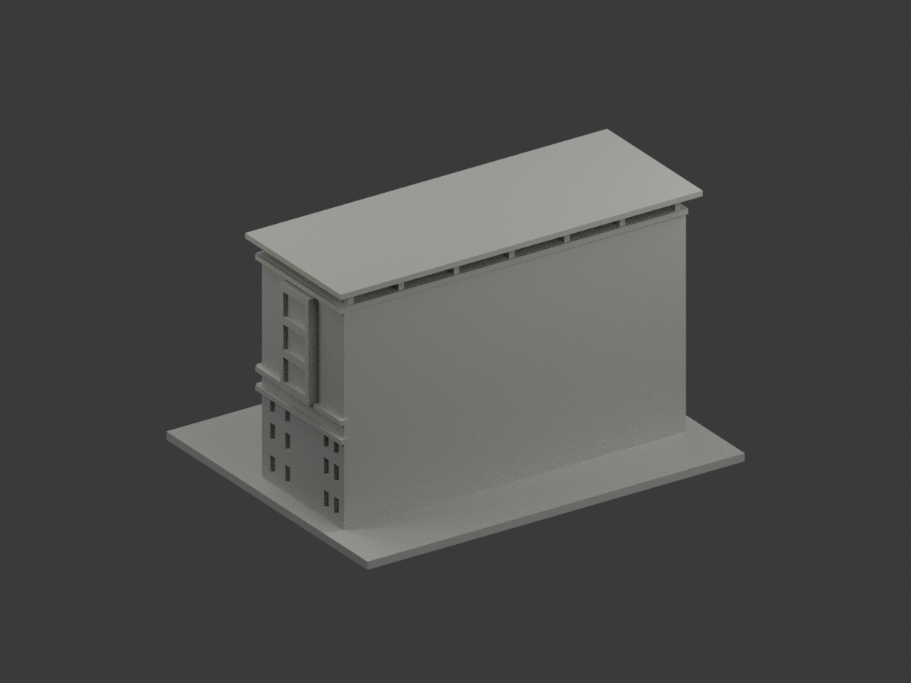
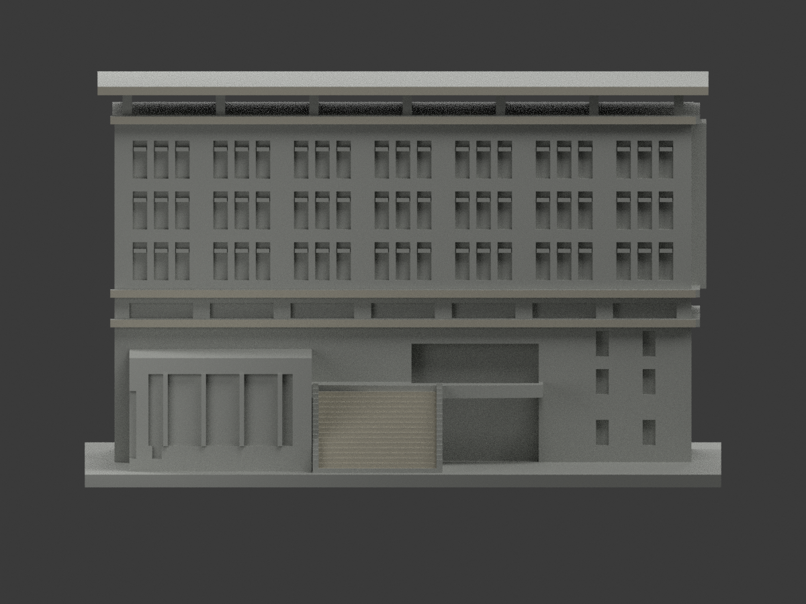
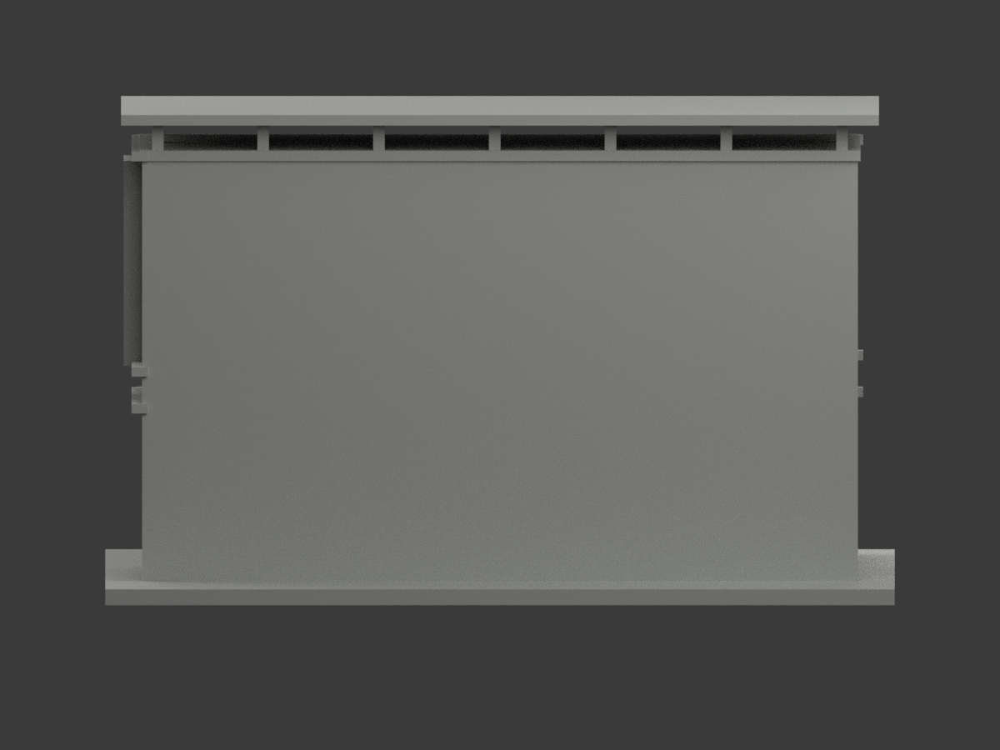
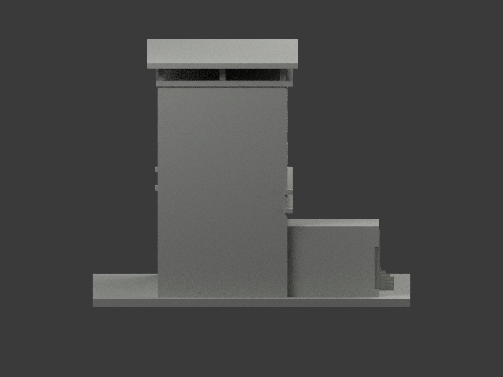
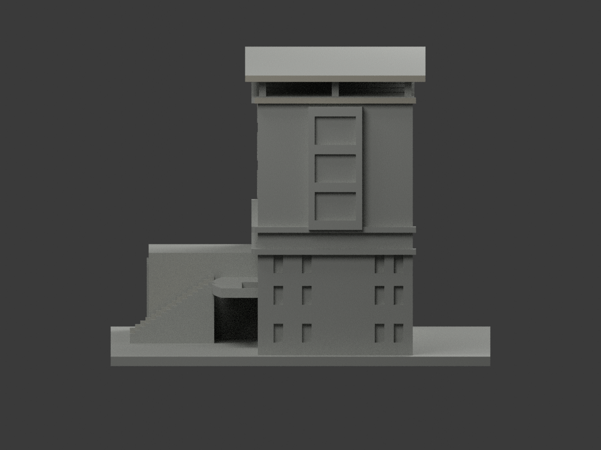
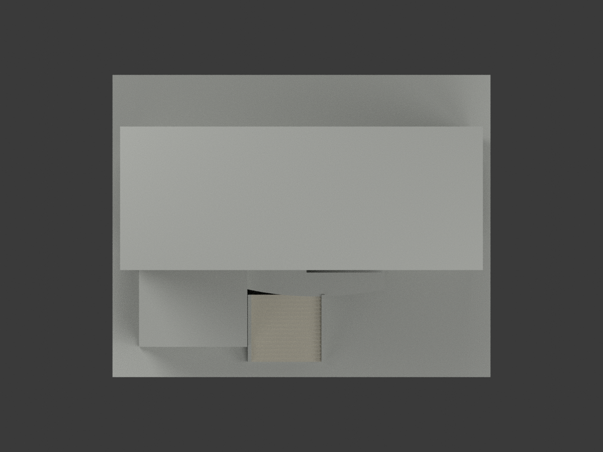
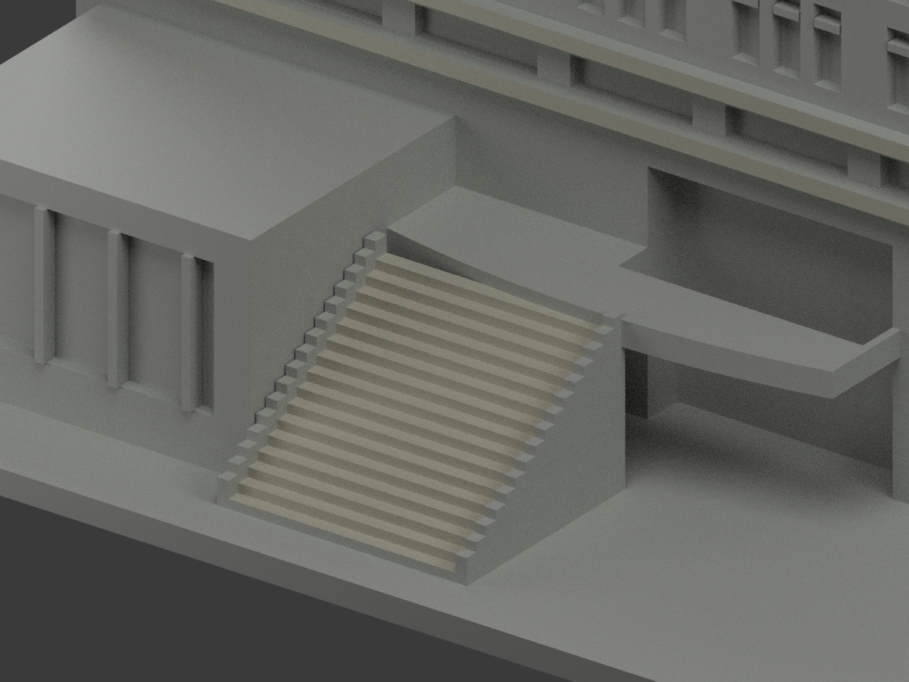
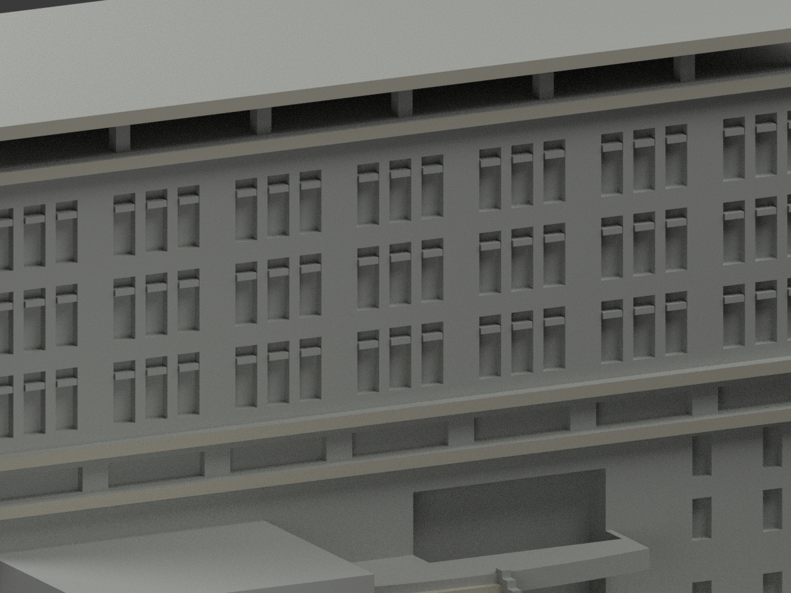
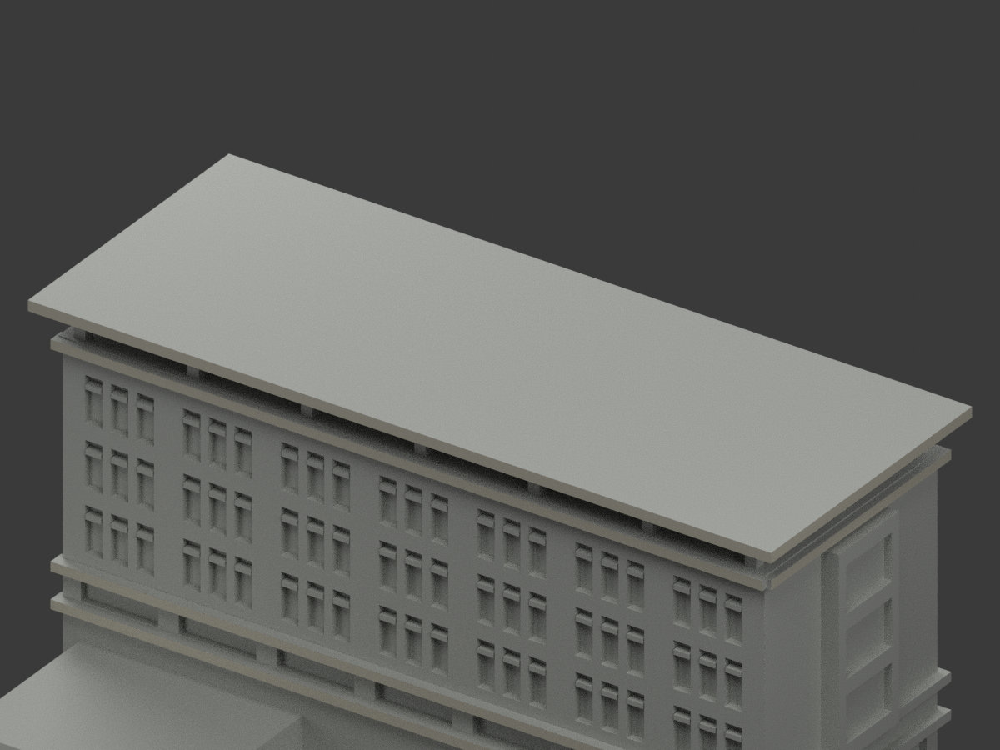

# 臺大萬才館｜上帽及最上灰帶右端有限補色

局部分色未完成。原94配色及兩palette名稱、色票/index完全保留，僅新增4原三角（兩完整共面域），共98配色、3864未知中性、3962原面。沿用名義石灰族#C4C0B2，不以陰影判黑。

原官方6031與6044小幅斜照再審，支持上帽與最上灰帶轉至右端的可見灰族；不是新拍照，也不宣稱2026現況。兩直接證據6031與6044皆336×448；另幅6032為448×336，拍攝日未知；2010photo路徑不是拍攝證明。頂帽域x72、y[-17.5,39.5]、z[90,92]，上帶域x70、y[-14.5,36.5]、z[83,84.8]，各2面。厚度、深度及整體量體仍是原照片近似，不是實測石材縫或逐毫米色證。新增官方電子報300×225正面照不當右端直接證據。

不擴下兩帶、混磚石側牆、玻璃、屋頂頂底、後帽、柱/棚架、附樓及其他返面；無切面、無幾何修改。原STL/OBJ/build及歷史工程例外、單色預覽aliases原bytes保持。來源圖片私人保存，不公開貼圖、不推定再散布權。此次只有限材色QA，未實際列印、不重新認證原幾何，兩材標籤不是已驗多料切片。

TOP-RIGHT-RETURN-SOURCE-QA是固定pending來源階段快照，最終獨審另檔；qa/top-right-return-previous保存原色QA。下列原版統計94等只對歷史版本。

## 原版說明與工程限制（完整歷史原文）

# 臺大萬才主體｜前帶與入口階梯局部材色

**磚灰混牆、窗背與未知面未完成分色。** `partial_color_incomplete=true`、`fully_colored_exterior=false`。僅主體前帶、頂前緣與入口階局部補灰，不是整館全色完成。

| 總覽 | 背側 | 正面 |
|---|---|---|
||||
||||
||||
||||

## 材色範圍
同 `ntu-wancai-main` 原項目，same-item、count_delta=0。**3962原三角面及原STL／OBJ／build_model.py位元組不變**，無新切面、加構件、修形。兩份原README另存原單色歷程。
- 三條獨立前水平帶6面、最上帽前fascia2面、真階踏面及前立面86面，總94面近似石灰色。
- 初候選90階面中4面因與未放行面連續共平面，整域撤中性。不是為滿色沿三角邊切色；不稱全部梯／頰牆／曲平台已校色。
- 其餘3868面中性，包含上磚／下灰但無材界的整主牆、短端、窗背玻璃反光細框、低附屋窗、右突出窗背、屋水平面、帶側返、未知側後／地台。不能以z高切紅磚、不能整窗塗黑。
- 色／中性界是原拓撲與證據範圍，並非真實材接縫。保留原粗欄省略與階數，補色不為原近似幾何重新背書；不新增文字、人物或周邊連接建築。

## 來源／日期與權利
三張校方公開影像IMG6031／6032／6044，2010網址資料夾只作年代脈絡，**不能當精確拍攝日或2026現況精測**。只外觀材色，不涉及內部。
照片私人保存，不公開／貼圖；未確認CC或再散布授權，不保證商用，HEX為展示近似色族非校準色票。

## 格式與列印
[原STL](model.stl) · [材色3MF](appearance.3mf) · [Blender](scene.blend) · [原說明](ORIGINAL-MONOCHROME-README.md)
150×120mm獨立近似展示底座，非精測縮尺。STL本身不含色，3MF與Blender真逐面材質；兩材標籤非已驗證兩色／四色耗材切片。**未實際列印**，無切片路徑，原薄件／挑台風險未因補色解除。

## 重建與 QA
原 `build_model.py` → `colorize_model.py` → `export_appearance.py` → `validate_color.py`；Blender執行 `render_color.py` 與 `verify_color_scene.py`。
原bytes／三角multiset、閉合正體積、3MF頂點與材號、完整隔離原build＋color重建、scene重開、十圖1200×900與圖文hash均核。整連通共面同材另核，不以程式代替人工來源審核。
原單色previews/render/validation全保留為歷程，不當新材色QA；未刪檔。
