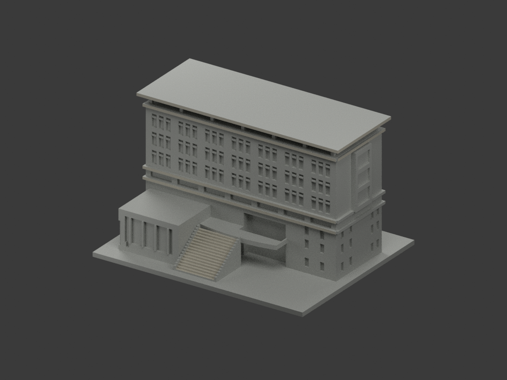
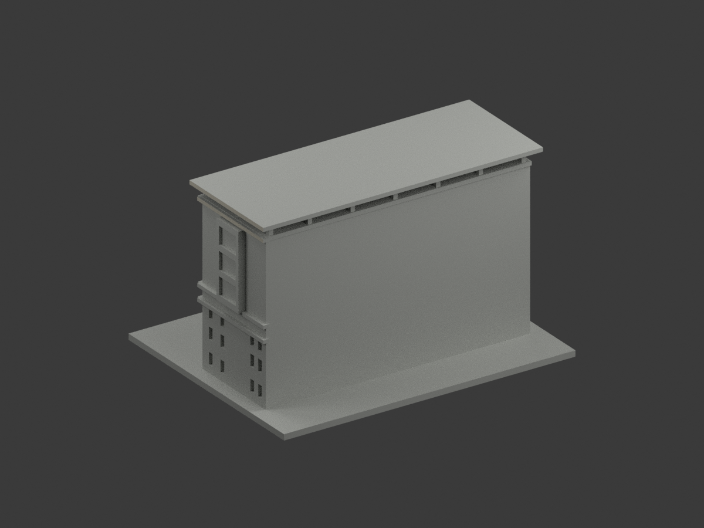
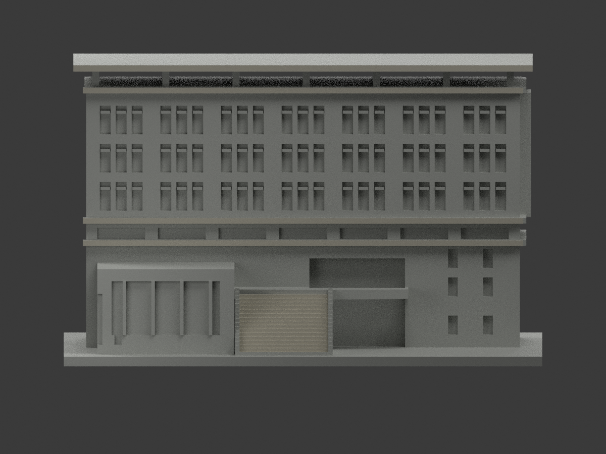
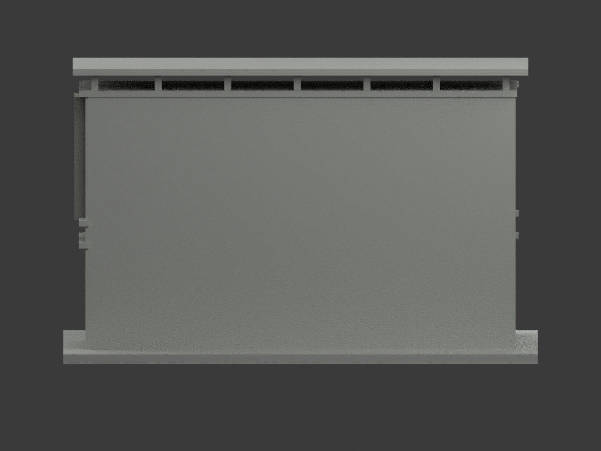
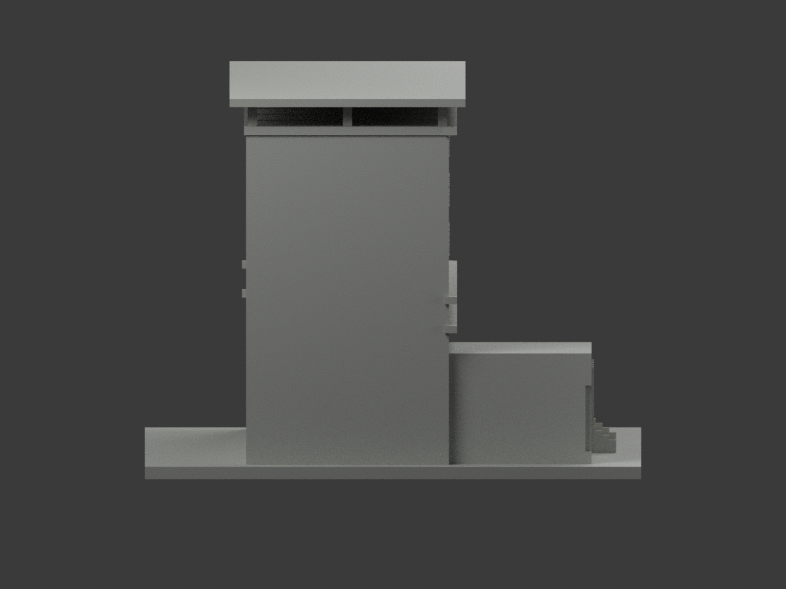
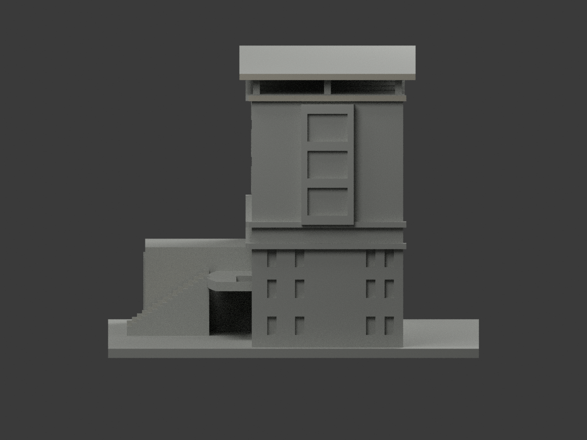
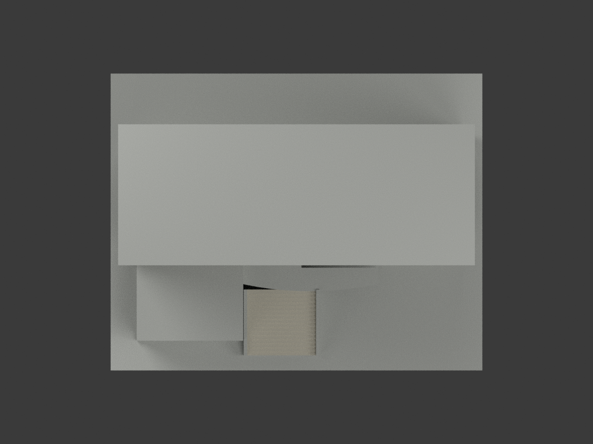
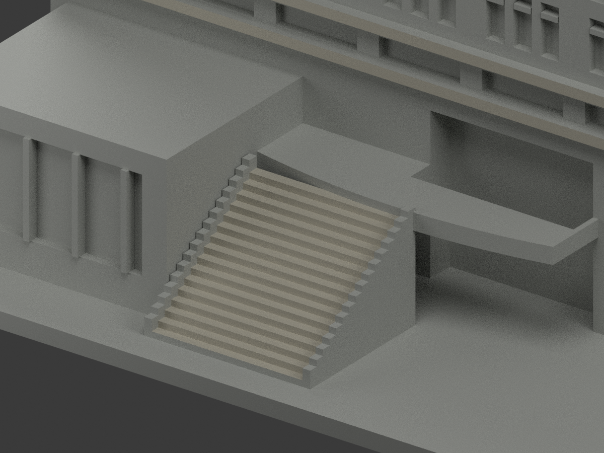
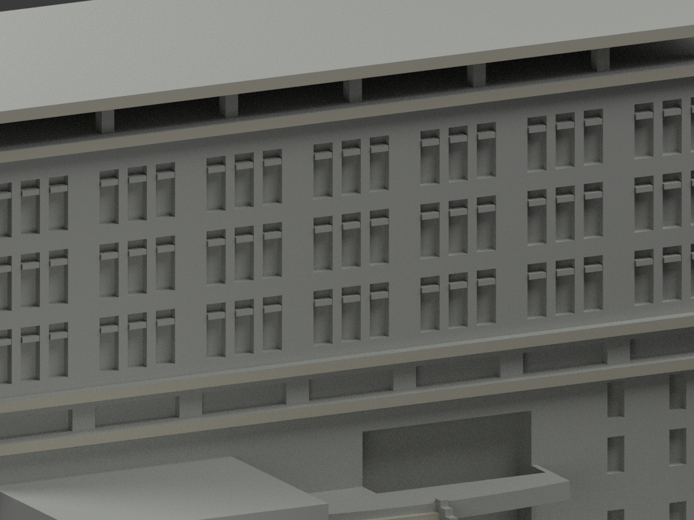
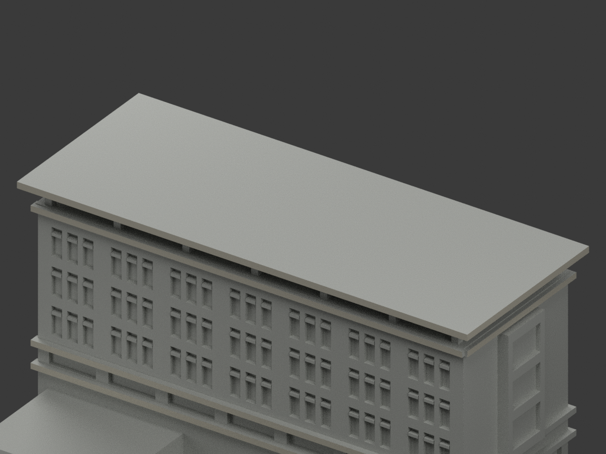

# 國立臺灣大學萬才館（主棟與前階梯段）

| 模型預覽 | 模型預覽 | 模型預覽 |
| :---: | :---: | :---: |
|  總覽 |  背側 |  正面 |
|  背面 |  西側 |  東側 |
|  頂面 |  入口階梯 |  前帶 |
|  頂前緣 |  |  |

[目前 Blender 色版](../scene.blend) · [目前 3MF 色版](../appearance.3mf) · [單色幾何 STL](../model.stl)

十張圖皆由目前局部上色場景以原相機重跑，與已發布的圖逐像素相符。現版在原前帶與階梯配色之外，另有上帽和最上灰帶右端的四個既有三角面採近似灰色。混磚石側牆、窗及未知區域未補色。未更動幾何，也未實體試印。

[原模型說明與來源限制](../README.md) · [原模型校驗](../SHA256SUMS) · [展示來源記錄](render-proof.json) · [展示檔檢查](SHA256SUMS)
