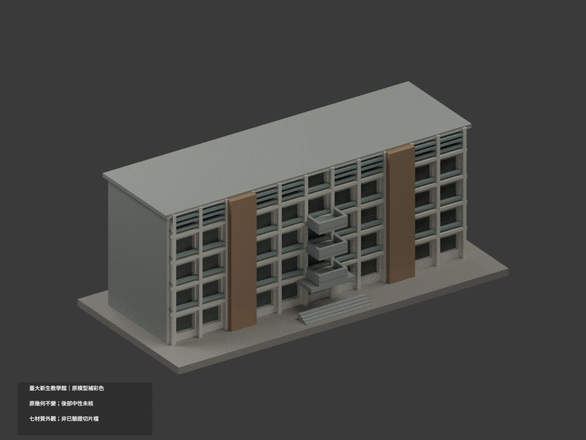
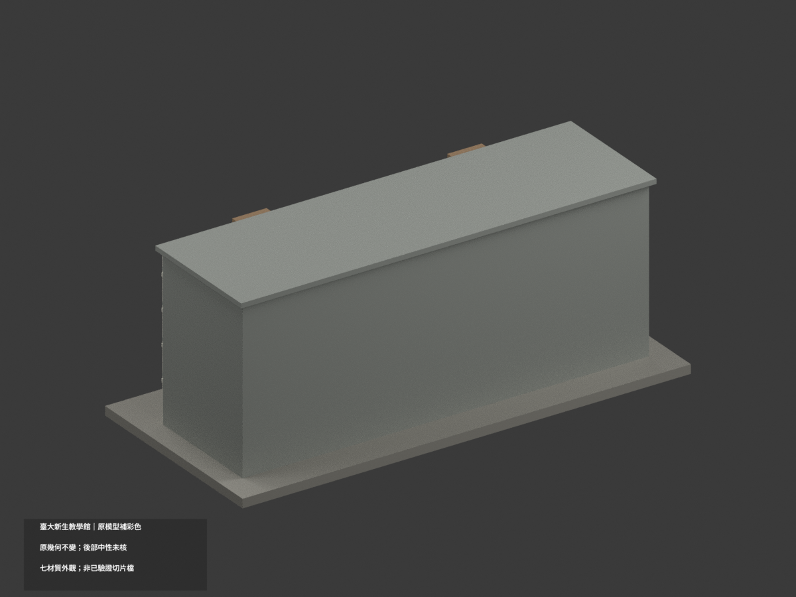
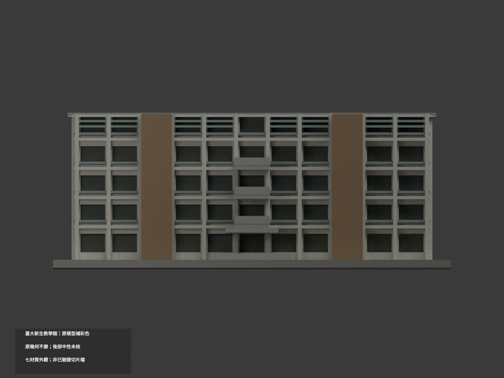
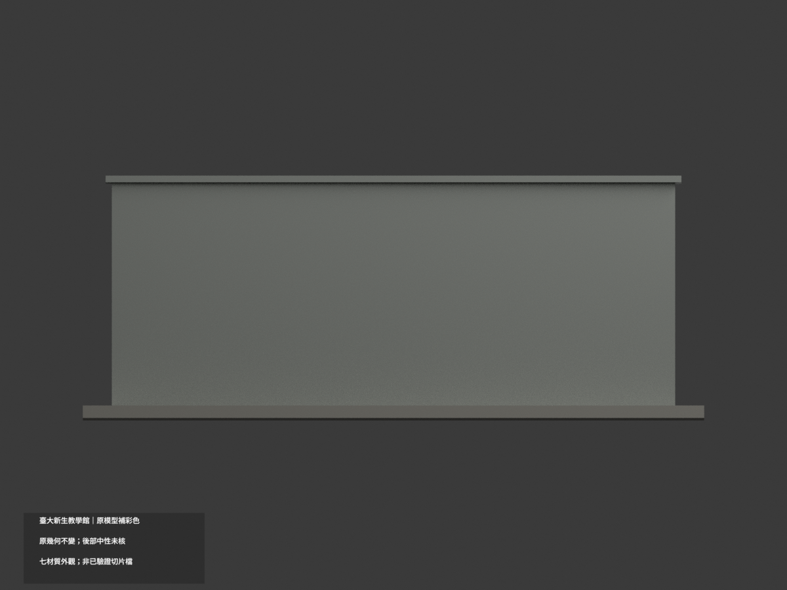
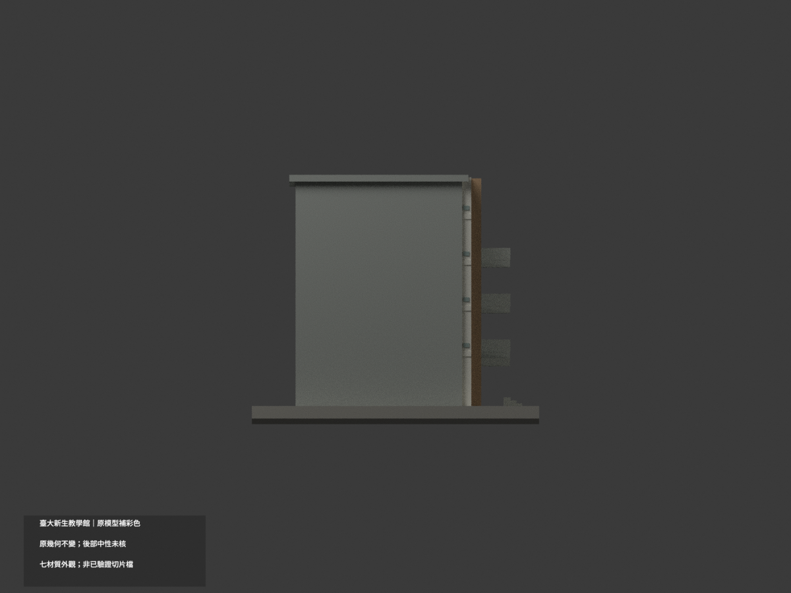
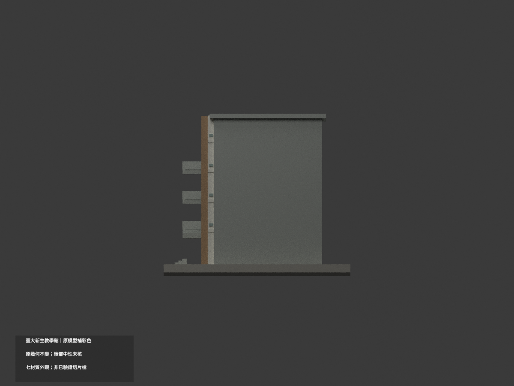
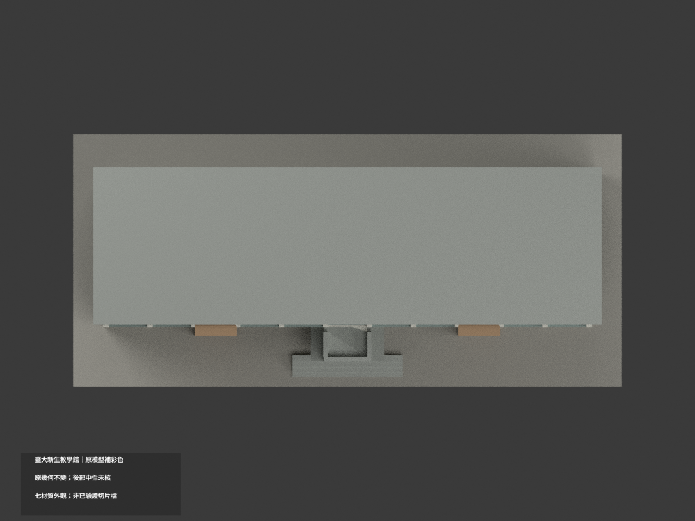
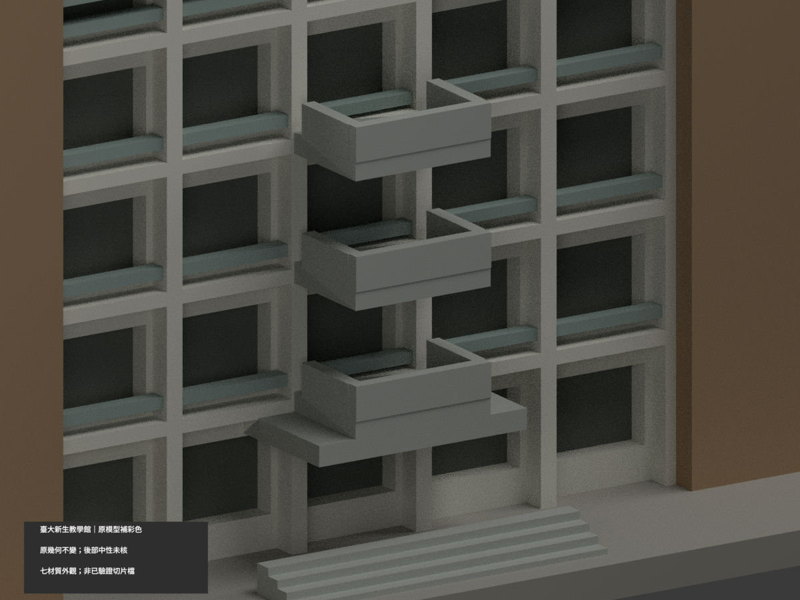
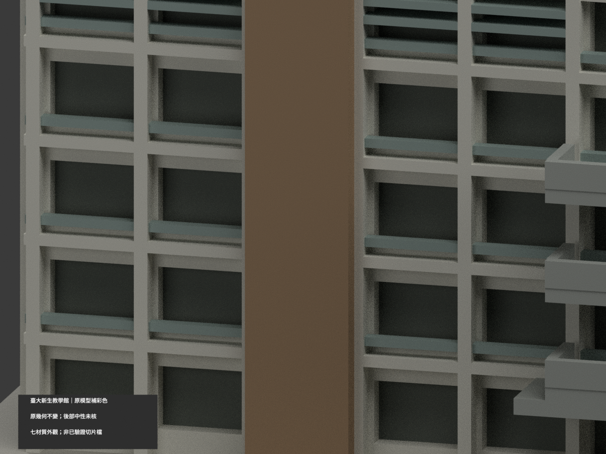
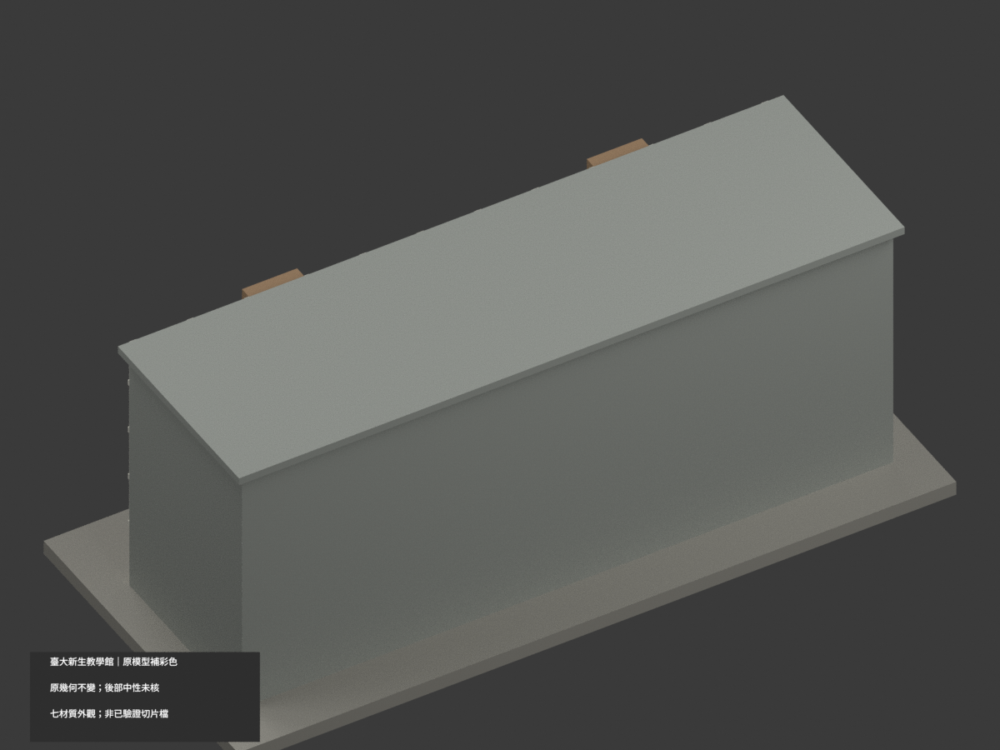

# 臺大新生教學館｜同項目彩色更新

## 彩色模型預覽

**原幾何與原 STL／OBJ／建模程式位元組不變；3518 三角面，150 × 69 × 58.6 mm；count_delta = 0。** 本次為既有照片近似模型補材質，不是重新測繪或增加建築套數。參考校方 2010 照片目錄及 2018 會議場地照片，個別拍攝日未確證，不稱 2026 即時現況。

| 整體 | 後向 | 正向 |
|---|---|---|
|  |  |  |
|  |  |  |
|  |  |  |
|  |  |  |

## 材質範圍與限制

- 兩片既有寬直牆近似低飽和暖棕米磚，不是紅磚。垂直框柱及寬水平結構帶近似灰白；既有中央突出平台、欄板與近門短階採灰色，細欄件近似銀灰。
- **照片可見細水平磚帶，但原簡化網格沒有充分獨立的材色邊界**；本次保守使用完整既有白框面域，沒有精確重現所有磚／框條帶，不切新面、不以面中心染出斜三角色塊，不新增磚縫。
- 開廊淺凹背底以深灰示意陰影，**不是藍玻璃、黑漆或完整開放空間幾何**；既有上部百葉近似淺灰，不新增玻璃幕牆、門扇、設備、植栽或文字。
- 平頂大面、未證側後與模糊面域保中性色。中性不是實景灰漆證據，HEX 只是未校色照片的色族近似，不是工程漆號。

## 彩色檔與列印

[appearance.3mf](appearance.3mf) 以毫米及七個基本材質逐面指派；[appearance-materials.json](appearance-materials.json) 列名稱與面數。[scene.blend](scene.blend) 為實際彩色材質場景；[model.stl](model.stl) 與 [model.obj](model.obj) 均保原檔，STL 本身不含顏色。

七材質外觀 **不等於已驗證四色耗材切片專案**。未測切片器的材質匯入、耗材對應、換色及支撐，本件**未實際列印**。補彩不提升原模型尺寸精度與可列印性主張。

## 可重現與 QA

依原 requirements 安裝後執行 `python build_model.py`、`python colorize_model.py`、`python export_appearance.py`；`blender -b -P render_color.py` 生成十圖及場景；`python validate_color.py` 與 `blender -b -P verify_color_scene.py` 核原檔、三角座標、3MF、隔離重建與場景重開。重建暫存保留，不自動刪除。

本次 QA 為 COLOR-ASSIGNMENT-QA、COLOR-FORMAT-GEOMETRY-QA、SCENE-QA、FRAMING-QA、SOURCE-VISUAL-QA 及 DELIVERY-QA。舊 previews、validation、layer-check、source-model-comparison 皆保留作原模型歷程，不作本次彩材或實印證明。舊 render_preview.py 是單色入口，不應拿來覆寫彩色場景。

## 來源與權利

校方[建築影像](https://homepage.ntu.edu.tw/~cpo/about_campus_archeitectureimage.html)中的 [5748 正斜照](https://homepage.ntu.edu.tw/~cpo/2010photo/N/N25/IMG_5748.JPG)、[5753 近照](https://homepage.ntu.edu.tw/~cpo/2010photo/N/N25/IMG_5753.JPG)，以及 [2018 AIMS 場地](https://aimsconference.org/conferences/2018/2018_Venue.html)照片。個別攝影者與拍攝日未確證，未見個別 CC 授權。

原照、原頁與裁圖只私人研究，不隨模型公開、不作照片紋理；模型授權不包含第三方照片或建築設計權利，不保證商業使用。詳 COLOR-SOURCE-REGISTER.json。

## 原模型說明與限制（仍有效）

# 國立臺灣大學 新生教學館

## 模型預覽

| 模型預覽 | 模型預覽 | 模型預覽 |
| :---: | :---: | :---: |
| 正面  | 背面  |  |

[返回校區圖鑑](../../README.md) · [返回臺大總圖鑑](../../../README.md)

## 實際 STL 正面與背面

[下載 STL](model.stl) · [Blender 場景](scene.blend) · [參數化來源](build_model.py) · [驗證結果](validation.json)

[新增34件列印幾何補查與細節警示](../../../qa/printability-20261013/README.zh-TW.md)

官方索引代碼 N25。公開外觀近似模型，非測繪或BIM。

## 範圍與比例
五層主要長形量體，根據官方2010斜角與立面近景，以及2018會議場地實景。屋頂與背面未充分確認而簡化，未補造背窗及額外樓翼；進深、立柱與窗距為目測，非完整現況測繪。

保留辨識特徵：五層開放廊道節奏、連續外露豎框、寬磚牆垂直帶、局部凸出小平台、頂樓橫向遮陽條。廊道改淺凹，欄杆改實心厚線與矮牆。

尺寸 [150.0, 69.0, 58.599998474121094] mm，含底座最長150 mm。各館獨立比例，不是可拼接的共同尺度校園沙盤。尺寸、厚度、窗距均為照片目測和列印簡化，不是原建物實測。

## 列印
- 底座向下，毫米單位。參考起點：0.4 mm噴嘴、0.16–0.2 mm層高、3道外牆、15–20%填充。須依自己的切片器調整。
- 連續平台及小陽台下緣、入口雨棚需支撐；欄杆經加厚，不能視作原建築比例尺寸。
- 新增細浮雕名義最小約0.9 mm；這不是全模型最小壁厚的測量結果。零碎設備、文字招牌、樹木、電線及細緻裝飾沒有加入。
- 門窗背牆與實心量體避免隱藏內殼；實際填充由切片器決定。
- 未實際列印；未用PrusaSlicer、Cura等生成工具路徑。不宣稱無支撐或無風險可印。

## 驗證與檔案
- model.stl、model.obj；scene.blend是由實際STL匯入的可編修網格。
- build_model.py為獨立參數來源；Python3.12，依requirements.txt裝依賴後執行python build_model.py。
- Blender4.3.2：blender -b -t 2 -P render_preview.py。previews/front.png、rear.png、elevation.png均直接渲染交付STL。
- python validate_model.py：原始法向、水密、流形邊／頂點、單一連通表面、無分離封閉內殼、正體積、150mm、獨立重建SHA256及已儲存Blender/STL三角幾何一致性。結果validation.json。
- python check_layers.py：每0.2mm水平截面幾何檢查，共 293 層，所抽樣截面全部閉合。首層採z=0.071mm避免重合平面退化，非實際列印首層設定。
- layer-check.json另記向下超45度面積指標與各層輪廓；它不是切片器、最小壁厚測試或實體試印。閉合截面不保證擠出連續、橋接、支撐可拆、床面附著或局部細節可印。
- SHA256SUMS可核對檔案；更改參數後需重建、重繪、重驗證。

## 公開來源
查閱及圖像像素檢視：2026-10-13。來源照片未隨檔重新散布。
- [臺大教學館身份](https://ntuinfo.ntu.edu.tw/p1_3_6.html)
- [臺大官方2010照片索引](https://homepage.ntu.edu.tw/~cpo/about_campus_archeitectureimage.html)
- [官方外觀 5748](https://homepage.ntu.edu.tw/~cpo/2010photo/N/N25/IMG_5748.JPG)
- [官方外觀 5753](https://homepage.ntu.edu.tw/~cpo/2010photo/N/N25/IMG_5753.JPG)
- [官方外觀 5755](https://homepage.ntu.edu.tw/~cpo/2010photo/N/N25/IMG_5755.JPG)
- [2018 AIMS會議場地](https://aimsconference.org/conferences/2018/2018_Venue.html)
- [2018長立面實景](https://aimsconference.org/conferences/2018/2018_schedule_wpsCA56.tmp.png)
- [臺大官方建物索引，檢索標題2026-08-17](https://cpo.ntu.edu.tw/map/C_01_list.pdf)

照片版權屬原權利人；沒有轉授原建築設計或照片權利。不同拍攝日期不等於已核實目前全部外觀。
