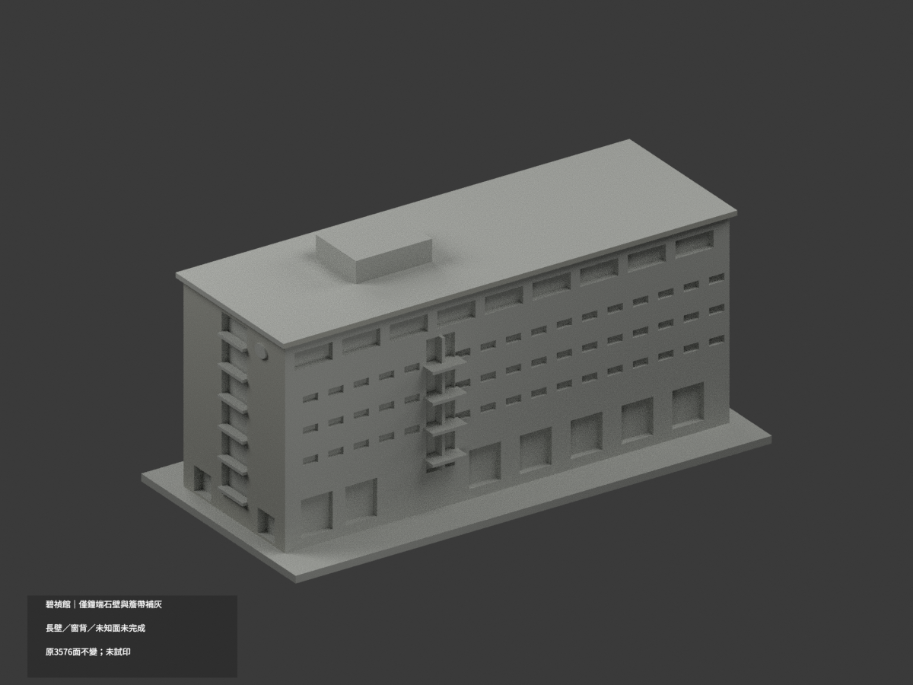
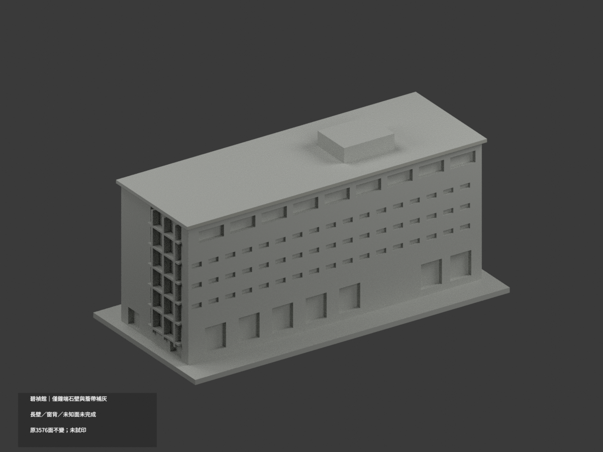
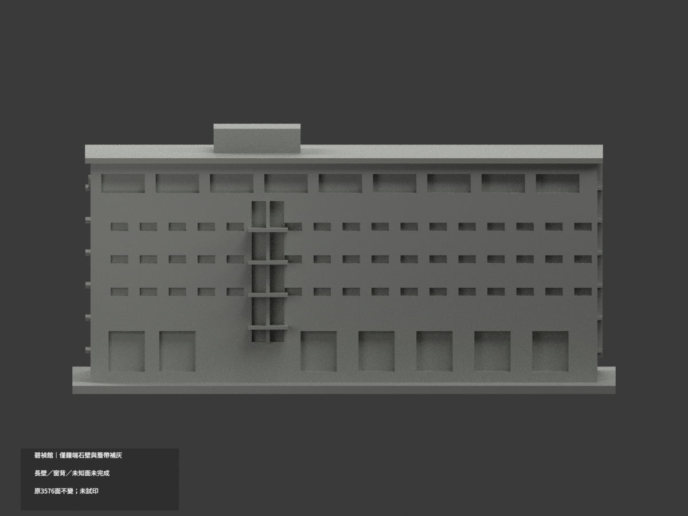
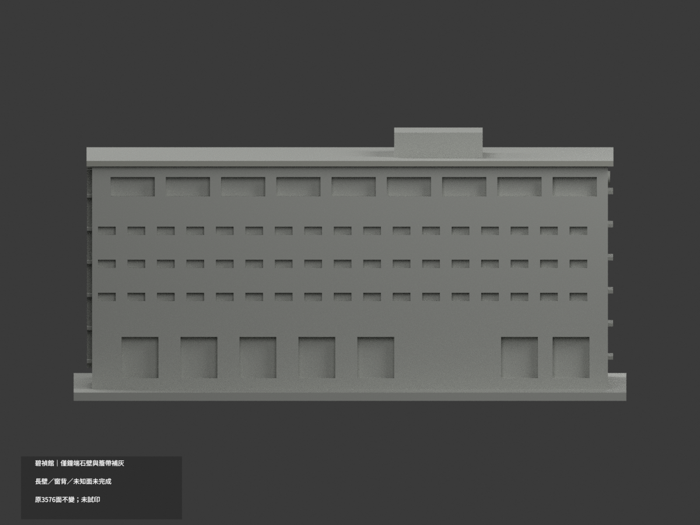
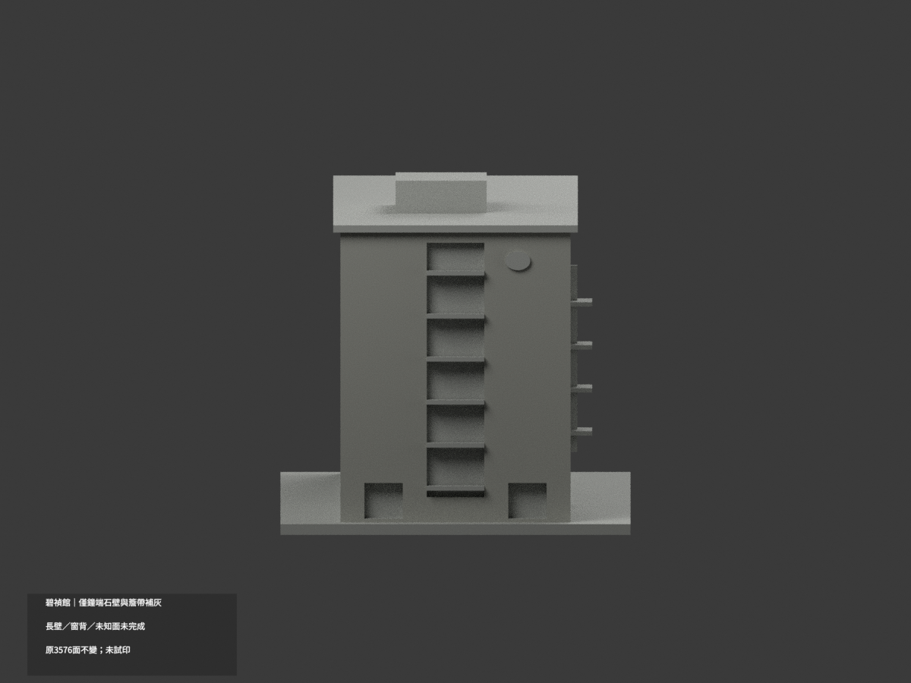
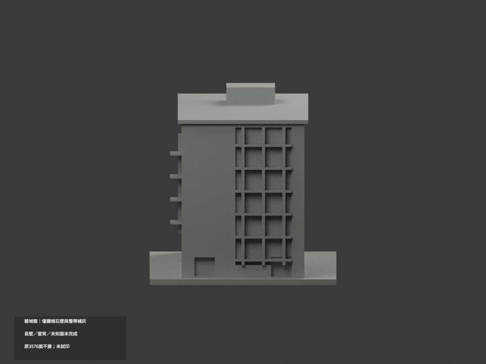
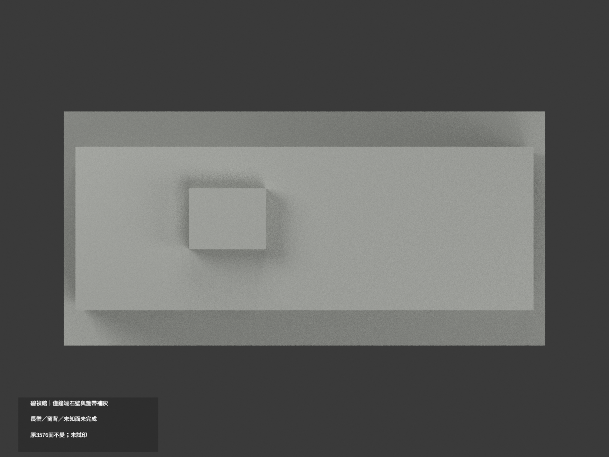
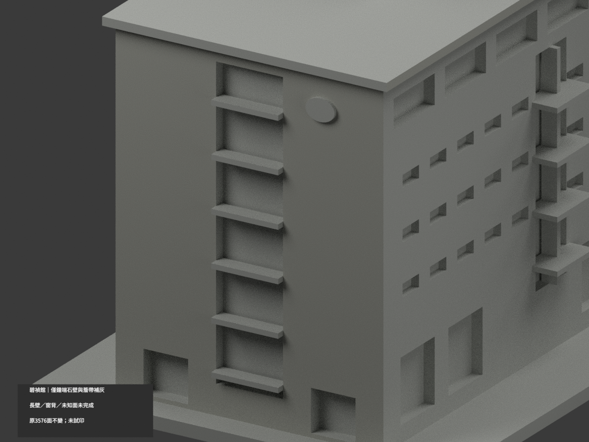
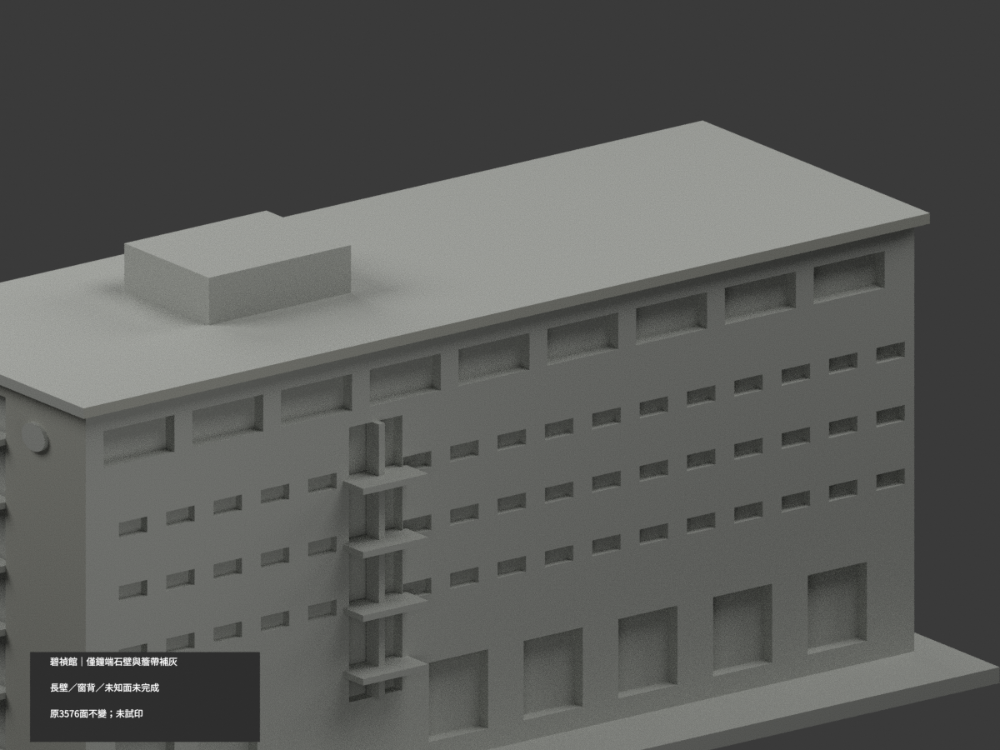
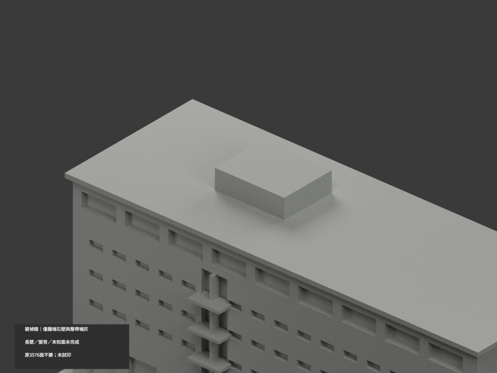

# 臺大碧禎館｜局部參考補灰

**局部補色未完成：僅鐘端外石壁及兩側長屋簷前緣局部補灰；長壁、窗背與未知面未完成。** `partial_color_incomplete=true`、`fully_colored_exterior=false`。同項目 `ntu-bizhen-hall`／`count_delta=0`，不新增套數。

| 前斜視 | 後斜視 | 正面 |
|---|---|---|
|  |  |  |
|  |  |  |
|  |  |  |
|  | | |

## 材色範圍

鐘端真正外石壁x=-70完整域78三角，以及兩長簷正向／背向前緣y=-25.5/+25.5各2面，共82面低飽和暖淺灰。其餘3494面未知中性，**不是實景灰色證明**。

原build在匯出前全體z×0.75，本次只按實際STL座標判讀：長簷前緣z63..64.5。真正x=-70外平面不包含鐘盤、中央後退槽背或槽內框。全部930共面連通域材色一致，沒有用centroid或z閾值切混材牆；不盲用來源面號。

長壁y±24的實心窗背／底層柱廊近似未充分對位，不整灰或分高度染色。所有窗背、頂層bay、端部長窗、原梃，混反光／實板／框無界全中性；鐘盤、鐘字、旗幟、對端主壁、屋頂上表面／設備、植槽／隱蔽基部亦中性，不添加地形或坡道。

原3576三角、坐標、尺寸、STL／OBJ／build字節完全不變。只外觀參考，不做室內配置；補色不追認原粗幾何，不稱2026完整現況。

## 來源與權利

[臺大2015校務報告](https://sec.ntu.edu.tw/001/Upload/relfile/9804/25967/103-2-1report.pdf)實體45/46頁、印刷43/44之4張碧禎館外照。頁中其他照片、室內及報告內容不作建模控制。2015是出版背景，非全部照片拍攝日；單張相機日期字樣未驗證亦不套其他照片。來源hash／GO2233／獨審2232-v1見`COLOR-SOURCE-REGISTER.json`。

未確認CC授權，原PDF／圖私存不公開或作貼圖；來源權利不被repo license取代，不保證商用。灰色只是近似族群，不是RGB精測或色票。

## 檔案與重建

`appearance.3mf`含2展示材、`scene.blend`有實際面材與相機，`color-mesh.npz`保留原三角與material index。STL無色，原OBJ未另加材，兩者字節原樣保留。

依`requirements.txt`執行`python colorize_model.py`、`python export_appearance.py`、`python validate_color.py`；Blender執行`render_color.py`及`verify_color_scene.py`。完整原build+color隔離重建目錄保留不自動刪。原件私存，兩個`ORIGINAL-MONOCHROME-README*`、舊`previews/`及舊QA／SHA清單屬單色歷程，非本次材色驗證。

## QA與列印限制

原STL／三角multiset、封閉正體積、3MF索引及隔離重建見`COLOR-*QA.json`；重開見`SCENE-QA.json`；10張1200×900圖及三欄/hash見`DELIVERY-QA.json`。人工視看另交父終審。

**未實際列印。** 2展示材非驗證過的四色列印工程；切片、材料映射、支撐和薄件強度另驗，不保證直接多料成功。
